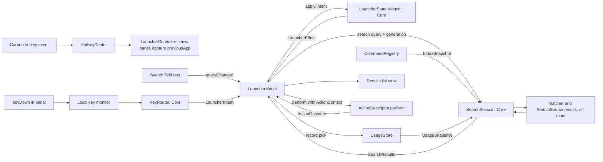

# OpenRay design

**Status:** Draft, last revised 2026-11-16. Milestones 1 to 6 are built, without clipboard history (the second part of milestone 4, §7), which still waits for the pasteboard experiment. Milestone 7 is built in full: window management, Lock Screen, snippets and file search (§7). None of it has been run: no window was moved, the screen was never locked, no snippet was pasted, the pasteboard was never read, no home folder was searched, and its list screens and settings panes have not been seen on screen. Milestone 8, script commands, is built as well (§4.10, §7), and none of that has been run on screen either: OpenRay was not launched, no login shell was started, no script of the owner's was executed, and the only processes it ever started were scripts that its tests wrote into temporary folders of their own. Milestone 9, command hotkeys, is built too (§4.11, §7), and nothing of it was run on screen either: no hotkey was registered with macOS, no key was pressed, and neither the recorder on a command's row, the key cap on a launcher row nor the wider settings window has been seen. The owner ran a build of milestone 6 on 2026-11-15 and reported that it works, Quick AI with a real key included; that was a try-out, and the checks of `RELEASE_CHECKLIST.md` are still open. Milestones 1 to 8 are on `main` with CI green, clipboard history apart, and milestone 9 has followed them there, CI green too. Nothing has been released: milestone 6 was built without an Apple Developer account, and `RELEASE_CHECKLIST.md` lists what the first release still needs and what a person at the Mac has to check.

## 1. Summary

OpenRay is an open-source, native macOS keyboard launcher. A global hotkey shows a floating panel; the user types and acts on the results. It covers the basics: app search, system commands, quicklinks, a calculator, clipboard history, Quick AI, window management, file search, snippets and script commands. Any app or command in it can be given a global hotkey of its own, which does what Return on it does without the launcher being opened first (§4.11).

A few decisions shape everything else. The panel is a non-activating `NSPanel` at screen-saver level, and the app is always an accessory app, so the panel appears over full-screen apps without taking focus from them. Every feature plugs in through one interface: sources yield `SearchItem`s, items carry `ActionDescriptor`s, and actions return an `ActionOutcome`. All logic lives in `OpenRayCore`, which imports no AppKit, SwiftUI or Carbon and is tested with `swift test`. SQLite holds usage, clipboard history, snippets and the hotkeys of commands; `UserDefaults` holds preferences; the Keychain holds the API key. A permission is requested only when the feature that needs it is first used.

## 2. Goals and non-goals

**Goals**

- The panel appears within 50 ms (p95, warm) over any app, including full-screen apps, on every Space and display, and never deactivates the frontmost app.
- Everything is reachable from the keyboard, and every key the launcher reacts to is routed from one place.
- Adding a command touches no launcher code (milestone 3's "done when").
- Matching, ranking, the command model, storage and every feature's decision logic can be tested with `swift test` without launching the app.
- OpenRay works with no permissions granted, and asks for each permission only when the feature that needs it is first used.
- No telemetry. The only network traffic is update checks and Quick AI requests the user triggers.
- A stranger installs OpenRay with one command and it updates itself.

**Non-goals**

- A third-party extension API or store, compatibility with other launchers' extensions or script metadata, cloud sync, team features, theming.
- The Mac App Store and the App Sandbox.
- A resizable or movable panel, multiple launcher windows. (Until M9 this line also had "per-command global hotkeys"; §4.11 is what replaced it.)
- Of global hotkeys, what §4.11 leaves out: key sequences and layers (a chord of two steps, a hyper key), hotkeys that work only in certain apps, a hotkey for an action other than an item's primary one, and rebinding the launcher's own keys (⌘K, ⌘1 to ⌘9, Esc and the rest of §4.1.3) or the shortcuts of actions.
- Shipping translations in v0.1. The code is ready for localisation; only English ships.
- These feature limits for v1: no currency conversion, no snippet auto-expansion while typing, no rich-text snippets, no saved AI chat history, custom AI commands, attachments or second AI provider, no inline script output, no window layouts, drag-snapping or animation, no file content search, no clipboard encryption.

## 3. Architecture overview

### 3.1 Module map

| Module | Contains | May import |
|---|---|---|
| `OpenRayCore` (Swift package, `Packages/OpenRayCore`) | Value types and protocols of the command model; key routing and navigation state; matching, ranking and frecency; the app index scanner; the database, migrations and stores; preferences; the steps of the paste path; the calculator; clipboard capture rules; snippet rendering; window geometry; file search (the Spotlight queries, the ranking and the walk without Spotlight); script commands (the metadata parser, the scan of the script folders, the runner on `posix_spawn`, the shell environment and the buffer for what a script prints); the Claude provider, SSE parser and Quick AI session; every feature's view model | Foundation, Dispatch, Observation, Synchronization, CoreGraphics, CoreServices, CryptoKit, os, GRDB |
| App target (`OpenRay/`) | Windows and SwiftUI views; Carbon hotkeys; the key monitor; AppKit, Accessibility (AX), IOKit, Apple events, Keychain and ServiceManagement integration; pasteboard access and synthetic key events; Quick Look previews; Sparkle; the composition root | Everything, including `OpenRayCore` |

Dependencies run one way: the app target depends on `OpenRayCore`. `OpenRayCore` never imports AppKit, SwiftUI or Carbon. On macOS `import SwiftUI` re-exports AppKit, so SwiftUI is excluded too. CI enforces the rule by grepping Core's sources for those imports, and for `Cocoa`, which re-exports AppKit too. Carbon and AppKit constants that Core needs (virtual key codes, Carbon modifier bits, `NSEvent` modifier-flag bits) are copied as literals with a comment naming the header.

If features later need views inside the package, they go in a separate `OpenRayFeatures` target that depends on Core; Core itself stays UI-free.

### 3.2 Runtime objects

| Object | Module | Responsibility |
|---|---|---|
| `AppDelegate` | App | Composition root. Owns every object below and the list of built-in features (`BuiltInFeatures.swift`). Attached to the SwiftUI `App` with `@NSApplicationDelegateAdaptor`; the `App` keeps the existing `MenuBarExtra`. |
| `HotKeyCenter` | App | Registers the global hotkeys with Carbon: the launcher's and, since M9, those of commands, each slot under a Carbon ID of its own (§4.1.2). |
| `LauncherHotKey` | App | `@MainActor @Observable`. Keeps the `launcher.hotKey` preference and the registration in step, and holds what Settings and the menu-bar menu show when the hotkey is not working (§4.1.2). Every recorder begins and ends through it, one that records for a command too. |
| `CommandHotKeys` | Core | `@MainActor @Observable`. The global hotkeys of commands: which item has which chord, which of them are registered, and why one is not. Reads `CommandHotKeyStore` once and writes every change through to it (§4.11). |
| `CommandHotKeyRunner` | Core | Runs an item's primary action for a press of its hotkey, through `ActionRunner`, and shows the launcher only where the action needs it, through `HotKeyPressHost` (§4.11). |
| `LauncherController` | App | Shows, places and hides `LauncherPanel`; connects the search field and the key monitor to `LauncherModel`. Since M9 also the `HotKeyPressHost` of command hotkeys (§4.11). |
| `FocusRestorer` | App | Records the previously frontmost app and gives the keyboard back to it (§4.1.7). One instance, shared by the launcher and the settings window. |
| `LauncherModel` | App | `@MainActor @Observable`. Holds `LauncherState`, executes its effects, holds the current results, runs actions, records picks. The only observable state the launcher views read. |
| `LauncherState`, `KeyRouter` | Core | Pure navigation state machine and key-to-intent mapping (§4.1.3, §4.1.4). |
| `CommandRegistry` | Core | Collects every source's indexed items into an immutable `IndexSnapshot` (§4.2.4). |
| `SearchSession` | Core | Fans out one root query to the matcher and the sources, merges, publishes `SearchResults` (§4.2.5). |
| `ScreenRegistry` | App | Maps a `ScreenRequest` to the owning feature's `ScreenSpec` (§4.2.3). |
| `HUDController` | App | Transient message window (§4.1.6). |
| `PasteService` | Core | The one path for copying and for pasting into the previous app: its steps and their order (§4.1.7). |
| `MacPasteHost` | App | What those steps do to the Mac. The only code that reads or writes the general pasteboard and the only poster of synthetic key events (§4.1.7). |
| `PermissionCenter` | App | The only place that checks or requests a permission (§5.1). |
| `AXWindowController` | App | An actor on a queue of its own, and the only place a window of another app is read or moved. `WindowManagementFeature` owns it, behind its `WindowHost` (§4.7). |
| `SpotlightSearcher` | Core | An actor on a queue of its own, and the only place a Spotlight query is run: one synchronous `MDQuery` per call, behind `FileSearching` (§4.8). |
| `FileSearch` | Core | An actor. One search of "Search Files" from the text to the ranked list, and what it has learned about Spotlight being on or off. `FileSearchFeature` makes it with its sources and keeps it while the app runs (§4.8). |
| `WorkspaceActions` | App | What Core's app, quicklink, file and script actions ask of `NSWorkspace` and `FileManager`: opening, revealing, moving a file to the Trash, and opening a script in the app that edits plain text (§4.2.8, §4.8, §4.10). Shared through the `FeatureEnvironment`. |
| `SettingsWindowController` | App | The settings and onboarding windows (§4.3.5). |
| `AppDatabase` and stores | Core | SQLite through GRDB (§4.3). |
| `Preferences` | Core | `@MainActor @Observable` view of `UserDefaults` (§4.3.4). |
| `KeychainSecretStore` | App | The Keychain behind `SecretStore`, shared through the `FeatureEnvironment` (§4.6.5). |
| `QuickAISession` | Core | `@MainActor @Observable`. The one Quick AI thread. The Quick AI feature makes it with its sources and keeps it while the app runs (§4.6.4). |
| `PosixScriptRunner` | Core | Starts a script as a process of its own with `posix_spawn`, each in its own process group, behind `ScriptRunning`. The only code in OpenRay that starts a process or sends a signal (§4.10). |
| `ShellEnvironment` | Core | An actor. The environment scripts run in, asked from the user's login shell before the first script of a session and kept in memory. The only code that starts the shell (§4.10). |
| `ScriptRuns` | Core | `@MainActor @Observable`. Clears a script for running, starts it as a `ScriptRun`, and keeps the last run for "Show Last Script Output". `ScriptsFeature` makes it with its source and keeps it while the app runs (§4.10). |
| `SparkleUpdater` | App | Sparkle behind Core's `UpdateControlling`: owns the `SPUStandardUpdaterController` and is both of its delegates. The only file that imports Sparkle (§6.4). |
| `UpdatesModel` | Core | `@MainActor @Observable`. Whether this build can update itself, the updater's settings, and whether an update is waiting. The Updates pane, the menu-bar menu, the launcher and onboarding read it (§6.4). |

**Launch order.** `AppDelegate.init` makes what needs no database, among it `SparkleUpdater` and `UpdatesModel`. `applicationDidFinishLaunching` installs the main menu, registers the hotkey and starts the updater in a build that can update itself (§6.4). Everything else comes a moment later, because it needs the database: `SearchSession` ranks by the usage in it, and the commands read their overrides from it, and `AppDatabase.openOnDisk` works on the disk. So a task opens the database and the usage store through a `@concurrent` function, and back on the main actor `AppDelegate.compose` builds the `FeatureEnvironment` (the `KeychainSecretStore` is made here, and nothing reads the Keychain yet; `MacPasteHost` is made just before it since M7, because `MacSystemControl` posts the key press of Lock Screen through it, §4.2.10), asks every built-in feature for its sources, and creates `CommandRegistry`, `SearchSession`, `LauncherModel`, `LauncherController` and the settings window with every feature's pane, in that order. `LauncherModel` is handed the `tabFallback` of the first feature that has one (§4.2.3). Since M9 `compose` also makes `CommandHotKeys`, sets `CommandRegistry.onPublish` right after the registry is made, so that no snapshot is missed, makes `CommandHotKeyRunner` once the launcher exists, and starts `CommandHotKeys.load()` in a task. The hotkeys of commands are registered when both have happened, the stored hotkeys read and the first snapshot published, in whichever order (§4.11); the launcher's own hotkey is registered earlier, in `applicationDidFinishLaunching`, as before. Right after composing, which can be before the hotkeys of commands are registered, `AppDelegate` shows the first window (onboarding for a new user, or Settings if the hotkey needs attention) and honour `-OpenRayShowPanelOnLaunch`. Opening never fails: a database that cannot be used at all is replaced by one in memory for this run (§4.2.11). A hotkey pressed before the launcher exists is ignored (it can only be the launcher's: no command's hotkey is registered that early), and a request for Settings in that moment is remembered and answered once the window exists. On `NSWorkspace.didWakeNotification` `AppDelegate` tells every feature (`Feature.systemDidWake()`); the apps feature has the app index `rescan()` (§4.2.8), and the scripts feature its source (§4.10).

### 3.3 From hotkey to action

1. The user presses the hotkey. Carbon delivers the event on the main run loop to `HotKeyCenter`, whose `onPress` reaches `LauncherController.toggle()` once the launcher exists (§3.2).
2. `LauncherController` has `FocusRestorer` record the frontmost app as `previousApp`, places the panel, applies `.willShow` (whose effects restart the root search and make the search field first responder), and makes the panel key.
3. Each text change in the field becomes a `.queryChanged` intent. Other keys go through one local key monitor to `KeyRouter`, which returns an intent or lets the key fall through to the field editor.
4. `LauncherModel` applies the intent to `LauncherState`. The reducer returns effects. At the root, a query change returns `.search(query:generation:)`, which `LauncherModel` passes to `SearchSession`.
5. `SearchSession` cancels the previous search, matches the query against the `IndexSnapshot` and asks each source for query-specific results, all off the main actor. It publishes `SearchResults` tagged with the generation; `LauncherModel` drops stale generations, hands the rows to the reducer as `.resultsArrived`, and the list redraws.
6. Return (or a shortcut, or a choice in the action panel) becomes `.perform`. `LauncherModel` shows the action's confirmation if it has one, checks its required permissions, records the pick in `UsageStore`, and awaits `perform(ActionContext)`.
7. The returned `ActionOutcome` closes the launcher, keeps it open, pushes a screen, pops to root, replaces the query, or closes it and shows a HUD message.

The hotkey of a command (M9, §4.11) skips steps 2 to 5. `onPress` names the slot that was pressed; for a command's slot `AppDelegate` asks `CommandHotKeys` for the item and hands it to `CommandHotKeyRunner`, which runs the item's primary action through the same `ActionRunner` as step 6, without the panel being shown or anything being searched, and without recording a pick. What step 7 does with the outcome the runner decides for a launcher that is usually hidden (§4.11).



### 3.4 Concurrency model

Both modules build in the Swift 6 language mode with strict concurrency and enable the `NonisolatedNonsendingByDefault` upcoming feature (in the package through `swiftSettings`, in the app target through `SWIFT_UPCOMING_FEATURE_NONISOLATED_NONSENDING_BY_DEFAULT = YES`). The app target also sets `SWIFT_DEFAULT_ACTOR_ISOLATION = MainActor`, so its classes and protocols are main-actor isolated without an annotation (the sketches in this document write `@MainActor` out for clarity), and the few app-target value types that must be usable from any isolation (`SettingsPane`, `SearchBarAppearance`) are declared `nonisolated`. `HotKeySlot`, `HotKeyError` and the failure of the launcher's hotkey, now `HotKeyFailure`, were among them until M9 moved them to Core (§4.1.2), where a type is nonisolated to begin with. Core keeps the default nonisolated isolation. All three settings ship with Xcode 26 (Swift 6.2).

Under `NonisolatedNonsendingByDefault`, a plain `async` function runs on its caller's actor, so a nonisolated `async` method called from the main actor runs on the main thread. Task-group children do not inherit the caller's actor. The rules that follow from this:

- **Main actor:** all UI, `LauncherModel`, `SearchSession`'s coordination, `CommandRegistry`, `Preferences`, `PermissionCenter`, `PasteService`, `ClipboardMonitor`, `QuickAISession`, `ScriptRuns` with every `ScriptRun`, and `CommandHotKeys` with `CommandHotKeyRunner` and the `HotKeyRegistering` protocol.
- **`@concurrent`:** every Core function that does blocking I/O or more than about 1 ms of CPU work is marked `@concurrent`. Named cases: building `IndexSnapshot`, scanning app bundles, the matcher's `rank`, SHA-256 hashing of clipboard payloads, Keychain calls, the walk through folders that file search can fall back to (`FolderWalk.hits`, §4.8), the scan of the script folders and every look at a script's file before it runs (`ScriptFolderScanner.scan`, and the `stat` and extended-attribute calls behind `ScriptRuns.isCleared`, §4.10), and the calculator only if profiling shows it needs it.
- **Actors with a serial dispatch-queue executor** for blocking calls into other processes: `AXWindowController` (§4.7), `SpotlightSearcher` (§4.8) and `AppleEventSender` (§4.2.10). Each declares `nonisolated var unownedExecutor` backed by its own `DispatchSerialQueue`, so a blocking call never occupies a thread of the cooperative pool. `FileSearch` (§4.8), which awaits the searcher and remembers what the canary answered, is an ordinary actor: nothing in it blocks.
- **GRDB** runs database reads and writes on its own queues; stores are `Sendable` structs with `async` methods, except `SQLiteUsageStore`, an actor that also holds the in-memory usage snapshot.
- **Streams:** a producer task created inside a nonisolated synchronous function (the Quick AI provider and the coalescer in front of it) runs on the global concurrent executor and is cancelled through the stream's `onTermination`. The script runner (§4.10) is not one of these and has no producer task: each run is confined to a serial dispatch queue of its own, where its dispatch sources fire and its `read` and `waitpid` are called, so that none of them takes up a thread of the cooperative pool, and the stream's `onTermination` hands over to that queue. `ShellEnvironment` is an ordinary actor: it awaits the runner's stream, and the one call in it that can block is the `getpwuid_r` at the start of a capture (§4.10), a short question to the user database that is kept off the main actor and is not worth a queue of its own.
- Only `Sendable` values cross isolation boundaries. `NSImage`, `AXUIElement`, `NSPasteboard`, `NSRunningApplication` and `NSAppleEventDescriptor` stay in the app target and inside the actor that uses them.

Code sketches in this document were type-checked against the macOS 26.5 and 27.2 SDKs. Type-checking does not run Swift 6's region-based isolation checks, which only run when SIL is generated, so a sketch that type-checks can still fail a build. CI builds the package and the app in Swift 6 mode, and that build is the authority.

### 3.5 Shared mechanisms

Each of these has exactly one owner. Features call the owner; they never reimplement it.

| Mechanism | Owner | Defined in |
|---|---|---|
| Key routing and list selection | `KeyRouter`, `LauncherState`, `LauncherModel` | §4.1.3, §4.1.4 |
| The launcher hotkey: its preference, registration and failure state | `LauncherHotKey` | §4.1.2 |
| The hotkeys of commands: their assignments, registration and failures | `CommandHotKeys`, over `CommandHotKeyStore` and `HotKeyRegistering` | §4.11 |
| Running an item by its hotkey | `CommandHotKeyRunner`, through `ActionRunner` | §4.11 |
| Releasing every hotkey while a recorder records, and taking them back | `LauncherHotKey.beginRecording()` and `endRecording()`, for every recorder | §4.1.2 |
| Root search fan-out, cancellation, generations | `SearchSession`, `LauncherState.generation` | §4.2.5 |
| Recording a pick for ranking | `LauncherModel` → `UsageStore` | §4.2.7 |
| Writing the pasteboard, pasting into the previous app, and the one read of the pasteboard | `PasteService` | §4.1.7, §4.9 |
| Posting a synthetic key press | `MacPasteHost`, through `PasteHost.post`: for a paste, and for Lock Screen | §4.1.7, §4.2.10 |
| Reading and moving the windows of other apps | `AXWindowController` | §4.7 |
| Running a Spotlight query | `SpotlightSearcher`, behind `FileSearching` | §4.8 |
| Opening, revealing and trashing a file | `WorkspaceActions`, behind `FileActionHost` | §4.8 |
| Running a script: clearing it, starting its process, signalling its process group | `ScriptRuns`, over `PosixScriptRunner` behind `ScriptRunning`. A run is started by `ScriptRuns.start` only, always after `ScriptRuns.isCleared`: from `ScriptSource.run` (silent), from the output screen's model (fullOutput) and from Run Again | §4.10 |
| Reading the user's shell environment | `ShellEnvironment` | §4.10 |
| Watching a folder for changes | `FolderWatcher` | §4.2.8, §4.10 |
| Restoring focus to the previous app | `FocusRestorer` | §4.1.7 |
| Transient messages | `HUDController` | §4.1.6 |
| Confirmations | In-panel confirmation view | §4.1.6 |
| Checking and requesting permissions | `PermissionCenter` | §5.1 |
| Sending Apple events | `AppleEventSender` | §4.2.10 |
| Preferences | `Preferences` / `PreferencesStore` | §4.3.4 |
| User content (usage, commands, command hotkeys, clips, snippets) | `AppDatabase` and its stores | §4.3 |
| Secrets | `SecretStore` | §4.6.5 |
| The settings window | `SettingsWindowController` | §4.3.5 |
| Logging and signposts | One `Logger` per subsystem category, one `OSSignposter` | §5.3 |

## 4. Subsystems

### 4.1 Launcher shell

The shell is the panel, the hotkey, the key router, the navigation stack, the results list, the action panel, the HUD and the paste path. It knows nothing about any particular feature.

#### 4.1.1 Panel

`LauncherPanel` is an `NSPanel` subclass created once at launch and only ever ordered out, never closed.

```swift
// App target
final class LauncherPanel: NSPanel {
    static let size = NSSize(width: 720, height: 474)   // fixed; the panel never resizes with its content
    static let cornerRadius: CGFloat = 18
    init(contentRect: NSRect)   // styleMask: [.borderless, .nonactivatingPanel, .fullSizeContentView]
    override var canBecomeKey: Bool { true }    // borderless windows return false by default
    override var canBecomeMain: Bool { false }
}
```

| Property | Value | Why |
|---|---|---|
| `styleMask` | includes `.nonactivatingPanel`, set in `init` | Changing this style after creation is reported not to update the window server's activation-prevention flag. UNVERIFIED on macOS 26: confirm with a test build in M1 (§8, item 1). |
| `collectionBehavior` | `[.canJoinAllSpaces, .canJoinAllApplications, .fullScreenAuxiliary, .transient, .ignoresCycle]` | Apple DTS (forum thread 826308, tested on macOS 26) gives this set for panels over other apps' full-screen Spaces. `.transient` replaces DTS's `.stationary` because the panel is short-lived; only one of managed, transient and stationary is allowed. |
| `hidesOnDeactivate`, `becomesKeyOnlyIfNeeded` | `false`, `false` | |
| `animationBehavior` | `.none` | Latency |
| `isReleasedWhenClosed` | `false` | Created once |
| `isOpaque`, `backgroundColor`, `hasShadow` | `false`, `.clear`, `true` | The glass content view draws the only background |
| `level` | `.screenSaver`, **set last** | DTS: `.floating` and `.statusBar` sit below other apps' full-screen Spaces. |

`isFloatingPanel` is not set. Setting it to `true` resets the level to `.floating` (observed on macOS 27.0: the level changes from 1000 to 3), which would put the panel below full-screen apps. The configuration code sets `level` after every other property, and a DEBUG assertion checks `level == .screenSaver` afterwards.

The DTS answer requires an accessory app. `LSUIElement = YES` is already set, and **OpenRay never switches to the `.regular` activation policy**, not even while Settings is open, because a regular app cannot layer over full-screen Spaces.

View hierarchy:

- `NSGlassEffectView` (macOS 26 system material, corner radius 18) is the panel's `contentView`.
- Inside it, `LauncherRootView` stacks `SearchBarView` (AppKit, 56 points high: an icon and `ShellSearchField: NSTextField`) above `LauncherBodyHostingView`, an `NSHostingView<LauncherBody>` (SwiftUI: the list or a custom screen, the action panel overlay, confirmations and the footer).
- The hosting view never accepts first responder, so a click on the list cannot take the keyboard from the search field, and its `sizingOptions` are empty, so SwiftUI content never drives the window's size.

The panel has one fixed size, 720 × 474 points (`LauncherPanel.size`). The list scrolls inside it; nothing the results or a screen do resizes the window.

The search field is AppKit so the shell controls first responder deterministically with `makeFirstResponder`. It is the only text input in the panel: pushed screens use it as a filter or as their input line, according to their `SearchBarMode`.

**Show.** `LauncherController.toggle()` hides the panel if it is visible and key. Otherwise `show()` has `FocusRestorer` record the frontmost app as `previousApp` (§4.1.7), un-hides OpenRay without activating it if an earlier focus restore hid it, sets the frame from `PanelPlacement` (§4.1.8), applies `.willShow`, and calls `makeKeyAndOrderFront(nil)`. `.willShow` resets to the root frame and returns `.focusSearchField`, which makes the field first responder with the previous query selected (§4.1.4), before the panel is ordered front.

**Hide.** Triggers are Esc at the bottom of the Esc ladder, `windowDidResignKey`, the hotkey, and the outcomes `.closeLauncher` and `.showHUD`. The panel is ordered out and then `FocusRestorer.restoreIfNeeded()` runs. The order matters: the restorer acts only when `NSApp.isActive`, and while the panel is key that can be true although the app behind it is still frontmost (§8, item 4). Ordering the key panel out makes it resign key, which calls `hide()` again; the second call returns because the panel is no longer visible. Hiding does not cancel an action that is still running. It applies `.didHide`, which gives up a Return that was still waiting for its results (§4.1.4) and otherwise leaves `LauncherState` as it is; the next `.willShow` resets it.

**Main menu.** `NSTextField` performs copy, paste, cut, undo and select-all through Edit-menu key equivalents, not through `keyDown`. A menu-bar-only app may have no Edit menu, which would make ⌘V do nothing in the search field and in the settings window. In `applicationDidFinishLaunching` the app delegate installs a hidden `NSApp.mainMenu` (`MainMenu.make(appDelegate:)`) with three items. The first is the application menu, which is what AppKit takes the first item of the main menu to be whatever it contains. It has Settings… (⌘,) and Quit OpenRay (⌘Q), which do what the same items of the menu-bar menu do: that menu's key equivalents work only while it is open, so without these ⌘Q would do nothing while the settings window is key. In the launcher panel ⌘Q does not get this far: the key monitor swallows it (§4.1.3), because there it would quit OpenRay under the menu bar of another app. Settings… names the app delegate as its target, because under the SwiftUI lifecycle `NSApp.delegate` is an object of SwiftUI's. The second is File with Close Window (⌘W, `performClose:`), so the settings window closes from the keyboard. The third is Edit (Undo, Redo, Cut, Copy, Paste, Select All with the standard selectors and key equivalents). The search field's cell sets `allowsUndo`, without which ⌘Z reaches the field and does nothing. UNVERIFIED: that the SwiftUI `App` lifecycle leaves a hand-installed main menu in place, and that its key equivalents fire while the panel is key but OpenRay is not the active app. The M1 checklist tests ⌘C, ⌘V and ⌘Z in the panel and in Settings. The fallback is for the key monitor to send the standard selectors with `NSApp.sendAction(_:to:from:)`.

#### 4.1.2 Global hotkey

```swift
// OpenRayCore
public struct HotKey: Codable, Hashable, Sendable {
    public var keyCode: UInt32                 // virtual key code (kVK_*), layout-independent
    public var modifiers: Modifiers
    public struct Modifiers: OptionSet, Codable, Hashable, Sendable {
        public let rawValue: UInt8             // stored with the preference: the bit assignments never change
        public static let command, option, control, shift: Modifiers   // 1<<0, 1<<1, 1<<2, 1<<3
        public init(eventModifierFlags: UInt)  // from NSEvent.ModifierFlags.rawValue; Caps Lock, Fn and the numeric-pad flag are dropped
    }
    public enum Validation: Sendable, Equatable { case ok, needsModifier, optionShiftOnly }   // optionShiftOnly is a warning
    public var carbonModifiers: UInt32 { get } // cmdKey 1<<8, shiftKey 1<<9, optionKey 1<<11, controlKey 1<<12 (Events.h)
    public func validate() -> Validation
    public static func isReservedShortcut(_ chord: KeyChord) -> Bool   // ⌘C, ⌘Tab and the like, which the recorder refuses
    public static let launcherDefault = HotKey(keyCode: 0x31 /* kVK_Space */, modifiers: [.option])
}

// OpenRayCore since M9, in the app target until then (see Slots)
public enum HotKeySlot: Hashable, Sendable { case launcher, command(ItemID) }   // the launcher's hotkey, or the one a command was given (§4.11)
public enum HotKeyError: Error, Equatable, Sendable {
    case inUseByAnotherApp
    case rejected(Int32)                       // the OSStatus, as a plain integer because Core does not import Carbon
    case heldBySlot(HotKeySlot)                // OpenRay holds the chord itself, for this other slot
    public var logDescription: String { get }  // for a public log line: it never says which command holds a chord (§5.3)
}
public struct HotKeyFailure: Equatable, Sendable { public let hotKey: HotKey; public let error: HotKeyError }   // a hotkey that is not registered, and why
@MainActor public protocol HotKeyRegistering { // the seam for a fake: FakeHotKeyRegistrar in the tests of CommandHotKeys (§5.4)
    /// Gives the slot this hotkey, replacing the one it had. On failure the slot keeps its previous hotkey.
    /// A chord that another slot has, registered or suspended, is refused with .heldBySlot.
    func register(_ key: HotKey, for slot: HotKeySlot) -> Result<Void, HotKeyError>
    func unregister(_ slot: HotKeySlot)
    func suspendAll()                          // releases every hotkey until resumeAll(), for the recorder
    func resumeAll() -> [HotKeySlot: HotKeyError]   // the slots that could not be registered again; they are left without a hotkey
}

// App target
@MainActor final class HotKeyCenter: HotKeyRegistering {
    var onPress: (@MainActor (HotKeySlot, _ eventTime: TimeInterval) -> Void)?
}

@MainActor @Observable final class LauncherHotKey {
    static let fallback = HotKey(keyCode: 0x31 /* kVK_Space */, modifiers: [.control, .option])
    init(registrar: any HotKeyRegistering, preferences: Preferences)
    private(set) var isActive: Bool            // a hotkey is registered
    private(set) var failure: HotKeyFailure?   // the last failed registration; cleared by the next success, except the fallback's
    private(set) var usesFallback: Bool
    var hotKey: HotKey { get }                 // the stored hotkey, or the fallback standing in for it
    func registerAtLaunch()
    func record(_ key: HotKey)                 // registers, then stores; on failure the previous hotkey stays. M9: a chord a command holds is refused first, and a change is told to commandHotKeys
    weak var commandHotKeys: CommandHotKeys?   // M9: asked who holds a chord, and told when a recorder begins and ends (§4.11)
    func beginRecording()                      // suspendAll(), then commandHotKeys.recorderDidBegin()
    func endRecording()                        // resumeAll(), whose result goes to commandHotKeys.recorderDidEnd; the launcher's hotkey that does not come back becomes a failure
}
```

`HotKeyCenter` only talks to Carbon. `LauncherHotKey` sits between it, `Preferences` and the UI: the recorder, the General pane and the menu-bar menu read and change the hotkey through it, never through the preference or the registrar directly. `CommandHotKeys` (Core, §4.11) is the same for the hotkeys of commands, over the same center.

**Slots (M9).** Until M9 `HotKeySlot` was an enum of the app target with the single case `launcher`, whose raw value was the Carbon hotkey ID. `HotKeyError` and `HotKeyRegistering` lived beside it, and this section called the protocol the seam for a fake and added that no test used it. Command hotkeys need any number of slots, and their registration is tested against a fake; there is no app test target and none is wanted, so the three types moved to Core. `HotKeyFailure` is there with them: the chord and the error of a hotkey that is not registered, which `LauncherHotKey.failure` and `CommandHotKeys` both hold. Until M9 it was `LauncherHotKey.Failure`. `HotKeySlot` has two cases, `.launcher` and `.command(ItemID)`. `HotKeyError.rejected` carries the status as an `Int32`, which is what an `OSStatus` is, because Core does not import Carbon. `LauncherHotKey` did not move, since nothing forced it, and is compiled only, as before. Nothing about the launcher's own hotkey changed: its preference, the fallback, its messages and its failure state are as this section describes them.

A slot no longer is a number, so `HotKeyCenter` gives each slot a Carbon ID from a counter the first time it is registered. The slot keeps the ID through a change of chord and through `suspendAll`, and loses it when it is unregistered or does not come back from `resumeAll`. No ID is handed out twice, so a press that Carbon delivers late can never be taken for another slot's. The C handler passes the ID to the center inside `MainActor.assumeIsolated`, because which slot an ID stands for is the center's state, and answers `eventNotHandledErr` for an ID the center no longer knows, which is the press of a hotkey that was unregistered while its event was on the way.

**One chord, one slot.** `register` refuses a chord that another of its slots has, registered or suspended, with `.heldBySlot` naming that slot, and does not ask Carbon. UNVERIFIED what Carbon answers when an app registers a chord it already holds exclusively; if it took the chord a second time, one press would fire two slots, which must not happen, so the center never lets it come to that (§8, item 36). The center's refusal is a backstop. Who holds a chord is decided in Core, in both directions (§4.11). For a command, `CommandHotKeys.assign` refuses the launcher's stored chord and another item's chord itself, with the holder named. For the launcher, `LauncherHotKey.record` asks `CommandHotKeys.holder(of:)` before it asks the center. The center could not answer that alone: it knows the hotkeys that are registered, and a command whose hotkey is stored and not registered at the moment, because the command is disabled or another app has the chord for now, holds its chord all the same. A chord that a command holds leaves the launcher on the hotkey it had, with the failure `.heldBySlot(.command(id))`, and the General pane and the hotkey step of onboarding say "⌃⌥S is the hotkey of a command. Clear it in Settings › Commands first." (`HotKeyFormatter.heldByCommandMessage`) Taking the chord from the command instead would change a hotkey the user did not touch. The command is not named because the pane would need `CommandHotKeys` for its title, and the user who has just given a command that chord is the one reading. What is left for the center are the two cases the model does not see: a command that asks for the launcher's session-only fallback, and a stored hotkey whose chord the launcher was given while the command's item was gone. An item that is gone does not hold its chord, against the launcher as little as against another item; if it comes back, its row says that the chord opens the launcher. Before the registry has published for the first time no item is known, which is not the same as gone, so until then every stored hotkey holds its chord (`CommandHotKeys.holder(of:)`): the General pane can be on screen that early, when the launcher's own hotkey failed at launch.

When `record` has given the launcher another hotkey, it tells `CommandHotKeys` (`launcherHotKeyDidChange()`), which tries the hotkeys that are not registered again. The chord the launcher stood on is free then, and a command that was refused it, the fallback ⌃⌥Space for one, gets it without waiting for the items to change.

**Registration.** One `InstallEventHandler` on `GetApplicationEventTarget()` for `kEventClassKeyboard`/`kEventHotKeyPressed`, then `RegisterEventHotKey(code, carbonModifiers, EventHotKeyID(signature:id:), target, kEventHotKeyExclusive, &ref)`. These functions are present and not deprecated in the macOS 27 SDK, and none of them causes a permission prompt. If the handler cannot be installed, `register` fails with `.rejected(status)` without registering anything, because a hotkey without the handler would be held but never fire. Registering the chord a slot already holds returns success without calling Carbon: the slot has what was asked for, and what Carbon answers for a chord this app already holds is not known (see One chord, one slot). When a slot changes chord, the new chord is registered before the old one is unregistered, so a failure changes nothing and the previous hotkey keeps working.

**Exclusivity.** With `kEventHotKeyExclusive`, OpenRay's registration stops other apps' non-exclusive registrations of the same chord from receiving events while OpenRay holds it, so only OpenRay fires. Registration fails with `eventHotKeyExistsErr` (-9878) if another app already holds the chord. `CarbonEvents.h` is inconsistent about whether a non-exclusive holder causes that error (the `HotKeyOptions` documentation says yes, the `RegisterEventHotKey` result documentation implies only exclusive holders do); M1 tests both cases (§8, item 2). -9878 maps to `.inUseByAnotherApp`, shown as "⌥Space is in use by another app."; any other status maps to `.rejected(status)`, shown as "macOS could not register ⌥Space (error -9868)." The message names the chord that failed, because after a failed change the recorder shows the previous hotkey, which still works.

**Threading.** Carbon dispatches application-target events on the main run loop. The handler is a non-capturing C function that recovers `HotKeyCenter` from `userData` and calls `MainActor.assumeIsolated`, which traps if the assumption is ever wrong. `HotKeyCenter` must be `@MainActor` for this pattern to compile in Swift 6; with a non-isolated class, generating SIL reports "sending 'me' risks causing data races". `GetEventTime(event)` gives the trigger timestamp for latency measurement.

**Option-only chords.** macOS 15.0 made hotkeys whose only modifiers are Option or Option+Shift fail (forum reports show error -9868). An Apple engineer stated this was addressed in macOS 15.2 beta 2; a later user report claims an intermittent regression. UNVERIFIED on macOS 26 and 27: test registration of ⌥Space on both. `register` checks the status every time, and the General pane warns while the hotkey is an Option-only chord.

**Fallback.** `LauncherHotKey.registerAtLaunch()` registers the stored hotkey. If that is the default, ⌥Space, and it cannot be registered, OpenRay registers ⌃⌥Space in its place for this session only. The fallback is never written to `launcher.hotKey`: the preference keeps the default, so every launch tries ⌥Space again. The fallback must not go unnoticed, so while `usesFallback` is true `failure` keeps the refusal of ⌥Space, and OpenRay tells the user in three places: it opens Settings at the General pane at launch; the pane shows the error for ⌥Space under the recorder, which shows ⌃⌥Space, with a note that ⌃⌥Space opens the launcher until OpenRay quits and that ⌥Space is tried again the next time it starts; and the menu-bar menu's first item reads "Hotkey is ⌃⌥Space for now — open Settings". Recording any hotkey ends the fallback. A hotkey the user chose has no fallback, and if the fallback is refused too, the failure reported is the default's, since that is the chord the recorder shows.

**Failure.** If no hotkey could be registered at launch (`isActive` is false), OpenRay opens Settings at the General pane with the error shown under the recorder, and while that lasts the menu-bar menu's first item reads "Hotkey inactive — open Settings". A change in the recorder that cannot be registered leaves both the registration and the preference on the previous hotkey and shows the same error, naming the chord that was refused; the next successful registration clears it. The recorder releases the hotkey while it records (see Recorder); if the hotkey cannot be registered again afterwards, because another app took the chord in the meantime, `resumeAll()` reports it, `isActive` becomes false and the same error and menu item appear. OpenRay never posts a user notification, which would need its own authorization prompt. All of this is about the launcher's hotkey. A command's hotkey that cannot be registered opens no window and changes nothing in the menu: its row in Settings › Commands says why (§4.11).

**Recorder.** `HotKeyRecorderView` is an `NSView` that becomes first responder and reads `keyDown` and `flagsChanged`. A click, Space or Return starts recording. While recording it calls `suspendAll()` (through `LauncherHotKey.beginRecording()`), otherwise Carbon would consume the current hotkey before the view saw it, and it overrides `performKeyEquivalent` to record ⌘ chords before the main menu sees them, otherwise typing ⌘W while recording would close the window. It requires at least one of ⌘, ⌃ or ⌥, and it refuses the chords for which `HotKey.isReservedShortcut` is true: ⌘A, ⌘C, ⌘V, ⌘X, ⌘Z, ⌘⇧Z, ⌘Q, ⌘W, ⌘H, ⌘M, ⌘, (which is also the launcher's own chord for Settings), ⌘Tab, ⌘⇧Tab and ⌥⌘⎋, which as a global hotkey would stop working in every app. The list stops at shortcuts that work nearly everywhere: ⌘S, ⌘N and ⌘F exist only in some apps, and ⌘Space and ⌘` can be reassigned in System Settings. The letters are matched by what the key types on the current layout, like the launcher's own chords (§4.1.3), and for this check the recorder reads what the key types with ⌘ held (`characters`): on "Dvorak – QWERTY ⌘" that is another letter than without. A refused chord beeps and the recorder shows why ("Add ⌘, ⌃ or ⌥", "⌘C is reserved") until a modifier is pressed for the next chord, so letting go of the refused chord does not clear it; recording continues. A key that repeats because it is held is answered once. Esc cancels, as does losing first responder or the window resigning key. Delete, or Forward Delete, restores the default hotkey, ⌥Space, through the same path as any other chord; the launcher's recorder has no way to leave the launcher without a hotkey. Recording ends, which resumes the current hotkey, before the new chord is registered, so that the new one replaces it as described under Registration. The display string ("⌥Space") comes from `HotKeyFormatter`: fixed names for keys that type nothing visible (Space, ↩, the arrows, F1 to F20) and otherwise `UCKeyTranslate` with the current keyboard layout, in upper case. It is recomputed when the input source changes; the binding stays on the physical key code. The hotkey is stored as the preference `launcher.hotKey` (§4.3.4).

**The recorder for a command (M9).** The same view records the hotkeys of commands, on each row of Settings › Commands (§4.3.5). It records for a `HotKeyRecorderTarget`, a struct of the four things that differ, each a value or a closure (the accessibility label, the current hotkey or nil, what a recorded chord does, and what Delete does). Beginning and ending a recording does not differ, so it is not in the target: the view is handed `LauncherHotKey` beside the target and calls it for both (next paragraph). `.launcher(_:)` makes the target that this section describes. `.command(…)` makes one whose current hotkey can be nil, shown as "Record Hotkey" in the secondary colour, whose chord goes to `CommandHotKeys.assign` and whose Delete goes to `CommandHotKeys.clear`: a command can be without a hotkey, and is by default. The rules above hold for both targets, since they are the view's: the modifier, the reserved shortcuts, the beep, Esc, and that recording ends before the chord is handed over. The view's width is a parameter, 150 points for the launcher's and 130 in a row. The row's is set by the longest reason a chord is refused with, "⇧⌘Z is reserved", which is about 110 points of text in the view's font, plus 8 of padding on each side; at 110 points "Record Hotkey" itself was cut off.

Whatever the target, the view begins and ends the recording through `LauncherHotKey`, because `suspendAll()` and `resumeAll()` are about every slot, whichever one is being recorded. While any recorder records, no hotkey of OpenRay fires, and a command's chord reaches the recorder as keys like any other. `beginRecording()` tells `CommandHotKeys`, which registers nothing until the recorder has ended: a chord registered in between would never reach the recorder. `endRecording()` hands what `resumeAll()` returned to `CommandHotKeys.recorderDidEnd(notRestored:)` before it reads its own slot. Until M9 it read `[.launcher]` and nothing else, which was all there was; with more slots the failure of every other one would have been lost there.

#### 4.1.3 Key routing

There is one interception point: an `NSEvent.addLocalMonitorForEvents(matching: .keyDown)` monitor (`LauncherKeyMonitor`), installed when the panel becomes key and removed when it resigns key. It ignores events for other windows, turns every other key press into a `KeyChord` and a `KeyRouter.Context`, and asks the router. The monitor decides nothing itself: whether the field editor `hasMarkedText()` is one more field of the context, and the router returns `nil` for every chord while it is true, so input-method composition keeps Return, the arrows and Esc. The monitor runs before key-equivalent dispatch, so ⌘ chords and plain keys take the same path.

```swift
// OpenRayCore
public struct KeyChord: Hashable, Codable, Sendable {
    public var keyCode: UInt16
    public var modifiers: HotKey.Modifiers     // ⌘ ⌥ ⌃ ⇧ only (HotKey.Modifiers(eventModifierFlags:))
    public var characters: String?             // charactersIgnoringModifiers
}
public enum VirtualKey { /* the kVK_* codes the router and HotKey.isReservedShortcut need, copied from Events.h */ }
public struct KeyRouter: Sendable {
    public struct Context: Sendable {
        public var actionPanelOpen: Bool
        public var confirmationOpen: Bool      // the panel is asking the user to confirm something
        public var queryIsEmpty: Bool          // the search field is empty (LauncherState.searchFieldText)
        public var depth: Int                  // 0 = root
        public var selectedItemShortcuts: [KeyChord: ActionID]
        public var hasMarkedText: Bool         // an input method is composing in the search field
        public var searchFieldHidden: Bool     // the screen on top has hidden the search field
        public var keyIsRepeating: Bool        // the press is a held key repeating (NSEvent.isARepeat)
        public init(state: LauncherState, selectedItemShortcuts: [KeyChord: ActionID] = [:], hasMarkedText: Bool = false, searchFieldHidden: Bool = false, keyIsRepeating: Bool = false)
    }
    public func intent(for chord: KeyChord, in context: Context) -> LauncherIntent?   // nil: let AppKit handle it
    public func swallows(_ chord: KeyChord, in context: Context) -> Bool   // no intent, and AppKit must not see it either
    public func reserves(_ chord: KeyChord) -> Bool   // the launcher keeps the chord; no action may have it as its shortcut
}
```

Routing, in priority order:

| Chord | Intent |
|---|---|
| Any chord while `hasMarkedText` | `nil` |
| While a confirmation is up: Return, keypad Enter (not repeating) / Esc / anything else | `.performPrimary` / `.escape` / `nil`, and `swallows` is true |
| Esc | `.escape` (see the Esc ladder in §4.1.4) |
| ↑ / ↓, ⌃P / ⌃N | `.moveSelection(-1)` / `.moveSelection(1)` |
| Return, keypad Enter (not repeating) | `.performPrimary`; a repeat has no intent, and `swallows` is true |
| Tab | `.tabComplete` |
| Delete (not repeating) with an empty field at depth > 0, while the action panel is closed | `.back` |
| ⌘K | `.toggleActionPanel` |
| ⌘1 to ⌘9 (not repeating) | `.activateIndex(n)`, matched by the key code of the digit row so AZERTY works without Shift; a repeat has no intent and is stopped, as a held Return is |
| ⌘[ | `.back` |
| ⌘, | `.openSettings` |
| A chord that triggers a shortcut in `selectedItemShortcuts` (not repeating) | `.performAction(id)`; a repeat has no intent and is stopped, as a held Return is |
| ⌘Q | `nil`, and `swallows` is true: the monitor stops the event |
| Anything else, including ⌘A, ⌘C, ⌘V, ⌘X, ⌘Z and typing | `nil`: falls through to the field editor |

**A held Delete does not go back.** Holding Delete is how a line that was typed into a screen's field is thrown away, and the repeat that arrives after the last character is gone would leave the screen with it. So Delete goes back only as a press of its own. The chat of §4.6.6, where prose is typed, is the screen that showed the need.

**A held Return acts once.** A Return that repeats because the key is held has no intent anywhere, and the monitor stops it, because the field editor would end editing on it. The Return that asked for something is often still down when what it asked for is there. Under a confirmation its repeat would say yes to a shutdown nobody has read, and at first only confirmations were kept from it. The list screens of M7 showed the same everywhere: held a moment too long on "Search Snippets", Return would land on the list the press brought up and paste its first snippet, and on the "Search Files" row it would open the best match. So every Return is a press of its own. ⌘1 to ⌘9 are Return on the n-th row and follow the same rule: ⌘1 held on "Search Snippets" would paste the first snippet just the same. Item shortcuts were left repeating until M8, whose output screen showed the need there too: ⌘R held on the output of a script that is over in a moment ran it again at the rate the key repeats, each time as a new process. So a shortcut of the selected item acts once for each press as well, and its repeat is stopped like the others.

**Modifiers are exact.** A fixed chord matches only with exactly the modifiers the table shows, out of ⌘, ⌥, ⌃ and ⇧: Esc, the arrows, Return, Enter, Tab and Delete with none, ⌃P and ⌃N with Control alone, the ⌘ chords with Command alone. Caps Lock, Fn and the numeric-pad flag (which AppKit sets on arrow keys) never count. So ⇧Tab, ⌥Return and ⌘⇧K are not fixed chords: they are free for item shortcuts and otherwise fall through. While the action panel is open the field holds the panel's filter, so Delete stays an editing key there.

**Layouts.** The chords named by a letter or a punctuation mark (K, P, N, `[` and `,`) match on `characters`, lower-cased, when that value is ASCII, so on Dvorak ⌘K is the key that types K. When it is not ASCII (for example on a Cyrillic layout) they match on the key code of that key's position on an ANSI keyboard.

**⌘Q** has no intent and is still kept from AppKit (`swallows`). The main menu has Quit OpenRay on ⌘Q for the settings window (§4.1.1). From the panel that item would end OpenRay, hotkey included, while the menu bar still shows the app behind the panel, so the monitor stops the event. This holds while an input method is composing too.

**Keys with nowhere to go** are swallowed as well. Under a confirmation, Return and Esc answer it (the reducer turns the two intents into the answer, §4.1.4) and every other key is stopped, because it would otherwise edit the query behind the question. On a screen that hides the search field (`SearchBarMode.hidden`), a key the router has no intent for is stopped too: nothing is first responder to take it, and AppKit would beep. An input method that is composing keeps all its keys in both cases, and a held Return of its own as well.

**Item shortcuts** are looked up only after every fixed chord has declined, so an item can never take over Esc, Return or ⌘K. A shortcut is triggered when the modifiers are equal and the key matches: by `characters`, compared without case, when both the shortcut and the pressed chord have ASCII characters, and by key code otherwise. If one press triggers two of the item's shortcuts, the action with the smaller `ActionID` wins, which keeps routing deterministic.

`CommandRegistry` drops, and logs, any action shortcut that collides with ⌘A, ⌘C, ⌘V, ⌘X, ⌘Z, ⌘⇧Z or a chord in this table (`KeyRouter.reserves`; Delete counts everywhere, not only where it means back). Rows that a source computes for a query and the rows of a screen never pass the registry, so `ActionShortcuts` (Core), which the key monitor and the action panel both ask for an item's shortcuts, leaves reserved chords out too. `ActionShortcuts` is also where an item's second action gets ⌘↩ when it has no shortcut of its own and no other action asked for that chord (§4.2.2), and where two actions that one key press would trigger are settled: the earlier action keeps its shortcut and the later one has none, so the router's own tie-break (the smaller `ActionID`) never comes into play for what the panel shows.

#### 4.1.4 Navigation state

The launcher is a stack of frames. The root frame is search; every other frame is a screen pushed by an action or by Tab. The state machine is pure Core code.

```swift
// OpenRayCore
public struct LauncherState: Equatable, Sendable {
    public struct Row: Equatable, Sendable, Identifiable {   // what navigation needs to know about a displayed row
        public var id: ItemID
        public var primaryAction: ActionID?    // what Return runs: the item's actions[0]
        public var tabTarget: ScreenRequest?   // what Tab opens
        public init(id: ItemID, primaryAction: ActionID? = nil, tabTarget: ScreenRequest? = nil)
        public init(_ item: SearchItem)
    }
    public struct Frame: Equatable, Sendable {
        public var screen: ScreenRequest?      // nil = root search
        public var query: String
        public var rows: [Row]                 // displayed order
        public var selection: ItemID?
        public var actionInFlight: Bool { get }        // computed: the frame waits for the outcome of an action
        public var selectedIndex: Int? { get }
        public var selectedRow: Row? { get }
    }
    public struct ActionPanelState: Equatable, Sendable {
        public var filter: String              // what the search field holds while the panel is open
        public var rows: [ActionID]            // the listed actions after filtering, in displayed order
        public var selection: ActionID?
    }
    public private(set) var stack: [Frame]             // never empty; stack[0] is root
    public private(set) var actionPanel: ActionPanelState?
    public private(set) var confirmation: Confirmation?   // the question the panel is asking; nil when none
    public private(set) var generation: UInt64         // bumped on every root query change and on every show
    public private(set) var actionSerial: UInt64       // bumped by .actionStarted; names that action in .actionFinished
    public var tabFallback: ScreenRequest?             // set by the app from Feature.tabFallback (§4.2.3), or nil
    public var top: Frame { get }
    public var depth: Int { get }                      // 0 = root
    public var searchFieldText: String { get }         // the action panel's filter while it is open, else the top frame's query
    public mutating func apply(_ intent: LauncherIntent) -> [LauncherEffect]
}

public enum LauncherIntent: Sendable, Equatable {
    case willShow
    case didHide                                       // gives up an activation that waits for results; nothing else
    case queryChanged(String)                          // the search field's text changed
    case moveSelection(Int), activateIndex(Int)        // activateIndex is 1-based
    case performPrimary, performAction(ActionID)
    case tabComplete, toggleActionPanel, back, escape, openSettings
    case push(ScreenRequest)
    case resultsArrived(rows: [LauncherState.Row], generation: UInt64)
    case screenRowsChanged([LauncherState.Row], query: String)   // the rows of the top screen, and the query they answer
    case actionPanelRowsChanged([ActionID])
    case askConfirmation(Confirmation)
    case actionStarted
    case actionFinished(ActionOutcome, serial: UInt64)
}

public enum LauncherEffect: Sendable, Equatable {
    case search(query: String, generation: UInt64)     // root frame only
    case forwardQuery(String)                          // to the top screen's ScreenContext
    case perform(ActionID, on: ItemID?)                // nil item: a screen-level action
    case cancelAction
    case showScreen(ScreenRequest)
    case popScreen                                     // once per frame removed
    case hide
    case focusSearchField                              // first responder, with its text selected
    case scrollTo(ItemID), openSettings
    case answerConfirmation(Bool)                      // the user answered, or the question went away, which is a no
}
```

The reducer never sees a `SearchItem`, a result section or an action descriptor, so everything it has to decide from travels in the intents. A `Row` carries the item's primary action and Tab target, which is how `.performPrimary`, `.activateIndex` and `.tabComplete` are answered without asking the app. The action panel's rows are the `ActionID`s the app lists after filtering. An action is named by the value of `actionSerial` after its `.actionStarted`, so that an outcome arriving late is never taken for the outcome of another action.

Rules:

- Each frame keeps its own query and selection, so going back restores both. A pushed frame starts with an empty query and no rows. Going back does not search again.
- Selection is tracked by `ItemID`, not by index, so rows that arrive later for the same query never move the highlight.
- **A new query selects the first row.** When a frame's query changes (and on every show), the next rows to arrive for that frame select their first row, even if the previously selected item is still among them. Until they arrive the selection stays where it was.
- **A vanished row keeps its position.** When rows arrive for an unchanged query and the selected item is no longer among them, the selection moves to the row now at the same position, or to the last row if the list became shorter. Empty rows clear it.
- **No wrap-around.** `.moveSelection` stops at the first and the last row. With nothing selected, a move down selects the first row and a move up the last.
- `.resultsArrived` with a generation other than the current one is dropped. `LauncherState.generation` is the only generation counter in the app. Root results that arrive while a screen is on top update the root frame without scrolling; `.screenRowsChanged` is ignored at the root, and dropped on a screen when the query it names is not the screen's query any more.
- `.activateIndex(n)` selects the n-th row of the top frame and performs its primary action; a position outside the rows does nothing.
- **Return ahead of the results.** Results arrive at least one main-actor turn after the query change that asked for them, and until then root search still holds the rows of its previous query. (The rule is written for root search; a list screen follows it too, see the next rule.) `.performPrimary` (with the action panel closed), `.activateIndex` and `.tabComplete` never act on those rows. While the root waits for the results of its query, the activation is remembered and performed on those results when they arrive: Return on their first row, ⌘n on their n-th, Tab on their first row's Tab target or else the fallback. The first results for the query use the activation up, also when they are empty or have no such row; rows that a slow source adds afterwards (§4.2.5) only update the list. Only the last activation is remembered. It is given up when the user does anything else first (typing, moving the selection, Esc, pushing or popping a screen, showing again), when the launcher is hidden (`.didHide`), and when an action starts; rows arriving and the late outcome of a cancelled action leave it alone. `.performAction` and opening the action panel are ignored in the same gap, because they name actions of the item that is on its way out. The app's side of this: every `.search` is answered with `.resultsArrived`, with no rows if it found nothing or failed, unless a newer search has replaced it. `SearchSession` gives that guarantee (§4.2.5), and `LauncherModel` passes every answer for the current generation on.
- **A list screen waits like root search.** `.screenRowsChanged` names the query its rows answer (§8, item 28, settled in M3). Rows for a query the screen has moved on from are dropped, so the reducer knows when the rows it holds answer the current query, and Return, ⌘n and Tab pressed in the gap wait for the answer exactly as at the root, while item shortcuts and the action panel are ignored. The other half of the contract is the screen's: a list screen calls `ScreenContext.setSections(_:answering:emptyMessage:)` once for the empty text it starts with and once for every `.forwardQuery`, also when its rows stay the same (§4.1.5 has the screen's rules in full). A custom screen is sent its queries too but has no rows to answer with, and nothing may wait for an answer that is not coming. The reducer is not told which kind a screen is; it learns it from the first rows a frame receives (even rows that come too late to show), and a frame that has never received rows never waits.
- **Confirmations.** `.askConfirmation` puts a question over everything else (§4.1.6). While it is up, `.performPrimary` answers yes and `.escape` answers no, each with `.answerConfirmation`; `.willShow`, `.didHide` and a second `.askConfirmation` answer no and then do what they always do; every other intent of the user's (moving the selection, ⌘n, Tab, ⌘K, back, ⌘,, an item shortcut, a push) is ignored. What the app reports back is still applied: results arrive behind the question, and the outcome of the action that asked still navigates. Asking gives up an activation that was waiting for results, so that nothing starts behind a question.
- **Esc ladder:** answer a confirmation with no; else cancel the frame's in-flight action; else close the action panel; else pop the frame; else clear the query; else hide.
- **Back** (⌘[, Delete) closes the action panel if it is open. Otherwise it pops one frame, which cancels an action running in that frame, and does nothing at the root.
- **Tab:** if the selected item has a `tabTarget`, push it. Otherwise, at the root with a non-empty query, push `tabFallback` with the query as its argument. Otherwise do nothing. At the root, Tab ahead of the results waits for them, as Return does.
- **Action panel.** `.toggleActionPanel` opens the panel with an empty filter and no rows; the app then supplies the rows with `.actionPanelRowsChanged`, and again whenever the filter changes. At the root the panel opens only with an item selected; a screen can have actions of its own, so there it opens without one. While it is open, `.queryChanged` edits the filter and leaves the frame's query alone, `.moveSelection` moves within the panel, and `.performPrimary` performs the selected action on the frame's selected item. The rows for a new filter select their first action; rows that merely update keep the selected action while it is still listed. `.activateIndex` and `.tabComplete` are ignored. A second `.toggleActionPanel`, Esc, back, performing an action, and pushing or popping a screen close it.
- **While an action is in flight** in the top frame, `.performPrimary`, `.performAction`, `.activateIndex`, `.tabComplete`, `.push` and opening the action panel are ignored: one action runs at a time per frame, and nothing is pushed over a frame that waits for one, so only the top frame can be waiting. Typing and moving the selection still work. Esc cancels the action (`.cancelAction`), and so does popping its frame.
- **Outcomes.** `.actionStarted` marks the top frame as waiting for the action that `actionSerial` now names. `.actionFinished(outcome, serial:)` is applied only if the top frame still waits for that serial, so an outcome always navigates from the frame that started its action. It is dropped after the action was cancelled, after its frame was popped, and after the launcher was shown again. `.closeLauncher` and `.showHUD` return `.hide`; `.keepOpen` only ends the wait; `.popToRoot` pops every screen; `.push` pushes; `.replaceQuery` changes the query as typing would, with a new search at the root and `.forwardQuery` on a screen.
- **Show.** `.willShow` pops every screen, closes the action panel and stops waiting for any action. It does not return `.cancelAction`: an action still running from before keeps running (§4.1.1), but its outcome no longer navigates. The root keeps its query and, of the rows it still has, selects the first. The generation is bumped and `.search` is returned for that query, so results from before the hide are stale and the fresh ones select their first row. `.focusSearchField` follows, which selects the query text so typing replaces it. Hiding (`.didHide`) changes nothing in the state that the next show would see: it only gives up an activation that was waiting for results, so that an action cannot run after the launcher has gone.

`LauncherModel` (app target) holds the state, the current `SearchResults` and the screens on the stack, one `ActiveScreen` (the `ScreenSpec` and its `LauncherScreenContext`) for every frame above the root. Its initializer takes the Tab fallback and puts it into the state; nothing changes it afterwards. Before applying an intent, it offers it to the top screen if that screen is a custom screen, neither the action panel nor a confirmation is up and no action is in flight (§4.1.5). Only what a key press means is offered (moving the selection, ⌘n, Return, Tab, back, Esc); text changes reach a screen through its `ScreenContext`. A Return the screen leaves alone runs the screen's first action, as it runs the first action of a selected item. The model derives the router's `selectedItemShortcuts` with `ActionShortcuts` from the current actions (the selected item's, or the custom screen's), and the rows of `.resultsArrived` from the results with `LauncherState.Row(item)`: the rows of every section, in displayed order. After every intent it tells the reducer which actions the open action panel lists (`ActionPanelFilter`, §4.1.6), hands the rows of a list screen that has come back to the top to the reducer again, and brings the search bar in line with the screen on top. It reaches the window through the `LauncherShell` protocol (hide, focus the field, set the field's text, set the search bar's placeholder, title and whether the field is hidden, open Settings, the previous app as an `AppRef`, and a note that results were committed, for the latency probe), which `LauncherController` implements.

No effect carries the search field's text. The reducer changes it in several ways (Esc clears the query, leaving a screen restores the query below, the action panel swaps its filter in and out, `.replaceQuery`), so after every intent the model compares `searchFieldText` with its value before and writes the field only if the reducer changed it. It must not write otherwise: text an input method is still composing is in the field but not yet in the state, and writing would discard it. The write comes before the effects run, so that `.focusSearchField` selects the new text.

**Running an action.** For `.perform`, `LauncherModel` finds the item among the rows of the top frame and the action among the item's actions, to which it has added "Set Hotkey…" since M9 (§4.2.2), or, for an action without an item, among the actions of the screen on top; if either is missing it does nothing. It then applies `.actionStarted`, notes `actionSerial`, and runs the steps below in one stored `Task`, which ends by applying `.actionFinished(outcome, serial:)` with that serial. The steps themselves are `ActionRunner.run` in Core, which asks through `ActionContext` and `PermissionChecking` and is tested against fakes of both; the model only starts it, counts the pick when it is told to, and shows what comes back. `.actionStarted` is applied before anything suspends, and the confirmation and the permission check both suspend, so the frame waits from before step 1: a second Return finds it waiting and starts nothing, and `.cancelAction` cancels the stored task whichever step it is in.

1. If the action has a `confirmation`, shows it in the panel (§4.1.6) and ends with `.keepOpen` if the user declines.
2. Checks `requiredPermissions` with `PermissionCenter` (§5.1), in a fixed order. If one is missing it requests it, or ends with `.push` of the permission screen, as §5.1 describes, instead of running the action. Cancellation is checked after each state has been read and before anything is shown, so Esc during the check stops the action without a prompt coming up for it.
3. If the item is in the root frame or a list screen, records the pick with `UsageStore.record(pick:query:at:)` using that frame's query. A row of the fallback section is recorded with an empty query (§4.2.7). Every action of a row counts, whatever it does: `ActionRunner` records before `perform` and knows nothing about the action, so Delete Snippet counts a pick of the snippet it deletes, as Copy Path counts one of its app. That is left as it is; the row of a deleted item fades from the usage tables on its own (§4.2.7). The write runs in a task of its own, so the action does not wait for the disk; a failed write is logged (§4.2.7). A screen's own action has no item and records nothing.
4. Awaits `perform`. An outcome of `.showHUD` is shown in the HUD after `.actionFinished` has closed the launcher, also when the outcome came too late to navigate: the action did run.
5. If `perform` throws, `ActionRunner` logs the error with its domain and code public; the description can name a file and stays private (§5.3). The model shows the error's `localizedDescription` in the HUD with the launcher still open. The frame stops waiting (`.keepOpen`). Until M9 the model wrote the log line. It moved into `ActionRunner` when a second caller arrived, the hotkey of a command (below), so that the line and what it keeps private are in one place. An action that throws because Esc cancelled it has not failed, and nothing is shown or logged.

M2 had steps 3 and 4 and the logging of step 5, and did not run an action with a `confirmation` or `requiredPermissions` at all. M3 added steps 1 and 2 and the HUD.

**Running by hotkey (M9).** `perform(_:on:)` cannot serve a command's hotkey: it finds its item among the visible rows of the top frame and ties the run to `.actionStarted` and `.actionFinished` of that frame, and a press comes with no frame and usually with no visible launcher. So `CommandHotKeyRunner` (Core) starts the same `ActionRunner.run` itself. Steps 1, 2, 4 and 5 are the same code. Step 3 records nothing (§4.2.7). No frame waits, so Esc does not cancel the action, the footer shows no spinner for it, and the reducer never hears of it; what the outcome does to the launcher is the runner's to decide (§4.11).

#### 4.1.5 Results list and screens

The list is SwiftUI: a `ScrollView` with a `LazyVStack` of non-focusable rows, selection driven by the model, and `ScrollViewReader.scrollTo` keeping the selected row visible. Each `.scrollTo` effect becomes a scroll request on the model, which the list observes; requests are numbered so that two for the same row are distinct. A row view is `Equatable` and holds only the values it draws, so SwiftUI skips the rows that did not change when the selection moves or new results arrive. Rows render `ScoredItem` data (§4.2.2), never views supplied by features, so the list can be replaced with an `NSTableView` inside `NSViewRepresentable` without touching any feature if it misses the latency budget. SwiftUI `List` is not used because its own selection and focus handling fights the shell's routing. UNVERIFIED: that `LazyVStack` meets the 16 ms budget with 200 rows replaced on every keystroke; the M1 benchmark decides.

A pushed screen is one of two kinds (`ScreenSpec`, §4.2.3):

- **List screen.** The feature supplies rows through `ScreenContext.setSections(_:answering:emptyMessage:)` and, optionally, a detail view for the selected item (the text of a snippet, a clipboard preview, Quick Look). The shell renders the rows and owns selection, Return, ⌘1–9 and ⌘K exactly as at the root. Clipboard history, snippets, file search, "Open With" and "Script Diagnostics" are list screens.
- **Custom screen.** The feature supplies a view and a `handleIntent` function. The shell offers each key intent to `handleIntent` first; the screen returns `true` if it consumed it. A screen that only needs Return to do one thing does not handle intents at all: it sets its actions with `ScreenContext.setScreenActions`, and Return runs the first of them through the same steps as an item's action (§4.1.4), which is how the two custom screens of M3 work. The Quick AI chat of M5 is the first screen that takes intents, Esc while a reply arrives and the two arrows (§4.6.6); Return it leaves to its first action like the others. Quick AI, script output, argument entry for scripts and quicklinks, and the permission screen are custom screens.

The search bar follows the screen on top: its `SearchBarMode` gives the placeholder, or hides the field, in which case the bar shows the screen's title in the field's place and the field comes back for the action panel's filter. On a screen the search icon becomes a back arrow, and the footer names the screen. A request that no feature answers still gets a screen, one that says it is not available, because the reducer has pushed a frame for it and the model's screens have to keep step with the reducer's stack.

M3 builds both kinds and ships two custom screens, the permission screen and the quicklink argument screen. No feature of M3 has a list screen, so until M7 that half was exercised by the reducer's tests only. The first list screen is "Search Snippets" (§4.9), built in M7, and "Search Files" with its "Open With" list followed in the same milestone (§4.8); clipboard history, planned as the first, still waits (§4.5). Building it settled what the list-screen path still lacked (§8, item 33). M8 adds three screens for script commands and changed nothing in the shell for them (§4.10): the argument screen and the output screen are custom screens, and "Script Diagnostics" is a list screen with a detail view for the whole sentence, its model held by `ScreenSpec.model`. The argument screen is the first that changes the search bar while it is on the stack, through `ScreenContext.setSearchBarMode`, for the placeholder of the next argument. The output screen is the second, after the chat, that takes intents (Esc, Delete and ⌘[ while a script runs, and the two arrows), and the first whose actions carry ⌘ shortcuts while the field is hidden. UNVERIFIED for both, like everything else on screen: that the placeholder follows, and that the chords arrive. The points that list-screen path lacked:

**The empty list.** A list without rows says why. `LauncherModel.emptyListMessage` is what the list draws in place of rows, centred and in the secondary colour. At the root it is "No Results" for a query that was answered with nothing, and nothing for the empty field. On a list screen it is the `emptyMessage` the screen gave with its answer ("No snippets yet. Add one with Create Snippet.", or the error of a search that failed); when the screen gave none, it is "No Results" for a text that found nothing and nothing for the empty field. The message is a parameter of `setSections` and not a setter of its own, so that `LauncherScreenContext` stores it and drops it with the rows it came with: an answer for a text the field has left is not drawn, and neither is its message. An answer without rows is passed as no sections at all.

**What a list screen's model does.** `SnippetSearchModel` is the first, and `FakeScreenContext` in the tests records every answer, so the rules are tested where the model is:

- It answers the empty text synchronously while it is being built, with no rows if it has to ask a store first. The reducer waits only on a frame that has received rows (§4.1.4), so without that first answer a Return typed ahead of the rows would find nothing to wait for. `LauncherModel` hands rows that were set during the build to the reducer once the screen is on the stack.
- It answers every text the field comes to rest on, naming the text: also when the rows are the same as before, and also when the text returns to an earlier value.
- It answers the current text again when its data changes under it, which is how a row deleted by its own action leaves the list.
- It never calls `setScreenActions`. Return runs a screen's own actions on custom screens only, while the footer and ⌘K would offer them on a list screen too. What a list screen has to offer beyond its rows goes into a command of root search or into the empty-state text, as "Create Snippet" does.
- It writes the search field only from a task after it was built, never while it is built, and only while the field is still empty: `LauncherModel` takes a text only from the screen on top, and a screen that is being built is not on the stack yet. `FileSearchModel` is the one screen that does this, for the query the "Search Files" fallback row hands over (§4.8).

**Who keeps the model.** A custom screen's view holds its Core model. A list screen is drawn by the shell and has a view of its own only while a row is selected, if it has a detail pane at all, so `ScreenSpec.model` keeps the model (§4.2.3): `LauncherModel` keeps the spec for as long as the frame is on the stack. The model's tasks hold it weakly and are cancelled when it goes, as in `QuicklinkArgumentModel`. In the tests `FakeScreenContext` keeps the model in the spec's place, until its `close()`.

Left as it is: ⌘K on a list screen with no row selected opens the action panel, which then says "No Matching Actions", because the reducer opens the panel on any screen (§4.1.4). Two lines in `LauncherModel` would stop it. It is behaviour nobody has seen on screen yet, so it is on the manual checklist and not changed blind. UNVERIFIED: how the list screen, its detail pane and the empty-state text look; nothing that built M7 could launch OpenRay.

#### 4.1.6 Action panel, confirmations and HUD

**Action panel (⌘K).** An overlay drawn inside the panel, never an `NSMenu`, because menus and other windows may appear below a screen-saver-level panel. It lists the selected item's actions, or the screen's actions for a custom screen, with their shortcuts. While it is open, the search field's text is swapped for the panel's own filter text and swapped back when it closes. The shell matches the actions against the filter with `ActionPanelFilter` (Core: the fuzzy matcher over the titles, keeping the actions' own order, so the primary action stays first) and reports the ones it lists with `.actionPanelRowsChanged`; the reducer owns the selection among them (§4.1.4). Since M9 the list of an item that can have a global hotkey ends with "Set Hotkey…" (§4.2.2).

**Confirmations.** An action with a `confirmation` shows an in-panel view (title, message, a destructive button and Cancel; Return confirms, Esc cancels). OpenRay never uses `NSAlert` from the launcher: an alert would appear behind the panel, and when it became key the panel would resign key and hide. The question is part of the navigation state (`LauncherState.confirmation`, §4.1.4), so that Esc and Return are routed to it from the one place that routes keys. `ActionContext.confirm(_:)` asks the same way from inside a running action. A launcher that is hidden cannot ask, and hiding it while it asks is an answer: both count as no, because what cannot be confirmed must not happen. That is right for an action that outlived its launcher and wrong for one that never had one, so the context of an action that a command's hotkey started shows the launcher first and asks then (M9, §4.11). Since M8 two questions are not about something destructive: the one before a script that sets `needsConfirmation` and the one before a downloaded script (§4.10). They use the same view, whose button is drawn as a destructive one whatever it is called; whether "Run" in that colour reads right is for a look at the screen to say.

**System windows.** Any action that opens a window outside the panel (`NSOpenPanel`, Settings, a permission prompt, the first Apple event to a new target) calls `ActionContext.closeLauncher()` first.

**HUD.** `HUDController` owns a borderless non-activating panel with the same level and collection behaviour as the launcher. It shows a short text (`showHUD` carries nothing else, so there is no icon) near the bottom of the display the mouse is on and fades out after 1.5 s; the text is also posted as an accessibility announcement. Actions reach it through `ActionContext.showHUD(_:)` (launcher stays as it is) or by returning `.showHUD(_:)` (launcher closes first). It works while the launcher is hidden, which silent scripts and paste fallbacks rely on, and since M9 every command that is run by its hotkey: the HUD has a window of its own, and nothing had to change for it. It also works after a focus restore has hidden OpenRay for want of an app to go back to (§4.1.7): a hidden app keeps every window off screen, so the HUD un-hides OpenRay without activating it first, as the launcher does.

#### 4.1.7 Focus restore and paste

Because the panel is non-activating, the frontmost app normally stays active and nothing needs restoring.

**`FocusRestorer`** (app target) keeps the `NSRunningApplication` behind `previousApp`. `AppDelegate` creates one and gives it to both `LauncherController` and `SettingsWindowController`, because OpenRay becomes the active app only through one of its own windows, in practice Settings.

- `recordFrontmostApp()` is called before the launcher is shown and before Settings activates OpenRay. It stores `NSWorkspace.shared.frontmostApplication`, unless that is OpenRay itself: then the app recorded earlier is kept, so a launcher opened over Settings, or Settings opened from the launcher, still leads back to the app the user came from.
- `restoreIfNeeded()` is called after the panel has been ordered out (§4.1.1) and one run-loop turn after the settings window closes, when the window has left the screen. It acts only if `NSApp.isActive` and none of OpenRay's windows that can become main is still visible. That is the one state that needs repair: OpenRay active with no window to take the keyboard, so typing would go nowhere. While Settings is visible it keeps the keyboard and nothing is restored.
- To restore, it calls `NSApp.yieldActivation(to:)` and then `activate(from: .current, options: [])` on the previous app (macOS 14+). If there is no previous app, if it has quit, or if `activate` returns `false`, it calls `NSApp.hide(nil)` instead, which lets the system choose the next app. A hidden app keeps its windows off screen, so `LauncherController.show()` calls `NSApp.unhideWithoutActivation()` first when `NSApp.isHidden`.
- ⌘, in the launcher shows Settings first and hides the panel second, so that the hide finds a visible window and does not hand the keyboard to the previous app. Settings opened any other way makes the panel resign key, which hides it the same way.

`restore() async -> Bool` (M4, for paste) brings the previous app forward the same way and then waits up to 300 ms for it to be frontmost, looking every 10 ms. It looks at `NSWorkspace.frontmostApplication` and does not wait for `NSWorkspace.didActivateApplicationNotification`: the notification says nothing the property does not, and it could be missed between asking for the activation and starting to listen. An app that is frontmost already is answered at once. The header warns that activation "is not guaranteed". UNVERIFIED: that `yieldActivation` and `activate(from:)` succeed from an accessory app, and that `NSApp.hide(nil)` then leaves the keyboard with a sensible app (§8, item 4). If the previous app quit, if `activate` returns `false`, or if the app is not frontmost when the time is up, `restore()` returns `false`.

**`PasteService`** (Core, `@MainActor`) is the one path for copying and pasting. Features reach it through `ActionContext.copy(_:)` and `ActionContext.paste(_:)`. It holds the steps below and their order, which are decisions and are tested; what the steps do to the Mac it asks of a `PasteHost`, a Core protocol that the app target's `MacPasteHost` implements. `MacPasteHost` is the only code that reads or writes the general pasteboard or posts synthetic key events (the probe of Debug builds aside, §4.5). It wraps `NSPasteboard`, `CGEvent`, `FocusRestorer`, the launcher and the HUD, and decides one thing itself, because the answer is in the keyboard layout: which key to press for a chord (see Posting). That choice and `FocusRestorer.restore()`'s wait are the two pieces of the paste path that no test runs. (The first sketch had the whole service in the app target, where none of it could be tested; M3 moved the steps of running an action into Core for the same reason, §4.1.4.) Since M7 the Lock Screen command posts its chord through the same host (§4.2.10).

```swift
// OpenRayCore
public struct AppRef: Sendable, Hashable { public var pid: pid_t; public var bundleID: String? }
public struct ClipRepresentation: Sendable, Hashable { public var uti: String; public var data: Data }
public enum PasteContent: Sendable, Hashable {
    case text(String, cursorOffsetFromEnd: Int?)
    case representations([ClipRepresentation])
}
public enum PasteResult: Sendable, Equatable {
    case pasted
    case copiedOnly(Reason)
    public enum Reason: Sendable, Equatable { case noAccessibility, targetChanged, noTarget }
}

@MainActor public protocol PasteHost: AnyObject {
    func writePasteboard(_ representations: [ClipRepresentation]) -> Int   // the change count of the write
    func readPasteboardText() -> String?       // M7, for {clipboard} in a snippet; see Reading
    func hideLauncher()                        // nothing when it is hidden already
    var isOpenRayActive: Bool { get }          // NSApp.isActive
    func restoreFocus() async -> Bool          // FocusRestorer.restore()
    var frontmostAppPID: pid_t? { get }
    func post(_ chord: KeyChord)               // key down and key up
    func showHUD(_ text: String)
}
@MainActor public final class PasteService {
    public struct Write: Sendable, Equatable { public var changeCount: Int; public var representations: [ClipRepresentation] }
    public init(host: any PasteHost, permissions: any PermissionChecking, preferences: Preferences)
    public var onWrite: (@MainActor (Write) -> Void)?   // the clipboard-monitor hook
    public func copy(_ content: PasteContent)
    public func paste(_ content: PasteContent, into target: AppRef?) async -> PasteResult
    public func clipboardText() -> String?              // M7; asks the host, writes nothing
}
```

`paste(_:into:)` runs these steps in order; `copy(_:)` runs steps 1 and 2 only. The target is `ActionContext.previousApp`, which `LauncherActionContext` passes in. The context takes it from `FocusRestorer` when it is made, as it takes the query, so an action that pastes after a wait still means the app its launcher was opened over, and only copies if another app is frontmost by then. The same holds for a screen's context, which is made when the screen is pushed: a screen never outlives the showing of the launcher it was pushed in (§4.1.4, Show), but work it started can.

An action that a command's hotkey started (M9, §4.11) gets its context at the press, and `LauncherController.makeActionContext()` has `FocusRestorer.recordFrontmostApp()` run just before it makes one. The launcher may never have been shown over the app that is in front now, and that app is the one the press means: a snippet is pasted into it and a window command moves its window. With one of OpenRay's own windows in front, Settings for one, the app recorded before it is kept, by the rule above, and step 4 hands the keyboard back to it before the paste. Someone who tries a freshly recorded hotkey from the Commands pane therefore sees it act on the app behind Settings.

1. Write the pasteboard. Text is written as `public.utf8-plain-text`; representations are written as they are, as one pasteboard item. `MacPasteHost` declares the types with `declareTypes(_:owner:)`, keeps the change count that call returns, and then sets the data of each type. The first sketch said `clearContents()` and a write of every representation: `declareTypes` is that in one call, and its return value is the count of this write. The count is not read back from `changeCount` afterwards, which would be one more access to the pasteboard than a copy needs, and that before the experiment of §4.5 has said what an access costs. UNVERIFIED: that setting the data of declared types leaves the count where `declareTypes` put it (§8, item 29).
2. Report the write through `onWrite`, with its change count and what was written. This is the clipboard-monitor hook: the monitor skips that change count and records the content, with OpenRay as its source, through `ClipboardStore.insertOrBump`, so OpenRay's own writes are recorded (a duplicate bumps the existing item) without reading the pasteboard back. The service reports every write and does not know whether clipboard history is on; nothing listens until the monitor exists.
3. Hide the launcher.
4. Without a target (the launcher was never opened over an app), return `.copiedOnly(.noTarget)`. If OpenRay is the active app, which it is only when the launcher was opened over one of its own windows such as Settings, `await` the host's `restoreFocus()`, and return `.copiedOnly(.targetChanged)` if it fails.
5. If the frontmost app's pid is not the target's, return `.copiedOnly(.targetChanged)`.
6. If `PermissionChecking` does not report Accessibility as granted, return `.copiedOnly(.noAccessibility)`. Pasting never requests the permission (§5.1).
7. Post ⌘V, then post ← `cursorOffsetFromEnd` times if set, never more often than the text has characters. Return `.pasted`.

**Copied only.** Every ending that only copied shows the HUD "Copied — press ⌘V", whatever the reason, and the service does it, so that a feature's paste action has nothing to add and returns `.closeLauncher`. (The first sketch showed it only for missing Accessibility, which left a paste whose target had quit without a word.) The first time the reason is missing Accessibility, the HUD adds "Grant Accessibility in Settings to paste directly"; that this has been said is the preference `paste.accessibilityHintShown`, so it is said once and not at every launch. Settings › General lists the permission with its button (§5.1).

**Reading (M7).** The snippet placeholder `{clipboard}` needs the text that is on the pasteboard, and until clipboard history exists nothing in OpenRay has it (§4.9). So the host reads in exactly one case: `PasteHost.readPasteboardText()` is `NSPasteboard.general.string(forType: .string)`, `PasteService.clipboardText()` passes it on, and actions reach it through `ActionContext.clipboardText()`. That is `async` because the answer is to come from `ClipboardStore` once history exists, and the protocol should not change shape then. `copy` and `paste` never read. An action that reads closes the launcher first (§4.1.6), because macOS may answer the read with its paste alert. Nothing that is read is stored or logged. UNVERIFIED: whether the alert appears for this read, and what a paste does after it (§8, item 6).

**Copying** has no HUD of its own in the service. An action that copies returns `ActionOutcome.copiedToClipboard`, which is `.showHUD("Copied to Clipboard")`: the launcher closes and the HUD says so.

**Posting.** `MacPasteHost.post` makes a key-down and a key-up `CGEvent` from a `CGEventSource` with the combined session state and posts them to `.cghidEventTap`. It sets the flags of both events to exactly the chord's modifiers, also when there are none: an event without flags of its own takes the modifiers that are held down, and ⌘ usually still is, from the ⌘↩ that asked for the paste, which would turn ← into ⌘←. A snippet pasted by its own hotkey (M9, §4.11) leans on the same thing harder: the hotkey's modifiers, ⌃⌥ for one, are almost certainly still down when ⌘V is posted. The flags set on the event are believed to be enough there too. UNVERIFIED: an app that asks for the state of the keyboard, and not for the event's flags, would see ⌃⌥⌘V and not paste. If that turns out to happen, the paste has to wait until the modifiers are released, which nothing does today (§8, item 36). The same goes for Lock Screen's ⌃⌘Q when the command is run by a hotkey (§4.2.10). The key is not always the chord's key code. A chord that names a character, as ⌘V does, is posted on the key that types that character on the current layout with the chord's modifiers held (`KeyboardLayout`, which asks `UCKeyTranslate`): apps go by what a shortcut types, so on Dvorak ⌘V is another key than on QWERTY, and on "Dvorak – QWERTY ⌘" it is the QWERTY one again. Only ⌘ is given to the layout for this: Control and Option turn a key into control characters and symbols, so a chord such as ⌃⌘Q would match no key. Nearly every layout types Latin letters while ⌘ is held, the Cyrillic and Arabic ones included; where a layout has no key for the character at all, the chord's key code is used, the position of the key on an ANSI keyboard.

Posting events is not blocked by Secure Event Input; the cursor arrows may be ignored in a secure field, which is harmless. UNVERIFIED on a real Mac: that the ⌘V posted right after the panel was ordered out reaches the app behind it, with no pause in between (§8, item 30). The ← presses were first posted by a snippet with `{cursor}` (M7). UNVERIFIED: that they land after the paste without a pause, and that each moves the caret by one character as Swift counts them, an emoji of several scalars included (§4.9; §8, item 30). Nothing in the tests or the build reads or writes the pasteboard or posts an event: `PasteService` runs against a fake host, and `MacPasteHost` is compiled only.

#### 4.1.8 Placement

```swift
// OpenRayCore. All rects in AppKit global coordinates (origin at the bottom-left of the primary display, y up).
public struct DisplayGeometry: Sendable, Equatable { public let id: UInt32; public let frame: CGRect; public let visibleFrame: CGRect }
public enum PanelPlacement {
    public static func frame(displays: [DisplayGeometry], mouse: CGPoint, size: CGSize) -> CGRect
}
```

The panel opens on the display whose `frame` contains `NSEvent.mouseLocation`, centred horizontally in that display's `visibleFrame`, with its top edge 22 % of the `visibleFrame`'s height below its top. The top edge is fixed and does not depend on the panel's height. The left and top edges are rounded to whole points; the size is passed through, and the app always passes `LauncherPanel.size` (§4.1.1), so the panel neither moves nor grows as results arrive.

The panel stays inside the `visibleFrame` whenever it fits there. At 474 points high it fits under the 22 % inset only if the `visibleFrame` is at least 608 points high; on a shorter display it sits higher, with its bottom edge on the bottom of the `visibleFrame`. A panel taller or wider than the `visibleFrame` cannot fit: it keeps its top-left corner, where the search field is, inside the `visibleFrame` and runs off the bottom or the right.

Finding the display has two edge cases. `CGRect.contains` includes a rectangle's minimum edges and excludes its maximum edges, so a mouse on the seam between two displays belongs to the display that starts there, whatever the order of the list. For the same reason a mouse resting exactly on a display's top edge can be in no display at all, so a second pass accepts the first display whose frame grown by one point contains it. A mouse that is still on no display gets the first display in the list, and an empty list gives a frame of the requested size at the origin.

The app target snapshots `NSScreen.screens` into `[DisplayGeometry]` on the main actor, with `NSScreenNumber` as the `id`, and refreshes it on `NSApplication.didChangeScreenParametersNotification`, which also re-places a visible panel. Window management uses the same type (§4.7).

#### 4.1.9 Latency budget

| Path | p95 budget | Measured from → to |
|---|---|---|
| Hotkey → panel on screen (warm) | 50 ms | `GetEventTime` of the hotkey event → first `NSView.displayLink(target:selector:)` callback after `orderFront`, compared with `GetCurrentEventTime()` (same since-boot clock per `CarbonEventsCore.h`) |
| First show after launch | 200 ms | same |
| Keystroke → root results drawn (index match and `.inline` sources) | 16 ms | `NSEvent.timestamp` → display-link tick after the state commit |
| Keystroke → first batch from a `.slow` source | 100 ms; typing never blocks | same |

`FrameLatencyProbe` (app target) takes these measurements. A signpost interval cannot begin in the past, so each interval begins when the event is handled (the hotkey callback, the field's text-change callback) and ends at the first display-link tick after the panel was ordered front or the results were committed. The time the budget is about, from the event's own timestamp to that tick, includes the wait before the handler ran; the probe computes it and writes it into the interval's end message ("12.3 ms since the event"). Read the budget from that message, not from the interval's length. A measurement that never reaches a frame, because the panel was hidden or the next keystroke replaced it, ends with the message "abandoned".

The panel and hosting view are built and laid out at launch to warm the first show. UNVERIFIED: that laying out without ordering the panel front warms SwiftUI enough; measure it. Signpost intervals are listed in §5.3.

#### 4.1.10 Failure modes

| Case | Behaviour |
|---|---|
| Hotkey registration fails | §4.1.2 Failure for the launcher's; §4.11 for a command's, which shows on the command's row and opens no window |
| A command's hotkey is held down | Carbon is believed to send `kEventHotKeyPressed` once for a press and not again while the key repeats. UNVERIFIED. If it does repeat, a script or an app that is still starting is protected, because a press is ignored while the item's earlier action runs (§4.11), but a window command, which is over at once, would run again and again. The fix would be to handle `kEventHotKeyReleased` in `HotKeyCenter`; it is not built blind (§8, item 36) |
| A command is given a chord macOS uses itself (⌃←, ⌘⇧4) | The recorder's reserved list is not extended blind: `RegisterEventHotKey` is asked, and a refusal shows on the row. UNVERIFIED what it answers for such a chord, and who gets the key if it says yes (§8, item 36) |
| Secure Event Input is on (password field) | UNVERIFIED whether Carbon hotkeys still fire; test on macOS 26 and 27 with `IsSecureEventInputEnabled()` logged. The answer holds for the hotkeys of commands too |
| Input-method candidate windows under a screen-saver-level panel | UNVERIFIED whether they appear; test Japanese and Pinyin input |
| Hotkey during Mission Control or while another app's menu is open | UNVERIFIED; test |
| `previousApp` quit while the panel was open | Nothing to restore unless OpenRay is the active app, and then `NSApp.hide(nil)` (§4.1.7); paste returns `.copiedOnly(.targetChanged)` |
| Display removed while the panel is visible | Re-placed on the display under the mouse, or the first display (§4.1.8) |
| Slow action | Footer spinner; the panel stays; Esc cancels the task |

### 4.2 Command model, search and ranking

One interface carries every feature. A **source** (`SearchSource`) yields **items** (`SearchItem`); each item carries **actions** (`ActionDescriptor`); performing an action returns an **outcome** (`ActionOutcome`). A **feature** (`Feature`, app target) bundles sources, an optional settings pane and the screens it can push. All of these types except `Feature` and `ScreenSpec` live in Core and contain no views.

#### 4.2.1 Identifiers

```swift
// OpenRayCore
public struct ItemID: RawRepresentable, Hashable, Sendable, Codable {     // "<namespace>:<local>"
    public let rawValue: String
    public init(rawValue: String)
    public enum Namespace: String, Sendable, CaseIterable { case app, system, command, quicklink, script, file, clip, snippet }
    public init(_ namespace: Namespace, _ local: String)
    public var namespace: Namespace? { get }   // nil for an unknown namespace
    public var local: String { get }           // everything after the first colon; may itself contain colons
}
public struct ActionID: RawRepresentable, Hashable, Sendable, Codable { public let rawValue: String }
public struct FeatureID: RawRepresentable, Hashable, Sendable, Codable { public let rawValue: String }
public struct SourceID: RawRepresentable, Hashable, Sendable { public let rawValue: String }
```

The identifier types are `RawRepresentable`, so each one encodes as a plain string, not as an object with a `rawValue` key: `["system:sleep","clip:7"]`, and a `ScreenRequest` as `{"feature":"ai","screen":"chat"}`. Anything that persists or transmits an identifier relies on that.

`ItemID`s are stored in the usage, alias and override tables, so their format is fixed. Sources build them with the factory for their namespace (`ItemID.app(bundleID:)`, `.app(path:)`, `.system(_:)`, `.command(_:_:)`, `.quicklink(_:)`, `.script(path:)`, `.file(path:)`, `.clip(rowID:)`, `.snippet(_:)`):

| Namespace | Local part | Example |
|---|---|---|
| `app` | Bundle ID, or `path:<absolute path>` when there is no bundle ID or another copy already holds it | `app:com.apple.Safari`, `app:path:/Applications/Old/Safari.app` |
| `system` | Command name | `system:sleep` |
| `command` | `<feature>.<name>` for feature entry points and fixed commands | `command:clipboard.history`, `command:window.leftHalf`, `command:ai.ask`. A row of an "Open With" list is `command:files.openWith.<app path>` (§4.8) |
| `quicklink` | UUID | `quicklink:6F1C…` |
| `script` | Absolute path | `script:/Users/…/Scripts/wifi.sh` |
| `file` | Absolute path | `file:/Users/…/report.pdf` |
| `clip` | Row ID in `clip_item` | `clip:4182` |
| `snippet` | UUID | `snippet:9A0E…` |

#### 4.2.2 Items and actions

```swift
// OpenRayCore
public enum IconSource: Sendable, Hashable { case file(path: String), symbol(String), emoji(String), bundled(String), image(path: String) }
// file: the icon macOS shows for the file at the path. image (M8): the picture file itself, which a script names as its icon (§4.10)
public struct NameVariant: Sendable, Hashable { public var text: String; public var weight: Double }  // 0.95 alias/keyword, 0.9 transliteration

public struct SearchItem: Sendable, Identifiable {
    public let id: ItemID
    public var title: String
    public var subtitle: String?
    public var alternateNames: [NameVariant]   // localised names, transliterations, keywords
    public var icon: IconSource
    public var kindLabel: String               // "Application", "Command", "Quicklink"
    public var accessories: [String]           // short trailing labels
    public var tabTarget: ScreenRequest?
    public var actions: [ActionDescriptor]     // [0] is primary (↩); [1] gets ⌘↩ unless it has its own shortcut
}

public struct ActionDescriptor: Sendable, Identifiable {
    public let id: ActionID
    public var title: String
    public var icon: IconSource?
    public var shortcut: KeyChord?
    public var isDestructive: Bool
    public var confirmation: Confirmation?
    public var requiredPermissions: Set<Permission>      // §5.1
    public var perform: @MainActor @Sendable (any ActionContext) async throws -> ActionOutcome
}
public struct Confirmation: Sendable, Hashable { public var title: String; public var message: String?; public var confirmTitle: String }

public enum ActionOutcome: Sendable, Equatable {
    case closeLauncher, keepOpen, popToRoot
    case push(ScreenRequest)
    case replaceQuery(String)
    case showHUD(String)                       // closes the launcher, then shows the HUD
}

public struct ScreenRequest: Hashable, Sendable, Codable { public var feature: FeatureID; public var screen: String; public var argument: String? }
public enum SearchBarMode: Sendable, Hashable { case hidden, filter(placeholder: String), input(placeholder: String) }

public enum Placement: Sendable { case ranked, pinnedTop, fallback }   // fallback: §4.2.9
public struct ScoredItem: Sendable {
    public var item: SearchItem
    public var quality: Double                 // match quality, 0...1 (§4.2.6)
    public var placement: Placement
    public var highlights: [Range<Int>]        // character offsets into title
}
public struct ResultSection: Sendable, Identifiable { public let id: String; public var title: String?; public var rows: [ScoredItem] }
public struct SearchResults: Sendable { public var sections: [ResultSection]; public var generation: UInt64 }
```

Actions are built eagerly with their item. Descriptors are cheap values plus a closure, and the shell needs the selected item's shortcuts before ⌘K is pressed.

**Set Hotkey… (M9).** One action of a row is not the item's own. For every item that can have a global hotkey (§4.11), `LauncherModel` lists "Set Hotkey…" after the item's actions: `CommandHotKeys.settingsAction(for:)`, action ID `set-hotkey`, with the keyboard symbol. It closes the launcher and opens Settings › Commands on the item (§4.3.5). The model adds it in one private function, `actions(of:)`, which the list of ⌘K, the shortcuts and the lookup of `.perform` all go through, so the panel never offers an action that `perform` cannot find. A row without actions has no action panel and gets none for this. The sources do not build it: whether an item can have a hotkey is not theirs to know, and a source that forgot the action would yield items without the way to their hotkey. An item with one action of its own, which is every window command, has it as its second action, and a second action gets ⌘↩ unless it has a shortcut of its own (`ActionShortcuts`): ⌘↩ on Left Half opens Settings on it. That is accepted and written down here; the alternative was a special case in `ActionShortcuts`. Like every action of a row it counts as a pick of the item (§4.1.4).

Actions talk to the shell through `ActionContext`. Features reach other services (stores, `SystemControl`, `AXWindowController`) through what they captured from `FeatureEnvironment` when they built their sources.

```swift
// OpenRayCore
@MainActor public protocol ActionContext: AnyObject {
    var previousApp: AppRef? { get }
    var query: String { get }                  // the query of the action's frame when the action started
    func closeLauncher()                       // before opening any window outside the panel
    func showHUD(_ text: String)
    func confirm(_ confirmation: Confirmation) async -> Bool
    func copy(_ content: PasteContent)
    func paste(_ content: PasteContent) async -> PasteResult
    func clipboardText() async -> String?      // M7: the plain text on the clipboard; a pasteboard read (§4.1.7)
}

@MainActor public protocol ScreenContext: AnyObject {
    var request: ScreenRequest { get }
    var searchText: String { get }
    func searchTextChanges() -> AsyncStream<String>
    func setSearchText(_ text: String)
    func setSearchBarMode(_ mode: SearchBarMode)
    var isOnScreen: Bool { get }                         // on top of the stack and the launcher is showing
    // List screens. §4.1.4 says why the query; emptyMessage is what the list says while the answer has no rows (§4.1.5).
    func setSections(_ sections: [ResultSection], answering query: String, emptyMessage: String?)
    func setScreenActions(_ actions: [ActionDescriptor]) // ⌘K entries for custom screens; Return runs the first
    var actionContext: any ActionContext { get }
}
```

`LauncherActionContext` (app target) implements `ActionContext`; `LauncherModel` makes one for each action it performs and one for each screen, and since M9 one for each press of a command's hotkey, with an empty query (`makeHotKeyActionContext()`), which `CommandHotKeyRunner` wraps in a context of its own for the sake of `confirm` (§4.11). `previousApp` is the pid and bundle identifier of the app `FocusRestorer` recorded, and `closeLauncher()` hides the panel through `LauncherShell`. Hiding twice is harmless, so an action may close the launcher itself and still return `.closeLauncher`. From M3 on `showHUD` shows the text in the HUD and `confirm` asks in the panel (§4.1.6). `LauncherScreenContext` implements `ScreenContext`. Rows that a screen sets while it is being built reach the reducer once the screen is on the stack, and rows for a text the field has moved on from are not drawn, as the reducer does not take them. `isOnScreen` is for a screen that keeps itself current by polling: hiding the launcher pops nothing, so a screen can stay on the stack unseen for hours, and it must not poll all that time. From M4 on `copy` and `paste` go to `PasteService` (§4.1.7), which every context is given, with the context's `previousApp` as the paste's target. Before that `copy` did nothing and `paste` returned `.copiedOnly(.noTarget)`. From M7 on `clipboardText()` asks the same service for the text on the pasteboard, for a snippet with `{clipboard}` and nothing else (§4.1.7, §4.9).

#### 4.2.3 Sources, features and screens

```swift
// OpenRayCore
public enum SourceLatency: Sendable { case inline, slow }   // inline: answers in under 5 ms
public struct SearchQuery: Sendable, Hashable {
    public var raw: String; public var normalized: String; public var head: String; public var tail: String
    public init(_ raw: String)                 // trims, folds and splits the text as typed
}

public protocol SearchSource: Sendable {
    var id: SourceID { get }
    var latency: SourceLatency { get }
    /// Items matched and ranked centrally. Yields the full set on start and again on every change.
    func indexedItems() -> AsyncStream<[SearchItem]>
    /// Results computed from the query (calculator answer, "Quit <app>"). nil = nothing to add.
    func results(for query: SearchQuery) async throws -> [ScoredItem]?
}
// A protocol extension gives both requirements empty defaults.

// App target
@MainActor protocol Feature: AnyObject {
    var id: FeatureID { get }
    func makeSources(_ env: FeatureEnvironment) -> [any SearchSource]
    func settingsPane(_ env: FeatureEnvironment) -> SettingsPane?             // §4.3.5; nil by default
    func makeScreen(_ request: ScreenRequest, context: any ScreenContext, env: FeatureEnvironment) -> ScreenSpec?   // nil by default
    func systemDidWake()                                                      // nothing by default
    var tabFallback: ScreenRequest? { get }                                   // what Tab opens for a query (§4.1.4); nil by default
}

@MainActor struct ScreenSpec {
    var title: String
    var searchBar: SearchBarMode
    var body: Body
    var model: AnyObject? = nil                                         // a list screen's Core model (§4.1.5)
    enum Body {
        case list(detail: ((ItemID) -> AnyView)?)                       // rows via ScreenContext.setSections
        case custom(AnyView, handleIntent: (LauncherIntent) -> Bool)    // true = consumed
    }
}

@MainActor struct FeatureEnvironment {      // shared services, built once by AppDelegate
    let database: AppDatabase
    let usage: any UsageStore
    let commands: CommandStore
    let preferences: Preferences
    let preferencesStore: any PreferencesStore   // for Core sources that follow a preference off the main actor
    let permissions: PermissionCenter
    let secrets: any SecretStore                 // the Keychain (§4.6.5), from M5
    let system: any SystemControl
    let workspace: WorkspaceActions              // NSWorkspace for Core's app, quicklink, file and script actions
    let updates: UpdatesModel                    // the updater's settings and whether an update waits (§6.4), from M6
    let currentItems: () -> [SearchItem]         // CommandRegistry.items
    let showSettings: (SettingsPane.ID?) -> Void
}
```

`SearchQuery.normalized` is the query without surrounding whitespace, composed (NFC) and folded for case, diacritics and width (§4.2.6). `head` is the first whitespace-separated token of the query and `tail` the rest, trimmed; quicklinks use them (§4.2.9). `ScreenRegistry` asks the feature named by `ScreenRequest.feature` for a `ScreenSpec`. `LauncherModel` keeps the spec, together with the screen's context, for as long as its frame is on the stack; the spec's view holds the feature's Core view model, which is how that model lives exactly as long as its screen. A list screen has no such view, so its spec holds the model itself, in `model` (M7, §4.1.5). `BuiltInFeatures.swift` lists the features and is the only place a new command is added: a feature's sources, its settings pane and its screens are all found through that list, and neither the launcher nor `AppDelegate` names a feature. The Tab fallback is found the same way: `AppDelegate` takes the `tabFallback` of the first feature in the list that has one and gives it to `LauncherModel`, which puts it into `LauncherState.tabFallback`.

Features are classes, because some keep what they made: the quicklinks feature looks the quicklink of a screen request up in its source, and the apps feature tells its index to rescan when the Mac wakes. The pane is a function of the environment because a pane needs services from it. The M3 features are `AppsFeature`, `SystemCommandsFeature`, `QuicklinksFeature`, `OpenRayFeature` (the "OpenRay Settings" command) and `PermissionsFeature` (the permission screen, no sources). M4 adds `CalculatorFeature`, which is one source and nothing else. M5 adds `QuickAIFeature`: it makes the `ClaudeProvider` (with the app's `URLSessionByteTransport` and a key source that reads `env.secrets`), keeps the one `QuickAISession`, returns the `QuickAISource`, names the chat screen as its `tabFallback` and builds that screen around a `QuickAIChatModel` (§4.6.6). Its pane is the Quick AI pane, whose `QuickAISettingsModel` gets the same session and, for a key to verify, a provider over the same transport (§4.6.7). M6 adds `UpdatesFeature`: the `UpdateSource` and the Updates pane, both over `env.updates` (§6.4). M7 adds `WindowManagementFeature`: the `WindowCommandSource` and the Window Management pane (§4.7). It owns the `AXWindowController`, behind a small `WindowHost`. This section once planned a `windows` member of the environment for the controller; one feature uses it, so it stays with that feature. M7 also adds `SnippetsFeature` (§4.9), after the quicklinks in the list: it makes the `SnippetStore` on `env.database` and the `SnippetsSettingsModel`, keeps both, and returns the `SnippetSource`, whose way into the editor is the model's `edit(_:)` followed by `env.showSettings`. Its screen is the "Search Snippets" list, a `SnippetSearchModel` held by the spec, with a detail view of the selected snippet. It is the only place in the app target that names snippets, apart from its pane. The last feature of M7 is `FileSearchFeature` (§4.8), after the snippets in the list: it makes the `SpotlightSearcher`, the `FolderWalk` and the one `FileSearch` over `env.preferencesStore` and `env.usage`, keeps the `FileSearch`, and returns the `FileSearchSource`. It has two list screens, "Search Files" with a `FileSearchModel` and a detail view, and "Open With" with an `OpenWithModel` and none; both models act through `env.workspace`, which is their `FileActionHost`. M8 adds `ScriptsFeature` (§4.10), after file search in the list. It makes the one `PosixScriptRunner`, the `ShellEnvironment` and the `ScriptRuns` over it, the `ScriptsSettingsModel`, and the `ScriptSource` over `env.preferencesStore`, an `FSEventsScriptFolderWatcher` and `env.workspace`, which is its `ScriptActionHost`. It keeps the source, the runs and the pane's model: a screen looks its script up in the source's last scan, the last run has to outlive the screen that showed it, and "Add Script Folder…" asks for the folder panel through the pane's model before it calls `env.showSettings`. It has three screens: `arguments` and `output` are custom screens around a `ScriptArgumentModel` and a `ScriptOutputModel`, and `diagnostics` is a list around a `ScriptDiagnosticsModel` that the spec holds. A request whose script is gone from the last scan gets no screen from it, and so the shell's "not available" (§4.1.5). When the Mac wakes it has the source `rescan()`.

#### 4.2.4 Command registry

`CommandRegistry` (Core, `@MainActor`) holds `[any SearchSource]` and listens to each source's `indexedItems()` stream. On every change it builds a new immutable, `Sendable` `IndexSnapshot` in a `@concurrent` function and publishes it back on the main actor. The snapshot stores each item's names pre-normalised (§4.2.6) next to the originals. Names of one item that fold to the same text are stored once, with the higher weight. Of items that share an `ItemID` the snapshot keeps the first and counts the rest, because the results list tells its rows apart by ID; the registry logs the count.

```swift
// OpenRayCore
@MainActor public final class CommandRegistry {
    public init(sources: [any SearchSource], commands: CommandStore? = nil)
    public let sources: [any SearchSource]
    public var items: [SearchItem] { get }                 // what the sources yielded, before the overrides; each ID once
    public private(set) var overrides: CommandOverrides    // as last read from the store
    // Internal, for SearchSession: the current snapshot, and a callback after it has changed.
    private(set) var snapshot: IndexSnapshot
    var onChange: (@MainActor () -> Void)?
    public var onPublish: (@MainActor () -> Void)?         // M9: called right after onChange, for the one listener outside search
}
```

The registry keeps the latest items of each source and builds the snapshot from all of them in the order of `sources`, so of two sources that yield the same `ItemID` the earlier one wins. A source without indexed items has a stream that ends at once and contributes nothing. Each change cancels the build that is still running and starts a new one; a build checks for cancellation on the main actor before it publishes, so an older snapshot never replaces a newer one. The snapshot is empty until every source has reported, by yielding once or by ending its stream (and, with a store, until the overrides are in). With one source, as in M2, that was the first yield. With several it matters: the system commands are there at once and the app scan takes a moment, and a snapshot of half the sources would list "Quit Safari" where Safari is about to be, under a Return that was meant for the app. The price is that a source which neither yields nor ends holds the index back, so a source has to do one of the two promptly. `isReady` says whether a snapshot has been built; until then the session shows no fallback rows (§4.2.5). When the registry goes away it cancels its listeners, which ends the sources' streams.

From M3 on the registry also applies the user's overrides while building. It follows `CommandStore.changes()` and builds again on every change. With a store it builds nothing until the store has answered once, so that an item the user has hidden never shows in the moment before its override arrives; if the store fails, search goes on with the overrides read so far. In the snapshot, aliases are names with weight 0.95 that pin on an exact match (§4.2.9), an item that is hidden or disabled is left out, and action shortcuts that collide with the launcher's own chords are removed and counted for the log (§4.1.3). `items` stays as the sources gave it, hidden and disabled items included: Settings lists them so that they can be brought back, and the permission list is read off their actions (§5.1).

**The second callback (M9).** `onChange` is one slot, which `SearchSession` takes and which tests of the registry and of the session replace on purpose. The hotkeys of commands have to follow the same snapshots (§4.11), so the registry calls a second callback, `onPublish`, right after `onChange` whenever it has published. `AppDelegate` sets it to hand `items` and `overrides` to `CommandHotKeys.update`. That is the moment the two belong together: the snapshot was built with these overrides. A list of listeners was the alternative, for two of them, one of which is internal.

#### 4.2.5 Search session

`SearchSession` (Core, `@MainActor`, not observable) is the only owner of root-search fan-out, cancellation and merging. Pushed screens never use it; they read the field through `ScreenContext`.

```swift
// OpenRayCore
@MainActor public final class SearchSession {
    public init(registry: CommandRegistry, usage: any UsageStore, now: @escaping @Sendable () -> Date)
    public func update(query: String, generation: UInt64)
    public var onResults: (@MainActor (SearchResults) -> Void)?
}
```

1. `update` cancels the previous task, remembers the query and generation as the current request, parses `SearchQuery`, and captures the registry's current `IndexSnapshot` and sources. It starts a main-actor task that awaits `usage.snapshot()` (an in-memory value, no disk access).
2. The task runs a task group. Its children do not run on the main actor: one for the matcher (`@concurrent func rank(...)`, checking `Task.isCancelled` every 256 items), one per source's `results(for:)`, and two timers (12 ms and 2 s). A source's error is caught in its child and logged, unless the search was cancelled: a source that honours cancellation throws at the end of every search that was replaced. The task takes the children's results one by one on the main actor.
3. **First results.** It publishes for the first time when the matcher's rows are in and either every `.inline` source has answered or 12 ms have passed. The 12 ms are for the inline sources only. The first results always wait for the matcher, however long it takes, because they use up a Return that was pressed ahead of them (§4.1.4), and without the matcher's rows that Return would act on nothing. A `.slow` source is never waited for.
4. **Later results.** A source that answers after the first results is published with the same generation, if it has rows. The reducer takes such results as an update of the same query, so the selection stays on its item. After 2 s the sources that still have not answered are logged (§4.2.11); their rows are still shown when they come.
5. **Survivors.** When a ranking runs to its end, the session keeps its normalised query and survivors (§4.2.6). The next search passes them to the matcher as its candidates if its normalised query starts with the kept one, scalar by scalar, so only those entries are looked at. The survivors of an empty query are not kept, and a cancelled ranking keeps nothing. Survivors are indices into one snapshot and are forgotten when the index changes.
6. **Index changes.** The session sets `CommandRegistry.onChange`. When the registry publishes a new snapshot, the session runs the current request again, with the same generation. That is how the first search after launch fills in once the apps have been scanned, and how an app installed while the launcher is open appears. Before the first `update` there is no request and nothing is published.

**The answer guarantee.** After `update(query:generation:)`, `onResults` is called at least once with that generation, unless another `update` came first. This holds when the index is empty, when nothing matches, when a source throws or never returns, and when the usage store is slow. The only thing that takes an answer away is the next `update`. The task checks `Task.isCancelled` and calls `onResults` in one stretch of main-actor code that does not suspend, and `update` runs on the main actor too, so a search that was replaced never publishes after its successor has started.

**Sections**, in this order. A section without rows is never published: `sections.isEmpty` is how the launcher knows that nothing was found.

| Section | `id` | Title | Rows |
|---|---|---|---|
| Pinned | `pinned` | none | The item whose alias equals the query (§4.2.9), then the `.pinnedTop` rows of every source that has answered, in source order. |
| Ranked | `results` | "Results", or "Suggestions" for an empty query | The matcher's rows and the `.ranked` rows of the inline sources that had answered by the first results, in one order: by final rank with the tie-breaks of §4.2.7. A source's row gets its rank from its own `quality` and the item's usage. Cut to 200 rows, the list size the latency budget is measured at (§4.1.5); a one-letter query matches most of the index. Once published, the section does not change for that search. |
| One per late source | the source's `SourceID` | none | The `.ranked` rows of a `.slow` source, or of an `.inline` source that missed the first results. Such an inline source is logged as misclassified. In source order, below the ranked section. |
| Fallback | `fallback` | "Use “<query>” with" | The `.fallback` rows of the sources, in the order of the user's fallback list, and only while the query is not empty, the ranked section is empty and the registry has built its first snapshot (§4.2.9). Before that, "nothing found" only means that the index is not there yet, and a Return typed right after launch must not become a web search. |

A source that returned `nil` or no rows, or threw, has no section. For an empty query the ranked section holds the suggestions of §4.2.7.

**One row per item.** The list tells its rows apart by `ItemID`, and one item can come in twice: a quicklink that the matcher finds by its name and that its source pins for the same query. Across all sections the first row in displayed order stays and the others are dropped.

**Overrides.** A search takes the registry's `overrides` when it begins. The registry keeps hidden and disabled items out of the index; rows that a source computes for the query get the same treatment in the session. A `.fallback` row is dropped only when its item is disabled: a hidden item is out of root search, and it still serves in the fallback list, where the user put it by name.

A search holds its `SearchSession` until it has ended. A source that neither answers nor honours cancellation therefore keeps one task alive for every search it was asked in; that is a bug in the source, and the 2 s log line names it.

#### 4.2.6 Fuzzy matching

**Normalisation.** Each original `Character` is composed with `precomposedStringWithCanonicalMapping` (NFC) and then folded with `folding(options: [.caseInsensitive, .diacriticInsensitive, .widthInsensitive], locale: nil)`, and each resulting scalar records its source character index in a map. The query is composed and folded the same way. Composing comes first because folding leaves Hangul and voiced kana in the form it finds them, and the two sides differ: a file name is listed from the disk decomposed (NFD), and an input method types composed text. Without it "ポケ" would not find an app whose file name is "ポケモン". Folding can change length ("Größe" folds to "grosse"), so highlights are mapped back through the map. A soft hyphen (U+00AD) in a name is dropped: it is invisible, nobody types one, and macOS has them in its German app names (the German name of System Settings has one after "System").

**Word starts.** Character classes come from the original character: separator (whitespace and `-_./()[]:,&+`), upper, lower, digit, CJK (Han, Kana, Hangul), other. A position is a word start when it is index 0, follows a separator, is a lower→upper or letter↔digit transition, or is CJK. Every CJK character counts as a word start because those scripts do not use spaces. A separator never starts a word itself, not even at index 0, so the initials of "(Old) App" are "oa". When one character folds to several scalars, only the first of them can be a word start.

**Non-Latin names.** At index time `applyingTransform(.toLatin, reverse: false)` followed by `.stripDiacritics` adds a transliterated variant ("微信 Привет" becomes "wei xin Privet"). Its weight is 0.9 times the weight of the name it was made from, so the transliteration of an alternate name with weight 0.95 has 0.855. Plain ASCII names skip the transform, and a result that folds like its original ("Größe") adds nothing. The query is matched against the title and every variant; the best score wins.

**Quality tiers** (m = query length, n = name length, in scalars):

| Tier | Condition | Quality q |
|---|---|---|
| Alias exact | normalised query equals an alias | 1.0, pinned first |
| Exact | name equals query | 1.0 |
| Prefix | name starts with query | 0.9 + 0.1·m/n |
| Word prefix | a word start begins a contiguous match | 0.8 + 0.1·m/n |
| Acronym | query is a prefix of the word-start initials ("vsc" → Visual Studio Code) | 0.75 |
| Fuzzy | subsequence, scored by the DP below | 0.7 · dp / dpMax(m) |

The tiers are tried in this order and the first that applies gives q. The word-prefix tier takes the earliest word start that fits. An empty query matches nothing (§4.2.7 covers the empty field).

q is multiplied by the variant weight. Fuzzy matches with q < 0.2 are dropped; the threshold is tuned against fixture tests. The threshold applies to the tier quality, before the variant weight: a name is either a good enough match or not, whatever it weighs.

**Highlights.** The matcher reports the offsets of the matched characters in the original name. `ScoredItem.highlights` are those of the title's own match, joined into ranges, also when another name of the item matched better. An item found only through an alternate name or a transliteration has no highlights, because offsets into those names mean nothing in the title.

**Survivors.** The survivors of a query (§4.2.5, step 5) are all entries with a name that contains the query as a subsequence, whether or not the match was good enough to show. That is more than the rows shown: a match below the threshold for "ab" can rise above it for "abc". An entry that is not a survivor of a query cannot match any query that extends it.

**DP.** fzf's v2 scheme, reimplemented: a Smith–Waterman-style O(n·m) DP after a linear subsequence prefilter, with names truncated to 256 scalars. Constants from fzf's `src/algo/algo.go`: match 16; gap start −3, gap extension −1; boundary bonus 8 (whitespace boundary 10, delimiter boundary 9); camel-case or digit transition 7; consecutive 4; first query character bonus ×2. With the word starts above, index 0 and a start after whitespace earn 10, a start after a delimiter 9, a CJK character that follows neither 8. Only word starts earn a bonus. Scores never drop below 0, and the matched positions are read back from the table. `dpMax(m) = 16m + 2·10 + 10·(m−1)`, the score of the query as a prefix of the name. fzf is MIT-licensed; the matcher's source carries a credit line.

#### 4.2.7 Frecency and per-query learning

- **Item frecency.** A pick at time t updates `s ← s·2^(−(t−t₀)/H) + 1` and `t₀ ← t`, with half-life H = 7 days. At query time `f = s·2^(−(now−t₀)/H)`. A negative elapsed time (the clock was set back) counts as zero, so waiting never raises a score.
- **Query affinity.** A pick also upserts `(normalized query, item)` with the same decay. At query time, for query q, `a = Σ decayed(score) · m/|Q|` over stored queries Q with `Q.hasPrefix(q)`. A pick of Safari after typing "saf" boosts Safari when the user types "s". Stored queries are capped at 32 scalars, and the query is cut the same way when it is looked up, so a longer query still finds the row it was stored as. A pick from the empty field stores no query row; it could only ever contribute 0. A pick of a fallback row (§4.2.9) stores none either, and `LauncherModel` records it with an empty query: the row was not found by the query but handed it to act on, its place is decided by the fallback list and never by affinity, and the query is a web search or a question for Quick AI, which is promised to stay off the disk (§4.6.7). The item's frecency is counted as for any pick.
- **Final rank:** `r = q + 0.15·min(1, ln(1+f)/ln 17) + 0.25·min(1, a/3)`. Match quality stays dominant; learning can overturn a near tie. Ties break on shorter title (in characters), then localised comparison (`localizedStandardCompare`), then `ItemID`.
- **Empty query:** the root shows the 8 items with the highest f, below any `.pinnedTop` items. Only items that were ever picked (f > 0) are shown, so a fresh install has an empty list instead of eight arbitrary apps.
- **Picks on a list screen (M7).** A pick on a list screen is recorded like one at the root, with what was typed into that screen's field as its query (§4.1.4). So the tables hold `snippet:<uuid>` with what was typed into "Search Snippets", `file:<path>` with what was typed into "Search Files", and `command:files.openWith.<app path>` with the filter of an "Open With" list. The query column only ever holds typed text: never a snippet's text and never a path. A snippet is the same item at the root, so a pick from its list counts there too. Files are not root results, so `FileRanker` is what reads theirs (§4.8). `PRIVACY.md` says what this stores.
- **A press is not a pick (M9).** Running an item by its global hotkey (§4.11) records nothing: `CommandHotKeyRunner` hands `ActionRunner` a `recordPick` that does nothing. Ranking answers what someone looks for in the launcher, and an item with a hotkey is one they no longer look for there. Counting presses would fill the eight suggestions of the empty field with a window command that is pressed fifty times a day. The usage tables therefore hold nothing about hotkeys, and `PRIVACY.md` says so.
- `now` is injected for tests.
- H, the weights 0.15 and 0.25, their saturation points (f = 16, a = 3), the 0.2 threshold and the 8 suggestions are the constants of `RankingTuning` (§8, item 9).

```swift
// OpenRayCore
public struct UsageSnapshot: Sendable {
    public init()                              // no usage: a fresh install, or no database
    public func frecency(of id: ItemID, at now: Date) -> Double
    public func affinity(of id: ItemID, query: String, at now: Date) -> Double   // query: SearchQuery.normalized
    public mutating func record(pick id: ItemID, query: String, at time: Date)   // query: as typed
}
public protocol UsageStore: Sendable {
    func record(pick: ItemID, query: String, at: Date) async throws
    func snapshot() async -> UsageSnapshot
}
public actor InMemoryUsageStore: UsageStore { public init() }
```

`UsageSnapshot.record` is the one implementation of the update rules above; both stores call it. `record` takes the query as typed and folds it as `SearchQuery` does, composing included, so a composed and a decomposed spelling of one query are one row. `affinity` expects the folded query, because ranking asks once per matching item on every keystroke and has folded the query already. `InMemoryUsageStore` holds a snapshot and nothing else. It is for tests, and for a session whose usage tables could not be loaded (§4.2.11).

`SQLiteUsageStore` (an actor in Core) loads both tables at launch, writes each pick through to SQLite (§4.3.2), and keeps its in-memory `UsageSnapshot` current, so ranking never waits on disk. `LauncherModel` records every pick (§4.1.4). At launch the store deletes `usage` rows whose decayed score is below 0.01 and keeps `query_usage` to 5,000 rows, pruning the lowest decayed scores. Both are judged by the scores decayed to the time of launch, computed in Swift, and deleted in one transaction. If the deletion fails, the store logs it and carries on with what it read, and the rows go at the next launch. The query rows of a faded item are not deleted with it: they have faded just as far, add next to nothing to a rank, and are the first to go once the table is over its limit.

A pick is counted in the in-memory snapshot first and then written in one transaction, with the values the snapshot now holds, so the tables cannot drift from what ranking uses. If the write fails, `record` throws and the pick still counts until the app quits (§4.3.8).

#### 4.2.8 App index

`AppIndexSource` (Core, Foundation and CoreServices only) scans, in order: `/Applications`, `/Applications/Utilities`, `/System/Applications`, `/System/Applications/Utilities`, `~/Applications`, `/System/Library/CoreServices/Applications` and `/System/Library/CoreServices/Finder.app`. Scans are `@concurrent`.

```swift
// OpenRayCore
public final class AppIndexSource: SearchSource {
    public static let standardRoots: [URL]
    public init(roots: [URL] = AppIndexSource.standardRoots,
                preferredLanguages: [String] = Locale.preferredLanguages,
                host: any AppActionHost,
                commands: CommandStore,                        // where "Hide from Root Search" writes
                preferences: any PreferencesStore)             // the user's folders, apps.folders
    public func rescan()                       // read every root again
}
@MainActor public protocol AppActionHost: AnyObject, Sendable {
    func openApp(at url: URL) async throws
    func showInFinder(_ url: URL)
    func quitApp(at url: URL) -> Bool          // false when no copy of the app is running
    func showAliasSettings(for item: ItemID)   // Settings › Commands, on this item
}
```

`AppActionHost` is the seam to AppKit: the app target's `WorkspaceActions` implements it with `NSWorkspace`. M2 passed a single `openApp` closure, when a protocol would have had one method and one caller; M3 has four operations and a fake of them in the tests. A root is either a folder of apps or a single app (`Finder.app`).

**User folders.** The preference `apps.folders` holds further folders as absolute paths, edited in Settings › Applications, the apps feature's pane. The source searches them after its own roots, so a copy of an app that a standard root has never takes that app's bundle ID. It follows `PreferencesStore.changes(for:)`: when the list changes, the watchers are started again for the new list and every root is read again, without a restart. A watcher names the root it watches by URL, so a request that is still in the queue when its folder has left the list is recognised and dropped. A user folder that is one of the roots already is left out of the list, because of two equal roots only the first would ever be rescanned.

- A folder whose name ends in `.app` is an app, as it is for Finder. `CFBundlePackageType` is not checked: Finder's is `FNDR`, a Safari web app's is `AAPL`, and both are apps the user opens. `LSUIElement` apps are kept.
- Search five levels below a root (an app in `/Applications/Setapp/` is at level 2; Unity Hub puts its editors at level 5, in `/Applications/Unity/Hub/Editor/<version>/`), never inside a `.app` or any other package (`URLResourceKey.isPackageKey`; an installer's `.bundle` can hold an app, which Finder and Spotlight do not show), and not in hidden folders. Folders are listed in name order, so two scans of an unchanged root give the same list.
- Follow symlinks (`/Applications/Safari.app` is a symlink into `/System/Cryptexes/App/…`) and dedupe by resolved path. A link that points nowhere is skipped. The depth limit is what ends a loop of links.
- A root that does not exist has no apps; many users have no `~/Applications`.

**Reading a bundle.** `Contents/Info.plist` is read with `PropertyListSerialization`. An iPhone or iPad app from the App Store has no `Contents`; its `Info.plist` is read from `WrappedBundle/Info.plist`. `Bundle` is not used, because it caches what it read for as long as the process lives. `FileManager.displayName(atPath:)` is not used either: it answers in the languages the calling app is translated into (an English-only OpenRay would get "Calculator" on a German Mac, where Finder shows "Rechner"), and for a bundle LaunchServices has not seen before it blocks on a call to another process and registers the bundle.

**Names.** The bundle's localisations are its `<lang>.lproj` folders. The languages read are `Bundle.preferredLocalizations(from: <localisations>, forPreferences: preferredLanguages)`, which gives the best match with its fallbacks (`en_GB`, then `en`), plus `en`, because people also type English names on a Mac set to another language. `Bundle` never answers with nothing: for a bundle that has none of the user's languages it names `en`, or else the first localisation in the list. Such an answer is dropped. A localisation counts as one of the user's only when its language code, taken from the canonical identifier (so `German.lproj` is `de`), is that of one of `preferredLanguages`. System apps keep the strings for every language in `Contents/Resources/InfoPlist.loctable` (a plist of `{lang: {CFBundleDisplayName: …}}`); other apps use `<lang>.lproj/InfoPlist.strings`, which is UTF-16 text or a binary plist. `PropertyListSerialization` reads all three.

The **title** is the name Finder shows, by LaunchServices' rules:

1. If `CFBundleDisplayName` in `Info.plist` equals the file name without `.app`, the title is the localised `CFBundleDisplayName` in the first of the user's languages that has one. A `CFBundleDisplayName-macos` entry goes before the plain one (Image Playground is "Playground" on iOS).
2. Otherwise, if `LSHasLocalizedDisplayName` is true and `CFBundleName` equals the file name, the same with `CFBundleName` (Activity Monitor).
3. Otherwise, or when the bundle has no name in the user's languages, the file name. An app the user renamed therefore keeps the name the user gave it. LaunchServices shows some localised name in the second case too (asked from an English-only process about a bundle with only Arabic and Japanese names, it answered with the Japanese one, whatever the development region); the index does not follow it there.

These rules were compared with `FileManager.displayName(atPath:)`, run from a bundle localised into each language, for the 188 apps of one Mac in thirteen languages. They agreed except for Safari in Simplified Chinese, where LaunchServices answers "Safari" for the symlink in `/Applications` and the index gives the app's Chinese name. In Arabic, LaunchServices also wraps each name in directional marks, which the index leaves out.

Every other name is an alternate name with weight 1.0: the file name, `CFBundleDisplayName` and `CFBundleName` from `Info.plist`, and both in every language read. They are the app's own names, so "code" finds Visual Studio Code, whose bundle calls itself "Code", as an exact match. The weight 0.95 is for aliases and keywords (§4.2.9).

**IDs** follow §4.2.1: the copy in the earliest root keeps `app:<bundleID>`; other copies, and bundles without a bundle ID or with an unreadable `Info.plist`, get `app:path:<path>` with the path as subtitle. The path is the one the bundle was found under, not the resolved one. Of several copies in one root, the one with the shortest path keeps the bundle ID, and of equally long paths the first in order. Usage is stored under the ID, so a copy that appears later must not take it over by sorting first, and such a copy usually has the longer name: "Xcode-beta.app" sorts before "Xcode.app".

**Freshness.** Each root that exists and is not under `/System` gets its own `FSEventStream` (directory events, 1 s latency, `FSEventStreamSetDispatchQueue`, `kFSEventStreamCreateFlagWatchRoot`). The stream is wrapped by `FolderWatcher`, which was `AppFolderWatcher` until M8 and since then takes its latency as a parameter and watches the script folders too (§4.10). Any event rescans that stream's root, and the source yields the full set again. The events are not inspected: a root is always read as a whole, which is also what `kFSEventStreamEventFlagMustScanSubDirs`, dropped events and a root that went away with its volume ask for. Watching starts before the first scan, so a change in between is not lost. The sealed system roots only change with OS updates, so the launch scan covers them. `rescan()` reads every root again; the app calls it on `NSWorkspace.didWakeNotification`. A root that appears while the app runs (the first `~/Applications`) is found by the next `rescan()` but only watched from the next launch, because a stream started on a missing folder does not report what later happens inside it. `indexedItems()` is made for one consumer at a time, the registry. Each stream it returns has its own queue of rescan requests, and `rescan()` and the watchers feed the stream that was returned last; a stream taken after an earlier one has ended is kept current like the first.

**Icons.** Core carries `.file(path)` with the bundle's resolved path, not the path it was found under: the icon of a symbolic link is drawn with an alias arrow, and `/Applications/Safari.app` is one. The app target loads icons with `NSWorkspace.icon(forFile:)` into an `NSCache` with a count limit, keyed by path and modification date, so an app that was updated shows its new icon. Icons stay out of Core because Core must not depend on AppKit.

**Actions.** Open comes first, which makes it what Return runs. It calls `ActionContext.closeLauncher()` first (§4.1.6; an app that was not running can take seconds to show its window), then `openApp`, and returns `.closeLauncher`; an error from `openApp` is thrown to the shell, which logs it and shows it in the HUD (§4.1.4). M3 adds Show in Finder (the second action, so ⌘↩), Quit (which asks every running copy to quit, and says "<App> is not running" in the HUD and keeps the launcher open when there is none), Add Alias… (closes the launcher and opens Settings › Commands on the app) and Hide from Root Search (sets the hidden flag of the item's override, keeps what else is stored about it, and says in the HUD where to bring the app back; the row leaves the list when the index has been rebuilt). M4 adds Copy Path and Copy Bundle Identifier, after Quit: they needed `ActionContext.copy` (§4.1.7). Copy Path copies the path the app was found under, the one Finder shows, not where a link leads. An app without a bundle identifier has no action to copy one. Both return `ActionOutcome.copiedToClipboard`.

#### 4.2.9 Aliases, quicklinks and fallback

**Aliases.** Any item can have one or more aliases (stored in `CommandStore`, folded as `SearchQuery.normalized` is, so an alias equals the query of whoever types it). An alias stands for one item: giving it to another item takes it from the first. In the index an alias is a name of its item with weight 0.95. A query that equals an alias pins the item first, above what the sources pin, with quality 1; a query that begins an alias ranks as a Prefix-tier match of a name with that weight. An alias that only repeats one of the item's own names adds no name: that name keeps its weight and pins like an alias.

**Quicklinks.** A quicklink has a name, a URL template, an optional app to open it with and an icon (stored as text: an emoji, or `sf:` and an SF Symbol name; without one it gets the link symbol). `{query}` in the template is replaced with the argument, percent-encoded with `.urlQueryAllowed` minus `&+=?#`. `QuicklinkSource` (Core) shows a quicklink in three ways. It is an indexed item, found by name. If the query's `head` equals a quicklink's name or alias and a `tail` follows, the quicklink is pinned with `tail` as its argument and as its subtitle. And it offers a `.fallback` row for the whole query (see Fallback). Selected without an argument, a quicklink whose template has the placeholder pushes the argument screen, a custom screen whose search field is the input line and which shows the URL that Return will open; Tab on the row leads there too. A quicklink without the placeholder opens at once and is never pinned with an argument. It opens with `NSWorkspace.open(_:withApplicationAt:configuration:)` when an app is set and is still installed, and with the default app for the URL otherwise; any scheme is allowed. The URL is parsed strictly (`URL(string:encodingInvalidCharacters: false)`) and must have a scheme: the lenient parser would escape "not a url" into a relative URL that nothing can open. If that fails, the action throws before it closes the launcher, so the HUD shows an error that names the quicklink and the launcher stays open. Quicklinks are created and edited in Settings › Commands, which refuses to save one without a name or with a template that makes no URL.

The source answers `results(for:)` on every keystroke from a copy of the store's last report, never from the database. The copy is kept current by the stream behind `indexedItems()`, which the registry reads for as long as the launcher lives.

**Fallback.** When the ranked section is empty and the query is not, the root shows the fallback section: "Ask AI" (`command:ai.ask`) always first, then the user-ordered fallback list, seeded with the Google and DuckDuckGo quicklinks and "Search Files". Each runs with the full raw query. A fallback row is an ordinary result with `Placement.fallback`: sources return such rows from `results(for:)` for whatever of theirs can take a whole query (every quicklink with the placeholder does), with an action that acts on that query, and `SearchSession` shows the ones on the user's list, in the list's order. So showing a fallback entry needs no code outside its feature, and entries whose feature is not present are skipped simply because nothing offers them; their rows stay in the list for when the feature arrives. That is how "Search Files" waited from M3, whose migration seeded it, to M7, when `FileSearchSource` began to offer the row (§4.8). Settings shows an entry that no item stands behind as not available yet and without a Remove button, because the pane could not add it back. What it can add are `CommandsSettingsModel.fallbackCandidates`: the quicklinks that take the query, and, since M7, the "Search Files" command while it exists and is not on the list. Without the second, the entry would have got a Remove button the moment it got a name, and removing it would have been for good.

#### 4.2.10 System commands

System command descriptors live in Core (`SystemCommandSource`); their effects go through `SystemControl`, a Core protocol with one method per command, implemented in the app target (`MacSystemControl`) and passed to the system-command source through `FeatureEnvironment`. The fixed commands have the IDs `system:sleep`, `lockScreen` (M7), `restart`, `shutDown`, `logOut`, `emptyTrash`, `toggleAppearance` and `quitAll`. Every running regular app with a bundle identifier gets two more items, "Quit <App>" (`system:quit.<bundle id>`) and "Force Quit <App>" (`system:forceQuit.<bundle id>`); two running copies of one app share theirs. The fixed commands are yielded at once and the app commands as soon as the list of running apps is in. Every command that sends an Apple event or opens a system dialog closes the launcher first (§4.1.6).

| Command | Mechanism | Confirmation | Permission |
|---|---|---|---|
| Sleep | `IOPMSleepSystem(IOPMFindPowerManagement(MACH_PORT_NULL))`; the header says the caller "must be root or the console user" | none | none |
| Restart, Shut Down, Log Out | `kAERestart`, `kAEShutDown`, `kAEReallyLogOut` (`kCoreEventClass`) to `com.apple.loginwindow` (QA1134), sent without waiting for the reply, as QA1134 sends them: running apps can cancel, and that can take as long as the user takes to answer a save dialog. | yes | `.automation(bundleID: "com.apple.loginwindow")`. UNVERIFIED whether macOS prompts for loginwindow as a target; test a signed build on macOS 26. |
| Empty Trash | Finder event `fndr`/`empt` (Finder.sdef), sent without waiting for the reply, because emptying a full Trash outlasts any sensible timeout; the HUD says "Emptying the Trash" | yes | `.automation(bundleID: "com.apple.finder")` |
| Toggle Appearance | System Events: a get event (`core`/`getd`), then a set event (`core`/`setd`), of the `dark mode` property (`thme`) of `appearance preferences` (`aprp`). The codes were read from SystemEvents.sdef on macOS 27. | none | `.automation(bundleID: "com.apple.systemevents")` |
| Quit App, Force Quit App, Quit All Apps | `NSRunningApplication.terminate()` / `forceTerminate()` over `.regular` apps; Quit All skips Finder and OpenRay. Items come from a main-actor source fed by workspace launch and terminate notifications. | Force Quit and Quit All only | none |
| Lock Screen (M7) | `SystemControl.lockScreen()`. `MacSystemControl` posts ⌃⌘Q, the shortcut of Lock Screen in the Apple menu, through the paste path's host (`PasteHost.post`, §4.1.7), which `AppDelegate.compose` therefore makes before the feature environment. The chord is the constant `KeyChord.lockScreen`, declared next to `SystemControl`: the key code of Q, Control and Command, and the character "q", by which the host finds the key on the current layout. The command closes the launcher first and is found by "Lock" too. UNVERIFIED that a synthetic ⌃⌘Q locks the screen on macOS 26 and 27: nothing that built M7 was allowed to post the event. If it does not lock, the command is removed and not replaced by a private call (§8, item 8). | none | `.accessibility`, because macOS drops a posted key press without it |

**`AppleEventSender`** (app target) is an actor with a serial-queue executor and the only place Apple events are sent. It takes a `Sendable` description of the event, Core's `AppleEventDescription` (target bundle ID, class, ID, parameters, and whether to wait for the reply), builds the `NSAppleEventDescriptor` inside the actor, and calls `sendEvent(options:timeout:)`. The descriptions of the events above are constants in Core, where tests check their codes, and each command's required permission is taken from its event's target, so the two cannot drift apart. The type is not called `AppleEvent` because the system SDK has a type of that name. A parameter is a Boolean or a property reached through a chain of properties; the sender turns the latter into an object specifier. `NSAppleScript` is not used: it is not `Sendable` and has historically required the main thread. If the target is not running (`procNotFound`), the sender launches it with `activates = false` and retries once. For an event that waits for its reply, a target that answers with an error of its own makes `send` throw; the four events that do not wait can only fail at sending. UNVERIFIED on a real Mac: nothing in the tests or the build sends an event, so the descriptors themselves have only been compiled (§8, item 7).

#### 4.2.11 Failure modes

| Case | Behaviour |
|---|---|
| A source throws or is slow | A source that throws is logged and has no section. One that has not answered after 2 s is logged; its section appears when it answers. Other results stand, and the search is answered either way (§4.2.5). |
| Query changes mid-search | The task is cancelled; stale results are dropped by generation. |
| FSEvents drops events or a volume unmounts | The root the stream watches is read again as a whole (§4.2.8). Vanished apps are removed; their usage rows are pruned by decay. |
| Automation denied | §5.1 |
| Restart cancelled by an app | Nothing to do; loginwindow names the cancelling app. |
| Database unavailable | A file that cannot be opened is moved aside and replaced (§4.3.8). If even that fails, the app runs on a database in memory for this run (§3.2): ranking starts from nothing, the commands have their seeded quicklinks, and whatever the user changes lasts until OpenRay quits, which the HUD says at launch. If only the usage tables cannot be loaded, picks are counted by an `InMemoryUsageStore`. Search works in every case. |

### 4.3 Storage and settings

Data is split by kind, with one store for each:

| Kind | Where | Examples |
|---|---|---|
| Small preferences | `UserDefaults` via `PreferencesStore` | hotkey, clipboard retention, AI model |
| Secrets | Keychain via `SecretStore` (§4.6.5) | Anthropic API key |
| User content and anything that grows | SQLite via `AppDatabase` | usage, aliases, quicklinks, clips, snippets, the hotkeys of commands |
| User files | Folders on disk | script commands |

#### 4.3.1 Database files

All paths come from `AppPaths` (Core), which derives them from `AppInfo.bundleIdentifier`, the running bundle's identifier, so Debug and Release builds never share data (§6.6). A process without a bundle identifier, such as a `swift test` run, uses its process name instead.

| Path under `~/Library/Application Support/<bundle id>/` (created with mode 0700) | Contents |
|---|---|
| `OpenRay.sqlite` (+ `-wal`, `-shm`) | usage, commands, snippets, command hotkeys |
| `Clipboard/Clipboard.sqlite` (+ `-wal`, `-shm`) | clipboard history |
| `Clipboard/Blobs/` | clipboard payloads over 256 KB, named `<sha256>.<ext>` |
| `Scripts/` | default script folder, made at launch if it is missing (§4.10). What is in it is the user's; OpenRay writes nothing into it |

Clipboard history lives in its own database so that clearing history can delete the whole directory, a corrupt history cannot take snippets with it, and backups can exclude it. `URLResourceValues.isExcludedFromBackup` applies only to the item it is set on, and in WAL mode recent data lives in the `-wal` file, so the flag is set on the `Clipboard/` directory, not on the database file.

**GRDB** (§5.2) wraps the system SQLite. It provides `DatabasePool` (WAL, concurrent reads, serialised writes; `@unchecked Sendable`), `DatabaseMigrator` (`Sendable`), `ValueObservation`, and FTS5 support. The macOS 26 SDK ships SQLite 3.51.0 and the 27.2 SDK 3.54.0, both built with FTS5, so the FTS5 `trigram` tokenizer (SQLite 3.34+) is available on every supported OS. A CI test that creates a trigram table and finds text from the middle of a word guards this (`AppDatabaseTests`, through an internal function of `AppDatabase`, because the tests do not link GRDB). GRDB 7.12.0 has no trigram helper, so the tokenizer is `FTS5TokenizerDescriptor(components: ["trigram"])`.

Pragmas: `journal_mode=WAL` and `foreign_keys=ON` are not set by hand, because a `DatabasePool` always runs in WAL mode and GRDB turns foreign keys on for every connection (`Configuration.foreignKeysEnabled` defaults to true). `Clipboard.sqlite` sets `secure_delete=ON` and `auto_vacuum=INCREMENTAL` in `Configuration.prepareDatabase`.

A pool needs a file, so `AppDatabase.inMemory()` is a `DatabaseQueue`: one connection, no WAL, the same migrations. Stores reach either through `any DatabaseWriter`.

**Migrations.** One `DatabaseMigrator` per file. Migration names carry their milestone. A migration that has shipped is never edited. `eraseDatabaseOnSchemaChange` is on in DEBUG builds only.

#### 4.3.2 Schema

```sql
-- OpenRay.sqlite, migration "m2_usage"
CREATE TABLE usage (
  item_id   TEXT PRIMARY KEY,         -- ItemID, §4.2.1
  score     REAL NOT NULL,            -- decayed score as of ref_time
  ref_time  REAL NOT NULL,            -- unix seconds
  use_count INTEGER NOT NULL
);
CREATE TABLE query_usage (
  query     TEXT NOT NULL,            -- normalised query at pick time, at most 32 scalars
  item_id   TEXT NOT NULL,
  score     REAL NOT NULL,
  ref_time  REAL NOT NULL,
  PRIMARY KEY (query, item_id)
);

-- OpenRay.sqlite, migration "m3_commands"
CREATE TABLE alias (alias TEXT PRIMARY KEY, item_id TEXT NOT NULL);       -- alias stored normalised
CREATE TABLE item_override (
  item_id  TEXT PRIMARY KEY,
  hidden   INTEGER NOT NULL DEFAULT 0,   -- not shown in root search
  disabled INTEGER NOT NULL DEFAULT 0    -- not available anywhere
);
CREATE TABLE quicklink (
  id TEXT PRIMARY KEY,                  -- UUID
  name TEXT NOT NULL, template TEXT NOT NULL,
  open_with TEXT,                       -- bundle ID
  icon TEXT, created_at REAL NOT NULL
);
CREATE TABLE fallback (item_id TEXT PRIMARY KEY, position INTEGER NOT NULL);
-- seeds: Google and DuckDuckGo quicklinks with fixed UUIDs; fallback rows for them and command:files.search

-- OpenRay.sqlite, migration "m7_snippets"
CREATE TABLE snippet (
  row_id INTEGER PRIMARY KEY,           -- what snippet_fts hangs on; never leaves SnippetStore
  id TEXT NOT NULL UNIQUE,              -- UUID; the snippet's identity everywhere else
  name TEXT NOT NULL, keyword TEXT UNIQUE, body TEXT NOT NULL,
  created_at REAL NOT NULL, updated_at REAL NOT NULL
);
CREATE VIRTUAL TABLE snippet_fts USING fts5(name, keyword, body,
  content='snippet', content_rowid='row_id', tokenize='trigram');
-- and three triggers on snippet (after insert, after delete, after update) that keep snippet_fts in step

-- OpenRay.sqlite, migration "m9_command_hotkeys"
CREATE TABLE command_hotkey (
  item_id   TEXT PRIMARY KEY,           -- ItemID: one chord for an item
  key_code  INTEGER NOT NULL,           -- HotKey.keyCode
  modifiers INTEGER NOT NULL,           -- HotKey.Modifiers.rawValue
  UNIQUE (key_code, modifiers)          -- one item for a chord
);

-- Clipboard.sqlite, migration "m4_clipboard"
CREATE TABLE clip_item (
  id INTEGER PRIMARY KEY,
  kind TEXT NOT NULL CHECK (kind IN ('text','rtf','image','files')),
  content_hash BLOB NOT NULL UNIQUE,    -- SHA-256 of kind + primary representation
  plain_text TEXT,                      -- search and preview; file paths joined by "\n"
  source_bundle_id TEXT,
  byte_size INTEGER NOT NULL,
  first_copied_at REAL NOT NULL, last_copied_at REAL NOT NULL,
  copy_count INTEGER NOT NULL DEFAULT 1,
  pinned INTEGER NOT NULL DEFAULT 0
);
CREATE INDEX clip_item_recent ON clip_item(pinned DESC, last_copied_at DESC);
CREATE TABLE clip_rep (                 -- every stored type of one item, for faithful paste-back
  item_id INTEGER NOT NULL REFERENCES clip_item(id) ON DELETE CASCADE,
  uti TEXT NOT NULL, data BLOB, blob_file TEXT,   -- exactly one of data and blob_file is set
  PRIMARY KEY (item_id, uti)
);
CREATE VIRTUAL TABLE clip_fts USING fts5(plain_text,
  content='clip_item', content_rowid='id', tokenize='trigram');
```

FTS tables are kept in sync with triggers. Trigram matching needs at least three characters, so shorter queries are compared with the 500 most recent rows instead (for snippets in Swift and not with `LIKE`, §4.3.3). The `snippet.keyword` column is a second name the snippet is found by (§4.9), and is there for a possible future auto-expansion as well, which would then need no migration.

**The snippet table, as built in M7.** The first sketch had the UUID as the primary key and `snippet_fts` on the table's implicit rowid. That holds only until the file is vacuumed: SQLite may renumber the rowids of a table that has no `INTEGER PRIMARY KEY`, and every row of the index would then point at another snippet. So the table has an integer key of its own, `row_id`, for the index to hang on, and the UUID is a `UNIQUE` column beside it. What is permanent once a release has run the migration, and is said in a comment on the migration too:

- The UUID stays the snippet's identity everywhere outside the table: in its `ItemID` (`snippet:<uuid>`, fixed since M1), and through that in the usage, alias and override tables. `row_id` never leaves `SnippetStore`, because the integers are handed out anew when the rows are carried over into a new database (§4.3.8).
- The table is never written with `INSERT OR REPLACE`, which deletes the old row without firing the delete trigger and would leave its text in the index. Saving is `INSERT … ON CONFLICT(id) DO UPDATE`, which fires the update trigger and leaves `created_at` alone.
- `snippet_fts` is an index and holds nothing of its own, so a later migration may drop it and build it again, with another tokenizer if need be. The `snippet` table may not change shape: a database that cannot be migrated is still read for its snippets (§4.3.8).
- `keyword` is `UNIQUE` and compared exactly, so "Sig" and "sig" are two keywords. A blank keyword is stored as `NULL`, which any number of rows may have. In root search the keyword is an alternate name and is folded like any name (§4.2.6).

**The hotkey table, as built in M9.** The hotkeys of commands (§4.11) have a table of their own. They are not a column of `item_override`: that row is deleted as soon as an item is neither hidden nor disabled, and its flags are not carried over when the database is replaced. They are not a preference either. A hotkey is content the user made for one item, keyed by `ItemID` like an alias; a deleted quicklink or snippet has to lose its row in the same transaction as itself (§4.3.3); and the two constraints say the rule where the data is, one chord for an item and one item for a chord. What is permanent once a release has run the migration, and is said in a comment on the migration too:

- The table may not change shape, because a database that cannot be migrated is still read for its hotkeys (§4.3.8).
- `key_code` is `HotKey.keyCode`, the virtual key code, and `modifiers` is `HotKey.Modifiers.rawValue`, whose bit assignments never change (§4.1.2). They are the two numbers of the `launcher.hotKey` preference, in columns. A row whose numbers do not fit a `UInt32` and a `UInt8` is skipped and logged when the table is read; only `CommandHotKeyStore` writes the table, so there should be none.
- `item_id` is the item's `ItemID` as text, so for a script the row holds the path of its file, as its usage row does (§4.10).

#### 4.3.3 Stores

Stores are `Sendable` structs (or, for `SQLiteUsageStore`, an actor) in Core with `async` methods that exchange `Sendable` values. GRDB types never appear in their interfaces: observation is exposed as `AsyncThrowingStream`, so the app target never imports GRDB.

```swift
// OpenRayCore
public struct AppDatabase: Sendable {
    public static func openOnDisk(at directory: URL) throws -> AppDatabase
    public static func inMemory() throws -> AppDatabase                // tests, and a session without a usable file
    public let wasReplaced: Bool                                       // the file was moved aside and this is a new one, with the old snippets and command hotkeys if they could be read (§4.3.8)
}
public actor SQLiteUsageStore: UsageStore {                           // §4.2.7
    public init(database: AppDatabase, now: Date = Date()) async throws   // now: when the stored scores are judged for pruning
}

public struct CommandStore: Sendable {
    public func snapshot() async throws -> CommandOverrides           // aliases, overrides, quicklinks, fallback order
    public func changes() -> AsyncThrowingStream<CommandOverrides, Error>   // the current state, then every change
    public func setAliases(_ aliases: [String], for id: ItemID) async throws   // replaces the item's aliases
    public func updateOverride(for id: ItemID, _ change: @escaping @Sendable (inout ItemOverride) -> Void) async throws
    public func saveQuicklink(_ q: Quicklink) async throws
    public func deleteQuicklink(_ id: UUID) async throws
    public func updateFallbackOrder(_ change: @escaping @Sendable (inout [ItemID]) -> Void) async throws
}

public struct ClipboardStore: Sendable {
    @concurrent public func insertOrBump(_ clip: CapturedClip) async throws -> ClipID   // hashes off the main actor
    public func search(_ query: String, limit: Int) async throws -> [ClipSummary]
    public func representations(of id: ClipID) async throws -> [ClipRepresentation]
    public func setPinned(_ pinned: Bool, _ id: ClipID) async throws
    public func delete(_ id: ClipID) async throws
    public func deleteAll() async throws
    public func prune(policy: RetentionPolicy, now: Date) async throws
    public func observeRecent(limit: Int) -> AsyncThrowingStream<[ClipSummary], Error>
}

public struct SnippetStore: Sendable {                               // M7
    public init(database: AppDatabase)
    public func save(_ snippet: Snippet) async throws                 // throws SnippetStoreError.keywordTaken
    public func delete(_ id: UUID) async throws
    public func search(_ query: String) async throws -> [Snippet]
    public func observeAll() -> AsyncThrowingStream<[Snippet], Error>   // every snippet by name, then after every change
}
public enum SnippetStoreError: LocalizedError, Equatable { case keywordTaken(String) }

public struct CommandHotKeyStore: Sendable {                         // M9
    public init(database: AppDatabase)
    public func all() async throws -> [ItemID: HotKey]
    public func set(_ key: HotKey, for id: ItemID) async throws       // also takes the chord from any other item that has it
    public func remove(_ id: ItemID) async throws
}
```

`openOnDisk` creates the directory if it is missing, runs the migrations and recovers from a database it cannot open, carrying its snippets and the hotkeys of commands over if they can still be read (§4.3.8). It works on the disk and blocks, so callers on the main actor go through a `@concurrent` function.

`CommandStore.changes()` is a GRDB `ValueObservation` over the four tables of `m3_commands`, without duplicates, so a write that leaves the tables as they were is not a change. Every write is one transaction that starts from what is stored, never from a copy the caller holds. `updateOverride` is the one way to change an item's override: the two switches of a row in Settings each change one flag, and with a read in one step and a write in the next, two quick changes could undo each other. `updateFallbackOrder` changes the fallback list the same way, and `setAliases` replaces the aliases of one item in one go, which is what the alias field of Settings sends. (The earlier sketch had `setAlias`, `setOverride` and `setFallbackOrder`, each of which wrote what the caller had worked out from its own, possibly stale, copy.) An override that neither hides nor disables removes its row. Deleting a quicklink takes its aliases, its override and its fallback row with it, and since M9 its hotkey.

`SnippetStore` (M7) goes through `AppDatabase.read` and `write` like the others, so each of its queries is a `dbQuery` interval (`snippets.save`, `snippets.search`).

- `save` is one transaction. It stores the name without surrounding whitespace and a blank keyword as none. Before it writes, it asks whether another snippet has the keyword and throws `SnippetStoreError.keywordTaken` if so, an error of its own with a sentence for the editor, so that nobody has to read the text of a constraint failure. Then it inserts, or updates the row with that UUID; the creation date of a stored snippet is never changed.
- `delete` removes the row and, like `deleteQuicklink`, the aliases and the override of `snippet:<uuid>`, and since M9 its hotkey. Its usage rows fade on their own (§4.2.7).
- `search` trims the query. An empty one returns every snippet by name (`localizedStandardCompare`, then the UUID). One of three Unicode scalars or more is looked up in `snippet_fts` as a single quoted phrase with every double quote doubled. With the trigram tokenizer a phrase is a substring match that ignores case, and inside the quotes nothing the user types is query syntax: not `*`, `:`, `-`, `^` or parentheses, and not `AND`, `OR` or `NOT`. A shorter query is compared in Swift, without regard to case, with the name, keyword and body of the 500 most recently changed snippets. Either way the matches are ordered by where the text was found, which the store looks up itself with the same comparison: in the name first, then in the keyword, then in the body, and by name within each. (The first version ordered the index's matches by `bm25` with weighted columns and compared a short query with `LIKE`. `bm25` counts how often the text occurs and how long the snippet is, so a short snippet with the text twice in its body came before a long one named after it; and `LIKE` ignores case for ASCII letters only, so "är" did not find "Ärger" while "ärg", through the index, did.)
- `observeAll` is a `ValueObservation` over the table, without duplicates. The source of root search, the open list and the Snippets pane all follow it, which is how a change made in one reaches the others.

`CommandHotKeyStore` (M9) is the table `command_hotkey` behind three queries (`hotkeys.all`, `hotkeys.set`, `hotkeys.remove`). `set` is one transaction: it deletes the row of any other item that has the chord and then inserts the item's row or updates it. Whether that other item may lose its chord is not the store's to say: `CommandHotKeys` refuses the chord of an item that exists and lets one that is gone give it up this way (§4.11). The store has no observation. `CommandHotKeys` reads it once at launch and is the only one that writes it while OpenRay runs, apart from the two deletes above; had it followed the table as `CommandsSettingsModel` follows its store, an emission from before a change could arrive after it and undo, for a moment, a chord that had just been registered. An internal function gives a test the two stored integers of a row, because the tests do not link GRDB.

`CommandOverrides`, `ItemOverride`, `Quicklink`, `Snippet`, `ClipID`, `ClipSummary` and `RetentionPolicy` are `Sendable` value types mirroring the tables in §4.3.2. `CapturedClip` carries a clip's kind, its representations (`[ClipRepresentation]`, §4.1.7), its plain text and its source bundle ID.

#### 4.3.4 Preferences

`UserDefaults` is not `Sendable` (the conformance is explicitly unavailable in the macOS 26.5 and 27.2 SDKs), but it is documented as thread-safe. So the store that wraps it is declared `@unchecked Sendable` with a comment saying why, and views bind to a main-actor observable façade.

```swift
// OpenRayCore
public struct PreferenceKey<Value: Codable & Sendable>: Sendable {
    public let name: String
    public let defaultValue: Value
}
public protocol PreferencesStore: Sendable {
    func value<V>(for key: PreferenceKey<V>) -> V                     // the key's default when nothing readable is stored
    func set<V>(_ value: V, for key: PreferenceKey<V>)
    /// The current value, then the new value after every `set` on this store. For code off the main actor.
    func changes<V>(for key: PreferenceKey<V>) -> AsyncStream<V>
}
public final class UserDefaultsPreferencesStore: PreferencesStore, @unchecked Sendable {
    public init(defaults: UserDefaults)        // UserDefaults is documented thread-safe
}
public final class InMemoryPreferencesStore: PreferencesStore {}      // Mutex-backed, for tests; encodes values the same way
@MainActor @Observable public final class Preferences {
    public init(store: any PreferencesStore)  // what views and main-actor code read and write
    public subscript<V>(key: PreferenceKey<V>) -> V { get set }
}
```

**Stored form.** A value is stored as a string of JSON, not as encoded `Data`, so `defaults read` shows it: a `Bool` as `true`, `[String]` as `["a","b"]`, a `HotKey` as `{"keyCode":49,"modifiers":2}`, and an optional preference set to nil as `null`. `JSONEncoder` writes it, with infinity and NaN as the strings `Infinity`, `-Infinity` and `NaN`, which JSON has no numbers for. It is not a native property-list object because property lists have no null: `PropertyListEncoder` writes the string `$null` for nil, and `PropertyListDecoder` then refuses to read a `String` with that value, anywhere in a preference. A stored object that is not a string, or that does not decode as the key's type, reads as the key's default and is logged.

**Changes.** `changes(for:)` yields the current value at once and then the value after every `set` made through the same store instance. A consumer that falls behind sees only the newest value, and after concurrent sets the last value yielded is the one that is stored. It does not observe `UserDefaults`: a write by another process (`defaults write`) or through another store instance is picked up by the next `value(for:)`, not by the stream. `Preferences` has the same boundary: reading a preference in an observation scope, such as a SwiftUI body, re-runs that scope when a preference is written through that `Preferences` object. So the app creates one store and one `Preferences`, in `AppDelegate`, and everything shares them.

Every preference has one `PreferenceKey`, declared next to the feature that owns it as a static member in an extension of `PreferenceKey` (`PreferenceKey.launcherHotKey`), with a typed accessor on `Preferences` (`preferences.launcherHotKey`):

| Key | Type | Default | Milestone |
|---|---|---|---|
| `launcher.hotKey` | `HotKey` | `.launcherDefault` | M1 |
| `onboarding.completedVersion` | `Int` | 0 | M3 |
| `apps.folders` | `[String]` | `[]` (§4.2.8) | M3 |
| `paste.accessibilityHintShown` | `Bool` | `false` (§4.1.7) | M4 |
| `clipboard.enabled` | `Bool` | `false` | M4 |
| `clipboard.retention` | `RetentionPolicy` | 1 month | M4 |
| `clipboard.ignoredApps` | `[String]` | §4.5 | M4 |
| `ai.model` | `AIModelID` | `claude-haiku-5-5` | M5 |
| `ai.effort` | `AIEffort` | `.low` | M5 |
| `windows.gap`, `windows.stageStripInset` | `Double` | 0, 0 (points, §4.7) | M7 |
| `files.scope` | `FileScope`: a JSON object with `kind` (`home`, `folders` or `everywhere`) and `folders`, the chosen folders as absolute paths (§4.8) | home, no folders | M7 |
| `files.fallbackWalk` | `Bool` | `false` (§4.8) | M7 |
| `scripts.folders` | `[String]` | `[]`: the folders the user added, as absolute paths. The default folder is not stored; it comes from `AppPaths.scriptsDirectory` and is always read first (§4.10) | M8 |

Launch-at-login state is never stored (§4.3.6). Sparkle keeps its own defaults.

#### 4.3.5 Settings window

Settings is a hand-built `NSWindow`, not the SwiftUI `Settings` scene. Since macOS 14 the scene can only be opened through `SettingsLink` or `@Environment(\.openSettings)`, which AppKit callers cannot reach, and neither activates an accessory app (Apple forums thread 731628).

```swift
// App target
@MainActor final class SettingsWindowController: NSWindowController, NSWindowDelegate {
    init(panes: [SettingsPane], focusRestorer: FocusRestorer)
    func show(pane: SettingsPane.ID? = nil)   // records the frontmost app, NSApp.activate(), makeKeyAndOrderFront
}
struct SettingsPane: Identifiable {
    let id: String
    let title: LocalizedStringResource
    let systemImage: String
    let order: Int
    let makeView: @MainActor () -> AnyView
}
```

`SettingsWindowController` and `OnboardingWindowController` (§4.3.7) share the activation path through their superclass, `ActivatingWindowController`: recording the frontmost app, activating, the one retry, and restoring focus when the window closes. The settings window is created in `AppDelegate.compose` (§3.2), when the services its panes need exist.

The menu-bar item, ⌘, in the launcher, the "OpenRay Settings" command and hotkey failures all call `show(pane:)`. It does not hide the launcher: the panel hides when it resigns key, and ⌘, hides it after Settings is up (§4.1.7). The app stays `.accessory` throughout (§4.1.1). `NSApp.activate()` (macOS 14+) is documented as "not guaranteed"; one run-loop turn after showing, the controller activates once more if none of OpenRay's windows is key. It leaves things alone if another OpenRay window, such as the launcher, has taken the keyboard since. UNVERIFIED: that this reliably brings the window to the front on macOS 26 and 27, including when invoked from the panel over a full-screen app; on the manual checklist.

The window is titled, closable and miniaturisable, 800 × 420 points, and is never released when closed. It was 660 points wide until M9: beside the 190-point sidebar that leaves a row of the Commands pane 437 points, of which the icon, the alias field and the two switches take 314, and the hotkey recorder with its clear button needs another 157 (the 130 of `CommandHotKeyRecorder.width`, the 15 of the button and the spacing), so the title would have had no room at all. ⌘W closes it through File › Close Window in the hidden main menu (§4.1.1). When it closes, the controller runs `FocusRestorer.restoreIfNeeded()` one run-loop turn later, because closing its last window would otherwise leave OpenRay the active app with nowhere for typing to go (§4.1.7).

The window's content is an `NSHostingController` whose root view is a plain `HStack`, not a `NavigationSplitView`: a `List` of the panes in sidebar style, sorted by `order`, then a divider, then the selected pane's view. The selection lives in an `@Observable` object the controller owns, which is how `show(pane:)` switches panes from AppKit.

**Panes.** General (hotkey recorder, launch at login, permissions with their state and a button each, Grant or Open System Settings) shipped in M1 with the hotkey recorder only; M3 adds the other two. Its list of permissions is not written down anywhere: `PermissionListModel` (Core) reads off the registry's items which permissions their actions require and which commands need each (§5.1). The one exception is Accessibility, which the model lists in any case, for pasting: paste actions use it without requiring it, so no item would bring it into the list. Commands arrives in M3, with three parts: the items (a list of commands and a list of applications, each with a filter, an alias field that takes several aliases separated by commas, and switches for "in search" and "enabled"), the quicklinks (add, edit, delete) and the fallback list (reorder, remove, add a quicklink or, since M7, "Search Files", §4.2.9). `CommandsSettingsModel` (Core) is its view model; it follows the store, so the pane shows a change once the store has it. "Add Alias…" in the launcher opens the pane filtered to that item with its alias field focused. Since M9 each row of the items also has the recorder for the item's global hotkey (see below). Each feature contributes its own pane through `Feature.settingsPane(_:)`: Applications in M3 (the user's app folders, §4.2.8), Quick AI in M5 (the key, the model and the effort, §4.6.7), Window Management, File Search and Snippets in M7 (§4.7, §4.8, §4.9), Scripts in M8 (§4.10), and later Clipboard. In the sidebar General has order 0, Commands 10, Applications 20 and Quick AI 40, which leaves 30 for Clipboard. Updates has 90 and About 100, so they stay last, and 50 to 80 are left for the panes of M7 and M8. Window Management has 50 (§4.7), File Search 60 (pane ID `file-search`, §4.8), Snippets 70 (pane ID `snippets`, §4.9) and Scripts 80 (pane ID `scripts`, §4.10).

**Hotkeys in the Commands pane (M9).** Each row of the items list has, between the alias field and the two switches, the recorder for the item's global hotkey (`CommandHotKeyRecorder`: the view of §4.1.2, 130 points wide, recording for a command) and a button that clears it. An item without a hotkey shows "Record Hotkey". Its clear button is still in the row then, invisible, disabled and hidden from accessibility, so that the recorders of all rows stand in one column. Under the row's controls, and only when there is something to say, a red line gives the item's refusal or else its failure (§4.11): "⌥Space opens the launcher.", "⌃⌥S is the hotkey of “Safari”.", "⌃⌥S is in use by another app.", "macOS could not register ⌃⌥S (error -9868).", and "OpenRay already uses ⌃⌥S for another command." for a refusal by the center that names another command's slot, which `CommandHotKeys` should have caught first. The sentences are composed in the view and not in Core, because naming a chord takes the keyboard layout (`HotKeyFormatter`), as for the launcher's hotkey in the General pane; Core hands over the chord, the error and the other item's title. The two sentences about macOS are worded once, in `HotKeyFormatter`, for both panes.

The General pane's hint for a chord whose only modifier is Option (§4.1.2) is not repeated on a row. ⌥ with a letter or a digit is an everyday choice for a command, and the hint would stand under every such row for as long as the hotkey is set. Under the launcher's recorder it warns about the one hotkey without which OpenRay cannot be reached. A command's chord that macOS refuses says so on its row at once, with the error.

Above the list, while any stored hotkey is not registered although it should be, one line names the items: "Hotkeys that are not working: Left Half and Safari." Each row says why, but a hotkey that failed at launch would otherwise be one row among two hundred, perhaps in the list that is not showing. Nothing else announces such a failure: no window opens at launch and there is no HUD, unlike for the launcher's hotkey, without which OpenRay cannot be reached at all. The pane's error line also shows `CommandHotKeys.errorMessage`, for hotkeys that could not be read or a change that could not be stored. Refusals are forgotten whenever the pane appears and whenever the settings window opens, so that it does not open on what went wrong the last time it was used. The second is `SettingsWindowController.onOpen`, because a pane's `onAppear` does not run again when the window is closed and opened with the same pane selected: the window keeps its views. The same call reads the items again, and so does every publish of the registry (`CommandsSettingsModel.reloadItems()` from `CommandRegistry.onPublish`), so that a row does not outlive its item: a chord recorded on the row of "Quit Safari" after Safari has quit would be dropped by `assign` without a word.

"Set Hotkey…" in the launcher (§4.2.2) opens the pane through `CommandsSettingsModel.show(_:)`, which reads the items again, picks the list the item is in and sets the item's title as the filter. It also sets `itemToShow`, which the view answers by bringing the list of items forward, in case the quicklinks or the fallback list were showing, and then clears. "Add Alias…" takes the same way since M9: `focus(on:)` calls `show` and then asks for the keyboard in the alias field. "Set Hotkey…" moves the keyboard nowhere, and a keyboard user reaches the recorder with Tab from the filter. Putting the focus on the recorder without starting to record is first-responder timing that nobody could watch, so it waits until the pane has been seen. Also not built: a filter or a scope for the items that have a hotkey; the summary line covers the failures, and a filter is easy to add once the pane has been looked at.

The window grew to 800 points for this row (above). The recorder overrides `hitTest` to answer for its own label: the list is an `NSTableView`, which keeps a click on a text field in a cell for itself, so without the override a click on the recorder's text never reached `mouseDown` and only its thin rim started a recording. That was found by hit-testing a stand-in view in a `List`, not by a click on screen. UNVERIFIED, like every pane: how the row looks, that the first click on the field's text starts recording, whether Tab reaches it, and whether its tooltip shows; on the manual checklist (§8, item 36).

**Updates (M6).** `UpdatesSettingsView`, pane ID `updates`, contributed by `UpdatesFeature`. A grouped form over `UpdatesModel` (§6.4): a switch for checking automatically, a switch for downloading and installing without asking, the date of the last check and "Check for Updates…". The second switch can only be changed while the first is on. That is Sparkle's rule and not OpenRay's: while `SUAllowsAutomaticUpdates` is not in the Info.plist, `allowsAutomaticUpdates` is `automaticallyChecksForUpdates`, and while it is false `automaticallyDownloadsUpdates` reads false and ignores a change (Sparkle 2.10.1, `SPUUpdaterSettings.m`). The second switch starts as `SUAutomaticallyUpdate` in the Info.plist has it, off (§8, item 24). The model reads the updater again whenever the pane appears. In a build that cannot update itself both switches and the button are disabled and the pane says why: a development build, or a build made without the public key. The footer says what a check sends, in the words of the onboarding step (§4.3.7).

**About (M6).** `AboutSettingsView`, pane ID `about`. It belongs to no feature and is made in `AppDelegate.compose` next to General and Commands. It shows the version as `AppInfo.versionLine` writes it, "0.1.0 (123)" from `CFBundleShortVersionString` and `CFBundleVersion`; that OpenRay is open source under the MIT licence, with a link to the repository; and the acknowledgements, GRDB.swift and Sparkle, each with its whole licence text in a disclosure group. The texts are the `LICENSE` files of the two libraries at their pinned versions, copied byte for byte to `OpenRay/Resources/Licenses` as `GRDB-LICENSE.txt` and `Sparkle-LICENSE.txt`. The names differ because the synchronized group puts every resource straight into `Contents/Resources`. Sparkle's file also holds the notices of what Sparkle bundles (bsdiff, sais-lite, Ed25519, `SUSignatureVerifier`), which §5.2 requires. Whoever changes a pin copies the file again. "Copy diagnostics" is not in the pane yet (§5.3).

UNVERIFIED: how either pane looks. Nothing that built M6 was allowed to launch OpenRay; on the manual checklist.

#### 4.3.6 Launch at login

```swift
// OpenRayCore
public enum LoginItemStatus: Sendable { case disabled, enabled, requiresApproval, unavailable }
@MainActor public protocol LoginItemControlling {
    var status: LoginItemStatus { get }
    func setEnabled(_ on: Bool) throws
    func openSystemSettings()
}
// App target: SMAppServiceLoginItem wraps SMAppService.mainApp
// (.status, register(), unregister(), openSystemSettingsLoginItems()).
```

`SMAppService.Status` maps `.notRegistered` → `.disabled`, `.enabled` → `.enabled`, `.requiresApproval` → `.requiresApproval`, `.notFound` → `.unavailable`. The status is re-read whenever the pane appears and on `NSApplication.didBecomeActiveNotification`, because the user can change it in System Settings › General › Login Items. `.requiresApproval` shows an "Open Login Items" button. No permission prompt is involved; macOS posts its own "login item added" notification.

If `register()` throws (for example a build running from DerivedData or a translocated copy), the error is shown inline and the toggle stays off. UNVERIFIED: how `mainApp` behaves for translocated or ad-hoc-signed bundles. Debug builds disable the toggle. `LoginItemModel` (Core) is the switch's view model: it holds the status and the last error, counts `.requiresApproval` as on, and with `canChange` false (Debug) never calls the controller. Nothing in the tests or the build registers a login item; the `SMAppService` wrapper is compiled only.

#### 4.3.7 Onboarding

The onboarding window uses `SettingsWindowController`'s activation path (§4.3.5) and opens at launch while `onboarding.completedVersion` is below the current onboarding version, which was 1 in M3, 2 with the Permissions step of M4, and is 3 with the Updates step of M6. A milestone that adds a step bumps the version, so existing users see only the new steps. M5 added none: Quick AI needs a key before it does anything, and the place for that is its pane, where the chat sends a user who has none (§4.6.6). M8 added none either, and the version stays 3: script commands need no permission and no choice before their first use, a user who never writes a script never meets them, and what there is to say about them, that a script runs as the user, is said where it matters, in the Scripts pane and in the question before a downloaded script runs (§4.10). M9 added none, and the version is still 3: no command has a hotkey until the user gives it one in Settings › Commands, so there is nothing to choose before first use and nothing new that OpenRay does on its own. A new version would also show the window again to everyone who has finished it, for a feature they may never use. `OnboardingModel` (Core) holds the steps and what the user chose. Finishing the last step stores the version; so does closing the window before that, because closing it is an answer too. The launch-at-login choice is applied by Continue on its own step, and the checkbox starts as macOS has the login item. (Until M4 it was applied by finishing, when its step was the last. With a step after it, a user who ticked the box, continued and closed the window on the next page would have lost the choice.) The Updates step works the same way: Continue on it sets automatic checks, and closing the window before that sets nothing. Sparkle then finds no value for `SUEnableAutomaticChecks` and asks the question itself, with its own prompt, at the next launch (§6.4). That is the price of not applying what was not confirmed; the alternative, telling Sparkle never to ask, would leave such a user without automatic checks and without having been asked. The two never ask side by side. `OnboardingModel.asksAboutUpdates(completedVersion:)` says whether the onboarding of a launch has the Updates step, and while it has, `SparkleUpdater` keeps Sparkle's prompt back (§6.4). A user who quits at the first launch with the onboarding window still open therefore gets the window again and no prompt. Before the review of M6 that user got both, and "Don't Check" in the prompt was undone by Continue on the ticked step. The checkbox is read once, when the window opens, as the one for launch at login is: a switch that is changed in Settings while onboarding is open is overwritten by Continue on that step. A hotkey recorded on the way is registered and stored at once, as it is in Settings: the step has to register the chord to let the user try it. When the hotkey could not be registered at launch, onboarding takes the place of the Settings window that would otherwise open: its hotkey step has the recorder and shows the failure.

1. **Welcome (M3).** States that OpenRay sends no telemetry, and that nothing typed leaves the Mac unless a command sends it somewhere: a web search or, since M5, a question to Quick AI.
2. **Hotkey (M3).** The recorder, defaulting to ⌥Space, with a "Use ⌘Space" path: the user turns off Spotlight's "Show Spotlight search" shortcut themselves (UNVERIFIED: the exact labels and any deep link on macOS 26). Onboarding registers the chosen chord and asks the user to press it; the step passes when the handler fires. This works whatever `RegisterEventHotKey` does while Spotlight still holds ⌘Space (UNVERIFIED whether it returns an error or silently never fires; both notes of this step are on the manual checklist). While this step is on screen a press of the launcher's hotkey goes to onboarding and does not open the launcher (only the launcher's: the hotkey of a command is not intercepted and runs its command, M9); recording another chord asks for that one to be tried in its turn. The step can be skipped, for a hotkey that cannot be pressed right now.
3. **Launch at login (M3).** A checkbox; nothing is registered until Continue.
4. **Clipboard history (M4).** Off by default. Turning it on here starts the pasteboard reads of clipboard history, so any system alert appears in context (§4.5). It was planned as OpenRay's first pasteboard read. Since M7 a snippet with `{clipboard}` can come before it: one read, at the moment the user pastes or copies that snippet (§4.9).
5. **Updates (M6, onboarding version 3).** A checkbox, "Check for updates automatically", ticked to begin with. Continue hands it to `UpdatesModel.setChecksAutomatically`, ticked or not, because to Sparkle off is an answer and no value is a reason to ask (§6.4). The step says what a check sends: OpenRay downloads its list of releases from GitHub, and the request carries the version of OpenRay and of the updater (Sparkle's `User-Agent`, "OpenRay/0.1.0 Sparkle/2.10.1") and no system profile. The step says that OpenRay adds nothing else about the user or the Mac. It does not say that the request carries nothing else: like any request it shows GitHub an IP address and the headers macOS adds on its own, the preferred languages among them, which `PRIVACY.md` spells out. In a build that cannot update itself the box is unticked and disabled, the step says why, and Continue writes nothing. The step does not depend on step 4: until that is built it follows Launch at login. A user who has completed version 2 sees this step and no other.
6. **Permissions (M4, onboarding version 2).** Text only: OpenRay works without any permission and asks for each at first use; Accessibility is what pasting directly needs, and Settings › General is where it is granted. Since M7 a third paragraph says that the window commands and Lock Screen need Accessibility too, and that OpenRay shows where to grant it when one of them is first used. That is a sentence in an existing step, so the onboarding version stays 3 and nobody who has finished onboarding is shown the window again for it. If Lock Screen does not ship (§8, item 8), its name leaves this text with it. It is the last step.

#### 4.3.8 Failure modes

| Case | Behaviour |
|---|---|
| Database fails to open or migrate | `openOnDisk` logs the error, renames the file and its `-wal` and `-shm` companions by appending `.corrupt-<yyyyMMdd-HHmmss>`, and opens a fresh database. It throws only when that fails too, and the session then runs on a database in memory (§4.2.11), which the HUD says at launch ("OpenRay cannot store its data. Changes last until it quits."). From M3 on `AppDatabase.wasReplaced` tells the app, which says so once in the HUD at that launch ("OpenRay's data could not be read and was reset. The old file was kept."); the next launch finds a good file and says nothing. Since M7 the snippets are carried over: before the file is renamed, `AppDatabase.replaceDatabase(at:)` opens it once more, read-only and without the migrations, and reads the `snippet` table; after the fresh database is open it inserts those rows, with their UUIDs and dates. (This row once said they were to be "exported" without saying where to. The old file is kept in any case, so the new database is the only place that needs them.) The read comes before the rename because in WAL mode the newest rows can still be in the `-wal` file, which SQLite does not find under its new name. Whatever fails on the way is logged and ignored: the user then starts without snippets, and the old file still has them. Since M9 the hotkeys of commands are carried over as well (§4.11). The same read-only opening reads `command_hotkey`, if the old file has that table, and the rows go into the new database in a transaction of their own; each of the two tables is read and written on its own, so that one that fails does not cost the other. They are carried because a global hotkey that has silently stopped working is the loss that is hardest to notice, and because they still name their items: the ID of an app, a system or window command, a script and a seeded quicklink is the same in every database, and the snippets have just been carried over with theirs. The hotkey of a quicklink the user made is carried too, although the quicklink is not. It waits for an item that does not come back, holds no chord, and gives its chord to the next item that is assigned it (§4.11). Usage, aliases and quicklinks are not carried over, as before, and the HUD text is the same. The tests run the recovery on a file that is in good order, because a file that fails to migrate cannot be made in a Debug build, where `eraseDatabaseOnSchemaChange` erases it instead; an unreadable file with nothing to carry is the older test, and a file from before the hotkey table, the fixture `m8.sqlite`, is a third. That test writes an empty `-wal` file beside its copy of the fixture: SQLite does not open a WAL database read-only when no `-wal` file lies beside it, and a bare copy has none. A database that the app has opened has one, since GRDB's pool leaves it there, so the recovery is expected to find it; if a file ever does arrive without it, nothing is carried over, and the old file is kept as always. |
| Disk full | Writes throw; the clipboard monitor drops the clip and logs it; the launcher keeps working read-only. A pick that could not be written still counts in the usage snapshot until the app quits. |
| Settings window opens behind other windows | One retry (§4.3.5); on the manual checklist |

### 4.4 Calculator

The calculator is an `.inline` `SearchSource` (`CalculatorSource`) with a hand-written lexer, recursive-descent parser and evaluator in Core. It returns one `.pinnedTop` item (`command:calculator.answer`) when the query contains a digit, parses completely, and contains at least one operator, function or conversion; a bare `42` returns nothing.

`NSExpression` is rejected. Each of these was reproduced: `"1/2"` evaluates to 0 (integer division); `FUNCTION('abc','uppercaseString')` runs an arbitrary selector; malformed input such as `"2+"` raises an Objective-C exception that Swift cannot catch, which would crash the launcher on a partial keystroke; and it has neither locale-aware parsing nor units.

```
input      := arith [ ("to"|"in"|"as") unit ]
arith      := term   { ("+"|"-") term }
term       := unary  { ("*"|"×"|"·"|"/"|"÷"|"mod"|"of") unary }   // "of" only directly after a percent
unary      := ("-"|"+") unary | power
power      := postfix [ "^" unary ]                 // right-associative
postfix    := primary [ "%" | "!" ]
primary    := number [unit] | "pi" | "π" | "e" | func "(" arith { argsep arith } ")" | "(" arith ")"
func       := sqrt cbrt abs round floor ceil ln log log2 sin cos tan asin acos atan min max
```

The first sketch of the grammar had `power := unary [ "^" power ]` under `term`, which makes `-2^2` equal 4. A sign now stays outside the power, so `-2^2` is −4 as in every other calculator, `2^-3` still works and `2^3^2` is `2^9`. `of` is new: `15% of 200` is 30, and anywhere but directly after a percent it is a syntax error. `−` (U+2212) is a minus and `·` a multiplication sign. Names are matched without regard to case. There is no implicit multiplication and no scientific notation in the input, where `e` is the constant.

- **Layout.** `Calculator.evaluate(_:locale:)` is the entry point. `CalcLexer` hands out tokens one at a time as `CalcParser` asks, because a unit is not a token like the others: `in` is inches after a number and a keyword elsewhere, and `m/s` would be three tokens. The parser asks for a unit where the grammar allows one. The parser builds a small tree (`CalcExpression`: number, unary, binary, call) and `CalcEvaluator` works it out. `CalcMath` has the arithmetic, `CalcUnits` the units and `CalcFormatter` the text.
- **Arithmetic.** `+ − × ÷`, `mod` and whole-number powers use `Decimal`, so `0.1+0.2` gives `0.3`. Transcendental functions and powers with a fraction use `Double`, in radians; the result comes back through the shortest text that reads as the same `Double` (`Decimal(string: double.description)`), because `Decimal(double)` carries the binary noise behind it. A `sin`, `cos` or `tan` that is smaller than 1e-15 times its argument is 0, so that `sin(pi)` is, and an argument of 1e15 or more is refused, because a `Double` that large no longer says where in the period it is. The result is `CalcValue(number: Decimal, unit: CalcUnit?)`, and `CalcResult` says with `isApproximate` whether any of it went through `Double`.
- **`Decimal` is not trusted.** It never traps, and that is all it promises. An overflow or a division by zero gives NaN; a product too small for it comes back with its exponent wrapped around, as a huge number (`1e-65 × 1e-64` is `1e127`); a quotient can be short of digits or plainly wrong when the divisor has many. Every operation goes through `CalcMath`, which turns each of these into an error: it checks a product's exponent, and it checks a quotient by multiplying it back, refines it when it is off and gives up when it stays off. Whole powers are computed by repeated squaring and never by looping over the exponent, and whole exponents above 1,000,000 are refused; only an exponent with a fraction goes through `Double`, and a result that underflows there is an error and not a 0.
- **38 digits.** A `Decimal` holds 38 digits, so `1/3*3` is 0.999…9 inside and is shown as 1. `round`, `floor`, `ceil` and `mod` would turn that last digit into a whole one (`floor(1/3*3)` would be 0), so they first round what they are given to 30 significant digits. `mod` refuses a whole quotient of more than 18 digits, beyond which the remainder's digits are no longer there (`2^130 mod 1000`), and checks the remainder it found against the divisor. What is left is that `1 - 1/3*3` shows 1E-38 and `1 mod (1/3)` shows 1E-30, where 0 is meant.
- **Percent.** `x%` is `x/100`. `a ± p` means `a·(1 ± p)` when `p` is a percentage and `a` is not one. A percentage is `x%`, a percentage with a sign in front, or a sum or difference of percentages, so `100 + -10%` is 90, and percentages add up among themselves: `5% + 10% + 10%` is 0.25. A product is not a percentage: `50 + 200 * 15%` is 80.
- **Limits.** Errors are a thrown `CalcError`, never shown as a row. Input is capped at 256 Unicode scalars, and anything over 1024 bytes is refused before a single character is counted, so that a file pasted into the search field costs nothing. Nesting is capped at 64 levels; the evaluator's own depth is bounded by the length of the input, since a sum of 128 terms is 128 levels deep. Factorial accepts whole numbers up to 103: the result has to fit a `Decimal`, and 104! does not. (The first sketch said 170, which is the limit of a `Double`.)
- **Locale.** The locale is a parameter everywhere; `CalculatorSource` passes the user's. The decimal separator is the locale's. The grouping separator is accepted only between groups of exactly three digits, and not after a number that starts with 0, so that `0,125` typed with the wrong separator is an error and not 125; where the locale's is a kind of space, any of them and an ordinary space are accepted, and an apostrophe is accepted in either of its two forms. Function arguments are separated by `;`, and by `,` too where the comma is not the decimal separator. Where the comma is both the grouping and an argument separator (English), the arguments win: a number directly inside a function's parentheses has no grouping, so `max(100,200)` is 200 and not 100200, while `max((1,234), 5)` and `1,234 + 1` read 1234. Digits are the decimal digits of any script, so full-width and Arabic-Indic digits work.
- **Display.** `Decimal.FormatStyle` with the locale. Below 1e21 the whole part of a number is always shown in full, so `2^64` has its 20 digits; the fraction is cut so that at most 12 significant digits are shown in all. (The first sketch said 12 significant digits for everything, which would have shown `2^64` rounded as if it were exact.) From 1e21 up, and below 1e-9, the notation is scientific with 12 significant digits, where the exponent says that the number is rounded. Showing the whole part in full is for exact answers. One that went through `Double` has at most 17 good digits, so it gets 12 significant digits whatever its size, and `sqrt(10^41)` ends in zeros and not in digits that are not there.
- **Units.** Length, mass, volume, area, temperature, speed, duration and data size, offline. `CalcUnits` has its own table: for every unit the spellings that name it (symbols and English names), the symbol to show, and its relation to the base unit of its quantity as an exact fraction and an offset. A conversion is done in `Decimal` with a single division at the end, so an answer that terminates is exact: `36 km/h to m/s` is 10, `1 lb to kg` is 0.45359237 and `32 F to C` is 0. The first design used Foundation's `Measurement` and `Dimension`. Their converters work in `Double` with rounded factors, and it showed: 32 °F came out as 2.2e-12 °C, 36 km/h as 10.000008 m/s, a pound as 0.453592 kg and a cup as 240 ml. The volumes are the US customary ones. A unit is read where the grammar allows one, as the longest spelling that is not followed by a letter or digit, by its exact case first (`Mb` is megabits and `MB` megabytes) and then without regard to case, unless it is a single letter, which counts only as written: `5k` is not five kelvin. So `10 km/h` is a speed, `10 km/2` a division, and `5 ft in in` works.
- **Arithmetic with units.** Values of the same quantity add and subtract, the right side converted to the left side's unit; a value times or divided by a plain number keeps its unit; two values of the same quantity divide to a plain ratio; `abs`, `round`, `floor`, `ceil`, `min` and `max` keep the unit, and so do a sign and `a ± b%` (`100 km + 10%` is 110 km). Two temperatures in different units are not added or subtracted, because `10 °C + 50 °F` could mean a point or a difference; they are still compared and converted. Anything else with a unit is an error, as is a conversion between quantities.
- **What gets a row.** The query has a digit, parses completely and asks for something to be worked out: an operator, a function or a conversion. A bare `42`, `-42`, `(42)` or `10 km` gets none. A date or a phone number is a subtraction to the calculator, so `2024-11-15` gets a row that says 1,998 (§8, item 31); `Xcode 16.2`, `10.15.7` and `1password` get none.
- **The row and its actions.** The title is the answer, with the unit's symbol; the subtitle is the expression as typed. Copy Answer (↩) copies the number alone, to the digits the row shows, in plain form: ASCII digits, `-`, `E` before an exponent, no grouping separators, and a comma for the decimal separator where the locale has one. Nothing else comes from the locale, whose own format can put invisible direction marks, a typographic minus or other digits into a number, and none of those survive a spreadsheet. Paste Answer (⌘↩) pastes the same through `ActionContext.paste`. Copy Expression copies the expression as typed. A pick of the row is recorded like any other (§4.1.4, step 3), under `command:calculator.answer` with the expression as its query, cut to 32 scalars as every stored query is. It changes no ranking, because the row is pinned and never indexed.

### 4.5 Clipboard history

Clipboard history is opt-in. When on, `ClipboardMonitor` records what the user copies; the "Clipboard History" command (`command:clipboard.history`) pushes a list screen to search and paste it.

**Pasteboard privacy.** Facts from the macOS 26.5 and 27.2 SDK headers, which are identical here:

- `NSPasteboard.accessBehavior` has the cases `.default`, `.ask`, `.alwaysAllow` and `.alwaysDeny`. For the general pasteboard, `.default` is documented as "ask upon programmatic access". An app moves to `.ask` after its first alert and then appears in System Settings.
- Under `.ask` and `.alwaysDeny`, access "that is both user originated and paste related will always be allowed".
- `detectedPatterns(for:)` and `detectedMetadata(for:)` inspect the pasteboard without notifying the user and without giving access to the contents. `detectedValues(for:)` reads the contents when a pattern matches, so it counts as programmatic access and can raise the alert.
- The macOS 27.2 release notes say the `EnablePasteboardPrivacyDeveloperPreview` user default "has been removed". Neither the macOS 26.x nor the 27.0 release notes mention the alert.

UNVERIFIED: whether the alert is enforced by default on macOS 26.x or 27.2, and which calls trigger it (`changeCount`, `types`, data reads). Third-party reports conflict: some say macOS 26 shows nothing unless the preview default was set. The experiment below is how it is found out. OpenRay never tries to read the TCC database to infer state; macOS 27 states that apps "can no longer access the local TCC database directly".

**The experiment.** M4 is built in two parts, and the first part ships a probe for this instead of clipboard history. A Debug build launched with `-OpenRayPasteboardProbe` shows one window and starts nothing else: no hotkey, no database, no launcher, so it can run beside a copy of OpenRay that is in use and touches the pasteboard only through its buttons. The window has a button for each of `accessBehavior`, `changeCount`, `types` and `string(forType: .string)`. A press makes that one call on `NSPasteboard.general` and nothing else, and the log says which call is about to be made (written before the call, in case macOS holds the call until its alert is answered), what came back and how long it took. What came back is a count, the names of the types or the length of the string, never the contents. A switch delays the call by five seconds, so that it can be made while another app is frontmost, which is how the monitor would read. The probe is compiled out of Release builds (`OpenRay/Debug/PasteboardProbe.swift` is inside `#if DEBUG`).

To run it:

```bash
xcodebuild -project OpenRay.xcodeproj -scheme OpenRay -configuration Debug -derivedDataPath build build
open -n build/Build/Products/Debug/OpenRay.app --args -OpenRayPasteboardProbe
```

Or add `-OpenRayPasteboardProbe` to the scheme's launch arguments in Xcode. Closing the window quits that copy; its menu-bar item says that the hotkey is inactive, which is true of a probe run and can be ignored. The log cannot be selected, because copying from it would put OpenRay's own text on the pasteboard that the next call reads; take a screenshot to keep it. Run through this once on macOS 26.x and once on 27.x, and on 26.x a second time after `defaults write io.github.gabrieldeml.openray.debug EnablePasteboardPrivacyDeveloperPreview -bool YES` (delete the default afterwards):

1. Copy a few words of text in another app.
2. Press `accessBehavior` and note the value.
3. Press `changeCount`. Did an alert appear? Note the number.
4. Press `types`. Did an alert appear? Note how many types came back, or `nil`.
5. Press `string(forType: .string)`. Did an alert appear, and what did it offer? Note the length, or `nil`, and what happens after each answer the alert offers.
6. Press `accessBehavior` again and note the value.
7. Press `string(forType: .string)` once more without copying anything in between. Does the alert come back?
8. Copy something else in another app, then press `string(forType: .string)` again. Does the alert come back for the new content? This is what the monitor would do after every copy.
9. Turn on the five-second wait and repeat steps 3 to 5 and step 8, switching to another app each time before the call is made. Keep the probe's window in view: OpenRay has no Dock icon to come back by.
10. Look in System Settings › Privacy & Security for a pane that now lists OpenRay Dev ("Paste from Other Apps" is the reported name). If it does, set it to deny and to allow in turn, and repeat steps 2 to 5 for each.

Do not rebuild between the steps: an ad-hoc build has a new signature after every build (§6.6), and macOS may then have forgotten what it was told. The window's last line names the macOS version and the bundle identifier, so a screenshot says which run it was.

What decides the design: which of the three calls raise the alert, in the foreground and in the background; whether the alert comes back at every read or once; and whether `changeCount` and `types` stay readable when access is denied. The Debug build is signed ad hoc, not with a Developer ID. If macOS treats the two differently here, the experiment has to be repeated with a signed build before clipboard history is released. (This said "before M6"; M6 made no signed build.)

Because a background reader is the textbook case of programmatic access, the design assumes the alert is enforced:

- History is off by default and is turned on in onboarding or in its settings pane, which is when its first read happens. (Until history is built, a snippet with `{clipboard}` reads the pasteboard on its own, once each time it is pasted or copied; §4.9.)
- On every enable and launch, the monitor checks `accessBehavior`. `.alwaysAllow`: run normally. `.default` or `.ask`: explain that macOS may ask on each copy and recommend "Allow". `.alwaysDeny`: pause capture and show a banner explaining how to allow access in Privacy & Security, without deep-linking to the pane. UNVERIFIED: that pane's name ("Paste from Other Apps" is reported) and whether `changeCount` stays readable under `.alwaysDeny`.
- Paste-back is posted into another app, so the read happens there, in response to the user's paste.

**Detecting changes.** `NSPasteboard` has no change notification. `ClipboardMonitor` (app target, `@MainActor`) polls `NSPasteboard.general.changeCount` with a 0.5 s timer (0.2 s tolerance); Maccy uses the same default. UNVERIFIED: the per-poll cost; measure it in Instruments. `NSPasteboard` is not main-actor isolated in the SDK but is not `Sendable`; confining it to the main actor is a choice, and large reads could move to a dedicated actor that uses `NSPasteboard.general` itself.

On a change the monitor:

1. Skips it if `changeCount` is one `PasteService` reported writing (§4.1.7).
2. Reads `types` and skips the change if it contains `org.nspasteboard.ConcealedType`, `org.nspasteboard.TransientType` or `org.nspasteboard.AutoGeneratedType` (nspasteboard.org), or if the frontmost app is on the ignore list. Concealed content is never stored.
3. Reads from the first item: `public.file-url` (all items), images (`public.png`, `public.tiff`, `public.jpeg`, `public.heic`), `public.rtf` and `public.utf8-plain-text`. Large or volatile private types (for example `com.apple.webarchive`, `org.chromium.web-custom-data`) are ignored.
4. Takes the source app from `org.nspasteboard.source` if present, otherwise from the frontmost app (which can be wrong by up to one polling interval).
5. Passes a `CapturedClip` to `ClipboardStore.insertOrBump`, which hashes off the main actor. A duplicate hash updates `last_copied_at` and `copy_count` and moves the item to the top.

The decisions in steps 2–5 are pure Core functions over `[UTI: Data]`.

**Limits.** Text over 1 MB and images over 20 MB are not stored; images are stored at full resolution. Retention is 1 day, 7 days, 1 month (default), 3 months or unlimited, with a hard cap of 5,000 unpinned items; pinned items are exempt. Pruning runs at launch and hourly, deletes orphaned blob files, and runs `incremental_vacuum`.

**Ignore list.** Defaults to the bundle IDs of common password managers (Passwords, 1Password, Bitwarden); each ID must be verified, as must whether those apps already set `ConcealedType`.

**Screen.** A list screen with search through `clip_fts` and a detail view previewing text, images or file lists. Actions: Paste (↩, `PasteContent.representations`), Copy (⌘↩), Pin or Unpin (⌘⇧P), Delete (⌃X), Clear History (⌃⇧X, confirmed).

**Encryption** is not used. SQLCipher would add a C dependency and a custom GRDB build, its key would sit in the same user's Keychain, and same-user malware can read the live pasteboard anyway; the system SQLite's codec is Apple-restricted (`HAS_CODEC_RESTRICTED`). OpenRay relies instead on skipping concealed content, `secure_delete`, mode 0700, backup exclusion, retention and FileVault.

| Case | Behaviour |
|---|---|
| Data read returns nil after a `changeCount` change | Treated as denied or transient: skipped; `accessBehavior` shown in the screen |
| `.alwaysDeny` | Existing items stay visible under a banner; capture is paused |
| Paste target quit or changed | `PasteService` leaves the content copied (§4.1.7) |

### 4.6 Quick AI

Quick AI answers a question typed in the launcher with a streamed reply from the Claude API, using the user's own API key, with follow-ups in the same thread. Nothing is sent until the user asks. Sources checked on 2026-11-14: Anthropic's streaming, errors, rate limits, models, prompt caching and Messages API documentation and the `2026-10-21` API-version migration guide; Apple TN3137 and the `NSAllowsLocalNetworking` reference; the SecItem headers; Ollama's `docs/api.md`. The streaming, errors, rate limits, List Models and Create a Message pages were read again on 2026-11-15, when the provider was written; where they said more than this section did, §4.6.2 now follows them.

#### 4.6.1 Provider protocol

```swift
// OpenRayCore
public struct AIProviderID: RawRepresentable, Hashable, Sendable, Codable { public var rawValue: String }
public struct AIModelID: RawRepresentable, Hashable, Sendable, Codable { public var rawValue: String }
public enum AIEffort: String, Sendable, Codable, CaseIterable { case low, medium, high }

/// Provider-specific blocks (Claude thinking blocks and their signature) replayed verbatim; other providers drop them.
public struct ProviderOpaqueBlock: Sendable, Hashable { public let provider: AIProviderID; public let json: Data }
public enum AIContentBlock: Sendable, Hashable { case text(String), opaque(ProviderOpaqueBlock) }
public struct AIMessage: Sendable, Hashable {
    public enum Role: String, Sendable { case user, assistant }
    public let role: Role
    public let content: [AIContentBlock]
}
public struct AIRequest: Sendable {
    public var model: AIModelID
    public var system: String
    public var messages: [AIMessage]
    public var maxOutputTokens: Int
    public var effort: AIEffort?
}
public struct AIUsage: Sendable, Hashable { public var inputTokens = 0, outputTokens = 0, cacheReadInputTokens = 0, cacheCreationInputTokens = 0 }
public enum AIStopReason: Sendable, Hashable { case endTurn, maxTokens, refusal(category: String?), contextWindowExceeded, other(String) }
public enum AIEvent: Sendable, Equatable {
    case started(model: AIModelID, requestID: String?)   // again after a retry: the reply starts over
    case reasoning(active: Bool)               // a thinking block is open: show "Thinking…"
    case textDelta(String)
    case usage(AIUsage)                        // cumulative
    case finished(AIStopReason, assistant: AIMessage)
}
public enum AIError: Error, Sendable, Equatable {
    case missingCredentials, credentialsUnreadable, invalidCredentials, permissionDenied(String)
    case rateLimited(retryAfter: Duration?), spendLimitReached(String), billing(String)
    case overloaded, server(status: Int, message: String), badRequest(String)
    case modelUnavailable(AIModelID), network(URLError.Code), malformedStream(String)
}
public protocol AIProvider: Sendable {
    var id: AIProviderID { get }
    func availableModels() async throws -> [AIModelID]    // also validates the credentials
    func stream(_ request: AIRequest) -> AsyncThrowingStream<AIEvent, any Error>
}
public protocol ByteStreamTransport: Sendable {             // URLSession in the app, fixtures in tests
    func open(_ request: URLRequest) async throws -> (HTTPURLResponse, AsyncThrowingStream<[UInt8], any Error>)
}
```

**Cancellation.** `stream(_:)` builds its stream with `AsyncThrowingStream.makeStream`, starts one producer task, and sets `continuation.onTermination = { _ in task.cancel() }`. When the consumer stops iterating or is cancelled, the producer and its in-flight request are cancelled. Cancellation ends the stream with `CancellationError`, never an `AIError`: a `URLError.cancelled` from the transport is cancellation too, and whatever a cancelled producer fails with on its way out is reported as cancellation. A consumer whose own task was cancelled sees its stream end without an error, as every `AsyncThrowingStream` does.

**Retries and `.started`.** A provider may send a request again after a failure, but only while no `.textDelta` has been delivered (§4.6.2). The second attempt begins with a second `.started`, and what `.reasoning` said before it no longer holds. Text is never taken back.

**Credentials.** `missingCredentials` means no key is stored; `credentialsUnreadable` means reading it failed (§4.6.8). The error carries nothing of what the store threw.

**A later provider.** An Ollama provider would POST `{model, messages, stream: true}` to `http://localhost:11434/api/chat`, read newline-delimited JSON (`message.content` → `.textDelta`, `done: true` → `.finished`), send only `.text` blocks of history, need no key, and list models with `GET /api/tags`. Loopback connections are not subject to Local Network privacy, so a localhost provider causes no prompt; a provider on another LAN host would, attributed to OpenRay. ATS on macOS 14+ blocks connections to IP addresses by default, so that provider also needs `NSAppTransportSecurity › NSAllowsLocalNetworking = YES`. None of this ships in v1.

What a second provider would and would not touch: the session, the chat model's logic and the chat view know only the protocol. The wording is Claude's, though. The messages of §4.6.8 name Anthropic and Claude (`AIError.userMessage`, "Claude declined"), and the Quick AI pane with `QuickAISettingsModel` is built around one Anthropic key and the three Claude models. Those texts and the pane change with a second provider; making them the provider's to supply can wait until there is one.

#### 4.6.2 Claude provider

`ClaudeProvider` (Core) uses `URLSession` through `ByteStreamTransport`; there is no official Swift SDK. Besides the transport it is given a key source, `@Sendable () async throws -> APIKey?`, in place of a `SecretStore`: the chat's provider reads the Keychain through it, and Settings makes a provider around a key that is not stored yet to verify it (§4.6.7). The source is called once per `stream(_:)` or `availableModels()`, when the request is about to be sent; `nil` is `missingCredentials` and a throwing source is `credentialsUnreadable`. The two URLs are constants, and no environment variable or preference changes them.

**Request.** `POST https://api.anthropic.com/v1/messages` with headers `x-api-key`, `anthropic-version: 2026-10-21` and `content-type: application/json`. Under that API version `temperature`, `top_p` and `top_k` are rejected on every model, so they are never sent. The key is set in the `x-api-key` header in one function and appears nowhere else. The body is written with sorted keys, so the same request is the same bytes: a retry resends them, and the prompt cache needs a prefix that does not change. `content` is always an array of blocks, and `system` is left out when the prompt is empty, because the API takes no empty text block.

```json
{ "model": "claude-haiku-5-5", "max_tokens": 8192, "stream": true,
  "system": [{"type": "text", "text": "<frozen per thread>"}],
  "messages": [ ... ],
  "output_config": {"effort": "low"},
  "cache_control": {"type": "ephemeral"} }
```

- **Thinking.** `thinking` is omitted, so every allowed model runs adaptive thinking, and depth is controlled only through `effort`. `{type: "disabled"}` returns 400 on Opus 5.5 and Sonnet 5.5, and `budget_tokens` returns 400 on all of them. With the default `display: "omitted"`, a thinking block streams an empty `thinking_delta` and then a `signature_delta`; the UI shows "Thinking…" while the block is open.
- **Effort** is always sent, because defaults differ (Haiku 5.5 and Opus 5.5 default to `medium`, Sonnet 5.5 to `high`). OpenRay defaults to `low`, as the documentation advises for chat; the setting is under Advanced in the Quick AI pane.
- **`max_tokens` is 8192.** Thinking counts toward it, so a small cap could end a reply before any text appears.
- **Prompt caching** is on through top-level automatic `cache_control`, which places the breakpoint on the last block and moves it forward as the thread grows. Prefixes under the model's minimum (512 tokens for these models) silently do not cache, so a one-shot question costs at most a 1.25× write on a few hundred tokens; follow-ups within 5 minutes read history at the cache-read price.
- **Server-side refusal fallbacks** are not sent in v1 (Haiku 5.5 has none; see §8).

**Models.** Quick AI offers the models of this allowlist (`ClaudeProvider.allowedModels`, in this order). The picker in Settings lists them without asking the API (§4.6.7). `availableModels()`, which Save & Verify calls, returns the intersection of `GET /v1/models` with the allowlist. It sends the same two headers as a question does and asks for `limit=1000`, the largest page; should `has_more` be set all the same, it follows `after_id` for at most five pages. It is not retried: whoever pressed Save & Verify can press it again. The example on the List Models page authenticates with `Authorization: Bearer`, while Anthropic's reference for `GET /v1/models/{id}` shows `x-api-key` with the same version header, which is what the provider sends. UNVERIFIED against the live endpoint.

| ID | Latency (docs) | Role |
|---|---|---|
| `claude-haiku-5-5` | Fastest | Default |
| `claude-sonnet-5-5` | Fast | Better answers |
| `claude-opus-5-5` | Moderate | Best general model |

**SSE parsing.** `URLSession.bytes(for:)`'s `.lines` drops blank lines, which are SSE's event separator (checked against a fixture). So `SSEParser` (`mutating func consume(_ bytes: some Collection<UInt8>) -> [ServerSentEvent]` plus `finish()`) implements the WHATWG rules over raw bytes: LF, CRLF or CR endings, a CR whose LF only arrives with the next chunk, a leading byte order mark, `event:` and `data:` fields with one optional space after the colon and multiple `data` lines joined by `\n`, a line without a colon as a field with an empty value, `:` comment lines, dispatch on a blank line and nothing dispatched when no `data` line was seen. `id` and `retry` are ignored. Lines are decoded with `String(decoding:as:)`, so bytes that are not UTF-8 become replacement characters and nothing traps. `finish()` drops an event that no blank line ended, as the standard says; the provider makes a parser per attempt and reports a stream that ends before `message_stop` as `malformedStream`.

`ByteStreamChunks.stream(of:)` (Core) turns the single bytes of `URLSession.AsyncBytes` into the transport's chunks. A chunk ends at every line feed, at 4 KB, and where the bytes end. Ending at a line feed matters: events are short lines, and a chunk that waited to fill up would hold back every word until 4 KB had arrived.

**Event mapping.** Each event's `data` is decoded into `ClaudeStreamEvent` and assembled by the pure `ClaudeMessageAccumulator`. The SSE `event` field decides what an event is, as in Anthropic's SDKs, so the data of an event that is passed over is never parsed.

| Event | Action |
|---|---|
| `message_start` | `.started(model, request-id header)`; initial usage |
| `content_block_start` | `text`: open a text buffer. `thinking`, `redacted_thinking`: keep every field of the block, known or not, and emit `.reasoning(active: true)`. Any other type: the block is dropped and its type logged. |
| `content_block_delta` | `text_delta`: append and emit `.textDelta`. `thinking_delta`: append to the block's `thinking`. `signature_delta`: replace its `signature`. Other delta types are ignored. |
| `content_block_stop` | Close the block. Text: kept as `.text` unless it is empty (the API rejects empty text blocks). Thinking: serialised with sorted keys into an `.opaque` block, then `.reasoning(active: false)` |
| `message_delta` | Read `stop_reason`, `stop_details.category` and cumulative usage (a count that is absent or null keeps its last value); emit `.usage` |
| `message_stop` | `.finished(reason, assistant)`, with text blocks as `.text` and thinking blocks as `.opaque`, in the order they ended. The provider stops reading here |
| `ping`, unknown events | Ignored; the documentation says new event types may be added |
| `error` | Mapped to an `AIError` through the status its type has as an HTTP response (`overloaded_error` → 529 → `.overloaded`, `api_error` → 500 → `.server`); an unknown type counts as 500 |

A block of an unknown type is not kept as an opaque block: its deltas were not understood, so what could be sent back would be half a block, and the API would answer every follow-up with a 400. A `redacted_thinking` block arrives whole, without deltas, and is replayed like a thinking block. A text block that the message ends on without a `content_block_stop` is kept, since the user has read it; a thinking block in that state has no signature and is dropped.

`malformedStream` covers data that is not the documented JSON, a delta or a stop for a block that never started, `message_stop` before any stop reason, and a stream that ends before `message_stop`. Its text names the kind of event and never quotes the data, which can be part of a reply.

**Stop reasons.** `end_turn`: complete. `max_tokens`: complete, with an "Answer cut off" notice. `refusal`: discard partial text, as the documentation advises, and show a refusal using `stop_details.category`. `model_context_window_exceeded`: "Thread too long, start a new one". Anything else (`stop_sequence`, `pause_turn`, `tool_use`, unknown): `.other`, treated as complete and logged.

**HTTP errors.** Error bodies are `{type: "error", error: {type, message}, request_id}`; at most 64 KB of a failed response is read. A body that is not this JSON, such as a proxy's error page, is never shown: the status decides alone and the message is a general one.

| Status | `AIError` |
|---|---|
| 400 with `invalid_request_error` whose message starts with "You have reached your specified" | `spendLimitReached` (a spend limit the user set on the organisation or workspace) |
| other 400, and 413 | `badRequest` |
| 401 | `invalidCredentials` |
| 402 | `billing` |
| 403 | `permissionDenied` |
| 404 | `modelUnavailable` with the request's model (the URL is fixed, so the model is the one thing that can be missing; the API answers the same for a model that does not exist and one the key may not use). For the models list, which names no model: `badRequest` |
| 408 | `network(.timedOut)` (the API documents no 408; a proxy can send one, and it is retried like a timeout) |
| 429 with `error.details.error_code == "enforced_spend_limit_reached"` | `spendLimitReached` (the usage tier's cap; no `retry-after`) |
| other 429 | `rateLimited`, with the `retry-after` header in seconds when there is one (a ramp limit, `error_code` `ramp_limit_exceeded`, is such a 429). The header is read on every failed response and believed only as a number from 0 to 86,400: anything else, a date or `1e30` included, counts as no header, because `Duration` traps on a number it cannot hold (§5.3) |
| 529 | `overloaded` |
| any other 4xx | `badRequest` (the documentation says `invalid_request_error` may come with other 4xx statuses) |
| 500, 502, 503, 504 and anything else, a 3xx included (the transport follows no redirect, see below) | `server` |

**Retry policy.** A pure `RetryPolicy` that answers how long to wait before retry n, or that the failure is final. Its jitter is an injected closure returning 0 to 1, and the provider waits through an injected `sleep` closure (`Task.sleep(for:)` by default), so neither needs a clock type in tests. Retries happen only before the first `text_delta`, at most twice, waiting for `retry-after` when present and otherwise 0.5 s × 2ⁿ with full jitter. The request, body and key included, is built once and resent byte-identical so the cache still hits. Retried: `URLError` `timedOut`, `networkConnectionLost` and `cannotConnectToHost`, 408, 429 with `retry-after` ≤ 10 s, 500/502/503/504, 529, and a mid-stream `overloaded_error` or `api_error` before any text. A `retry-after` above 10 s is not waited for on any status: the launcher must not sit silent for a minute, and the error says more. Never retried: other 4xx, a 429 without `retry-after`, either spend limit, `billing`, `notConnectedToInternet`, a missing, unreadable or rejected key, `malformedStream`, and any error after text has streamed (the partial text stays on screen and the user asks again, §4.6.4).

**Session configuration.** `URLSessionConfiguration.ephemeral` with `urlCache = nil`, `httpCookieStorage = nil`, `httpShouldSetCookies = false` and `requestCachePolicy = .reloadIgnoringLocalCacheData`; the ephemeral configuration alone still has an in-memory cache and cookie store. `timeoutIntervalForRequest = 60` (the idle gap between bytes) and `timeoutIntervalForResource = 300`. `waitsForConnectivity` keeps its default, false, so a question asked offline fails at once. `URLSessionByteTransport` (app target) is that one session and nothing else: `open(_:)` awaits `bytes(for:delegate:)`, throws `URLError(.badServerResponse)` for a response that is not HTTP, and passes the bytes through `ByteStreamChunks.stream(of:)`. The delegate refuses every redirect: `URLSession` would otherwise send the request again, `x-api-key` header and thread included, to whatever host a `Location` header names, and the key is promised to go to api.anthropic.com and nowhere else (§4.6.7). A refused redirect arrives as the 3xx response it is, which the provider reports as `server` and does not retry (checked against two loopback servers: without the delegate the second one received the request, key header included; with it, nothing). The transport retries nothing and logs nothing, and it is compiled but never run by a test. UNVERIFIED: how often `ping` arrives while omitted thinking produces no text; measure the longest byte gap at `high` effort on Opus 5.5 before keeping 60 s.

#### 4.6.3 System prompt

Frozen at the start of each thread so the cached prefix stays stable:

> You answer questions typed into OpenRay, a macOS keyboard launcher. Answers appear in a small panel and are often copied or pasted elsewhere. Lead with the answer: no preamble, no restating the question, no sign-off. Default to one to four sentences or a short list; go longer only when steps or code are needed. When asked to write or rewrite text, output only that text. Put code in fenced blocks with a language tag. Use Markdown sparingly: bold, inline code, lists, fenced code; no tables, headings or images. If the question is ambiguous, answer the likeliest reading and state the assumption in one clause. If the answer may have changed since your training data, say so briefly. Reply in the language of the question. Today's date is {yyyy-MM-dd}.

#### 4.6.4 Conversation state

`QuickAISession` (Core, `@MainActor @Observable`) is owned by the Quick AI feature for the app's lifetime, so a reply keeps streaming while the panel is hidden. It holds the thread in memory only, as `exchanges`: each is a question, the text of its answer, and the assistant's message as the provider gave it, thinking blocks included. `threadMessages: [AIMessage]`, what a request sends ahead of its new question, is read off the exchanges. Beside the thread it holds a `phase` (`.idle`, `.waiting`, `.thinking`, `.streaming`, `.complete(AIStopReason)`, `.failed(AIError)`, `.cancelled`), `pendingQuestion` (the question that has no answer in the thread: the one being answered, or one whose reply was not kept), `partialAnswer` (the text that has arrived for it) and the usage of the latest request.

**What a thread pins.** The first question of a thread freezes the system prompt (with that day's date), the model and the effort, as the preferences have them then; a change in Settings applies from the next thread. The model is pinned because thinking blocks can only be sent back to the model they came from, the prompt and the effort because a request whose beginning or whose top-level effort differs from the last one misses the prompt cache. A thread that has no answer yet has nothing to agree with, so the three are read again for every question until the first answer is kept: after "Model unavailable to this key" the user picks another model and asks again. Every request is `threadMessages` plus the new question, `max_tokens` 8192 and the pinned effort.

**Events.** `.started` sets `.waiting` and empties `partialAnswer` (it comes again when the provider retried, §4.6.1); `.reasoning(active:)` switches between `.thinking` and `.waiting`; `.textDelta` appends and sets `.streaming`; `.usage` is kept; `.finished` ends the reply as described below. A stream that ends without `.finished` or an error is a `malformedStream` failure, so that a provider's mistake cannot leave the chat waiting. A `CancellationError` that the session did not cause (the request was cancelled underneath it) is treated as Stop, not as a failure.

History is append-only, because models that preserve thinking reject a replayed thinking block after any earlier content changed. It grows by one exchange at a time, a question together with its answer, and only in these cases:

- A reply that **finished** with `endTurn`, `maxTokens` or a stop reason this version does not know, and has text: the question and the assistant's message exactly as the provider gave it. After `maxTokens` the phase says so and the view shows "Answer cut off".
- **Stop after text has streamed** appends the question and a text-only assistant turn. The thinking before the text is dropped: the provider hands its blocks over with `.finished`, which never came, and a thinking block that was cut off has no signature.

Nothing is appended, and the question stays in `pendingQuestion` for the chat to put back into its field, in every other case:

- A **refusal**. The partial text is discarded, as the documentation advises.
- **`contextWindowExceeded`**: sent back, the exchange would make the next request longer still.
- A reply **without text**, which is one that reached `max_tokens` while the model was still thinking; text that is only white space counts as none. An assistant turn that is only a thinking block is not safe to replay, and the API takes no text block that is blank. The view shows it as cut off.
- A **failure**. Before any text the chat shows the error alone. After text, the text that arrived stays on screen in `partialAnswer`, with the error under it, but it is not part of the thread: asking again, which is what Return does with the question back in the field, replaces it.
- **Stop before any text.**

**Regenerate** is offered while the last thing in the chat is an answer (`canRegenerate`: no reply in flight, no pending question). It removes the last exchange and asks its question again, so the request has the same messages as the one before it. The old answer is gone from then on, also if the new reply fails.

**A question while a reply is in flight** stops that reply by the Stop rule and is then asked in the same thread. The chat's own field never does this (Return does nothing while a reply runs); it happens when a question arrives from root search while an older reply still streams. **New Chat** cancels the reply, clears the thread and forgets what it pinned. Changing or removing the key starts a new chat too (§4.6.7): thinking blocks only work in the account that produced them.

**One task reads the reply**, and it is what Stop, Regenerate, New Chat and a new question cancel. Cancelling happens on the main actor, and the task checks for it in the same main-actor stretch in which it applies a batch of events, so nothing of a reply that was given up arrives afterwards. That check is what stands between a Stop and a batch that was already handed to the task, and a test only meets that moment by chance while the coalescer's own task sits in between. So the session has a second, internal initializer that takes the function which turns a provider's stream into batches (`AIEventCoalescer.batches(of:)` in the public one). The tests of this rule pass a stream they feed themselves, and yield a batch and give the reply up without leaving the main actor in between.

**Coalescing.** The task reads the provider's stream through `AIEventCoalescer` (Core), a pure struct (`receive(_:at:)`, `finish()`) driven by a producer task off the main actor that hands the session batches of events. Text is passed on at most once in 33 ms, and what arrives in between is joined into one `.textDelta`. The first text of a reply, and text after a quiet 33 ms, goes out at once, so the time to the first word is not delayed. Every other event goes out at once, behind the text that came before it; so do the end of the stream and an error. Order never changes. There is no timer: text that is held back goes out with the next event or at the end of the stream, whichever comes first. During a stall the last few characters therefore wait with the stream; a timer can be added if that ever shows. The time is an injected closure over `ContinuousClock.Instant`.

**The end of a thread.** The thread ends on New Chat, on quit, or after 15 minutes idle. The 15 minutes are counted from the end of the latest reply, with the injected clock and without a timer: `isLive` is false for a thread that has rested longer, and the thread is cleared when it is next asked something (`ask`) or when the chat opens on it (`endThreadIfIdle()`). A reply in flight never expires. While a thread is live (it has an answer, or a reply is in flight), the Quick AI source returns a `.pinnedTop` "Continue AI chat" item for the empty query.

**Logging.** Besides the provider's line (§4.6.5) the session logs which model answers a request, a stop, a reply that was not kept for want of text, and a thread that ended idle, each with the request ID where there is one. Questions and answers are never logged.

#### 4.6.5 Key storage

```swift
// OpenRayCore
public struct SecretAccount: Hashable, Sendable { public let service: String; public let account: String }
public protocol SecretStore: Sendable {
    func read(_ account: SecretAccount) async throws -> String?
    func write(_ value: String, for account: SecretAccount) async throws
    func delete(_ account: SecretAccount) async throws
}
extension SecretAccount {
    public static let anthropicAPIKey: SecretAccount    // service: bundle ID + ".anthropic", account: "api-key"
}
// App target: KeychainSecretStore, whose methods are @concurrent so SecItem calls never run on the main actor.
```

Core has the protocol and the one account and no implementation: a secret is never in a file or a preference, and the tests use an in-memory store that exists only in the test target.

The key is a generic-password item with `kSecAttrService` = bundle ID + `.anthropic`, `kSecAttrAccount` = `"api-key"` (`SecretAccount.anthropicAPIKey`; Debug and Release builds have different bundle IDs, so each has a key of its own), `kSecAttrSynchronizable` = false, in the file-based login keychain (`kSecUseDataProtectionKeychain` is not set). TN3137 says data-protection keychain access groups "must be authorized by a provisioning profile"; Debug builds are ad-hoc signed and CI builds are unsigned, so neither could use it. `kSecAttrAccessible` applies on macOS only to synchronizable or data-protection items, so none is set.

`KeychainSecretStore` is a `Sendable` struct around the three SecItem calls. `read` returns nil for `errSecItemNotFound`; `write` adds the item and updates it when `SecItemAdd` answers `errSecDuplicateItem`; `delete` takes `errSecItemNotFound` as done. Every other status is thrown as `KeychainSecretStore.Failure`, which carries the `OSStatus` and describes itself with the system's message for it (`SecCopyErrorMessageString`), never with the secret. Nothing in the build or the tests runs it.

On Developer ID builds the item's access list trusts the app's designated requirement (bundle ID and team), which survives updates. Each ad-hoc rebuild changes the signature, so expect a "wants to use your confidential information" prompt after rebuilding (UNVERIFIED; confirm with two ad-hoc builds on macOS 26). The key is read in two places only: by the provider, when a request is about to be sent, and by the Quick AI pane when it appears, which has no other way to learn whether a key is stored (§4.6.7). Nothing reads the Keychain at launch, so any prompt follows something the user did.

The key is wrapped in `struct APIKey: CustomStringConvertible, CustomDebugStringConvertible, CustomReflectable`, which prints `sk-ant-…<redacted>`, and is held only for the duration of a request and its retries. Requests, headers, questions and replies are never logged. `Log.ai` gets one line when a request ends: the `request-id` header and the stop reason are public, as are the types of content blocks that were dropped; a failure is logged with the request ID and, marked private, the error. The Quick AI pane logs a key that could not be read, with the store's message for it, private as well.

#### 4.6.6 Launcher integration

- `QuickAISource` (Core, an `.inline` source that holds the session) is Quick AI in root search. For a query that is not blank it returns "Ask AI" (`command:ai.ask`) as a `.fallback` row, which the session puts first in the fallback section (§4.2.9); Return or Tab on it pushes the chat screen with the whole trimmed query. That row is built without the session, so a keystroke never waits for the main actor. For a blank query, and only then, the source asks the session whether a thread is live and returns "Continue AI chat" (`command:ai.continue`, `.pinnedTop`), which pushes the chat screen as it is.
- "Ask AI" is also an indexed command with the same ID: it is found by name (and by "Quick AI" and "Chat"), opens the chat without a question, and is listed in Settings › Commands, where it can be given an alias or disabled. Disabled, it also leaves the fallback section (§4.2.5). The source yields it once and ends its stream, as §4.2.4 asks of a source.
- The chat screen is `ScreenRequest(feature: "ai", screen: "chat")` (`QuickAISource.chatScreenRequest(asking:)`). Its argument is a question to ask as soon as the screen is pushed; without an argument the screen only opens the chat, with the thread as it is.
- The Quick AI feature names the chat screen as its `tabFallback` (§4.2.3) and the app puts it into `LauncherState.tabFallback`, so Tab with a non-empty query and no `tabTarget` asks the question (§4.1.4).
- The chat is a custom screen using the shell field with `.input(placeholder: "Ask a follow-up")`. Its view model is `QuickAIChatModel` (Core), made each time the screen is pushed; the thread is the session's and outlives it. The model follows the session through observation, one main-actor turn after each change, and holds everything the view draws: the turns (each question with its answer in blocks), whether the model is thinking, a notice about the latest reply and the token line.
- **Return** sends the field's text as a follow-up, and the screen does not intercept it: "Ask" is the screen's first action, and Return runs the first screen action (§4.1.4), so the footer names what Return does. Ask clears the field with `setSearchText("")`. With a blank field, or while a reply is arriving, it does nothing.
- **Esc** while a reply is waiting, thinking or streaming stops it (the screen's `handleIntent` consumes `.escape`); the next Esc goes down the normal ladder.
- **↑ and ↓** scroll the transcript. The screen has no rows to move through, so it consumes `.moveSelection` and hands its view a numbered scroll request, as the results list is handed its own (§4.1.5). A long answer can be read without a mouse.
- A question that got no answer (its reply failed, was refused, had no text, or was stopped before its first word, §4.6.4) goes back into the field when the reply ends, unless the user has typed something since; Return then asks it again. A chat that opens on such a question puts it back one main-actor turn after it was built, because a screen cannot write the field before it is on the stack.

| State | View |
|---|---|
| Nothing asked | "Type a question and press Return." |
| No key | "Add your Anthropic API key" with a button that opens Settings on the Quick AI pane. A rejected key and an unavailable model get the same button under their message |
| Waiting or thinking | Spinner and "Thinking…" |
| Streaming | Growing answer; the view stays at its end until the user scrolls away |
| Complete | Answer, a token line, the field ready for a follow-up |
| Error | The message of §4.6.8, under the text that had arrived, if any; the question back in the field |
| Cancelled | Partial answer marked "Stopped" |

**The token line** reads "812 in · 240 out · 600 cached". "In" is everything the request sent: the input tokens together with what was read from the prompt cache and what was written to it. "Cached" is the part read from the cache and is left out when it is zero. The counts are the server's, so their sum stops at `Int.max` and cannot trap (§5.3). Token counts replace any cost estimate: `GET /v1/models` returns no prices, and hard-coded prices go stale. The pane links to the Anthropic Console for spend.

**Screen actions**, in the order ⌘K lists them:

1. Open Quick AI Settings, only while the key is missing or rejected or the model is unavailable. It is first then, so that Return leads to the place where that is put right, and it closes the launcher before the settings window opens on the Quick AI pane (§4.1.6).
2. Ask (↩).
3. Paste Answer (⌘↩, through `ActionContext.paste`; the launcher closes) and Copy Answer (⌘⇧C), while the thread has an answer and no reply is arriving. The answer they mean is the last one in the thread, and while another arrives that is not the one the user is looking at.
4. Regenerate (⌘R), while `canRegenerate` (§4.6.4).
5. New Chat (⌘N), once something was asked.
6. Stop, while a reply is arriving. It has no shortcut: its key is Esc, which the launcher keeps for itself, so `ActionShortcuts` would not offer it (§4.1.3). Esc reaches the screen through `handleIntent` instead.

The first sketch listed Paste Answer first and gave Stop the shortcut Esc. With Paste Answer first, Return would have pasted, and the screen would have had to take Return away from the launcher to send a follow-up. The actions read the session when they run, so the screen sets the list again only when it is a different list, not at every word of a reply. While Open Quick AI Settings is first and there is no answer to paste, Ask is the second action and answers to ⌘↩ by the rule of §4.2.2.

**Rendering.** `MarkdownBlockParser` (Core, pure) splits text into paragraphs, list items, fenced code, quotes and headings (rendered bold). It reads only what the system prompt lets the model use: lists do not nest (an item inside an item is one more item), and a table or an image comes out as a paragraph. `StreamingMarkdown` is the same for an answer that is still arriving: every block but the last is finished and keeps its ID, and only the text from the first line of the last block on is read again on each update. That gives the same blocks as a full parse because a line that has begun a block still begins one when more of it arrives: a heading needs the space after its `#`, a list item the space after its mark, and a line that starts with three backticks is a fence whatever follows. A fence that is never closed holds the rest of the text, which while a reply arrives is the code written so far. Inline formatting uses `AttributedString(markdown:options: .init(interpretedSyntax: .inlineOnlyPreservingWhitespace, failurePolicy: .returnPartiallyParsedIfPossible))`; SwiftUI `Text` does not render block-level intents, so blocks are laid out in a `LazyVStack`, each an `Equatable` view, so that the blocks that did not change are not read again. Code blocks are monospaced and wrap, with a copy button that goes through `ActionContext.copy` like every other copy. Text in the chat cannot be selected: a selectable `Text` can take the keyboard from the search field, where the next question is typed.

**Links.** `AttributedString` makes a link of `[title](address)` and of a bare web address, with any scheme, and `Text` would hand a click on one to `NSWorkspace`. An answer can be steered by text the user pasted into the question, and a link shows its title, not where it leads, so one click on `[details](smb://…)` or on a `file:` link would mount a share or start an app. The transcript therefore sets the `openURL` environment value: a link is opened only when `QuickAIChatModel.opensLink(to:)` (Core, tested) says so, which is for `http` and `https`, and every other link does nothing.

#### 4.6.7 Settings and privacy

The Quick AI pane (`QuickAISettingsView` in the app target, pane ID `quick-ai`, contributed by `QuickAIFeature.settingsPane`) is a grouped form over `QuickAISettingsModel` (Core, `@MainActor @Observable`). The model is given the `SecretStore`, `Preferences`, the session, and a closure that makes a provider for one `APIKey`: the app's closure builds a `ClaudeProvider` over the feature's transport whose key source returns that key (§4.6.2). The view calls `load()` when it appears and decides nothing.

**The key.** A `SecureField` is bound to the model's `draft`, the only place the model holds the text of a key. ⌘V reaches the field through the hidden Edit menu (§4.1.1). The draft is emptied after a successful save and when the pane goes away.

- **When the pane appears**, `load()` reads the Keychain and keeps one fact: no key, a key, or a read that failed. `SecretStore` can only read a secret, so finding out whether there is one means reading it; a fourth method that looked up attributes only would spare that, and was not worth a protocol change for one caller. On a Developer ID build the read is silent. On an ad-hoc build it can prompt after a rebuild (§4.6.5), and opening the pane is the user action that accounts for the prompt. A read that throws shows "Couldn't read key" with Try Again and deletes nothing.
- **Save & Verify** trims the draft and calls `availableModels()`, the free `GET /v1/models`, with it. A key is saved only once Anthropic has accepted it: an answer writes the key to the Keychain and shows "Key verified"; 401 shows "Key rejected", 403 the API's message, and any other failure its message from §4.6.8, and in all of those nothing is written and the draft stays to be corrected. A write that fails shows the system's message for the status. A second press while a verification runs does nothing, and neither does an empty field. A draft that starts with `sk-ant-admin` gets a warning while it is in the field; saving it is not held back.
- **Remove Key** deletes the item, and is offered for a key that could not be read too. A delete that fails shows the system's message.
- **Saving or removing a key starts a new chat** (§4.6.4): thinking blocks only work in the account that produced them. A key that was rejected changes nothing, and the thread goes on.

**Model and effort.** The picker lists the three models of §4.6.2 with a few words on each ("Fastest"; "Fast, with better answers"; "Slower, with the best answers") and sends no request of its own. The first design had it show the intersection with `GET /v1/models`, which would have been a request for opening a pane, against the statement below. Instead, a verification narrows the list for the rest of the run: the models its key cannot use are marked "Not available to this key" and cannot be chosen, and if the chosen model is one of them, the first usable one takes its place and the pane says so. Nothing about availability is stored. After a restart all three can be chosen again, and a wrong choice shows in the chat as "Model unavailable to this key", with the action that opens this pane (§4.6.6). A stored `ai.model` that is not on the allowlist is replaced in the same way when the pane appears. Effort (Low, Medium, High) is under an Advanced disclosure. Both are written through `Preferences` (§4.3.4) and apply from the next thread (§4.6.4), which the pane says in one line.

**Links.** Beside the key the pane links to the Anthropic Console, where usage and spend are (§4.6.6), and under the statement to Anthropic's commercial terms. The two addresses are constants at the top of `QuickAISettingsView.swift`. Both were opened on 2026-11-15: the first leads to the Console, the second to the Commercial Terms of Service.

The pane shows this statement, word for word:

> Quick AI sends data to Anthropic (api.anthropic.com, HTTPS) only when you press Tab or Return to ask, ask a follow-up, regenerate, or verify a key. It sends your question, earlier messages in the current thread, a short instruction text including today's date, the model name and your API key. It never sends keystrokes before you ask, your clipboard, selection, files or screen contents. Threads stay in memory and are discarded on quit. Anthropic handles API data under its commercial terms.

#### 4.6.8 Failure modes

| Case | Behaviour |
|---|---|
| No key | `missingCredentials`, before any request is sent: "Add your Anthropic API key"; Return opens Settings (§4.6.6) |
| Keychain read denied or prompt cancelled (`errSecAuthFailed`, `errSecInteractionNotAllowed`) | `credentialsUnreadable`: "Couldn't read key"; Return asks again, which reads the key again; the key is not deleted. The Quick AI pane says the same, with Try Again |
| Save & Verify fails | In the pane: "Key rejected" for 401, otherwise the message this table has for the error. Nothing is written, and the draft stays in the field (§4.6.7) |
| Keychain write or delete fails | In the pane: the system's message for the status. What the pane says is stored does not change |
| `invalidCredentials` | "Key rejected"; Return opens Settings |
| `modelUnavailable` | "Model unavailable to this key"; Return opens Settings, where the model is chosen |
| Offline | Fails at once with "You're offline"; no retries |
| `network(.timedOut)`, any other `network` error | "The request timed out", "Couldn't reach Anthropic" |
| `rateLimited` beyond the retry policy | "Rate limited, try again in N s", N rounded up; without a `retry-after`, "Rate limited, try again later" |
| `overloaded` beyond the retry policy | "Claude is overloaded, try again in a moment" |
| `spendLimitReached`, `billing`, `permissionDenied`, `badRequest`, `server` | The API's own message, which names the limit or the setting in the way. The link to the Console is in the Quick AI pane (§4.6.7), not in the chat |
| Error after text has streamed | The partial text stays on screen with the error and is not added to the thread; the question goes back into the field, and asking again replaces the attempt (§4.6.4) |
| Refusal | Partial text discarded; "Claude declined (category)"; question kept for editing |
| Panel hidden mid-stream | The stream continues; the root shows "Continue AI chat" |
| Quit mid-stream | The task is cancelled |
| Malformed SSE | `malformedStream`: "The reply could not be read"; what was wrong is logged with the request ID and not shown |
| Reply cut off at `max_tokens`, or ended without text | "Answer cut off" |
| `contextWindowExceeded` | "Thread too long, start a new one" |

### 4.7 Window management

Window commands act on the focused window of the app the launcher was opened over, or, run by a hotkey of their own, of the app that is in front when it is pressed: left, right, top and bottom halves; the four quarters; first, centre and last thirds; first and last two-thirds; maximise; almost maximise; centre; next and previous display; restore. They are the items `command:window.<action>` of `WindowCommandSource` (Core, `.inline`, feature ID `window`), one for every `WindowAction`, each with one action that has `requiredPermissions: [.accessibility]`. They have no shortcut in the launcher and come with no global one, so as installed they cannot clash with macOS's own tiling (Fn-Control-arrow keys, macOS 15+). Since M9 the user can give any of them a global hotkey in Settings › Commands (§4.11); a chord that macOS uses itself is the user's choice then, and what happens to it is UNVERIFIED (§4.1.10). Until M9 this paragraph said that they have no global shortcut at all, and §2 listed per-command hotkeys as a non-goal. Besides its title ("Left Half", "Top Left Quarter", "First Two Thirds", "Maximize Window", "Almost Maximize Window", "Center Window", "Move Window to Next Display", "Restore Window"), every command is found by "Window", "Tile" and "Snap".

```swift
// OpenRayCore: pure geometry
public enum WindowAction: String, Sendable, CaseIterable {
    case leftHalf, rightHalf, topHalf, bottomHalf, topLeft, topRight, bottomLeft, bottomRight
    case firstThird, centerThird, lastThird, firstTwoThirds, lastTwoThirds
    case maximize, almostMaximize, center, nextDisplay, previousDisplay, restore
}
public enum ScreenCoordinates {      // AppKit (bottom-left origin, y up) <-> AX (top-left origin, y down)
    public static func toAX(_ r: CGRect, primaryMaxY: CGFloat) -> CGRect       // y' = primaryMaxY - r.maxY
    public static func toAppKit(_ r: CGRect, primaryMaxY: CGFloat) -> CGRect   // the same flip
}
public enum WindowLayout {
    /// `window` and the result are in AX coordinates; `displays` are DisplayGeometry (AppKit coordinates, §4.1.8).
    /// nil without a display, for a display move on a single display, and for `restore`.
    public static func target(for action: WindowAction, window: CGRect, displays: [DisplayGeometry],
                              gap: CGFloat, stageStripInset: CGFloat, isDockOnTheLeft: Bool) -> CGRect?
}
public enum WindowError: Error, Sendable, Equatable {
    case notTrusted, noWindow, fullScreen, appNotResponding
    case unchanged, noOtherDisplay, nothingToRestore   // nothing to do, which is no failure
    public init(axStatus: Int32)               // what a failed AX call means
}
public protocol WindowBackend {                // AX in the app, a fake in tests
    func isFullScreen() throws(WindowError) -> Bool
    func readFrame() throws(WindowError) -> CGRect
    func isSizeSettable() throws(WindowError) -> Bool
    func write(size: CGSize) throws(WindowError)
    func write(position: CGPoint) throws(WindowError)
}
public struct RestoreRecord: Sendable, Equatable {
    public struct Move: Sendable, Equatable { public var target: CGRect; public var result: CGRect }
    public var restoreFrame: CGRect
    public var lastMove: Move?                 // nil after a command that failed halfway
}
public enum WindowMover {                      // the whole sequence for one window
    public static func perform(_ action: WindowAction, on window: some WindowBackend, displays: [DisplayGeometry],
                               gap: CGFloat, stageStripInset: CGFloat, isDockOnTheLeft: Bool,
                               record: inout RestoreRecord?) throws(WindowError)
}
@MainActor public protocol WindowHost: AnyObject, Sendable {   // the Mac, for the commands
    var displays: [DisplayGeometry] { get }
    var isStageManagerOn: Bool { get }
    var isDockOnTheLeft: Bool { get }
    func perform(_ action: WindowAction, pid: pid_t, displays: [DisplayGeometry], gap: CGFloat,
                 stageStripInset: CGFloat, isDockOnTheLeft: Bool) async throws(WindowError)
}
public struct WindowCommandSource: SearchSource {
    public init(host: any WindowHost, preferences: any PreferencesStore)
}

// App target
actor AXWindowController {                     // serial dispatch-queue executor, §3.4
    func perform(_ action: WindowAction, pid: pid_t, displays: [DisplayGeometry], gap: CGFloat,
                 stageStripInset: CGFloat, isDockOnTheLeft: Bool) throws(WindowError)
}
```

The first sketch had less: a mover that only applied a frame it was given, a backend without the full-screen question, a controller that took no gap, and no host. M7 put the whole sequence for one window into `WindowMover.perform`, so that it is one tested Core function and the controller only finds the window, and added `WindowHost`, so that the commands are tested without a Mac. The sketch's `WindowError.notResizable` is gone: a window whose size cannot be set is moved, which is no error. `.unchanged` at first stood for all three ways of having nothing to do, and the command had to guess which one it was from the action and the number of displays; the mover now says which, with `.noOtherDisplay` and `.nothingToRestore`.

**Coordinates.** `kAXPositionAttribute` is documented with 0,0 at "the top-left corner of the screen that displays the menu bar", y increasing downward; AppKit puts the origin at the bottom-left of the primary display, y up. `WindowLayout` converts each display to AX space with `ScreenCoordinates.toAX`, using the `maxY` of the display whose frame origin is (0, 0), or of the first display if none is there, so all layout maths happens in one space.

**Layout.** These are the rules `WindowLayout` settles. They are all tested (§5.4).

- *The window's display* is the one whose frame shares the largest area with the window. A window that is on no display, or on two in equal parts, belongs to the earlier one in the list.
- *The work area* is that display's `visibleFrame`, narrowed by `stageStripInset` where Stage Manager keeps its strip: on the left, unless the Dock is on the left; then on the right. `isDockOnTheLeft` says which, for every display alike: the Dock is on one display only, and a hidden Dock takes nothing off a `visibleFrame`, so the side cannot be read off the display. The caller passes an inset of 0 while Stage Manager is off. At least a point of the width is left.
- *A tile* covers a part of each axis that is counted in equal parts: halves, thirds, two thirds. Each of its edges is `area.min + (extent × numerator ÷ denominator ± inset).rounded()`. Multiplying before dividing makes two thirds of 1440 exactly 960. Rounding the distance from the work area's edge, and not the coordinate, makes a display at a negative origin round like one at zero. Two tiles that meet work out their common edge with the same expression, so the halves, the quarters and the thirds cover the work area without a hole or an overlap, also where the extent does not divide: 1448 points give thirds of 483, 482 and 483.
- *The gap* (`windows.gap`) is the inset of that formula: the whole gap on an edge that lies on the edge of the work area and half of it on an edge towards another tile, so that the space is the gap everywhere. Maximise is a tile of the whole area and gets the gap all around. A negative gap counts as 0. A gap that would leave less than a point of a tile is cut down to one that leaves a point, and no result is smaller than a point in either direction.
- *Almost maximise* runs from 1/20 to 19/20 of each axis, which is 90 % of the work area, centred. It takes no gap: it keeps its distance from every edge anyway and has no neighbour.
- *Centre* keeps the window's size, cut down to the work area where it is larger, and centres it, with the distances rounded. It takes no gap either.
- *Next and previous display.* The displays are ordered by `minX`, then `minY`, of their AppKit frames. Next is the following one and wraps around, previous goes the other way, and on a single display there is no target. A window whose frame is, within a point on each edge, the target of a tile, of maximise or of almost maximise on its own display (tried in the order of `WindowAction.allCases`, with the same gap and inset) gets that action on the other display. Any other window is scaled between the two work areas, each edge as `target.min + ((edge − source.min) × target.extent ÷ source.extent).rounded()`, and the result is then kept inside the target work area: cut down to it where it is larger, and moved in from the side it sticks out on. Without that, what stuck out of one display would stick out of the other, and a window that is on no display, which counts as on the first, could not be brought back by a display move.
- *Restore* is not a layout: `target` returns nil for it, and the mover knows where to go back to.
- Repeating an action does not cycle through sizes (§8, item 16).

**The mover.** `WindowMover.perform` does the following, and stops at the first error of the backend without writing anything further.

1. A full-screen window: `.fullScreen`, and nothing is written.
2. Read the frame and work out the target: for `restore` the recorded frame, for everything else `WindowLayout.target`. Restore without a record is `.nothingToRestore`, and so is Restore to a frame that shares no area with any display now, because the display it was on was unplugged or rearranged; the record is kept for when the display is back. A display move with fewer than two displays is `.noOtherDisplay`. No display at all, or a frame that is within half a point of the target already, is `.unchanged`. Nothing is written in any of these cases.
3. The same command again on a window that could not take its target is `.unchanged` too: the record's last move has the same target, and the window is still where that move left it. Without this, Right Half on a window with a minimum width would write the target's origin and then the anchored one each time, and the window would jump there and back.
4. If the size cannot be set, write the position only, placed by the action's anchors with the size the window has, and read the frame back. Otherwise write the size, the position, and the size again: moving across displays can clamp the first size write to the display the window is still on.
5. Read the frame back. If its size differs from the target's by more than a point (a minimum size, or a terminal that grows by whole characters), place the origin by the anchors and write the position once more if that changes it.

The *anchors* say which edge of the target a window keeps to when it has another size. Horizontally: the right edge for the right half, the two right quarters, the last third and the last two thirds; the centre for the centre third; the left edge for the other tiles. Vertically: the bottom edge for the bottom half and the two bottom quarters; the top edge for the other tiles. Maximise, almost maximise, centre, the two display moves and restore centre on both axes. A tiled window that goes to another display is centred on its new tile too, because the action is the display move.

*Restore* goes by a `RestoreRecord` per window: the frame to go back to, and the last move OpenRay finished on the window, which is the target of that command and the frame that was read back after it. Before a layout action, the frame that was read becomes `restoreFrame` if there is no record or the window is not where the last move left it, which means the user has moved it since. So two commands in a row lead back to the place before the first, and a command after the user dragged the window leads back to where it was dragged. The record is written before the window is, and without a last move, so Restore still leads back when the app stops answering halfway. A record without a last move also tells the next command that the window was left somewhere between: it keeps `restoreFrame` whatever frame it reads, so repeating the command that failed does not make the half-written frame the place to go back to. After the write, the last move is set. Restore moves the window to `restoreFrame` and clears the record; while it writes, the record is without a last move as well, so a Restore that fails halfway can be repeated, whatever command comes between.

**The commands.** A command's action runs after the launcher has checked Accessibility; without it, the launcher pushes the permission screen (§5.1) and the host is not called. Then:

1. Without `ActionContext.previousApp` there is no window to mean: HUD "No window to move".
2. Close the launcher, read `windows.gap` from the `PreferencesStore`, and `windows.stageStripInset` only if `WindowHost.isStageManagerOn`, and `await` the host's `perform` with the previous app's pid, the host's displays and its `isDockOnTheLeft`.
3. `.unchanged` closes the launcher without a word. The two commands that can have nothing to work with say so, because they would otherwise look broken: `.nothingToRestore` is "No earlier position to restore", and `.noOtherDisplay` is "No other display". `.noWindow`: "No window to move". `.appNotResponding`: "App not responding". `.fullScreen`: "Full-screen windows cannot be moved". `.notTrusted`: "Accessibility is no longer allowed. Grant it in Settings › General." (§5.1). Every error but `.unchanged` is logged to `Log.windows` with the action and the error, never with a window's title.

**`AXWindowController`** (app target, compiled only) finds the window and hands `WindowMover` a backend for it.

1. On its first `perform`, it calls `AXUIElementSetMessagingTimeout(AXUIElementCreateSystemWide(), 1.0)`. A timeout set on any other element applies only to that element object, not to the window elements read from it, so only the system-wide call bounds every AX call. The first sketch made the call when the controller is created, which is at launch; it waits for the first command so that OpenRay makes no AX call before the user has used something that needs the permission. A call that fails is made again at the next command.
2. `AXUIElementCreateApplication(pid)`, with the pid from `ActionContext.previousApp`. The panel is non-activating, so that app is still frontmost. The one exception is a launcher opened over a window of OpenRay's own, Settings for one: the previous app is then the one that was frontmost before OpenRay (§4.1.7), and the command moves its window. A command run by its hotkey (M9) gets its `previousApp` at the press, by the same rule: the app in front, or with Settings in front the app before it (§4.1.7, §4.11).
3. Read `kAXFocusedWindowAttribute`; if there is none or its subrole is not `AXStandardWindow`, fall back to `kAXMainWindowAttribute`. An app that does not answer the first read is not asked a second time.
4. If the app's `AXEnhancedUserInterface` is true, set it false for the move and true again afterwards, also when the move fails. An app that stopped answering during the move does not take the second write either, and VoiceOver relies on the attribute, so the controller keeps the pid of such an app and writes true again at the start of the next command, for whatever app that is, until the write succeeds or the app has quit. Each app that still does not answer costs that command one timeout.
5. `WindowMover.perform` with a backend around the window element: position and size through `AXValue`, `AXUIElementIsAttributeSettable` for the size, `"AXFullScreen"` for full screen, and every failed call turned into a `WindowError` by `WindowError(axStatus:)`: `kAXErrorAPIDisabled` is `.notTrusted`, `kAXErrorCannotComplete` is `.appNotResponding`, anything else `.noWindow`. Core has the codes as literals from AXError.h, because it does not import the framework.

`AXUIElement` is not `Sendable`; every AX object lives inside the actor, which imports `@preconcurrency import ApplicationServices`, and only `Sendable` values cross its boundary. The restore records are kept in memory inside the actor, by pid and then by window element (`CFEqual`/`CFHash` through a small `Hashable` wrapper). Those of a process that is gone are dropped at the next command, not through a notification; the record of a window that was closed stays until then. The private `_AXUIElementGetWindow` is never used. There is no animation: AX offers only discrete writes, and animating would mean about ten synchronous round-trips into a possibly slow app.

`WindowManagementFeature` owns the controller, behind a small main-actor `WindowHost` that reads `NSScreen.screens`, the Stage Manager default and the Dock's side (`orientation` in `com.apple.dock`, "left" for the left edge and absent for the bottom; not documented either); `FeatureEnvironment` did not gain it (§4.2.3).

**Settings.** The Window Management pane (`WindowManagementSettingsView`, pane ID `window-management`, order 50) has two number fields over `Preferences`, the gap and the room for Stage Manager, both stored as 0 when a negative number is entered. Its text says that the inset counts only while Stage Manager is on, that the commands need Accessibility and that it is granted in Settings › General, and, since M9, that a command can be given a global hotkey in Settings › Commands and then moves the front window of the app that is in front at the press. Until M9 its last sentence said that the commands have no shortcuts of their own.

**Edge cases.**

| Case | Behaviour |
|---|---|
| Size not settable (`AXUIElementIsAttributeSettable`) | Move only, placed by the anchors |
| Minimum size or size increments (Terminal) | Handled by the read-back step |
| App not responding (`.cannotComplete`) | HUD "App not responding" |
| No AX window | HUD "No window to move" |
| Chromium and Electron apps | If the app's `AXEnhancedUserInterface` is true, set it false around the write and restore it afterwards (these apps animate their own resizing otherwise, and the writes race). The attribute is not in the public headers. UNVERIFIED in such an app. |
| Native full screen | Read the undocumented `"AXFullScreen"` attribute (UNVERIFIED on macOS 26 and 27) and return `.fullScreen`. A window without the attribute counts as not full screen. |
| Stage Manager | UNVERIFIED that `visibleFrame` excludes the strip, on which side the strip is, and that `com.apple.dock` › `orientation` says where the Dock is. If the undocumented default `com.apple.WindowManager` › `GloballyEnabled` is true, `windows.stageStripInset` is applied on the side the work-area rule names. |
| Restore after the window's display was unplugged or rearranged | A recorded frame that is on no display now is not restored: HUD "No earlier position to restore". The record stays for when the display is back. A frame of which a display still shows a part is restored as it is, also when that part is small. |
| A window that is partly or wholly off its display | A tile or Center Window brings it in. A display move keeps it inside the work area it moves to. |
| macOS tiling | UNVERIFIED whether an AX write clears the system's tiled state. `windows.gap` defaults to 0; "Tiled windows have margins" stays the user's system preference. |
| Accessibility taken away while OpenRay runs | The AX call returns `kAXErrorAPIDisabled`: the HUD says so and where to grant it (§5.1) |

Nothing that built M7 was allowed to make an AX call: the geometry, the mover and the commands are tested in Core against fakes, and `AXWindowController`, the host and the pane are compiled only. What is left for a person at the Mac is item 16 of §8.

### 4.8 File search

File search finds files and folders by name through Spotlight, behind the "Search Files" command (`command:files.search`, also found as "Find File" and "File Search") and its fallback row (§4.2.9). It is a list screen, not a root source, in v1: a file is never a result of root search. Content search and an index of OpenRay's own are out of scope.

`FileSearchSource` (Core, feature ID `files`, `.inline`) yields the command once and ends its stream, and for every query that is not blank it returns the same item as a `.fallback` row, as `QuickAISource` does for "Ask AI". Return and Tab on either push the screen `search`; the fallback row's request carries the trimmed query as its argument, and the screen puts it into its search field.

Every row has the same actions:

| Action | Key | What it does |
|---|---|---|
| Open | ↩ | Closes the launcher and opens the file with its default app, through `NSWorkspace`. An error is thrown to the shell, which shows it (§4.1.4) |
| Show in Finder | ⌘↩, as the second action | Closes the launcher and reveals the file. Named as the same action of an app is (§4.2.8); the first sketch of this section called it "Reveal in Finder" |
| Open With… | | Pushes the screen `openWith` with the file's path as its argument |
| Quick Look | ⌘Y | Switches the detail pane between what Spotlight says about the file and its preview. Returns `.keepOpen` |
| Copy Path | ⌘⇧C | Copies the path and returns `.copiedToClipboard`. ⌘C alone is Copy in the search field (§4.1.3) |
| Move to Trash | ⌃X | Destructive; asks in the panel first and names the file. `FileManager.trashItem`, off the main thread, then the row is taken off the list and the launcher stays open (see below for the prompt macOS may raise) |

**Types.**

```swift
// OpenRayCore
public struct FileScope: Codable, Sendable, Hashable {        // the preference files.scope (§4.3.4)
    public enum Kind: String, Codable, Sendable, CaseIterable { case home, folders, everywhere }
    public var kind: Kind
    public var folders: [String]              // absolute paths; kept while another kind is chosen
    public var searched: FileScope { get }    // what a search uses: folders without a folder is home
}
public struct FileHit: Sendable, Hashable {
    public var path: String; public var lastUsed: Date?; public var contentType: String?
    public var url: URL { get }; public var name: String { get }; public var itemID: ItemID { get }
}
public enum SpotlightQueryBuilder {
    public enum Pass: Sendable { case namePrefix, nameSubstring }
    public static func tokens(of text: String) -> [String]               // the text split at whitespace
    public static func build(_ text: String, pass: Pass) -> String?      // nil for a text without a word
    public static let canary: String                                     // application bundles
}
public enum FileRanker {
    public static func rank(_ hits: [FileHit], query: String, usage: UsageSnapshot, now: Date) -> [FileHit]
}
public protocol FileSearching: Sendable {     // one Spotlight query, most recently used first
    func hits(matching queryString: String, in scope: FileScope, limit: Int) async -> [FileHit]
}
public actor SpotlightSearcher: FileSearching { public init() }          // serial dispatch-queue executor, §3.4
public struct FolderWalk: Sendable {
    public var maximumDepth = 6
    public var maximumEntries = 20_000
    @concurrent public func hits(matching text: String, in folders: [String], limit: Int) async -> [FileHit]
}
public actor FileSearch {
    public enum Answer: Sendable, Equatable {
        case found([FileHit]), nothingFound, spotlightLooksOff, foundByWalking([FileHit])
    }
    public typealias Walk = @Sendable (_ text: String, _ folders: [String], _ limit: Int) async -> [FileHit]
    public init(spotlight: any FileSearching, walk: @escaping Walk, preferences: any PreferencesStore,
                usage: any UsageStore, homeFolder: String = NSHomeDirectory(),
                now: @escaping @Sendable () -> Date = { Date() })
    public func search(_ text: String) async -> Answer
}
public struct OpenWithApp: Sendable, Hashable { public var url: URL; public var name: String; public var isDefault: Bool }
@MainActor public protocol FileActionHost: AnyObject, Sendable {
    func open(_ url: URL) async throws
    func showInFinder(_ url: URL)
    func moveToTrash(_ url: URL) async throws
    func appsAbleToOpen(_ url: URL) -> [OpenWithApp]
    func open(_ url: URL, withAppAt appURL: URL) async throws
}
```

The first sketch of this section had a `FileQuery` with `scopes: [URL]`, a hit that carried a URL, and a `SpotlightSearcher` that did the two passes, the merge, the ranking and the canary itself (§8, item 33). A list of URLs cannot say "home" or "everywhere", which are names `MDQuery` has and not folders, so `FileScope` is the preference and what the searcher is handed, and the limit is a parameter. A hit carries its path, which is what Spotlight returns and what the `ItemID`, Copy Path and the log use. And nothing inside the actor could be tested without running a query, so the searcher runs one query per call behind `FileSearching` and everything else is in `FileSearch`: the canary goes through the same method, and its five-minute memory is tested against a fake with an injected clock. The walk is a closure and not a second implementation of the protocol, because it takes the text and the folders and not a Spotlight query string.

**The query string.** The text is split at whitespace into words. In the prefix pass the first word must start the file's name, `kMDItemFSName == "word*"cd`, and every further word must be somewhere in it, `"*word*"cd`; in the substring pass every word is `"*word*"cd`. The clauses are joined with `&&`, and the last clause of every query is `kMDItemContentTypeTree != "com.apple.application-bundle"`: applications are root search's. In a word, a backslash, a double quote and an asterisk are written with a backslash in front, the backslash first. A question mark is left as typed. UNVERIFIED: whether `MDQuery` reads it as a wildcard for one character; if it does, "what?" finds a few names too many and the ranker puts them last.

**Data flow.**

- `FileSearch.search` reads `files.scope`, runs the prefix pass capped at 100 and then the substring pass capped at 200, merges the hits by path, takes `UsageStore.snapshot()`, ranks with `FileRanker` and returns the best 60. Hits also tell it that Spotlight is on. With no hits at all it asks the canary (see Spotlight off).
- `SpotlightSearcher` makes one `MDQuery` per call: `MDQueryCreate` with `kMDItemLastUsedDate` as the sorting attribute, `MDQuerySetSearchScope` (`kMDQueryScopeHome`, the chosen folders' paths, or `kMDQueryScopeComputerIndexed`), `MDQuerySetMaxCount`, `MDQuerySetSortOptionFlagsForAttribute(q, kMDItemLastUsedDate, kMDQueryReverseSortOrderFlag)` because the default order is ascending, and `MDQueryExecute(q, kMDQuerySynchronous)`. It then reads `kMDItemPath`, `kMDItemLastUsedDate` and `kMDItemContentType` of every result. A query that cannot be created or started has no hits. `MDQuerySetMaxCount` exists only on `MDQuery`; `NSMetadataQuery` has no cap, needs a run loop, and is not `Sendable`.
- `MDQueryExecute` with `kMDQuerySynchronous` runs the calling thread's run loop in the default mode until the initial results are gathered (`MDQuery.h`). It runs on the actor's own queue, where nothing else is registered with the run loop. Run once while this was built, the canary query capped at 5 and scoped to `/System/Applications` returned five apps in 44 ms.
- `MDQuerySetMaxCount` does not return the top N by the sort keys. On macOS 27.0 a capped query returned a subset the engine chose (observed: the most recently used items) and then sorted only that subset. That is why each pass is capped generously, why names that start with the text get a pass of their own, and why `FileRanker` orders the result.

**Ranking.** `FileRanker` scores each hit and sorts by the score, then by the shorter path, then by the path, so the order is the same on every run:

- The name: each word of the query is matched against the file's name with the matcher of root search (§4.2.6), and the mean of the qualities is the name's quality. A word the matcher finds too loosely counts 0, and the file stays in the list, because Spotlight said it matches. Each word is matched on its own, so "annual report" finds `report-annual.pdf`.
- Usage: `RankedRow.finalRank` (§4.2.7) with the frecency and the query affinity of `file:<path>`. Both are recorded for a pick on a list screen already (§4.1.4), the affinity under what was typed into "Search Files".
- Recency: plus `0.1 · 2^(−days/30)`, from `kMDItemLastUsedDate`; nothing for a file that was never opened.
- The path: minus 0.3 for a file inside a folder named `Library`, `node_modules`, `.git` or `.Trash` (the folder itself is not penalised), and minus 0.01 for every part of the path beyond five. A `Library` does not count when the folder below it on the path is `Mobile Documents` or `CloudStorage`: that is iCloud Drive and the drives of Dropbox, OneDrive and their like, which hold documents and lie in the home scope.

Those numbers are the constants of `FileRanker.Tuning` and are first guesses: nothing that built this has seen the files of a real home folder (§8, item 17). `.Trash` is not in the first sketch. UNVERIFIED: whether `MDQuery` returns what is in the Trash at all; if it does, those files sink.

**The list screen.** `FileSearchModel` (Core, `@MainActor @Observable`) follows the rules of §4.1.5, and adds patience, because a synchronous `MDQuery` cannot be cancelled:

- It answers the empty field at once, with no rows and "Type to search for files by name", and does the same for a text of nothing but spaces.
- A text is searched once the field has rested on it for 120 ms. At most one search runs. What is typed meanwhile is the one pending text, replaced by anything newer; when the running search ends, the pending text is searched if its 120 ms have passed, and otherwise when they have. An empty text drops what is pending. This is plain state in the model (the pending text, whether it is due, whether a search runs), and the pause is an injected `sleep`, so the tests decide when it ends.
- Every search is answered with the text it was started for. The shell drops an answer for a text the field has left, and Return waits for the answer to the current text (§4.1.4). The model keeps the hits of the answer to the current text only; `hit(for:)` serves the detail pane from them.
- The four answers: files as one section without a title; "No files found"; the Spotlight notice (below); the hits of the walk under the heading "Found without Spotlight", or "No files found" if it has none.
- A row is `file:<path>`, the file's name, the folder it lies in with the home folder written as `~`, the file's icon, and "Folder" for `public.folder` or else "File".
- Opened from the fallback row, it puts the request's argument into the search field, from a task after it was built and only while the field is still empty (§4.1.5).
- After Move to Trash it takes the row off its list and answers the same text again with the rest, without asking Spotlight, whose index learns of the move a moment later. A search started within that moment can still bring the row back; opening it then fails with the error of `NSWorkspace`.

**Open With.** `OpenWithModel` (Core) is the second list screen, without a detail pane: the apps `FileActionHost.appsAbleToOpen` names for the file, the default app first and marked "Default", the others by name. The search field narrows the list with the fuzzy matcher and keeps its order. A row is `command:files.openWith.<app path>` and not the app's own item, so that choosing Preview for one file is not a pick of Preview in root search. Its one action closes the launcher and opens the file with that app. A file no app opens gets "No app can open this file".

**Quick Look and the detail pane.** The detail pane (app target, `FileDetailView`) shows the selected file's icon, name, folder, kind and the date it was last opened, all from the hit; ⌘Y switches it to a `QLPreviewView` (QuickLookUI) wrapped in `NSViewRepresentable`, and back. `QLPreviewPanel` is avoided because it takes control through the responder chain. The view is closed when SwiftUI takes it down, since the panel it lives in is never closed. UNVERIFIED: that `QLPreviewView` renders in the non-activating panel; `SwiftUI.quickLookPreview(_:)` is the fallback and is not built.

**Spotlight off.** When both passes return nothing, `FileSearch` asks the canary: one application bundle in `/System/Applications`, through the same `FileSearching`. An answer means the index is on and the search found nothing. No answer means Spotlight looks off, and the list says "Spotlight indexing appears to be off.", gives the line `sudo mdutil -i on /` to run in Terminal, and points to the slower search in Settings › File Search; OpenRay never runs `sudo`. The canary's answer, either way, is kept for five minutes, by the injected clock. A search that finds files within that time replaces an answer of "off" with "on": right after login, or after the `mdutil` line was run, the canary can come back empty once, and the next typo must not bring the notice back when Spotlight has just returned files.

The slower search is the preference `files.fallbackWalk`, off by default. With it on, a search on a Mac whose Spotlight looks off is answered by `FolderWalk`: it reads the chosen folders, or the home folder for both other scopes (the whole disk is more than its cap could cover usefully), level by level, six levels deep and 20,000 entries in all, skipping hidden files, never listing applications, listing a package without reading what is in it, and following no symbolic link. Each folder is read once, also when one chosen folder lies inside another, so no file is found twice. A name matches when it contains every word, folded as queries are. It makes one pass and stops at 200 hits, which are ranked, names that start with the text first, and cut to 60 like any answer. A walk that finds nothing is still the walk's answer, and the list says "No files found".

**Settings › File Search.** `FileSearchSettingsView` (app target, pane ID `file-search`, order 60) is a form over `Preferences`: the scope (home folder, chosen folders, everywhere on this Mac), the list of chosen folders with "Add Folder…" and the note that an empty list means the home folder, the switch for the slower search with the note that macOS may ask about Desktop, Documents and Downloads when it runs, and the two paragraphs of Privacy below.

**App target.** `FileSearchFeature` makes the `SpotlightSearcher`, the `FolderWalk` and the one `FileSearch`, which it keeps so that the canary's answer outlives a screen, and returns the `FileSearchSource`. Its screens are the two lists, each model held by its `ScreenSpec` (§4.2.3). `WorkspaceActions` implements `FileActionHost`, one call each: `NSWorkspace.open`, `activateFileViewerSelecting` (the method it already has for apps), `urlsForApplications(toOpen:)` with `urlForApplication(toOpen:)` for the default, `open(_:withApplicationAt:configuration:)`, and `FileManager.trashItem`, the last in a `@concurrent` function.

**Move to Trash and §4.1.6.** The rule there is that an action which may bring up a system window closes the launcher first, and Move to Trash may bring up a Files & Folders prompt the first time it touches Desktop, Documents or Downloads. It keeps the launcher open all the same, on purpose: the list with the row gone is the confirmation that the file went, and a launcher that closed on every Move to Trash for the sake of a prompt that comes once for a folder would be the worse trade. What the action must not do is hold the main thread while macOS waits for the answer, so `moveToTrash` is `async` and the file call runs off the main thread: if the prompt comes up under the panel, Esc still closes the launcher and shows it. UNVERIFIED, like the prompt itself (§8, item 17): whether it comes up over or under the panel, and that the launcher reacts while it is up. If it turns out to come up under the panel, the action should close the launcher first like the others.

**Privacy.** Full Disk Access is never requested: Spotlight returns metadata without OpenRay opening files, and opening a result goes through `NSWorkspace`, so the receiving app reads it. Showing an icon or a preview of a file in Desktop, Documents, Downloads or iCloud Drive may raise a Files & Folders prompt naming OpenRay, and so may Move to Trash and the slower search, so the Info.plist carries usage strings for the three folders (§5.1). Files in privacy-protected app data (Mail, Messages) may be missing, and folders excluded in Spotlight's privacy list do not appear; the pane says both. The path of a file that was acted on, and what was typed to find it, are stored with the pick like any other (§4.2.7), and so is the app chosen in Open With; `PRIVACY.md` says so. `Log.files` gets a line when the canary finds Spotlight off and one for a file moved to the Trash, the path private (§5.3).

Nothing that built M7 was allowed to query anybody's files, to open, reveal, preview or trash one, or to launch the app: every test runs against a fake Spotlight and a fake workspace, the walk is tested inside a folder its test made, and the one test of the real `MDQuery` is scoped to `/System/Applications` and runs only when it is asked for (§5.4). `SpotlightSearcher` beyond that one query, `FileSearchFeature`, the detail view, `QuickLookPreview`, the pane and the file actions of `WorkspaceActions` are compiled only. What is left for a person at the Mac is UNVERIFIED (§8, item 17): that a strong name match that was not used recently still comes back under the two caps; how the list, the detail pane, the Open With list and the pane look; that `QLPreviewView` draws in the panel; whether icons, previews, Move to Trash and the slower search raise Files & Folders prompts, whether such a prompt comes up over or under the panel, and that the launcher still reacts while the one of Move to Trash is up; that Move to Trash works on a file in a protected folder once the prompt is answered; the Spotlight notice on a Mac without an index; and how good the ranking is on real files.

### 4.9 Snippets

A snippet is named plain text with an optional keyword, written in Settings and pasted from the launcher. Each snippet is an indexed root item (`snippet:<uuid>`), found by its name and, as an alternate name, by its keyword; its row shows the first line of its text as it was written. Two commands are indexed with them. "Search Snippets" (`command:snippets.search`) pushes a list screen backed by `snippet_fts`, with Return and with Tab. "Create Snippet" (`command:snippets.create`, also found as "New Snippet") opens the editor on a new snippet. Snippets are created and edited in Settings › Snippets, so the panel never hosts a second text editor.

`SnippetSource` (Core, feature ID `snippets`) follows `SnippetStore.observeAll()` and yields the two commands and one item for every snippet. `SnippetSource.item(for:)` builds a snippet's row with its actions, and the list screen uses the same function, so a snippet has the same actions wherever it is found:

| Action | Key | What it does |
|---|---|---|
| Paste Snippet | ↩ | Renders the text and hands it to `ActionContext.paste(.text(_:cursorOffsetFromEnd:))`. Returns `.closeLauncher`; when the paste could only copy, `PasteService` has said so in the HUD (§4.1.7) |
| Copy Snippet | ⌘↩, as the second action | Copies the rendered text and returns `.copiedToClipboard` |
| Edit Snippet… | ⌘E | Closes the launcher and opens Settings › Snippets with the snippet in the editor |
| Delete Snippet | ⌃X | Destructive; asks in the panel first and names the snippet. Deletes it from the store and returns `.keepOpen`: the row goes when the store reports the change, in root search and in the list alike |

The clock, the locale and the time zone the text is rendered with are injected. In the app the last two are `Locale.autoupdatingCurrent` and `TimeZone.autoupdatingCurrent`, not `.current`: the source is made once at launch, `.current` is the value of that moment, and a Mac that has changed its time zone or its region since would go on pasting the old time. The way into the editor is injected too, `openEditor: (Snippet?) -> Void`, with nil for a new snippet. It is handed the snippet and not its ID, so that the pane has nothing to look up before its own store has reported.

**Placeholders.** They are written exactly as below, in lower case:

| Placeholder | Becomes |
|---|---|
| `{date}`, `{time}`, `{datetime}` | The current date, time, or both, in the locale's numeric form: 11/15/2026 and 9:41 AM in `en_US`, 15.11.2026 and 09:41 in `de_DE` |
| `{date format="yyyy-MM-dd"}`, and the same for the other two | The current date and time written with the pattern. One space or more before `format`; the pattern is everything up to the next double quote, at least one character and at most 100 |
| `{clipboard}` | The plain text on the clipboard, put in as it is; see below |
| `{cursor}` | Nothing. It is where the caret is left after the paste |
| `{{date}}`, and any other placeholder in doubled braces | The placeholder written out in single braces: the text `{date}` |

`SnippetRenderer` (Core, pure) takes the body, the time, the locale, the time zone and the clipboard's text, and returns the text with `cursorOffsetFromEnd`, the number of characters after the place of `{cursor}`, or nil. It reads the body once from left to right and never looks again at what it produced. Its rules:

- **Braces.** Only a known placeholder in doubled braces is an escape. Every other brace stays as it was typed: an unknown name, a lone brace, `}}`, and a placeholder that is not written exactly right all come out unchanged. So `${{ secrets.TOKEN }}` and JSON that ends in `}}` come out whole, and those are just the things people keep in snippets. (The first sketch had `{{` and `}}` as literal braces everywhere, which would have taken a brace from both.) The one thing the rule cannot write is a rendered placeholder directly inside a pair of braces.
- **Formats.** A pattern goes through `DateFormatter`, with the injected locale and time zone; the sketch said `Date.FormatStyle`, which takes no pattern. An empty pattern, `format=""`, makes no placeholder and stays as typed. The forms without a pattern use a `DateFormatter` too, with the locale's own arrangement of year, month and day and of hour and minute (the templates `yMd`, `jm` and `yMdjm`): `Date.FormatStyle`'s short time is "9:41" in German, where the clock in the menu bar says "09:41". These defaults are a matter of taste and easy to change.
- **The cursor.** Of several `{cursor}` the first counts and the others render as nothing; the editor refuses to save a snippet with more than one. The offset is counted in characters as Swift counts them, one for an emoji of several scalars and one for a CR LF, because that is what one press of ← passes. `PasteService` presses ← that often after the paste (§4.1.7).
- **The clipboard's text is put in as it is** and never read for placeholders: a `{date}` in something the user copied is not the snippet's.
- No input traps, and a long body full of braces is still read in one pass; both are tested with random text.

Pasting a snippet does not restore the previous clipboard: restoring needs a read before the write, with the privacy alert risk and timing races.

**`{clipboard}` until clipboard history exists.** The sketch took the text from the latest item of clipboard history, with a pasteboard read as the fallback. There is no history (§4.5), so the read is the only case: `{clipboard}` becomes the plain text that is on the general pasteboard at the moment the snippet is pasted or copied. It is read through the paste host (`ActionContext.clipboardText()`, §4.1.7), which stays the only code that touches the pasteboard. The read happens only for a snippet whose body has the placeholder, `SnippetRenderer.usesClipboard`, which a placeholder written out as `{{clipboard}}` does not count for; a snippet without it never causes a read. The action closes the launcher before it reads, because macOS may answer with its paste alert, a system window that would come up behind the panel (§4.1.6). The text is put into the snippet and into nothing else: it is not stored and not logged. A clipboard without plain text renders as nothing. The preview in Settings does not read the clipboard; it shows a stand-in. In the tests the text is a value the fake context is given. UNVERIFIED: whether macOS shows its paste alert for this read, a read the user asked for a moment ago but that OpenRay makes in the background, and what happens to the paste when it does. If the alert takes the keyboard, the paste may end as "Copied — press ⌘V" (§8, item 6). Once clipboard history exists, `clipboardText()` can answer from `ClipboardStore` without a read, and nothing else changes.

**The list screen.** `SnippetSearchModel` (Core, `@MainActor @Observable`) is the screen behind "Search Snippets", built with the store, the `SnippetSource`, whose `item(for:)` builds its rows, and the `ScreenContext`. It follows the rules of §4.1.5: it answers the empty field at once, with no rows, and then from the store; it answers every text in turn with `SnippetStore.search` (§4.3.3), as one untitled section; and it follows `observeAll` and answers the current text again after every change, which is how Delete here and an edit in Settings reach an open list. While the user has no snippets at all, the list says "No snippets yet. Add one with Create Snippet.", whatever is typed; a text that finds nothing among existing snippets gets the launcher's "No Results"; a search that fails is logged and its error shown in the same place. Two answers can be on their way at once, one for the text and one for a change of the store, so an answer that finds a newer one started drops its rows. The detail pane shows the selected snippet's name, keyword and text as written, read-only and not selectable; `snippet(for:)` serves it from the rows on screen. `ScreenSpec.model` keeps the model (§4.2.3). What was typed into the list is stored with a pick like any query (§4.2.7).

**Settings › Snippets.** `SnippetsSettingsModel` (Core) is the pane's view model, after `CommandsSettingsModel`: `start()` follows the store; `draft` is the snippet in the editor as its fields hold it now, nil while it is closed; `edit(_:)` opens the editor on a snippet or on a new one, which is what "Edit Snippet…" and "Create Snippet" call before they show the pane, and does nothing while an editor is open, so that the launcher cannot replace a snippet that is being written; `problem(with:)` says what keeps a draft from being saved (no name, no text, `{cursor}` more than once); `save` stamps `updatedAt` from an injected clock, and `createdAt` too for a new snippet, closes the editor when the store took the snippet, and keeps it open with the store's message when it did not, which is how a keyword that is taken is reported; `preview(of:)` renders the draft with a stand-in for the clipboard. `SnippetsSettingsView` (app target, pane ID `snippets`, order 70) decides nothing: the snippets in a list with Edit and Delete, "New Snippet…", and a sheet for the editor with the name, the keyword, the text, an explanation of the placeholders, the preview and the problem or error. The sheet is up for as long as `draft` is set, and its fields edit `draft` itself and keep no copy: when Settings shows another pane the sheet goes with this one, and what was typed is there when it comes back. Delete asks first with a confirmation dialog, since this is the settings window and not the panel (§4.1.6). The pattern is the quicklink list of Settings › Commands; a list beside an editor was the other candidate and did not fit a window of 660 by 420 points with its sidebar, which is what the settings window was until M9 widened it (§4.3.5).

Nothing that built M7 could launch the app, paste, or read the pasteboard: the renderer, the store, the source and the two models are tested in Core against a database in memory and fakes, and `SnippetsFeature`, its detail view and the pane are compiled only. What is left for a person at the Mac is UNVERIFIED: how the list, the detail pane, the pane and the editor look, that the sheet comes up when Settings is opened from the launcher with a draft already set, and comes back with what was typed after another pane was shown; that ← moves by one character as Swift counts them in every app (check Terminal and Electron apps) and that the presses need no pause after the ⌘V (§8, item 30); and the paste alert for `{clipboard}` above.

Auto-expansion while typing is not in v1. It needs a session event tap on `keyDown` (Input Monitoring) plus event posting (Accessibility); the tap receives nothing while Secure Event Input is on, so expansion would fail silently in password fields and some terminals; and composing input methods make keyword matching unreliable.

### 4.10 Script commands

A file in a script folder that describes itself in `@openray.` comment lines becomes a command of root search. A script runs in one of two modes, silent or with its output on a screen, and takes up to three text arguments. Everything that decides something is in Core (`Sources/OpenRayCore/Scripts`): the parser, the scan, the security rule, the runner, the shell environment, one run and its output, the source, and the models of the three screens and of the pane. The app target has `ScriptsFeature`, the two views, the pane and the script half of `WorkspaceActions`. M8 built it without launching OpenRay: the only processes that ever ran were scripts that tests wrote into their own temporary folders, no login shell was started, and none of the screens has been seen. What that leaves open is collected at the end of this section.

**Folders.** The default folder is `<AppSupport>/<bundle id>/Scripts` (`AppPaths.scriptsDirectory`). The source makes it at launch if it is missing, with mode 0700, since what is in it runs as the user. Further folders are added in Settings › Scripts and kept in `scripts.folders`. The preference holds the added folders only and starts empty; the default folder is handed to everything that needs it and always comes first (`ScriptFolders.all`, which also takes off a slash at the end and drops a folder that is listed twice). (The first sketch stored the default folder in the preference. An in-memory preference store in a test would then name the real folder, the stored path would go stale with the bundle identifier or the home folder, and the folder could be removed from under "Open Scripts Folder".) OpenRay reads the files directly in a script folder and those one folder below, where the subfolder's name becomes the scripts' group, shown at the end of their rows. `ScriptFolders.protectedLocation` says whether a folder is, lies in, or is directly above Desktop, Documents, Downloads or iCloud Drive (`~/Library/Mobile Documents`), comparing whole path components (directly above counts because the folders one level down are read; for the home folder, which is above three of them, it names the first), so that the pane can warn that macOS may ask before OpenRay reads it.

**Metadata** is read from the first 8 KiB of a file. A line counts when it holds, after optional whitespace, one of the comment prefixes `#`, `//`, `--` or `;`, optional whitespace, and then `@openray.<key>`; the value is the rest of the line without the whitespace around it. Code with a comment behind it does not count, and `#!/bin/zsh` is simply no such line. Lines end at LF, CR LF or CR. The bracketed remarks below are documentation, not syntax:

```
#!/bin/zsh
# @openray.schemaVersion 1                   (required; only 1 is read)
# @openray.title Toggle Wi-Fi                (required, not empty)
# @openray.mode silent                       (required: silent | fullOutput, exactly)
# @openray.icon 📶                           (emoji | sf:wifi | relative/path.png)
# @openray.description Turns Wi-Fi on or off
# @openray.keywords wifi network             (split at whitespace)
# @openray.argument1 {"placeholder":"SSID","optional":true}   (argument1 to argument3; text only)
# @openray.timeout 30                        (whole seconds, 1 to 86400)
# @openray.needsConfirmation true            (true | false)
```

`ScriptMetadataParser.parse` returns the metadata or a `ScriptParseError`, each of which has a sentence for the diagnostics list; it throws nothing and traps on nothing, and is tested with random bytes. Its rules, which the first sketch left open:

- Keys are exact in case. A key this version does not know is skipped, also when it is repeated, so that a later version can add keys without making its scripts unreadable here. A known key given twice is an error. `icon`, `description` and `keywords` with no value count as not given; `timeout`, `needsConfirmation` and `argumentN` with no value are errors, as any other value that cannot be used is. A byte order mark at the very beginning of the file, as editors on Windows write one, is passed over; the `#!` line of such a file is still no `#!` line to the kernel, and the file is judged accordingly.
- A `schemaVersion` other than `1` is an error and not half understood: a later version may use the keys in another way.
- `icon` is `sf:` and a symbol name, a path (it has a `/` or a `.`), or else an emoji.
- `argumentN` is a JSON object with an optional `placeholder` (a string) and an optional `optional` (true or false; false when missing). Other fields are not read, except that a `type` other than `"text"` is an error, so that a script written for a dropdown does not get a text field in its place. `argument2` without `argument1` is an error, because arguments are handed over by position. `argument4` is a key nobody knows.
- A file whose head has no `@openray.` line at all is `noMetadata`, which the scan treats as "not a script" and not as a mistake.

**Types.**

```swift
// OpenRayCore
public enum ScriptMode: String, Sendable { case silent, fullOutput }
public struct ScriptMetadata: Sendable, Equatable { /* title, mode, icon, description, keywords, arguments, timeout, needsConfirmation */ }
public enum ScriptMetadataParser { public static func parse(_ head: String) -> Result<ScriptMetadata, ScriptParseError> }

public struct ScriptCommand: Sendable, Equatable {       // one script the scan found
    public var path: String                               // as the scan came to it; links are not resolved
    public var folder: String                             // the script folder it is in, or one level below
    public var group: String?                             // the subfolder's name
    public var metadata: ScriptMetadata
    public var isExecutable: Bool
}
public struct ScriptScan: Sendable, Equatable { public var scripts: [ScriptCommand]; public var diagnostics: [ScriptDiagnostic] }
public struct ScriptFolderScanner: Sendable {
    @concurrent public func scan(folders: [String], cache: ScriptParseCache) async -> (scan: ScriptScan, cache: ScriptParseCache)
}
public protocol ScriptFolderWatching: Sendable {
    func startWatching(_ folders: [String], onChange: @escaping @Sendable () -> Void) -> () -> Void   // returns what ends the watching
}

public enum ScriptEvent: Sendable, Equatable { case stdout(String), stderr(String), exited(Int32), timedOut }
public struct ScriptInvocation: Sendable {
    public var executable: URL
    public var arguments: [String]
    public var environment: [String: String]              // the whole environment; nothing is added from OpenRay's own
    public var workingDirectory: URL
    public var timeout: Duration?
    public var mergesStandardError: Bool                  // stderr on the pipe of stdout
}
public protocol ScriptRunning: Sendable { func run(_ invocation: ScriptInvocation) -> AsyncThrowingStream<ScriptEvent, any Error> }
public final class PosixScriptRunner: ScriptRunning {
    public init(killDelay: Duration = .seconds(2), outputGrace: Duration = .seconds(1))
}

public actor ShellEnvironment {
    public init(runner: any ScriptRunning, shellPath: String? = nil, inherited: [String: String] = ProcessInfo.processInfo.environment,
                homeFolder: URL = .homeDirectory, timeout: Duration = .seconds(5))
    public var cached: Captured? { get }                  // never starts the shell
    public func current() async -> Captured
    public func reload() async -> Captured
}
@MainActor @Observable public final class ScriptRun {    // one run: state, output, stop(), waitUntilFinished(), hudText
    public enum State: Equatable, Sendable { case preparing, running, exited(Int32), timedOut, stopped, failed(String) }
}
@MainActor @Observable public final class ScriptRuns {
    public private(set) var last: ScriptRun?
    public func isCleared(_ script: ScriptCommand, context: any ActionContext) async throws -> Bool
    public func start(_ script: ScriptCommand, arguments: [String]) -> ScriptRun
}
@MainActor public protocol ScriptActionHost: AnyObject, Sendable {   // WorkspaceActions in the app
    func openInEditor(_ file: URL) async throws
    func openFolder(_ folder: URL)
    func showInFinder(_ url: URL)
}
```

**The scan.** `ScriptFolderScanner.scan` only ever reads: it runs nothing, changes nothing and never looks at an extended attribute. It takes the parse cache as a value and returns the next one, throws nothing, and reports what it could not use as `ScriptDiagnostic`s. Entries are read in name order, so that two scans of an unchanged folder give the same list. What it does with what it finds, in the order it decides, so that a file without metadata is passed over whoever owns it:

| In a script folder | Becomes |
|---|---|
| A name that begins with a dot | Skipped |
| A file with no `@openray.` line in its first 8 KiB (a helper, a data file, a program) | Skipped without a diagnostic. (The first sketch made every file that fails to parse a diagnostic; every helper in the folder would then be one for ever.) |
| A file whose `@openray.` lines do not parse | A diagnostic with the parser's sentence |
| A file with valid metadata that is not the user's own or is writable by everybody | A diagnostic (see Security) |
| A file with valid metadata and the owner's permission to run | A script |
| A file with valid metadata and a `#!` line, but without that permission | A script with `isExecutable == false`: an item found by its title that offers "Make Executable" in place of running. (The sketch said such a file "offers Make Executable" without saying where; a row in root search is where the user looks for the script.) |
| The same without a `#!` line | A diagnostic: nothing says what to run it with, and Make Executable would not help |
| A file that cannot be opened | A diagnostic. It is not cached, so the next scan tries again |
| A file whose content iCloud Drive has moved off this Mac (`SF_DATALESS` in `st_flags`) | Skipped without a diagnostic and without being opened: reading its head would make macOS fetch the whole file, for every such file in a folder in Documents or iCloud Drive and at every launch, and the scan would wait for it. The first scan after the file is back reads it. UNVERIFIED on a real iCloud folder; a test cannot make such a file |
| A symbolic link to a file | A script at the link's path, judged by the file the link leads to, which is the file that would run |
| A link that points nowhere, a device, a socket | Skipped |
| A subfolder directly in a script folder | Read, with its name as the group. Folders below it are not read, and a link to a folder is not followed: it could lead anywhere, also back up |
| A folder that is not the user's own or is writable by everybody | One diagnostic for the folder, and no script from it |
| A script folder that is missing, is a file, or cannot be listed | A diagnostic for the folder; the other folders are still read |
| The 501st entry of one folder | A diagnostic for the folder, which is read up to there, so that a script folder that turns out to be a photo library does not hold a scan up |

Each folder is read once, however often it is listed; otherwise its scripts would be commands twice with one ID. A script folder that lies in another script folder is not read as a group of the outer one: it is read on its own turn, as a script folder with the folders one level below it, whichever of the two comes first in the list. The scanner reads 8193 bytes to learn whether a file goes on after 8192. If it does, the head ends with its last whole line, so that a line cut by the limit is not read as a shorter value. Bytes that are not UTF-8 become replacement characters. The cache holds the parse result of every file by path, modification time (seconds and nanoseconds) and size, files without metadata included, since those are the ones that would otherwise be opened on every scan, and only the files of the last scan. The owner and the mode are never cached: `chmod` does not change a file's modification time.

**Watching.** `FSEventsScriptFolderWatcher` is the adapter behind `ScriptFolderWatching`: one `FolderWatcher` for each folder that exists, with 0.3 s latency. `FolderWatcher` is the app index's watcher (§4.2.8), renamed from `AppFolderWatcher`, moved to `App/` and given a latency parameter, so there is one FSEvents wrapper for both. Events are not inspected: any report rescans every folder, and the parse cache keeps that cheap. (The sketch had file events and a rescan of the changed paths. The app index showed that reading the whole is simpler and also what dropped events ask for, and the folders here are small.) A watcher that cannot start is logged, and its folder is still read at launch, on wake and when the list of folders changes. The protocol is a function that returns what ends the watching and not a stream, because the watchers are not `Sendable` and a stream's `onTermination` would have to be.

**The source.** `ScriptSource` (source and feature ID `scripts`, `.inline`) yields its five commands alone before it touches a folder: the registry publishes nothing of any source until every source has yielded once (§4.2.4), and a script folder in Documents can wait behind a prompt of macOS for as long as the user leaves it unanswered. Then it makes the default folder if it is missing, starts the watching, scans, and yields the commands with the scripts after them, and again after every rescan. The watching starts before the first scan, so a change that falls between the two is a request in the queue and not a change nobody noticed. A rescan is asked for by the watcher, by a change of `scripts.folders`, which the source follows without a restart, and by `rescan()`, which also begins the watching afresh: `ScriptsFeature` calls it when the Mac wakes (FSEvents reports nothing for the time asleep), and the actions call it after "Make Executable" and after "Open Scripts Folder" had to make the folder again. So a folder that was missing when the watching began is watched from the next `rescan()` on. A scan that found exactly what the one before found yields nothing: FSEvents reports whatever changes below a script folder, at any depth and dot-files included (an editor's swap file, a `.git` folder, a log a script writes beside itself), and the registry and the search session must not go over every item again for a report that changed no script. The first scan of a stream always yields. The stream keeps every list for its reader, where the app index keeps the newest only, so that whether a reader sees the commands-only list first does not depend on how fast the first scan is. The last scan is kept for `script(atPath:)` and `diagnostics`, which the screens ask. Scanning, watching and yielding never start a process and never ask the shell.

**Items.** A script is the indexed item `script:<absolute path>`, the path as the scan came to it. Its title is the script's, its subtitle the description, its keywords are alternate names with the keyword weight, its accessory the subfolder's name, its kind "Script". Its icon is the emoji, the symbol, or the picture file beside the script: `IconSource.image(path:)`, a new case (§4.2.2), which `IconView` draws through a cache keyed by path and modification date. The picture's path is taken from the folder the script is in; an absolute path and any path with a `..` component are refused, because a script is text that may have come from anywhere and must not make OpenRay open a file outside its own folder. A script that names no icon, a refused path or a picture that cannot be read shows the terminal symbol.

| Action | Key | What it does |
|---|---|---|
| Run | ↩ | For a script without arguments: see Running. For one with arguments: pushes the argument screen, which is also the row's Tab target |
| Make Executable | ↩, in place of Run | Only for a script that may not be run yet. Checks the security rule, sets the owner's execute bit (`chmod u+x`, every other bit as it was), asks the source to rescan, says "“<file>” can be run now" in the HUD and keeps the launcher open; the item with Run arrives with the next scan |
| Open in Editor | ⌘O | Closes the launcher and opens the file with the default app for `public.plain-text`, or TextEdit if macOS names none. Never the way Finder opens a file: Launch Services can hand an executable script to Terminal, which runs it. (The sketch did not say how; `NSWorkspace.open(file)` would have been the Finder's way.) |
| Show in Finder | | Closes the launcher and reveals the file |
| Copy Path | | Copies the path the script was found under and returns `.copiedToClipboard` |

The three file actions are `ScriptFileActions`, shared with the output screen and the diagnostics list. No action here has ⌘↩: the second action has a key of its own, and the shell gives ⌘↩ only to a second action without one (§4.2.2).

**Commands.** Five, always there, also with no script:

| Command | ID | What it does |
|---|---|---|
| Open Scripts Folder | `command:scripts.openFolder` | Closes the launcher and opens the default folder in Finder, making it again first if it was removed |
| Add Script Folder… | `command:scripts.addFolder` | Closes the launcher and opens Settings › Scripts, whose pane then asks for the folder (see Settings). (The sketch showed an `NSOpenPanel` from the launcher itself. The settings window's activation and focus-restore path exists, §4.3.5; a panel from an accessory app without a window is ground nobody could check, and the warning about protected folders belongs where the list of folders is.) |
| Reload Shell Environment | `command:scripts.reloadEnvironment` | Closes the launcher, since a capture can take seconds with nothing to look at, captures again, and says in the HUD where the environment came from: the shell's name and the number of variables, and no variable |
| Show Last Script Output | `command:scripts.lastOutput` | Pushes the output screen without a run to start; also its Tab target |
| Script Diagnostics | `command:scripts.diagnostics` | Pushes the list of files and folders that give no script; also its Tab target |

**Arguments.** A script with arguments pushes a custom screen whose input line is the search field (`ScriptArgumentModel`, with `.input(placeholder:)`). The placeholder is the argument's, or "Argument <n>" when the script gives none. The screen has one action at a time, "Continue" and on the last argument "Run", and the view under the field shows the script, the values entered so far and whether the argument that is asked for is optional. Return trims what was typed. An empty text for an argument that is not optional stays, with the notice "<placeholder> is required", which goes with the next keystroke. Otherwise the value is stored (an optional argument that was left out as `""`, so that the ones after it keep their places), the field is emptied and the next placeholder is set through `ScreenContext.setSearchBarMode`. After the last argument the script runs as below; for a fullOutput script the form starts over, so that coming back from the output finds it empty. Esc leaves the screen; there is no way back to the argument before. A script with `needsConfirmation` is asked about here, after the last argument has been looked at, and not by its action's own confirmation, which would come before "SSID is required". It is a model of its own beside `QuicklinkArgumentModel` and not the same screen with one field, as the sketch had it: one previews a URL, the other steps through up to three fields, and what they share is the kind of screen, which the shell already provides.

**Running.** A script never runs without an action the user ran: the scan, the watcher, the pane and the screens start nothing. A run is started by `ScriptRuns.start` only, and always after `ScriptRuns.isCleared`. It has three callers: `ScriptSource.run` for a silent script, the output screen's model for a fullOutput script (reached through the screen that `ScriptSource.run` pushes), and Run Again, which asks `isCleared` itself. `ScriptSource.run` is what the Run action and the argument screen call, for a script that has all its arguments:

1. `ScriptRuns.isCleared`, while the launcher is still open: the security rule is applied to the files as they are now, and a file that macOS marked as downloaded is asked about (see Security). A refusal is thrown and shown in the HUD with the launcher open (§4.1.4); a "no" keeps the launcher open and runs nothing. It has to come first because a hidden launcher answers every confirmation with no (§4.1.6). The files are looked at off the main actor, which can take a while on a network volume; an action that Esc cancelled meanwhile throws `CancellationError` here and runs nothing (§4.1.4 turns that into `.keepOpen`).
2. A **silent** script: `closeLauncher()`, `ScriptRuns.start`, wait for the end, and return `.showHUD(hudText)`; an outcome that arrives after the launcher has long closed still shows its HUD (§4.1.4).
3. A **fullOutput** script: `.push` of the output screen, whose model starts the script.

A script with `needsConfirmation` and no arguments carries the confirmation on its Run action. Every question before a run is "Run “<title>”?" with the button "Run".

`ScriptRun` is one run. It starts as `preparing` while the shell environment is read, which only the first run of a session waits for (for as long as two timeouts of the capture when the shell does not answer), becomes `running`, and ends as `exited(code)`, `timedOut`, `stopped` or `failed(message)`. The file is the executable itself, so the kernel reads its `#!` line. The arguments are argv, exactly as they were typed and never part of a shell string. The working directory is the folder the file is in, so that a script finds what lies next to it (the sketch did not say). The timeout is the script's, else 30 s for a silent script, which nobody is watching, and none for a fullOutput script, which has Stop. Each stream goes through its own `AnsiStripper` into `output`. `stop()` cancels the reading, which makes the runner end the group, and sets `stopped` at once. A runner stream that ends without saying how leaves the run `stopped`, so that none looks alive for ever. `ScriptRuns` starts runs and keeps the last one, of either mode, in memory until the next run or until OpenRay quits; that is what "Show Last Script Output" shows. (The sketch offered it for silent scripts only.)

What the HUD says when a silent script is over (`ScriptRun.hudText`):

| The run | HUD |
|---|---|
| Exit code 0, something on stdout | The last line of stdout that is more than whitespace, cut to 80 characters. It is found in a second, 16 KiB buffer fed with stdout only; of a line longer than 4 KiB it is the last part |
| Exit code 0, nothing printed | The script's title |
| Another exit code | "Script failed" |
| Timeout | "Script timed out" |
| Stopped | "Script stopped" |
| Could not be started | The sentence of `ScriptRunError.cannotStart`: the file's name and the system's text for the error, with a hint at the `#!` line for `ENOENT` and `ENOEXEC` |

**Output.** Three small value types turn bytes into the lines a view shows, each keeping its state between pieces, since a read can end anywhere. `Utf8ChunkDecoder` holds back the last one to three bytes of a read when they begin a character that is not whole yet, so the pieces put together are the text that decoding all the bytes at once would give. `AnsiStripper` removes CSI sequences, the control strings with all they carry (OSC, and DCS, SOS, PM and APC, in which a tool that ignores `TERM=dumb` sends sixel or kitty graphics; each ends at BEL or `ESC \`, and also at a line end, so one that is never closed cannot swallow the rest), two-byte escapes and those with an intermediate byte such as `ESC ( B`, and the C0 control characters other than LF, CR and tab. `ScriptOutputBuffer` turns the text into lines with running numbers that are never given twice: LF and CR LF end a line, and a lone CR starts the current line over once more text follows, as a progress bar does, and several CRs in a row count as one, so that CR CR LF ends a line with its text in it. A line holds at most 4 KiB of text; a line of the script that is longer is kept as several, cut between characters (also when a character arrives in two pieces: the buffer takes back the last character of a line when the next piece begins with more of it) and marked as continuing (`Line.continuesLine`), so that what Copy Output copies has the line ends the script printed and no others. The reason is the view: it lays a line out as one paragraph, again after every piece added to it, and CoreText needs 0.2 s for a paragraph of 64 KiB and 3 s for one of 256 KiB, which minified JSON or the output of `base64` reaches at once. A lone CR starts the whole line over, all its parts. The buffer counts the UTF-8 bytes of the lines plus 64 for each line, which stands for the memory a line takes besides its text and bounds the number of lines: past 4 MB the oldest lines go until three quarters are left, so there are never more than 65,536. (It first counted one byte for a line. `yes` then left two million lines, 50 MB of line records behind a limit of 4 MB, and a list of two million rows.) The line that is being written always stays. It is a buffer of lines with a limit and not a ring in the strict sense.

**The output screen.** A custom screen with the field hidden and the script's title in its place. Its request carries a `ScriptRunRequest` (`path`, `arguments`) as JSON in `ScreenRequest.argument`, as the chat's carries the question (§4.6.6); without an argument the screen shows the last run, and "No script has run yet." when there is none. `ScriptOutputModel` starts the run when it is made with a script, and `ScriptsFeature` answers with no screen when the script is gone from the last scan, is not executable, or takes another number of arguments than the request has. The view shows the lines in a monospaced font, anchored to the bottom, a note when earlier output was dropped, and under them a status line: "Reading your shell environment…", "Running…", "Finished", "Exit code <n>", "Script timed out", "Script stopped" or why the script could not be started. A fullOutput run has stderr on the pipe of stdout (`ScriptInvocation.mergesStandardError`): with two pipes the order between the streams cannot be known, so "in arrival order", which the sketch asked for, is only possible with one, and the price is that the two cannot be told apart. A silent run keeps two pipes, because the HUD wants the last line of stdout alone.

Esc while the run goes on stops it, and only the next Esc leaves; the arrows scroll, as in the chat. Delete and ⌘[ (`.back`) are taken the same way as Esc: the field is hidden and so always empty, which would make one stray Delete pop the screen and end a long run with it. The actions are set again only when their list changes, not with every piece of output:

| Action | Key | When | What it does |
|---|---|---|---|
| Copy Output | ⌘⇧C, and ↩ as the first action | always | Copies what is kept of the output. While the script runs it says so in the HUD and keeps the launcher open; afterwards it returns `.copiedToClipboard` |
| Stop | ⌘. | while the script runs | `ScriptRun.stop()`. The title is `ActionTitles.stop`, written once for this action and the chat's |
| Run Again | ⌘R | once it is over | Asks the script's own confirmation if it wants one, then `isCleared` again, since the file may have changed hands, and puts the new run, with the same arguments, on the same screen. After the check it starts nothing when the action was cancelled, when the screen has been popped, or when another Run Again has put its run on the screen meanwhile. A held ⌘R acts once (§4.1.3) |
| Open in Editor | ⌘O | always | As on the script's row |

A fullOutput script runs only while its output screen is on the launcher's stack. The model follows `ScreenContext.searchTextChanges()`, which ends when the screen is popped, and then stops a fullOutput run that still goes on. The task that waits for this holds the model, because SwiftUI may let go of the screen's view first, and Run Again starts nothing once the screen has been popped. The reason for the rule is that a fullOutput script has no timeout by default and must not be left running for good with nothing on screen that stops it.

Hiding the launcher pops nothing (§4.1.4), so a fullOutput script goes on behind a hidden launcher, unseen, until the launcher is next shown: every show pops every screen, and that stops the script. This is on purpose, although it is a stretch of the rule. A script that opens an app, or that makes macOS ask for a permission, takes the key window from the panel, which hides the launcher; stopping at the hide would make such a script end itself halfway. A run that ends while the launcher is hidden is found whole under "Show Last Script Output". What is not friendly is the other case: a script that still runs is stopped, without a word, by the next press of the hotkey, whatever the launcher was opened for. (The sketch only said that Esc stops the script. The alternative, a script that runs on in the background with "Show Last Script Output" attaching to it, is friendlier to long builds and needs a rule for a second run starting meanwhile; it is left for later.) A silent script is left alone by all of this: it has its timeout and runs to its end behind the closed launcher, also when a later run has taken its place as the last one.

**The process.** `PosixScriptRunner` uses `posix_spawn` directly (not `posix_spawnp`, and not `Foundation.Process`, which gives no say over the process group) with `POSIX_SPAWN_SETPGROUP` and group 0, so the script leads a group of its own; `POSIX_SPAWN_CLOEXEC_DEFAULT`, so it gets its three descriptors and none of the files OpenRay has open; and `POSIX_SPAWN_SETSIGDEF` with `POSIX_SPAWN_SETSIGMASK`, every signal at its default and none blocked, because a child inherits what an app ignores. stdin is `/dev/null`, the working directory is set with `posix_spawn_file_actions_addchdir` (available on macOS 26; the `_np` variant is deprecated), argv is the file's path and the arguments, and the environment is exactly the invocation's. The pipe ends get `FD_CLOEXEC` right after `pipe()`, so that a process started elsewhere in the app in that moment cannot inherit a write end and hold the pipe open. A file that cannot be started ends the stream by throwing `ScriptRunError.cannotStart(file:code:)`. Each run has one serial dispatch queue, and everything that changes is touched there only (§3.4).

*Reading.* Dispatch read sources on that queue: a pipe is read at most 64 KiB at a time and then left alone for 10 ms. The stream behind the runner has no limit and no way to say that its reader is busy, so the pause is the back-pressure: what is not read stays in the kernel's pipe, and a script that prints without end waits in its `write` instead of filling OpenRay's memory. The price is a ceiling of about 6 MB of output per second and pipe. (The sketch named `DispatchIO`, which reads as fast as the script writes; with `yes` in a script the launcher would be handed output faster than it can draw.) It is a cap on the rate and not true back-pressure against a reader slower than that; what the 4 MB buffer and the view make of a flood is on the manual checklist.

*The exit.* A process source for `.exit`, and one `waitpid(WNOHANG)` right after it is resumed, since a script can be over before the source watches. Once the source has fired the script is reaped with a `waitpid` that waits: the source can report the exit a moment before the process can be reaped. A script that was killed by a signal OpenRay did not send reports `exited(128 + signal)`, as a shell does, and one whose `waitpid` fails, because somebody else reaped it, `exited(-1)`. The final event, `exited` or `timedOut`, comes when the script has been reaped and every pipe is at its end, or 1 s after the exit (`outputGrace`) when something the script started still holds a pipe open. After a normal exit nothing is signalled: a script may leave a process running on purpose.

*Stopping.* A timeout and a reader that went away start the same ending: `SIGTERM` to the group; `SIGKILL` to the group 2 s later (`killDelay`) if the script has not been reaped by then; and when the script exits before that, `SIGKILL` at once for whatever is left of the group, and only then the `waitpid`. So something the script started gets less than 2 s when the script itself ends quickly. The invariant behind this: **a signal is only ever sent between `posix_spawn` and the `waitpid` that reaps the script.** For that long the script's pid, which is the group's ID, is taken, also while the script is dead and not reaped yet; afterwards the system is free to hand the number to a stranger. `signalGroup` refuses once the script has been reaped, and every `killpg` first asks `PosixScriptRunner.maySignal(group:)`, which refuses 0, 1, negative numbers and OpenRay's own group. None of those can be a script's group; the check is for the day a mistake puts another number there, and it is tested. There is no `cancelled` event, which the sketch had: cancelling means that the stream's reader stopped reading, and a reader that has stopped cannot be handed an event. The runner closes the pipes at once, so a script that goes on printing also gets `SIGPIPE`, kills and reaps, and reports nothing; `ScriptRun` has set its own state.

Two ways out of this are known and accepted. A process that leaves the group, as one that calls `setsid` does, is not reached by `killpg` and runs on. And nothing is done about a script that still runs when OpenRay quits: it leads its own process group and goes on. What follows from the pipes is that its next write to stdout or stderr fails, which ends a script that does not ignore `SIGPIPE`; nobody has watched that happen. Killing at quit was left out because an update's relaunch would trigger it too.

**Environment.** A GUI app inherits launchd's environment, with little more than the system folders in `PATH` and nothing of what the user's shell sets up (UNVERIFIED that the `PATH` is exactly `/usr/bin:/bin:/usr/sbin:/sbin`, and whether `SHELL` is set at all for an app started from Finder). So before the first script of a session runs, `ShellEnvironment` asks the user's shell for its environment and keeps the answer. It captures through `ScriptRunning` itself, so that everything but the runner is tested against a fake:

1. `<shell> -l -i -c "printf '%s' 'openray-environment-start-<UUID>'; /usr/bin/env -0; printf '%s' 'openray-environment-end-<UUID>'"`, started with the inherited environment, the home folder as working directory and a timeout of 5 s. The UUID is new for every attempt, so nothing an rc file prints can be taken for a sentinel, and `env -0` ends each variable with a NUL, since a value can have line ends in it. The command is written with only what zsh, bash and fish read the same way (UNVERIFIED until it has been tried with each). `-i` is there because most people set their `PATH` in `.zshrc` or `.bashrc`.
2. If that gave no environment, the same with `-l -c`: `-i` makes some setups wait for a terminal that is not there.
3. If that gave none either, `ScriptEnvironment.fallback`: the inherited environment with `/opt/homebrew/bin` and `/usr/local/bin` in front of `PATH` unless they are in it, starting from `/usr/bin:/bin:/usr/sbin:/sbin` when there is no `PATH`.

An attempt counts when both sentinels are in what the shell printed to stdout, in that order, however the shell ended: one that printed everything and then hung until the timeout has still answered. `ShellEnvironmentParser` reads the entries between the sentinels and drops `_`, `SHLVL`, `PWD` and `OLDPWD`, which describe the capturing shell and not the user's environment. The shell is `SHELL` when that is an absolute path, else the account's login shell from the user database (`getpwuid_r`), else `/bin/zsh`; it is found when a capture starts, inside the actor, and not when `ScriptsFeature` makes the environment on the main actor (§3.4). (The sketch had `$SHELL` alone, and `env -0` without a path.) `current()` captures once; callers during a capture wait for the same one, and a caller that is cancelled does not cancel it. `reload()` captures again, for "Reload Shell Environment" and the pane's button. `Captured` says where the environment came from (`interactiveLoginShell`, `loginShell` or `inherited`) and has the one sentence the HUD and the pane show.

The values are the user's and may be secrets. The environment lives in memory only, is never written anywhere, and nothing logs a value or a name: the one log line gives the origin, the number of variables and how long the capture took. (The sketch suggested logging `ProcessInfo` in a Finder-launched build to learn launchd's `PATH`. That would log an environment; the owner reads it with `ps eww` instead, which is on the manual checklist.) The capture has one more way out of the process group than a script has: an interactive shell may put what it starts into groups of its own, as job control does, and then the timeout's `killpg` does not reach it. UNVERIFIED which shells do so without a terminal.

For each run `ScriptEnvironment.variables` sets `OPENRAY=1`, `OPENRAY_VERSION`, `OPENRAY_SCRIPT_PATH`, `NO_COLOR=1` and `TERM=dumb` over whatever the base holds, and `LANG=en_US.UTF-8` only when `LANG` is missing or empty.

**Security.** Scripts run unsandboxed as the user; the real boundary is the user account, since anything that can write to the folder can also edit `~/.zshrc`. Within that:

- OpenRay never runs a script without a user action (see Running).
- **Owner and mode.** The owner must be the user OpenRay runs as, so a file of root is refused too, and the file must not be writable by others (`S_IWOTH`). Writable by the group is allowed: a user's files belong to `staff`, and files shared with it are common and deliberate. The rule (`ScriptSecurity.problem`) is applied to the file as `stat` sees it, links followed, to the folder it is in, and to the script folder when the file is one level down. Before a run it is also applied to the folder of the file a symbolic link leads to (`realpath`): whoever can write to that folder can put another file in the place of the one that runs. The scan does not resolve links, so such a script is listed and refused when it is run. Only the folder of the final file is looked at, not every folder a chain of links passes through, and the check goes by path as `posix_spawn` does, so it narrows the window for swapping a file and does not close it. It is applied at two moments. The scan applies it, so a refused file is a diagnostic and not a command, and a refused folder gives none. And `ScriptSecurity.problem(withScriptAt:inFolder:)` applies it again before every run, before Run Again and before "Make Executable", because the scan may be old; the refusal is then a sentence in the HUD that names the file and says what to do (`chmod o-w`, or make a copy of your own). (The sketch said "world-writable or owned by another user" and left open whether root counts, whether links are followed and which folders are meant.)
- **Quarantine.** The scan never looks at it. When a run is asked for and the file has `com.apple.quarantine`, `isCleared` asks in the panel: "Run “<title>”?", with "“<file>” was downloaded. It runs as you and can do anything you can do on this Mac. OpenRay does not ask about this file again." Only after a yes is the attribute removed (`removexattr`), and when the removal fails the script does not run. UNVERIFIED: whether macOS would stop a quarantined script that is started with `posix_spawn` at all, and whether removing the attribute after the question is enough for it.
- **What a script may do** is macOS's to decide, and macOS treats OpenRay as the responsible process for its children: TN3179 states this for local network access ("macOS considers the app to be the responsible code"); UNVERIFIED for other privacy services. So prompts a script causes (Automation through `osascript`, Documents) name OpenRay, and the script receives the error if the user denies them. The usage strings say so (§5.1).

**Script Diagnostics.** A list screen with a detail view. A row has one line for the sentence, about 80 characters beside the file's name, and the sentences of the security rule are longer and say what to do at their end; so the view beside the list shows the selected file's name, its path and the whole sentence (`ScriptDiagnosticsModel.diagnostic(for:)`). `ScriptDiagnostic` has the path and the problem; whether the path is a folder follows from the problem and is not stored beside it. Its model (`ScriptDiagnosticsModel`, kept by `ScreenSpec.model`, §4.1.5) takes the source's diagnostics as they are when the screen is pushed, answers the empty text while it is built and every text after it, and filters by the file's name and by the sentence of its problem with the fuzzy matcher, in the order of the scan. With nothing to show it says "No problems in your script folders." A row is `command:scripts.diagnostic.<path>` and not the script's own ID, so that a pick in the list is not counted as a pick of the script the file may become. Its actions are Open in Editor, Show in Finder and Copy Path; a folder has no Open in Editor. The list is not live: every show of the launcher pops the screen, so whoever has put a file right and comes back gets a new one.

**Settings › Scripts.** Pane ID `scripts`, order 80 (§4.3.5). `ScriptsSettingsModel` lists the default folder, which cannot be removed, and the added ones, each with the protected place it is, lies in or is directly above, for which the pane shows "macOS may ask whether OpenRay may access your … folder" on the folder's row, and with what is wrong with the folder itself (missing, or refused by the security rule), which the model asks `ScriptFolderScanner.problem(withFolderAt:)`, the scan's own check, when the pane appears and when the list changes. A folder that is there and cannot be listed is only found by the scan and is in Script Diagnostics. "Add Folder…" and the launcher's command both set `isChoosingFolder`, which the pane's `fileImporter`, an open panel for one folder, is bound to; one binding serves both, and no modal loop runs from inside a view update. A folder that is in the list already, the default one included, is not added twice. The pane shows where the environment comes from ("Not read yet. OpenRay asks your shell before it runs the first script.", the shell's name and the number of variables, or that the shell did not report its environment) and has a Reload button. It reads `ShellEnvironment.cached` only: the pane appearing never starts the shell. Its footer says that scripts run as the user without a sandbox, and names Script Diagnostics.

**Onboarding** has no step for scripts and no new version (§4.3.7): they need no permission and no choice before first use.

**Future work.** An inline mode (output as the row's subtitle, refreshed in the background), dropdown and password arguments, and the trust records that background execution would need. Also left out on purpose: arguments typed inline at the root, going back one argument, a sample script written into the folder, a fullOutput script that runs on without its screen, telling stderr from stdout on the output screen, and any sandboxing. Global hotkeys for scripts were on this list until M9, which gave one to every indexed item (§4.11): a silent script runs at the press and shows its HUD, and a script with arguments or with fullOutput opens the launcher on its screen.

**Not run.** Nothing that built M8 could launch OpenRay, start a login shell or raise a prompt. The parser, the scan, the security rule, the output types, the source, the screens' models and the pane's model are tested in Core against temporary folders and fakes; the runner is tested with scripts the tests wrote, which print, sleep, read their arguments and environment, and exit; the capture is tested against a fake runner and one stand-in shell script (§5.4). `ScriptsFeature`, the views, the pane, `WorkspaceActions.openInEditor` and `openFolder`, and the image case of `IconView` are compiled only. What is left for a person at the Mac is UNVERIFIED and on the manual checklist (§8, item 18):

- launchd's `PATH`, and whether `SHELL` is set for an app started from Finder;
- that the capture works with zsh, bash and fish as login shell, with an rc file that prints and with one that waits for input, and what an interactive shell without a terminal does about process groups;
- how TCC attributes what a script asks for, beyond local network access, and whether Apple events from a script's `osascript` depend on OpenRay's entitlement (§5.1);
- whether Gatekeeper stops a quarantined script at all, and whether removing the attribute after the confirmation is enough;
- that ⌘., ⌘R, ⌘⇧C and ⌘O reach the output screen while the field is hidden, ⌘. in particular, which AppKit knows as Cancel;
- that opening a script with the app for plain text opens an editor and runs nothing, for a `.sh`, an extensionless and a `.command` file, and whether that app is the editor the user expects;
- the Files & Folders prompt for a script folder in a protected place: when macOS asks, at adding or at the next launch, and what a refusal does;
- FSEvents on the real folder, the folder panel coming up when Settings opens with the request already made, and focus going back afterwards;
- the output view under a script that prints fast and a lot, whose every piece redraws a `LazyVStack` over all lines;
- a hardened Release build starting an interpreter from `/opt/homebrew`;
- what a script that is still running does when OpenRay quits;
- how the three screens and the pane look, and what VoiceOver makes of the output.

### 4.11 Command hotkeys

Any command can be given a global hotkey of its own. Pressing it anywhere does what Return on the item in root search does, through the same `ActionRunner`, without the launcher having to be opened first: a window command acts on the window of the app in front, a snippet is pasted into the app in front, an app is opened, a silent script runs. Where the action needs the launcher, for a confirmation, a permission that has to be explained or a screen that takes text, the launcher is shown with exactly that. Until M9, §2 listed per-command global hotkeys as a non-goal.

The assignments and their rules are `CommandHotKeys` in Core, the press is `CommandHotKeyRunner` in Core, and the table is behind `CommandHotKeyStore` (§4.3.2, §4.3.3). The app target has what needs Carbon, AppKit or SwiftUI: `HotKeyCenter` with a slot for every command (§4.1.2), the recorder on each row of Settings › Commands (§4.3.5), `LauncherController` as the host of a press, the key cap on a launcher row, and the wiring in `AppDelegate`. Registration is Carbon's `RegisterEventHotKey`, as for the launcher's hotkey: no event tap, no private API, no new permission and no new dependency. M9 built it without registering a hotkey or pressing a key; what that leaves open is at the end of this section.

**Which items.** Every item that a source yields as an indexed item, which is what `CommandRegistry.items` holds: an app, a system command, a window command, a quicklink, a snippet, a script, and a built-in command that opens a screen (Search Files, Search Snippets, Ask AI and the rest). Rows with an ID of their own that exists only for one query cannot have one: a calculator result, a file in Search Files, a row of Open With, a row of Script Diagnostics. Their IDs name nothing that is there at the next launch. A row of the fallback section ("Search Google for …", "Ask AI: …", "Search Files for …") and the pinned row of a quicklink with its argument are another matter: they carry the ID of their indexed item, as they do for the usage and override tables (§4.2.9), so they show that item's key cap and offer "Set Hotkey…" for it. Which rows can have a hotkey goes by the ID alone. The hotkey runs the item's primary action, `actions[0]`, and no other.

```swift
// OpenRayCore. HotKeySlot, HotKeyError, HotKeyFailure and HotKeyRegistering are in §4.1.2, CommandHotKeyStore in §4.3.3.
@MainActor @Observable public final class CommandHotKeys {
    public enum Refusal: Equatable, Sendable {             // why a chord the user tried for an item was not taken
        case opensLauncher(HotKey)                         // it is the launcher's stored hotkey
        case belongsTo(HotKey, itemTitle: String)          // another item that exists has it
        case notRegistered(HotKeyFailure)                  // the registrar refused it
    }
    public init(store: CommandHotKeyStore, registrar: any HotKeyRegistering, preferences: Preferences,
                showSettings: @escaping @MainActor (ItemID) -> Void)   // opens Settings › Commands on the item
    public private(set) var assignments: [ItemID: HotKey]  // every hotkey the user gave, registered or not
    public private(set) var failures: [ItemID: HotKeyFailure]   // hotkeys that should be registered and are not
    public private(set) var refusals: [ItemID: Refusal]    // for each item, the last try that was refused
    public private(set) var errorMessage: String?          // the hotkeys could not be read, or the last change not stored
    public func load() async                               // reads the store, once, at launch
    public func update(items: [SearchItem], overrides: CommandOverrides)   // from CommandRegistry.onPublish (§4.2.4)
    public func assign(_ key: HotKey, to id: ItemID) async
    public func clear(_ id: ItemID) async
    public func clearRefusals()                            // when the Commands pane appears
    public func recorderDidBegin()
    public func recorderDidEnd(notRestored: [HotKeySlot: HotKeyError])
    public func launcherHotKeyDidChange()                  // the chord the launcher stood on is free: tries again what is not registered
    public func holder(of key: HotKey) -> ItemID?          // the item that has the chord and exists; LauncherHotKey.record asks (§4.1.2)
    public func hotKey(for id: ItemID) -> HotKey?
    public func canHaveHotKey(_ id: ItemID) -> Bool        // the sources have yielded the item
    public func title(of id: ItemID) -> String?
    public func item(pressedFor id: ItemID) -> SearchItem? // nil when the item is gone or disabled
    public func settingsAction(for id: ItemID) -> ActionDescriptor?   // "Set Hotkey…" (§4.2.2)
}

@MainActor public protocol HotKeyPressHost: AnyObject {    // LauncherController; FakeHotKeyPressHost in the tests
    var isLauncherVisible: Bool { get }
    var launcherShowCount: Int { get }                     // counts every time the launcher is shown, by whatever shows it
    var screenOnTop: ScreenRequest? { get }                // nil at root search
    func showLauncher()                                    // at root search, as the launcher's own hotkey does
    func showLauncher(on screen: ScreenRequest)            // anew, with this screen on top of root search
    func showLauncher(replacingQueryWith text: String)     // at root search, with this text in the field
    func hideLauncher()
    func showHUD(_ text: String)
    func makeActionContext() -> any ActionContext          // previousApp is the app in front now; the query is empty
}
@MainActor public final class CommandHotKeyRunner {
    public init(host: any HotKeyPressHost, permissions: any PermissionChecking)
    public func press(_ item: SearchItem) async
}
```

**Giving an item a hotkey.** `assign(_:to:)` is what the recorder of a row calls with the chord it recorded. In this order:

1. Nothing happens before the stored hotkeys are read, when there is nothing to check a chord against, or for an item the sources have not yielded.
2. The chord that is the launcher's stored hotkey is refused: `.opensLauncher`.
3. The chord that another item has is refused with that item's title, `.belongsTo`, if the item exists, disabled or not. One chord is one item, and taking it away would change a hotkey the user did not touch. `holder(of:)` answers the same question for the launcher's recorder (§4.1.2).
4. For an enabled item the registrar is asked. If it refuses (the chord is in use by another app, macOS rejects it, or the launcher holds it as its fallback), the refusal is `.notRegistered` with the chord and the error, and the item keeps the hotkey it had, still registered: the registrar leaves a slot's previous chord in place when it refuses a new one. A disabled item's chord is only stored.
5. Only then is the chord stored: first registered, then written, as `LauncherHotKey.record` does, so that the table never holds a chord that was refused a moment ago.

A refusal is kept for the item until the next try for it, and all refusals go when the Commands pane next appears or the settings window next opens. What the row says for each is in §4.3.5. Everything up to the write happens before the first suspension, so the row shows the outcome at once. If the write fails, the hotkey still works until OpenRay quits, like a pick that could not be written, and `errorMessage` says why it will be gone afterwards.

`HotKey.validate` and `HotKey.isReservedShortcut` are not asked again in `CommandHotKeys`. They are the recorder's rules and apply to a command's chord exactly as to the launcher's, because it is the same view (§4.1.2): at least one of ⌘, ⌃ or ⌥, and none of the reserved shortcuts. The second needs the key press with what the key types, which only the recorder has, and the recorder is the only way a chord reaches the model. `validate` has a third answer, `.optionShiftOnly`, which refuses nothing: the General pane shows a hint for it under the launcher's recorder. A command's row does not (§4.3.5).

Recording the chord an item already has changes nothing, with one exception: if that hotkey is not registered at the moment, recording it again is a new try. That is the way to get a hotkey back after closing the app that held its chord, without waiting for the item list to change.

`clear(_:)` unregisters the slot, forgets the item's refusal and failure and deletes its row. The clear button of the row and Delete in the recorder both call it.

**When a hotkey is registered.** An assignment is registered while its item is among the registry's items and is not disabled, once the stored hotkeys have been read and while no recorder records. `CommandHotKeys` brings the registrations in line with that whenever something changes: after `load()`, at every `update(items:overrides:)`, which the registry calls for every snapshot it publishes, when a recorder has ended, and when the launcher was given another hotkey (`launcherHotKeyDidChange()`), which frees the chord it stood on. It goes through the assignments in the order of their IDs, so that the registrar is asked in the same order at every launch. A hotkey that is already registered with its chord is not asked for again, so a snapshot that changes nothing for the hotkeys costs no call to Carbon.

A stored hotkey that should be registered and is refused becomes the item's entry in `failures`, with the chord and the error. The entry goes when the hotkey registers, when the item goes or is disabled, and when the hotkey is cleared. It is logged once for each new answer, not at every retry. A registration that succeeds also drops the item's refusal when that is the registrar's for the same chord: someone recorded the chord again while another app still had it, and the row must not go on saying so once the hotkey works.

**The decisions**, each with its reason. §8, item 35, lists them in short.

- *An item that is gone.* An uninstalled app, a deleted script, "Quit Safari" while Safari is not running: the assignment is kept, and the hotkey is unregistered for as long as the item is not among the registry's items and registered again when it is back. The registry cannot tell gone for good from gone for now, such as an app that is being updated or a script folder on a disk that is not mounted, and forgetting a hotkey because of an update would be the worse mistake. The price is a row that stays in the table for an item that never returns. Such an assignment does not hold its chord: giving the chord to another item drops it, in memory and, in the same transaction as the new row, in the table. The launcher can be given the chord too. The assignment stays then, and if the item comes back its row says that the chord opens the launcher. A quicklink or a snippet that the user deletes loses its row with it (§4.3.3). In memory its assignment stays until OpenRay quits, as that of an item that is gone, which is what it is.
- *A disabled item* keeps its assignment and is not registered: disabled means not available anywhere in OpenRay, and a hotkey is somewhere. It still holds its chord, against other items and against the launcher's recorder (§4.1.2), because enabling it must not find the chord given away. The same goes for an item whose hotkey is not registered because another app has the chord for now.
- *A hidden item* stays registered. Hidden means not shown in root search, and a hotkey is not a search. Hiding a command and keeping its hotkey is a sensible way to use both.
- *A press is not a pick* (§4.2.7).
- *One chord, one slot inside OpenRay.* Who holds a chord is this model's to say, for a command's recorder and for the launcher's. Behind it `HotKeyCenter` refuses a chord that another of its slots has, without asking Carbon (§4.1.2).
- *How many.* OpenRay sets no limit. Whether Carbon does is UNVERIFIED, and a refusal shows on the row like any other.
- *Onboarding.* No step and no new version (§4.3.7). Only the launcher's slot answers the "press your hotkey" step; a command's hotkey pressed meanwhile runs its command.
- *No default hotkeys.* No command comes with one, so OpenRay takes no chord from another app or from macOS that the user did not choose.
- *A failure at launch is quiet.* A command's hotkey that cannot be registered opens no window and shows no HUD, where the launcher's opens Settings: without the launcher's hotkey OpenRay cannot be reached, and without a command's hotkey that command is one search away. The row says why, a line above the list names the items (§4.3.5), and the registration is tried again whenever the registry publishes its items, so once the other app has let go of the chord the hotkey comes back by itself at the next change of the items, or at once when the same chord is recorded again.
- *The launcher's fallback.* A command may be given ⌃⌥Space, the chord the launcher falls back to when ⌥Space is refused (§4.1.2). At a launch where the fallback is needed the launcher registers first, the command's registration is refused by the center, and its row says that ⌃⌥Space opens the launcher. The hotkey is registered as soon as the launcher is given a chord of its own in Settings, and otherwise at the next launch at which ⌥Space is not refused.
- *The key cap on a launcher row* (below) shows every assignment, also one that is not registered at the moment. Only Settings › Commands says that a hotkey is not working.

**While a recorder records.** `suspendAll()` has released every slot (§4.1.2), so the hotkey of a command reaches the recorder as keys and nothing runs. `recorderDidBegin()` makes `CommandHotKeys` register nothing until `recorderDidEnd(notRestored:)`: the items can change in between, and a chord registered then would not reach the recorder. A slot that did not come back from `resumeAll()` has been forgotten by the registrar. `recorderDidEnd` forgets it too and brings the registrations in line at once, which asks for the chord again; if it is still refused, that is the item's failure, by the ordinary path. The launcher's slot among the slots that did not come back is `LauncherHotKey`'s concern. The order the model relies on is the recorder's: recording ends first, and the chord is handed to `assign` afterwards.

**A press**, step by step.

1. Carbon delivers the event to `HotKeyCenter`, which finds the slot of the Carbon ID and calls `onPress` with `.command(id)` (§4.1.2).
2. `AppDelegate` asks `CommandHotKeys.item(pressedFor:)`. An item that is gone or disabled gives nil and nothing happens: its hotkey is not registered, but a press can be on its way while the slot is being released. Onboarding is not asked.
3. `CommandHotKeyRunner.press(_:)` takes the item's first action. If an earlier press of the same item is still running, it ignores this one (see below).
4. It makes the action's context. `LauncherController.makeActionContext()` first has `FocusRestorer.recordFrontmostApp()` run, so that `previousApp` is the app in front at the press (§4.1.7), and then lets `LauncherModel` make a `LauncherActionContext` with an empty query. The runner wraps it in a context of its own, `PressContext`, which passes everything on and differs in `confirm` only. It also notes the host's `launcherShowCount`, for the ending (below).
5. `ActionRunner.run` takes the action through its steps (§4.1.4): the confirmation, the permissions, `perform`. Its `recordPick` does nothing.
6. The ending is applied to the launcher:

| The action ends with | What the launcher does |
|---|---|
| `.closeLauncher` | It is hidden, unless it was shown again since the press (below); nothing happens if it was not showing, which is the usual case |
| `.showHUD(text)` | It is hidden, with the same exception, then the HUD shows the text in any case |
| `.push(screen)` | It is shown anew: root search with this screen on top, whatever it held before. The permission screen arrives this way too. If the launcher is visible with this very screen on top, it is left as it is (below) |
| `.replaceQuery(text)` | It is shown at root search with the text in the field. No action returns this today; the case is there so that the mapping is total and a future action is not dropped without a word |
| `.keepOpen`, `.popToRoot` | It is left as it is. If it came up only to ask (below), it is hidden again, unless it was shown again since. A declined confirmation and a permission refused at the system prompt end this way |
| an error | If the launcher came up only to ask, it is hidden, with the same exception. The error's description is shown in the HUD. `ActionRunner` has logged it, in the line every action that throws gets (§4.1.4) |

- *An item that needs text first.* A quicklink with `{query}`, a script with arguments, Ask AI, Search Files, a fullOutput script: the primary action of each returns `.push`, so the press shows the launcher on that screen. Nothing is typed blind and nothing had to be built for it.
- *A confirmation.* The launcher's own context answers no while the panel is hidden (§4.1.6). That is right for an action that outlived its launcher and wrong for one that never had one, so `PressContext.confirm` shows the launcher first when it is hidden and asks then. The question can also come from inside the action (a script that is not cleared to run asks there, §4.10), which is why the context does this and the runner does not look at the descriptor's confirmation before the run. After a no, the launcher that came up only to ask is hidden again, so Esc on "Shut Down?" leads straight back to the app. After a yes it stays up at root search until the action ends or closes it itself, as it does after Return, but without the footer's spinner, because no frame waits for this action (§4.1.4); Esc in that time hides the launcher and does not cancel the action. Most actions that ask are over at once or close the launcher first (Shut Down, a silent script). Whether the bare root is in the way for the rest is for a look at the screen to say.
- *The launcher is already open.* The action runs all the same, on the app behind the panel, and its ending is applied by the table: `.closeLauncher` and `.showHUD` hide the launcher, `.push` starts it over on that screen, `.keepOpen` leaves it alone. Ignoring the press while the launcher is open was the alternative; it would make a hotkey unreliable in exactly the moment the user has both hands on the keyboard.
- *The launcher is opened while the action runs.* An action can end long after its press: an app that takes seconds to start returns `.closeLauncher` only then, and a silent script returns its `.showHUD` when it has finished, which can be minutes. A launcher that someone has opened in that time, with its own hotkey or by another press, is in use for something else, and hiding it would also answer a question that is up in it with no. So the ending hides only the launcher the press knows. The host counts every time the launcher is shown (`launcherShowCount`); the press reads the count when it starts and again after it has shown the launcher itself to ask, and its ending leaves the launcher alone when the count has moved since. The HUD text and an error's text are shown either way. This is the rule Return follows, where an outcome that arrives after the launcher was shown again no longer navigates (§4.1.4). `.push` and `.replaceQuery` are not held back by it: showing the launcher is what they are for, and no action returns them late.
- *The screen is already up.* A fullOutput script returns `.push` of its output screen at once and runs there, so nothing marks it as still running, and a second press of its hotkey would show the launcher anew: the screen is popped, which stops the script, and pushed again, which starts it over. A second press on an argument screen would empty what was typed, and on the chat would start over as well. So when the launcher is visible and the screen on top equals the one the action pushes, the press leaves the launcher as it is. Two requests for the same script run are equal (§4.10). With another screen on top, or with the launcher hidden, the screen is shown anew as the table says.
- *A second press while the first still runs.* A silent script that runs, an app that is starting, a question that is up: the press is ignored, silently, with a debug line in the log. A hotkey is pressed blind, and a second press is far more often impatience than a wish for two runs; from the launcher a second run stays possible. A HUD text was the alternative. It would have to fit all three cases, and it would flash if Carbon turned out to repeat a held key. The price: a silent script that runs for an hour makes its hotkey do nothing for that hour. Two different items run side by side, each with a context of its own.
- *Two hotkeys that both ask.* The second question answers the first with no, which is the reducer's rule (§4.1.4). The first press then ends with `.keepOpen` and hides the launcher it brought up, and hiding answers the second question with no as well. Nothing runs, which is the safe side, and it is left so.
- *The target.* A window command or a paste by hotkey means the app in front at the press, also when the launcher was never shown since launch. With one of OpenRay's own windows in front it means the app that was in front before it (§4.1.7, §4.7).
- *The HUD* needs no panel (§4.1.6).
- *A held key.* Carbon is believed to send one press for it. Nothing is built for the other case until a Mac has shown that it exists (§4.1.10).

**In the launcher.** A row of an item that has a hotkey shows it in a key cap between the accessories and the kind label ("⌃⌥←"), and says it to VoiceOver as the row's value (§5.5). The list reads the assignments once for each drawing, formats only the rows that have one, and the row view compares the text in its `==`, so a hotkey given or taken away redraws that row and no other. Every item that can have a hotkey has the action "Set Hotkey…" at the end of its action panel, which leads to its row in Settings › Commands (§4.2.2, §4.3.5). The recorder is not started for the user there, and a hotkey cannot be recorded in the launcher itself: the recorder needs every hotkey released while it records, the launcher's included, and belongs in a window that is not closed by the next key.

**Failure modes.**

| Case | Behaviour |
|---|---|
| The chord is the launcher's stored hotkey | Refused before the registrar is asked: "⌥Space opens the launcher." |
| The chord is another item's, and that item exists | Refused, also when that item is disabled: "⌃⌥S is the hotkey of “Safari”." |
| The chord is that of an item that is gone | Taken over. The gone item's assignment and row go with the write of the new one |
| The chord is in use by another app, or macOS rejects it | Refused on the row with the chord and the reason. The item's previous hotkey keeps working |
| A stored hotkey cannot be registered, at launch or after a recorder | A failure on the row and in the line above the list; no window, no HUD. Tried again whenever the items change, and when the same chord is recorded again |
| The launcher runs on its fallback and a command has ⌃⌥Space | The command's hotkey is not registered: "⌃⌥Space opens the launcher." |
| The launcher's recorder is given a command's chord | Refused in the General pane, also when the command's hotkey is not registered at the moment because the command is disabled or another app has the chord (§4.1.2). The chord of an item that is gone is given |
| The launcher is given another hotkey while a command waits for the chord it stood on | The command's hotkey is registered at once |
| The item is disabled, or gone | Unregistered and kept; a failure it had is dropped, since nothing should be registered |
| A quicklink or snippet with a hotkey is deleted | Its row goes in the same transaction. The slot is released when the registry publishes the items without it |
| A press arrives for an item that is gone or disabled | Nothing happens |
| A press arrives while the item's action still runs | Ignored, with a debug line in the log |
| A press whose action pushes the screen that is on top of the visible launcher | The launcher is left as it is; a fullOutput script goes on running |
| The action ends after the launcher was shown again | The launcher is not hidden. A HUD text or an error is still shown |
| A hotkey is pressed while a recorder records | It is released like every other and arrives at the recorder as keys |
| The hotkeys cannot be read at launch | There are none for this run; the Commands pane shows the error |
| A change cannot be stored | It holds until OpenRay quits; the pane shows the error |
| A stored row whose numbers are out of range | Skipped and logged (§4.3.2) |
| The database is replaced | The hotkeys are carried over with the snippets (§4.3.8) |

**Left out on purpose** (§2): key sequences and layers; hotkeys that work only in certain apps; a hotkey for a secondary action; rebinding the launcher's own keys or the shortcuts of actions; import and export of hotkeys; a filter for the items that have one; default hotkeys; starting the recorder from the launcher; waiting for the modifiers to be released before a paste, and a handler for the key's release, neither of which is built before a Mac has shown that it is needed.

**Not run.** Nothing that built M9 may register a global hotkey, install an event handler, post a key or launch OpenRay, and running a command by hotkey reuses `ActionRunner`, so no window was moved and nothing was pasted either. `CommandHotKeys` is tested against `FakeHotKeyRegistrar` and an in-memory database, `CommandHotKeyRunner` against `FakeHotKeyPressHost` and `FakeActionContext`, and the store and the migration against in-memory databases and the fixture `m8.sqlite` (§5.4). `HotKeyCenter`, `LauncherHotKey`, the recorder, the Commands pane, the launcher row and the wiring in `AppDelegate` are compiled only. What is left for a person at the Mac is UNVERIFIED and on the manual checklist (§8, item 36):

- that a command's hotkey fires at all: in another app, over a full-screen app, under Secure Event Input, and with the launcher open;
- that a held key fires once (§4.1.10);
- how many chords `RegisterEventHotKey` takes, and what it answers for one that macOS uses itself, such as ⌃← or ⌘⇧4;
- what Carbon answers for a chord this app already holds, which the center never asks (§4.1.2);
- that a snippet pasted by its hotkey arrives while the hotkey's modifiers are still held, and the same for Lock Screen's ⌃⌘Q (§4.1.7);
- that a window command by hotkey moves the front window when the launcher was never opened since launch, and what it does while Settings is in front;
- that the HUD shows without the panel;
- that a confirmation brings the launcher up over the app in front, goes again after Esc, and how the launcher looks after a yes while the action still runs;
- that the launcher opens directly on an argument screen, on the chat and on Search Files, and that a second press of a fullOutput script's hotkey leaves the output screen and the script as they are;
- that a launcher opened while a slow command runs (a silent script that sleeps, an app that starts cold) stays open when the command ends, with its HUD text shown over it;
- how the recorder, the clear button, the message line and the summary line fit a row at 800 points, and that the recorder in a list row takes the first click, on its text too (§4.3.5), and can be reached with Tab;
- that every hotkey is released while any recorder records and is back afterwards, and what the row shows when another app holds the chord;
- the key cap on the launcher row, and what VoiceOver reads for it.

## 5. Cross-cutting concerns

### 5.1 Permissions

**Rule.** OpenRay never asks for a permission at launch or in onboarding. Each action declares `requiredPermissions`. Commands stay listed when a permission is missing. `PermissionCenter` is the only code that checks or requests permissions; it lands in M3 with the first command that needs one.

```swift
// OpenRayCore
public enum Permission: Sendable, Hashable { case accessibility, automation(bundleID: String) }
public enum PermissionState: Sendable { case granted, denied, notDetermined, unknown }

@MainActor public protocol PermissionChecking: AnyObject {
    func state(_ p: Permission) async -> PermissionState
    func request(_ p: Permission) async -> PermissionState   // shows the system prompt where one exists
    func openSystemSettings(for p: Permission)
}
public enum PermissionGate {                                 // what the launcher does about one required permission
    public enum Step { case proceed, request, explain }
    public static func step(for permission: Permission, state: PermissionState) -> Step
}

// App target
@MainActor final class PermissionCenter: PermissionChecking {}
```

`PermissionCenter` is the only implementation and the only code that talks to the system about permissions. Core reaches it through `PermissionChecking`, so the decisions below, the permission screen's model and the permission list of Settings are tested against a fake. It is not `@Observable` yet: it holds no state in M3, and the views observe the Core models that ask it.

**Before an action runs** (§4.1.4), `LauncherModel` asks `PermissionCenter` for each required permission:

- `.granted`: run.
- Automation `.notDetermined`, or `.unknown`: close the launcher (the prompt is a system window), `request`, and run if granted. `.unknown` is a target that is not running, which is the usual state of System Events; requesting launches it, and then the system either asks or already has an answer. If the answer is not `.granted`, the action does not run and the launcher stays closed. After a refusal at the prompt nothing more is said; any other answer means that macOS could not be asked, and the HUD says that the permission could not be had, because otherwise the command would seem to do nothing.
- Accessibility not granted, or anything `.denied`: push the shared permission screen, a custom screen that says what the permission is for (the commands that need it, read off the registry's items), offers what `PermissionGate.step` says helps from the current state (**Grant** where the launcher would request, **Open System Settings** where it would explain, **Done** once the permission is granted), and shows live status by reading the state again every second while it is on screen (`ScreenContext.isOnScreen`; not while the launcher is hidden with the screen still on the stack).

`PermissionGate.step` is that table as a function, and the permissions of one action are checked in a fixed order (Accessibility, then the Automation targets by bundle identifier). The permission screen belongs to `PermissionsFeature`; its request carries the permission as text (`accessibility`, `automation:<bundle id>`). In M3 `PermissionCenter` knew Automation only, and Accessibility read as `.unknown`. M4 adds Accessibility, for the paste path.

Paste actions do not declare Accessibility; they degrade to copy instead (§4.1.7). Settings › General lists every permission with its state and a button, and because no action declares Accessibility for pasting, `PermissionListModel` lists it in any case, with "Pasting into the app you came from" as what it is for. The commands that do require Accessibility are named in the same row: since M7 Lock Screen and the nineteen window commands. So that the row stays a line, it shows `PermissionListModel.Row.summary`, which names the first three uses and counts the rest ("… and 18 more") with a plural from the catalog. The permission screen names no commands for Accessibility and is as it was.

**Accessibility.** `AXIsProcessTrusted()` checks the state. It only says whether OpenRay is trusted, not whether the user was ever asked, so the state is `.granted` or `.denied` and never `.notDetermined`; the label of `.denied` is therefore "Not allowed", which is true before the first prompt as well as after a refusal. The gate never requests Accessibility (`PermissionCenter.request` would show the prompt and answer with the state as it was before it, but nothing calls it for Accessibility): it explains, and the button that follows from that, on the permission screen and in Settings, is **Open System Settings**. For Accessibility `PermissionCenter.openSystemSettings(for:)` first calls `AXIsProcessTrustedWithOptions(["AXTrustedCheckOptionPrompt": true] as CFDictionary)` when OpenRay is not trusted, and then opens the Accessibility page. The call is what puts OpenRay into the list of that page, where the user then only has to turn a switch on; the first time, macOS also shows its own alert, which leads to the same page. The key is the string literal: under Swift 6, referencing the global `kAXTrustedCheckOptionPrompt` fails to compile as "not concurrency-safe". The prompt "occurs asynchronously and does not affect the return value". There is no grant notification. The permission screen reads the state again every second while it is on screen (as for Automation), and the list in Settings reads a permission again every 0.5 s for two minutes after its button has sent the user to System Settings, until it is granted, besides reading everything when the pane appears and when OpenRay becomes active. The reading is done by the Core models through `PermissionChecking`, not by `PermissionCenter` itself. UNVERIFIED: that a grant takes effect without relaunching on macOS 26 and 27, and that the alert and the page opening together read well (§8, item 15). The first AX calls are those of the window commands (M7); none is made before a command runs, not even the one that sets the messaging timeout (§4.7). If one of them returns `kAXErrorAPIDisabled`, the permission has been taken away since the launcher checked it. This section once said the permission is then "marked revoked", but `PermissionCenter` holds no state to mark: the command ends with the HUD "Accessibility is no longer allowed. Grant it in Settings › General.", and every later check reads `AXIsProcessTrusted()` as before, so the next command gets the permission screen. UNVERIFIED: that macOS answers a revoked permission with that error. `CGRequestPostEventAccess` is not used.

**Automation.** `state` and `request` call `AEDeterminePermissionToAutomateTarget` from a `@concurrent` helper, never on the main thread (the header warns it "may take arbitrarily long" there): first with `askUserIfNeeded: false`; `errAEEventWouldRequireUserConsent` means `.notDetermined`, and `request` calls again with `true`; `errAEEventNotPermitted` means `.denied`; `procNotFound` means the target must be launched first (`AppleEventSender` does this). `AutomationPermission.state(forStatus:)` (Core) is that mapping; any other status reads as `.unknown`. For `procNotFound`, `request` launches the target in the background, as the sender does, and asks once more. Denied Automation opens Privacy & Security › Automation (UNVERIFIED: the `x-apple.systempreferences:com.apple.preference.security?Privacy_Automation` link on macOS 26; §8, item 7).

**Matrix.**

| Feature | Needs | When asked | If missing or denied |
|---|---|---|---|
| Hotkey, launcher, app search, quicklinks, calculator, settings | nothing | — | — |
| Command hotkeys (M9, §4.11) | nothing: they are registered with Carbon's `RegisterEventHotKey`, like the launcher's, and no event tap is used. The command that a hotkey runs needs what it needs from the launcher | when the command asks, as from the launcher | the command's own row of this table; the permission screen comes up in a launcher that the press shows |
| Launch at login | no privacy permission; macOS shows a "login item added" notification | on enabling | `.requiresApproval`: "Open Login Items" |
| Restart, Shut Down, Log Out | Automation for loginwindow (UNVERIFIED whether macOS asks) | first use | permission screen |
| Empty Trash, Toggle Appearance | Automation for Finder, System Events | first use | permission screen; other commands unaffected |
| Clipboard history capture | pasteboard access (`accessBehavior`, §4.5) | first read after enabling | capture paused with a banner |
| Paste into the previous app (clipboard, calculator, snippets, Quick AI) | Accessibility | never asked for by a paste; granted from Settings › General, whose button leads to System Settings | copies instead; HUD says to press ⌘V |
| Window management, Lock Screen | Accessibility | never asked for with a prompt by the launcher; at first use the permission screen explains, and its button leads to System Settings | permission screen; a permission lost while OpenRay runs is reported in the HUD |
| File search | nothing; Files & Folders prompts possible for icons, previews, Move to Trash and the slower search (UNVERIFIED, §4.8) | possibly at the first file shown from Desktop, Documents or Downloads | protected files omitted; an action that macOS refuses shows its error in the HUD |
| Script commands | nothing for OpenRay itself. Two things can still raise a prompt: reading a script folder that the user added in Desktop, Documents, Downloads or iCloud Drive (Files & Folders; UNVERIFIED whether macOS asks when the folder is added, at the next launch, or at all for iCloud Drive), and whatever a script does, which macOS attributes to OpenRay (UNVERIFIED beyond local network access, §4.10) | when the folder is first read; when a script triggers one | a folder that may not be read is expected to show up in Script Diagnostics as "OpenRay cannot read this folder.", and Settings › Scripts warns on the folder's row, which is there once the folder is in the list: the folder is read as soon as it is added, so the warning comes with the first read and not ahead of it; the script receives the error |
| Quick AI | nothing (outbound HTTPS, file-based Keychain) | — | — |
| Auto-update | nothing | — | — |

**Entitlements.** A release carries only `com.apple.security.automation.apple-events = true`, from `Config/OpenRay.entitlements`: `ENABLE_HARDENED_RUNTIME = YES` is set for both configurations, and under the hardened runtime Apple events are blocked without the entitlement even outside the sandbox, so the system commands would not work without it. Notarisation requires the hardened runtime. No sandbox, network-client, JIT, unsigned-memory, library-validation or dyld-environment entitlements. UNVERIFIED: whether Apple events sent by a script's `osascript` child depend on OpenRay's entitlement.

From M6 on, Debug builds are signed with a file of their own, `Config/OpenRay-Debug.entitlements`, which has the same key and adds `com.apple.security.cs.disable-library-validation` (§6.6). Xcode adds `get-task-allow` to every build that is not archived. Checked in M6 with `codesign -d` on ad-hoc signed builds from Xcode 27.2:

- The Debug build carries all three entitlements and is not hardened (`flags=0x2(adhoc)`). Xcode resolves `ENABLE_HARDENED_RUNTIME` to `NO` for it and says so in the build log: "Disabling hardened runtime with ad-hoc codesigning". Neither of the two entitlements is therefore needed by that build. They stay, because Xcode 26 was not tried, and because a Debug build signed with a contributor's own team is expected to be hardened (UNVERIFIED: nobody who built this had a team).
- The Release build is hardened also when it is signed ad hoc (`flags=0x10002(adhoc,runtime)`) and carries `apple-events` and `get-task-allow`. Library validation applies to it, which decides whether a locally built Release build can be launched at all (§6.6).

**Info.plist (v1).**

| Key | Value or purpose | From |
|---|---|---|
| `LSUIElement` | `YES` (already set) | M0 |
| `NSAppleEventsUsageDescription` | "OpenRay sends commands to Finder, System Events and the login window when you run Empty Trash, Toggle Appearance, Restart, Shut Down or Log Out. A script you run from OpenRay may also send commands to other apps." The second sentence is M8's: macOS shows the text under a prompt that a script's `osascript` causes (§4.10) | M3, M8 |
| `NSDesktopFolderUsageDescription`, `NSDocumentsFolderUsageDescription`, `NSDownloadsFolderUsageDescription` | One sentence each, the same but for the folder's name: "OpenRay shows icons and previews of the files that Search Files finds in your Desktop folder, moves a file to the Trash when you ask it to, and reads the folder if you switched on the search without Spotlight or added a script folder there. A script you run from OpenRay may also use files in it." They were worded for file search in M7; M8 added the script folder and the second sentence | M7, M8 |
| `SUFeedURL`, `SUPublicEDKey`, `SUEnableSystemProfiling = NO`, `SUAutomaticallyUpdate = NO` | Sparkle (§6.4). The first two take their values from the build settings `SPARKLE_FEED_URL` and `SPARKLE_PUBLIC_ED_KEY` | M6 |

Xcode generates the Info.plist. A key that has an `INFOPLIST_KEY_` build setting is set in `Config/Shared.xcconfig`; the Sparkle keys have none and are in the partial `Config/Info.plist`, which Xcode merges into the generated file (§6.4).

Accessibility and pasteboard access have no usage-description key; their prompt text comes from the system. So the window commands and Lock Screen of M7 added no key; file search added the three folder keys above, as `INFOPLIST_KEY_` settings in `Config/Shared.xcconfig`, and no entitlement. M8 added no key and no entitlement either. It reworded the three folder texts and the Apple-events text, because macOS shows them under a prompt that a script causes as well as under one that OpenRay causes, and a text that speaks only of Search Files or of Empty Trash would mislead there. There is no usage key for iCloud Drive. UNVERIFIED for pasteboard access: check Apple's Information Property List reference. Keys for Input Monitoring, removable or network volumes, and local networking are not added until a feature needs them. The "everywhere" scope of file search can list a file on such a volume; whether showing or opening it then raises a prompt without a text of OpenRay's is UNVERIFIED and on the manual checklist.

### 5.2 Dependencies

Third-party code is avoided unless it saves substantial, risky work. `DEPENDENCIES.md` lists each dependency's name, licence, exact pinned version and reason; anything new needs a written justification in its pull request.

| Dependency | Purpose | Licence | Pin | Target |
|---|---|---|---|---|
| GRDB.swift | SQLite access: connection pool, migrations, observation, FTS5, `Sendable` types | MIT | `exact: "7.12.0"` (requires swift-tools 6.1; Xcode 26 ships Swift 6.2) | `OpenRayCore` only |
| Sparkle | Auto-update | MIT for Sparkle itself, plus BSD-style licences for bundled components (bsdiff/bspatch) and other bundled notices, which must be reproduced in the app's acknowledgements | `exact: "2.10.1"` | App target only (binary XCFramework) |

`Package.resolved` is committed for both the package and the Xcode project, and CI checks that they resolve GRDB to the same version, because `swift test` and `xcodebuild` resolve separately. Sparkle is pinned in the project's file only: the package does not depend on it. The licence texts of both are in the About pane (§4.3.5). CI also keeps both builds to their file (`swift test --force-resolved-versions`, `xcodebuild -disableAutomaticPackageResolution`): a pin that the manifest no longer allows fails the build, where it would otherwise be replaced without a word and the check would have compared two stale files.

Considered and not adopted: KeyboardShortcuts (MIT; the hotkey code needed is about 300 lines), `swift-subprocess` 1.0.2 (Apache-2.0; this section expected a runner of about 250 lines, and `PosixScriptRunner` came to about 500 with its comments. It stays: the length is in decisions the runner has to own with or without a package, namely when a process group may still be signalled, how fast a pipe is read and how long output is waited for after the exit, §4.10), any fuzzy-matching, SSE, Markdown or math-parser package (each under 500 lines to own, and none fits the requirements), SQLCipher (§4.5), SettingsAccess (works around a scene OpenRay does not use).

### 5.3 Error handling and logging

**Principles.** No user input may crash the app: the calculator, the matcher, the SSE parser and the script parser report bad input as an error they return or throw, never by trapping, and are fuzz-tested. Each feature degrades on its own (a failing source omits its section, a missing permission degrades or explains, an unavailable database leaves search working). Errors thrown from actions surface in the HUD (§4.1.4). Failures that need the user to act open the relevant settings pane; nothing posts user notifications.

**Logging.** `Logger(subsystem: AppInfo.bundleIdentifier, category: …)`, one category per subsystem (`launcher`, `search`, `storage`, `clipboard`, `ai`, `windows`, `files`, `scripts`, `permissions`, `updates`). The loggers are static members of `Log` in Core (`Log.launcher`, `Log.storage`), each added with the first subsystem that logs. Interpolations are private by default. Queries, clipboard contents, AI prompts and replies, and file paths use `privacy: .private`, or `.private(mask: .hash)` where entries need correlating. Counts and timings use `.public`. API keys are never logged. `Log.updates` (M6) gets one line for every update cycle that ends with an error, which to Sparkle includes "no update found". Sparkle logs its own work under its own subsystem, `org.sparkle-project.Sparkle`. `Log.windows` (M7) gets one line for a window command that moved no window, with the action and the error, both public, and never a window's title or an app's name. `Log.files` (M7) gets a line when Spotlight looks off and one for every file moved to the Trash, the path private; what was typed into "Search Files" is not logged. `Log.scripts` (M8) gets a line for every scan of the script folders that found something other than the scan before, with the number of scripts and of problems; one for every capture of the shell environment, with where it came from, how many variables it has and how long it took; one for how a run ended (the exit code, a timeout or a stop) and one for a script that could not be started, with the `errno` value, each with the script's path private; one from the runner when a process ran into its timeout, with the process ID and no path, which is the only line a capture of the shell environment that timed out leaves besides its own; and a line for a folder that cannot be watched or made, for a `waitpid` that failed and for a process group the runner refused to signal. What it never holds: a script's arguments, anything a script printed, and any environment variable, by name or by value. No error message and no diagnostic holds one of those either; they name a file by the last part of its path and give the system's text for an error. Command hotkeys (M9) have no category of their own. `Log.launcher` gets a line for a stored hotkey that could not be registered, once for each new answer and not at every retry, and one for a slot that did not come back after a recorder. Both have the item's ID private, because the ID of an app or a script can be a path, and the reason public, through `HotKeyError.logDescription`, which says "held by a command" and never which one. A press that was ignored because the item's action was still running leaves a debug line without the item, and an action that failed after a press is logged by `ActionRunner`, in the line every action that throws gets (§4.1.4). `Log.storage` gets a line when the hotkeys cannot be read or a change cannot be stored, when a stored row is out of range, and when hotkeys were carried over to a new database, with their number.

**Signposts.** One `OSSignposter(subsystem: bundleID, category: .pointsOfInterest)`, held with the interval names by `Signposts` in Core, with intervals `hotkeyToFirstFrame`, `keystrokeToResults`, `indexBuild` and `dbQuery`, viewed in Instruments against the budget in §4.1.9. The first two begin when their event is handled, not when it happened, and carry the true time since the event in their end message (§4.1.9). `indexBuild` (M2) spans one build of an `IndexSnapshot` and names the number of items; each build has a signpost ID of its own, because a build that was overtaken can overlap the next. `dbQuery` arrives with M4. `AppDatabase` has a `read` and a `write` that take the query's name and run it inside the interval; the stores go through those two, so every read and write of the usage and command stores is an interval whose message names it (`usage.load`, `usage.recordPick`, `commands.updateOverride`), each with a signpost ID of its own because they overlap. The one exception is `CommandStore.changes()`, whose observation GRDB runs on the writer itself: its fetches have no interval. Nothing on screen waits for any of those. The first query that a keystroke waits for is clipboard search, which gets its interval the same way.

**Diagnostics.** About › "Copy diagnostics" reads `OSLogStore(scope: .currentProcessIdentifier)`. UNVERIFIED: whether private values come back redacted when read in-process. M6 built the About pane without it, and without the `MXMetricManager` subscriber below; both wait until after v0.1. Whether the redaction holds can only be judged by reading what the button copies on a real Mac, and it would be a second writer of the pasteboard beside `MacPasteHost` (§4.1.7). Crash reports come from `~/Library/Logs/DiagnosticReports`; optionally a local-only `MXMetricManager` subscriber shows the last crash diagnostic in About. There is no analytics or crash SDK, and `PRIVACY.md` lists every network request (the updater's fetch of the appcast and download of an update, and the Claude API calls the user triggers) and everything OpenRay stores. A change that adds a request or a store changes that file with it.

### 5.4 Testing strategy

**Thin-shell rule.** AppKit, Carbon, AX, IOKit, Apple-event, Keychain and pasteboard adapters are short wrappers behind protocols, without branching. Every decision is a pure Core function over value snapshots, tested with Swift Testing (`import Testing`) under `swift test` in CI. `KeychainSecretStore` is the one adapter that reads a status itself (§4.6.5): not found is no secret on a read and done on a delete, and a duplicate on a write means update. Those three comparisons stay with the calls they belong to. In Core a table could test them, but no SecItem call would run either way, and what is unproven about the store is the calls (§4.6.5). `AXWindowController` (§4.7) is the other: which window is meant (the focused one, else the main one), a window without the `AXFullScreen` attribute counting as not full screen, and the `AXEnhancedUserInterface` switch around a move are decided next to the AX calls, because they are about what an app answers, which no fake knows. What a status means is Core's `WindowError(axStatus:)`, and everything after the window is found is `WindowMover`. `HotKeyCenter` (§4.1.2) is the third, since M9. It keeps the table of slots, and two things are decided beside the Carbon calls: a slot that already has the chord is not registered again, and a chord that another slot has is refused without Carbon being asked. Both are about what Carbon may be asked at all, and the second is there because nobody knows what Carbon would answer (§8, item 36). The second is also only a backstop: who holds a chord, among the commands and between them and the launcher, is `CommandHotKeys` in Core and is tested, and the center's refusal is reached in two cases that model cannot see (§4.1.2). A Core function for the lookup would test a search through a dictionary and still leave the order of the checks in `register` to the compiler alone. App-target view models take fakes (`HotKeyRegistering`, `PreferencesStore`, `LoginItemControlling`, `SecretStore`, `AIProvider`, `UpdateControlling`). Since M9 `HotKeyRegistering` is Core's and has its first fake, `FakeHotKeyRegistrar`, which keeps to the protocol's contract as `HotKeyCenter` does: a chord another slot has is refused, a refused chord leaves the slot's previous one, and a slot that does not come back after `resumeAll` is forgotten. It does so by its own few lines, so the tests show what `CommandHotKeys` makes of a refusal and not that the center refuses. Everything about registering the hotkeys of commands runs against it, and a press runs against `FakeHotKeyPressHost`, which stands for the launcher's window and hands every press a `FakeActionContext` of its own, so that two presses in one test do not share state. No test registers a hotkey with Carbon, installs an event handler or posts a key. `HotKeyCenter`, `LauncherHotKey` and the recorder are compiled only, as they were before (§4.11). The paste path runs against a fake `PasteHost`: no test reads or writes the general pasteboard, posts a key event or asks macOS about a permission. The window commands run against a fake `WindowHost` and the mover against a fake `WindowBackend`: no test makes an AX call or touches a window. File search runs against a fake `FileSearching` and a fake `FileActionHost`, and its walk only inside a folder the test made: no test runs a Spotlight query over anybody's files, and none opens, reveals or trashes a file. `SpotlightSearcher` is the one adapter that lives in Core, because Core may import CoreServices; it is as thin as the others, and one test that has to be asked for runs it (see the table). The list screens of M7 run against `FakeScreenContext`, which records every answer a screen gives, and a snippet's `{clipboard}` is a value the fake action context was given. Script commands (M8) run against a `FakeScriptRunner`, which starts nothing and records every invocation, a `FakeScriptFolderWatcher` and a `FakeScriptActionHost`; the scan, the security rule and the quarantine attribute are tested on files in a UUID-named folder under the temporary directory, which the suite removes. `PosixScriptRunner` is the second adapter that lives in Core, because Core may import Darwin and Dispatch, and it is the one adapter whose tests run the real thing in CI, under three rules. A test only ever runs a file it wrote itself into its own temporary folder, and such a file does nothing but print, sleep, read its arguments and environment, and exit. A signal only ever goes to a process group the same test started, and through the runner's own guard. And no test starts a login shell: the capture is tested against the fake runner, with `makeShellEnvironmentWithoutShell` and `makeShellEnvironmentWithFakeShell` for the suites that only need an environment to be there, and once against a stand-in shell, a dozen lines of `/bin/sh` that the test writes, with a made-up environment. No test waits a fixed time for another process: it waits for an event, or polls with a limit of twenty seconds that only a failing test reaches. One test starts a real `FSEventStream`, on a folder it made. One suite asks the real login shell of whoever runs it (see the table); it has to be asked for.

| Area | Core tests (CI) |
|---|---|
| Shell | `KeyRouter` table (marked text, exact modifiers, keypad Enter, AZERTY ⌘1 by key code, Dvorak ⌘K by character, Cyrillic ⌘K fallback, item shortcuts and their priority, editing-chord fall-through, a held Delete, a held Return and a held ⌘1); `LauncherState` (push and pop restore query and selection, first row on a new query, selection kept by position, no wrap-around, the Esc ladder, Tab fallback, stale generations dropped, re-show, the action panel, what is ignored while an action runs, late outcomes dropped by serial); `PanelPlacement` (negative-origin displays, mouse on a seam and on a top edge, displays without a menu bar, displays too small for the panel, whole points); `HotKey` (Codable round trip and stored format, Carbon modifier bits, validation); identifiers (namespace formats, plain-string coding); `PreferencesStore` and `Preferences` (round trips, defaults for unreadable values, `changes(for:)`, observation) |
| Search | Matcher golden cases (prefix against fuzzy, "vsc", "gh" → GitHub Desktop, Größe/grosse, 微信 by "weixin" and "wx", full-width input) and a property test that highlights increase and fold to the query; ranking with an injected clock and fake `UsageSnapshot` (learning flips "s" to Safari; frecency alone cannot lift q = 0.3 over a prefix match); decay maths at exact half-lives and pruning; `SearchSession` with fake sources (an answer for every search, cancellation, the 12 ms publish, slow sections, selection kept by ID, index changes, survivors, the row limit); app index over a temporary directory of fake bundles (Info.plist, loctable, lproj, symlink, duplicate bundle ID) and one FSEvents test with a 5 s timeout; quicklink expansion (spaces, `&`, `#`, emoji, empty argument); system command descriptors |
| Storage | Every store against `AppDatabase.inMemory()`; migrations from fixture databases of earlier milestones (`m2.sqlite`; `m6.sqlite`, made by the code as it was before `m7_snippets`, with a pick, an alias and a third quicklink; and `m8.sqlite`, made by the code as it was before `m9_command_hotkeys`, with a pick, an alias, a third quicklink, a hidden app and a snippet); FTS queries; dedup bumps; pruning with an injected clock; a trigram-table smoke test. `SnippetStore` (M7): saving, updating and the dates; a blank keyword and a taken one; delete with the alias and the override; search by three letters from the middle of a word in each column, after an update and after a delete (the triggers); queries with quotes, `*`, `:`, `-`, parentheses and `AND`, `OR`, `NOT` taken literally; one- and two-letter queries with `%` and `_` literal; a capital Ä found by a query of one, two and three letters; a name match ahead of a keyword match ahead of a body match, for a short query too and against a short snippet that has the text twice. The recovery of §4.3.8 on a healthy file with two snippets, on one with hotkeys (M9: both carried over, the snippet whose hotkey it is under the same ID, the aliases still not), and on `m8.sqlite`, which has no hotkey table and must still give up its snippet |
| Calculator | Table-driven cases in `en_US`, `de_DE` and `fr_CH`; property tests against `Double` within tolerance; fuzzing with random bytes (no crash, bounded time) |
| Clipboard, snippets | `CapturedClip` rules (marker types, oversized payloads, duplicates), which do not exist yet. Snippets (M7): `SnippetRenderer` with a fixed date, `en_US`, `de_DE` and an injected clipboard (the three date placeholders with and without a pattern, the time zone, the cursor's offset in characters, two cursors, a clipboard that itself holds placeholders, doubled braces, everything that is no placeholder left as typed, the 100-character limit, random text and a long run of braces); `SnippetSource` against a fake action context (the IDs, the keyword, the index following the store, what each action does and in which order it closes the launcher, reads the clipboard and pastes, the shortcuts); `SnippetSearchModel` against `FakeScreenContext` (the first answer at once, an answer for every text and for a text that comes back, the list following a delete and a save, the empty-state text, the detail pane, the model released with its screen); `SnippetsSettingsModel` (the list, the problems, an open editor left alone, saving with the injected clock, the keyword error, the preview); `PasteService.clipboardText` against the fake host. `SnippetsFeature`, the detail view and the pane are compiled only |
| Quick AI | SSE fixtures in `Tests/OpenRayCoreTests/Fixtures/claude/` (plain text; thinking then text; refusal before and during output; `max_tokens`; mid-stream `overloaded_error`; unknown event and block types; `ping`; CRLF), each sent through a fake `ByteStreamTransport` whole, byte by byte and in random chunks from a seeded generator with identical results; `SSEParser` on its own, with fuzzing; error fixtures (401, 404, 429 with `retry-after`, 429 tier cap, both 400 user spend limits, other 400, 402, 403, 413, 500, 529, a body that is not JSON) and a 408; a golden request body (no sampling parameters; `stream`, `effort`, `cache_control` present; exactly the three headers; the key nowhere else); a thinking block sent back byte-identical; a `retry-after` that is no number of seconds a client could wait; a redirect that arrives as a response; thinking that arrives in pieces kept whole; retries, timeouts, cancellation and credentials against the fake transport; the models list; `ByteStreamChunks`; each request's messages are a prefix of the next except after Regenerate; `RetryPolicy` with a fixed jitter; `MarkdownBlockParser` (each kind of block, fences with and without a language and never closed, lists after paragraphs) and `StreamingMarkdown` (equal to a full parse after every prefix of a set of sample answers, for random cuts of them and for random text; finished blocks keep their IDs; random characters neither trap nor take long); `QuickAIChatModel` with fakes of the screen and action contexts over a session with `FakeAIProvider` (a question in the request asked once; the action list and its shortcuts in every state; what Ask, Paste Answer, Copy Answer, Regenerate, New Chat, Stop and Open Quick AI Settings do; Esc and the arrows; a question without an answer going back into an empty field only; the token line, also for counts too large to add up; which links are opened; the message for every error and stop reason); `QuickAISession` transitions with `FakeAIProvider` (what is kept after a finished, stopped, failed, refused or cut-off reply; what a thread pins; a question or New Chat during a reply; a batch or a failure that is already on its way when the reply is stopped, replaced or abandoned, handed over by the test itself so that it happens every time; idle expiry with an injected clock); `AIEventCoalescer` with made-up instants, and that nothing is lost or reordered; `QuickAISource` on its own and under a real `SearchSession` next to the seeded quicklinks; `QuickAISettingsModel` over an in-memory `SecretStore`, in-memory preferences and `FakeAIProvider` (what `load` finds, also in a store that throws; what Save & Verify writes, and that it writes nothing after 401, 403, a network error or during another verification; the new chat after a save and after a removal; the admin-key warning; which models can be chosen before and after a verification; that the text of the key is in nothing the pane shows) |
| Updates | `UpdaterAvailability` (a Debug build whatever its Info.plist says; a feed or a key that is missing, empty or blank); `UpdatesModel` over a `FakeUpdater` that keeps the settings in memory and follows Sparkle's rule for the second one (what the model shows at the start; both switches written through and read back; installing following checking; nothing written and no check passed on in a build that cannot update; `refresh` after a change behind its back; an update that waits, is seen and waits again); `UpdateSource` (the source and item IDs; no command in a build that cannot update; the pinned row for the empty field only, and only while an update waits; both actions close the launcher and ask the updater once); the Updates step of `OnboardingModel` (set by Continue ticked or not, not by the checkbox and not by closing the window, never in a build that cannot update; which steps a user of version 0, 1 and 2 sees; for which of them onboarding asks about updates and not Sparkle); `AppInfo.versionLine`. `SparkleUpdater` is compiled only |
| Window management | `ScreenCoordinates` (displays left of, below and above the primary, the round trip); `WindowLayout` over five arrangements of displays (every action on one display; a display at a negative origin, one above, two of different sizes with the Dock on the left of one, three in a row; odd widths; gaps at the edges and between tiles; the Stage Manager inset on either side, with the Dock on the left shown, hidden and on another display; which display a window belongs to; display moves that keep a tile, that scale and that wrap around, and those of a window that sticks out of its display, is larger than its work area or is on no display; a negative or absurd gap; that halves, quarters and thirds cover every work area without hole or overlap); `WindowMover` against a fake backend (a window that complies; minimum sizes and size increments with their anchors; a size that cannot be set; a size write clamped by the smaller display; full screen; a frame already in place; a display move on one display; the same command again on a window that refused its size; an app that stops answering at a read and at a write; Restore after two commands, after the user moved the window, without a record, of a window that is back already, to a display that is gone, after a failed move and after the failed command was repeated); `WindowError(axStatus:)`; `WindowCommandSource` against a fake `WindowHost` (the nineteen items, their IDs, keywords and permission; what the host is handed; the inset only while Stage Manager is on; the message or the silence for every error; the permission screen under `ActionRunner`); the Lock Screen command and its chord; the summary of a permission row. `AXWindowController`, the host and the pane are compiled only |
| File search | `SpotlightQueryBuilder` (both passes as exact strings, several words, whitespace, a quote, an asterisk and a backslash escaped, no words); `FileRanker` with a fixed date and a made-up `UsageSnapshot` (a name that starts with the query against a loose match used today, recency, a file never opened, picks and picks for this query, the noisy folders, the two cloud folders of a Library, depth, words in either order, the same order for the hits in any order); `FileSearch` against a fake `FileSearching`, in-memory preferences and usage and an injected clock (the two passes with their limits, the merge, the cut to 60, the scope, the canary and its five minutes for either answer, files found after it said "off", the walk only when switched on and over which folders); `FileSearchModel` against `FakeScreenContext`, a search and a pause the test controls (the hint, one search for three quick changes, exactly one more search for what was typed during a search, the empty text, a text that comes back, the argument of the fallback row, the rows, the actions with their order and shortcuts and what each does against a fake `FileActionHost`, the four answers); `OpenWithModel` (the order, the filter, the row IDs, the action, no apps); `FileSearchSource` on its own and under a real `SearchSession` with the seeded fallback list; `FolderWalk` in a folder the test makes under the temporary directory and removes (matching, hidden files, packages, applications, links, one folder inside another, the depth, the two caps); the fallback candidates of `CommandsSettingsModel`. No test runs a query over anybody's files, and none opens, reveals or trashes a file. One suite runs the real `SpotlightSearcher`: the canary query, scoped to `/System/Applications`, with a limit of 5. It is enabled only when `OPENRAY_SPOTLIGHT_TESTS` is `1`, as the benchmarks are by their variable, asserts that at most five hits come back and that each lies in that folder, and so passes with no hits, because a CI runner may have no index. CI does not set the variable. `FileSearchFeature`, the detail view, `QuickLookPreview`, the pane and the `FileActionHost` half of `WorkspaceActions` are compiled only |
| Scripts | `ScriptMetadataParser` over 16 golden files in `Tests/OpenRayCoreTests/Fixtures/scripts/`, which are read and never run (a complete header, each of the four comment prefixes, CRLF, the ways an argument's JSON can be wrong, a gap between arguments, a dropdown, an unknown and a missing schema version, missing keys, a key given twice, an unknown key, no metadata), and inline cases (CR-only line ends, the icon forms, the values of `timeout` and `needsConfirmation`, the sentences), with random bytes, random headers and megabyte runs of the marker; `ScriptFolderScanner` in a temporary folder (subfolders and their depth, dot files, name order, files without metadata, a head that is not UTF-8 or exactly 8 KiB long, a line cut by the limit, a file that may not be run with and without `#!`, world-writable files and folders, folders that are missing, cannot be listed or are listed twice, links to a file, to a folder and to nowhere, the limit per folder, and the cache: unchanged files not opened again, another size, another date, permissions never taken from it); `ScriptSecurity` (the rule over made-up statuses, `stat` on temporary files and links, the three levels, a link whose file lies in a folder everybody can write to, the quarantine attribute set, seen and removed, `chmod u+x` over four modes); `ScriptFolders`; `Utf8ChunkDecoder`, `AnsiStripper` and `ScriptOutputBuffer`, each also with a seeded property test that every way of cutting the input into pieces gives the same result, and the buffer with lines of many kilobytes kept in parts, cut between characters, started over by a CR and dropped from the front, and with the number of lines that `yes` leaves; `ShellEnvironmentParser` and `ScriptEnvironment`; `PosixScriptRunner` with scripts the tests write (exit codes, 50 runs of `exit 7`, the wait status, argv as given, the exact environment, an empty stdin, the working directory, the two streams apart and merged in order, a UTF-8 character written in two parts, 2 MB whole and in order before the exit, the three ways a file cannot be started, a timeout that ends a `sleep` grandchild through the process group, a cancelled reader, a script that ignores `SIGTERM`, a grandchild that outlives the script, a script that prints without end, a process left running on purpose, and the guard on group IDs); `ShellEnvironment` against `FakeScriptRunner` (both attempts with their arguments, the fallback, a shell that hangs or fails after it printed, output in pieces among what rc files print, one capture for several callers, a caller that is cancelled, reload, which shell) and once against the stand-in shell with the real runner; `ScriptRun` and `ScriptRuns` (the states, stop at every moment, the invocation of each mode, the HUD texts, a refusal and the question about a downloaded file on temporary files); `ScriptSource` (the commands alone first, the items, the icons and the picture paths that are refused, watching before reading, a file added, changed and removed after the fake watcher reports, a report that changes no script and yields no list, the list of folders followed, `rescan()`, the diagnostics, a run that was cancelled while the files were looked at, that nothing runs and the shell is not asked without an action, what every action and each of the five commands does, and the source under a real `CommandRegistry` and `SearchSession`; one test runs the real FSEvents adapter on a temporary folder, raced against 10 s); `ScriptArgumentModel`, `ScriptOutputModel` and `ScriptDiagnosticsModel` against `FakeScreenContext`, which since M8 also records the search bar modes a screen sets and counts how often it set its actions; `ScriptsSettingsModel`. `RealShellEnvironmentTests` asks the real login shell through the real runner. It is enabled only when `OPENRAY_SHELL_ENV_TESTS` is `1`, as the Spotlight suite is by its variable; it asserts that the shell answered and that there is a `PATH`, and prints the origin, the shell's name and the number of variables, never a value. CI does not set the variable, and nothing that built M8 did. `ScriptsFeature`, the two views, the pane, the script half of `WorkspaceActions` and the image case of `IconView` are compiled only |
| Command hotkeys | `CommandHotKeyStore` against an in-memory database (the round trip, every modifier, a second chord for an item, a chord given to another item, the same chord again, removing, and the two integers a row holds); `CommandHotKeys` against `FakeHotKeyRegistrar`, in-memory preferences and an in-memory database (nothing registered until the hotkeys are read and the items are there, in either order; registration in the same order on every run; a snapshot that changes nothing; an item that goes and comes back, is disabled and enabled, is hidden; a chord registered and then stored; a second chord; the same chord again; a disabled item; an item never yielded; a chord before the hotkeys are read; the refusals: the launcher's chord, another item's with its title, a disabled item's, a chord the registrar refuses for either error with the previous hotkey kept, the launcher's fallback; a gone item's chord taken over; a refusal forgotten at the next try, all of them forgotten at once, and the registrar's refusal of a chord gone once that chord registers while that of another chord stays; clearing; a stored hotkey that fails until it can be registered; the failed chord recorded again; a failure that goes with its item; nothing registered while a recorder records; a slot that did not come back; the launcher's slot left alone; a hotkey registered when the launcher moves off its chord; who holds a chord, asked for a hotkey that failed, one that is only stored and one whose item is gone; the item of a press; which items can have a hotkey; an item's title; "Set Hotkey…"); `CommandHotKeyRunner` against `FakeHotKeyPressHost`, `FakeActionContext` and the fake permission checker (each outcome; a screen shown anew over another one and over a hidden launcher, and left alone when it is on top already; only the primary action; an item without actions; a confirmation with the launcher up before the question, after a no, after an outcome that does not need it, with the launcher already open, and asked from inside the action; the permission screen, a permission granted at the prompt and one refused; an error in the HUD, an error after a confirmation, a cancelled action; the app in front at the press; everything an action asks of its context reaching the host's; a second press ignored while the first runs, which the test holds open itself and no sleep does; two items side by side; a launcher shown while the action ran left open by `.closeLauncher`, by `.showHUD` with its text still shown, and after a question, and one that was open at the press hidden by a late ending); `deleteQuicklink` and `SnippetStore.delete` taking the hotkey's row; `CommandRegistry.onPublish` for every snapshot with the items and overrides in step; `CommandsSettingsModel.show`; `HotKeyError.logDescription`. The migration and the recovery are in the Storage row. `HotKeyCenter`, `LauncherHotKey`, the recorder, the row of the Commands pane, the key cap of the launcher row and the wiring in `AppDelegate` are compiled only |

The Quick AI fixtures of M5 are hand-written from the documented event and error shapes, because nothing that builds or tests OpenRay may call the API. Each `.sse` file begins with a comment line that says so. `Scripts/record-claude-fixture.sh` is how the owner replaces them with recordings: curl, the key from the `OPENRAY_ANTHROPIC_KEY` environment variable handed over as a header and never written or printed, the response's raw bytes written to the fixture folder. `.gitattributes` keeps Git from rewriting the line endings of the `.sse` files. There is no live smoke test: one that runs whenever a variable is set would make `swift test` able to send a request, and whether the fixtures match the wire is checked by recording them.

**Builds.** CI builds the package and the app in Swift 6 mode (the concurrency authority, §3.4), the app in both configurations since M6, so that the first Release compile on CI's toolchain is not the one of a release. It checks Core's imports (§3.1), checks the two `Package.resolved` files agree (§5.2) and runs the tests of the release scripts (§6.3). It does not run `swift format lint`, although this section said so before M6: there is no committed `.swift-format`, and the code has only ever been formatted by convention (4 spaces, 100 columns, the module import last in a test file). A lint step is planned for when a configuration has been tried on the whole code; added blind, it could only turn CI red.

**Benchmarks.** They are a test target of their own in the package, `OpenRayCoreBenchmarks`, timed with `ContinuousClock`. One ranks a query of one to five characters against an index of about 5,000 made-up app names, every prefix against the whole index, which is the worst case (§4.2.5). The other lets 200 rows arrive in the reducer over the 200 of the keystroke before. Each prints its median and its 95th percentile in milliseconds and asserts nothing about time.

- The suites are enabled only when the environment variable `OPENRAY_BENCHMARKS` is `1`. The `swift test` that gates CI, and that everyone runs before a commit, builds them and reports them as skipped.
- They hang below one parent suite that is `.serialized`. Swift Testing would otherwise run them at the same time, and each would be timed while the others keep the cores busy.
- CI runs them in a step of its own with `continue-on-error`: `swift test -c release -Xswiftc -enable-testing --filter OpenRayCoreBenchmarks`. They report in CI but do not gate merges, because hosted runners are noisy. The release configuration is what a user runs, and `-enable-testing` is what lets `@testable import` reach `IndexSnapshot` in it.
- The target arrived with M6 without the tuning of the ranking constants, for which there are still no sessions (§8, item 9). No benchmark changes a constant.

On the Mac that built M6 (Apple silicon), ranking the first character against 5,040 items took a little over 7 ms, at the median and at the 95th percentile alike, the fifth 0.2 ms, and the reducer 0.003 ms. Those numbers are for comparing one run with the next. The budget of §4.1.9 is about the time to a drawn frame and is still read from the signposts in Instruments.

**UI tests.** XCUITest may cover the settings and onboarding windows and the launcher, opened with the `-OpenRayShowPanelOnLaunch` launch argument instead of the hotkey. The job is non-blocking at first. UNVERIFIED: whether GitHub's hosted macOS runners allow UI automation, and whether `XCTOSSignpostMetric` latency tests run there.

**Manual release checklist.** Section 4 of `RELEASE_CHECKLIST.md` is run by hand on macOS 26 and 27 for each release: the panel over full-screen Safari, QuickTime and a Keynote presentation, on every Space with "Displays have separate Spaces" on and off, in Stage Manager and on two displays; hotkey toggling; the caret returning to TextEdit after dismissal; ⌘C, ⌘V and ⌘Z in the search field and in Settings; the latency budget in Instruments on the oldest supported Apple-silicon Mac; every permission flow; system commands on a signed build; paste into TextEdit, Terminal and a browser; the login item; a Sparkle update; Gatekeeper on a downloaded build; VoiceOver. Since M7 the list has a block for the window commands (Safari, Terminal, Chrome, an Electron app, System Settings, a full-screen window, Stage Manager, one and two displays, a gap, Restore), for Lock Screen, which has a single question to answer (§8, items 8, 15 and 16), for snippets (the pane and its editor, the first list screen, and the two things about them that only a Mac can say, the arrow presses after a paste and the alert for `{clipboard}`; §8, items 6 and 30), and for file search (results on real files, Quick Look in the panel, the Files & Folders prompts, the Spotlight notice with the slower search, Open With, and the fallback row with its entry in Settings; §8, item 17). Since M8 it has a block for script commands: a script appearing, changing and going without a restart, both modes with Stop and the timeout, a script that prints without end, the arguments, the files that are refused, a downloaded script, the folders with their prompts, the shell environment under zsh, bash and fish, what macOS attributes to OpenRay when a script asks for something, and the screens and the pane (§8, item 18). Since M9 it has a block for command hotkeys: a hotkey that fires in another app, over a full-screen app and under Secure Event Input; a held key; chords that macOS uses; a snippet and Lock Screen under the hotkey's own modifiers; a window command without the launcher and from Settings; the HUD alone; a confirmation that brings the launcher up; the launcher opening on a screen; the row of the pane; the recorder releasing every hotkey; and the key cap (§8, item 36). The file also has every UNVERIFIED note and open question of the milestones built so far that needs a person at the Mac (§8), because none of those milestones could launch the app. Automated UI tests use a private `NSPasteboard(name:)` so the user's clipboard is never touched.

### 5.5 Accessibility and localisation

**Accessibility.** The search field keeps focus, so selection changes are not announced automatically; `LauncherModel` posts `AccessibilityNotification.Announcement("<title>, <n> of <m>")` once the selection has rested for 300 ms, so a held arrow key does not queue one announcement per row, and only while the panel is visible. Rows carry labels and the `.isSelected` trait. Animations follow `NSWorkspace.shared.accessibilityDisplayShouldReduceMotion` in AppKit and `@Environment(\.accessibilityReduceMotion)` in SwiftUI, and reduced transparency is respected. Every function is reachable without a mouse, including the hotkey recorder. In the Quick AI chat the question, each block of an answer, the "Thinking…" indicator and the copy button of a code block have labels or readable text, and the arrows scroll the transcript (§4.6.6). An answer that has finished arriving is not announced yet: the search field keeps the focus, as in the results list, and what to announce (the whole answer, or only that there is one) is better decided with VoiceOver running. The list screens of M7 are drawn by the same list as root search, so their rows have the same labels and announcements. The text an empty list shows is plain text and is not announced, and the detail panes hold text that cannot be focused, because the keyboard stays with the search field. What VoiceOver makes of a `QLPreviewView` inside the panel is UNVERIFIED. The output screen of M8 (§4.10) has nothing that takes the focus either: its lines are plain text, the arrows scroll them, and its spinner is hidden from accessibility because the status line beside it says the same in words. New output and the end of a run are not announced, except that the HUD of a silent script is announced like every HUD (§4.1.6); what VoiceOver should say about a script that is running is better decided with it running. A launcher row whose item has a global hotkey (M9, §4.11) says so as its accessibility value, "Hotkey ⌃⌥←": the key cap that shows the chord is hidden from assistive technologies like every key cap, so the row says it itself. In Settings › Commands the recorder of a row is a button labelled "Hotkey of <title>" whose value is the chord or "Record Hotkey", and the button beside it is "Clear hotkey", hidden while there is nothing to clear. The label is set when the row's view is made, so a quicklink renamed while the pane is open keeps its old name there until the pane is shown again. UNVERIFIED how VoiceOver reads a chord written in symbols. VoiceOver is on the manual checklist.

**Localisation.** The app target has no catalog yet. Its views are written with SwiftUI's localisable literals (`Text("…")`, `Button("…")`), the settings panes of every milestone among them, so a String Catalog can take them up when there is a translation to hold. Core uses `String(localized:bundle: .module)` with `defaultLocalization: "en"` in `Package.swift`; its catalog is `Sources/OpenRayCore/Resources/Localizable.xcstrings`, a processed resource of the target. Xcode compiles the catalog into the package's resource bundle inside the app. `swift build` only copies it, so under `swift test` every string is its English key. No user-visible string is built by concatenation, and plurals go through the catalog; the first one is the "%lld more" that ends the summary of a permission row (M7, §5.1). The strings of M7's list screens are Core's, the Spotlight notice among them as one string of three lines; the titles and placeholders of those screens and the text of the panes are literals of the app target. M8 keeps to that split: the commands, the actions, the HUD texts, the sentences of the diagnostics, the status line of the output screen, the notice of the argument screen and the two sentences about the shell environment are Core's, with their keys in the catalog; the titles "Script Diagnostics" and "Script Output", the filter's placeholder, the hint about an optional argument, the note about dropped output and all of the Scripts pane are literals of the app target. M9 has one string in Core, "Set Hotkey…", with its key in the catalog. Everything else about command hotkeys that the user reads is a literal of the app target: "Record Hotkey" and the recorder's label, the sentences under a row and above the list, the texts of the clear button, and the row's "Hotkey …" for VoiceOver. The sentences that name a chord are composed there because the chord's name comes from the keyboard layout (§4.3.5). Matching already handles localised app names and non-Latin scripts (§4.2.6, §4.2.8). Only English ships in v0.1.

## 6. Distribution and release

OpenRay ships as a Developer ID–signed, notarised zip, updated by Sparkle and installable through a Homebrew cask. A pushed tag produces the release. Two steps of a release are a person's: renaming the changelog heading before the tag, and approving the run (§6.3). M6 built all of this without an Apple Developer account, so nothing has been signed with a real identity, notarised or published, and the EdDSA key does not exist yet. `RELEASE_CHECKLIST.md` is the owner's list of what has to exist before the first tag: the account, the certificate, the keys, the secrets, the `release` environment, the `gh-pages` branch and the tap.

### 6.1 Signing

Developer ID Application certificate, hardened runtime (`ENABLE_HARDENED_RUNTIME = YES` is already set), secure timestamp, no `get-task-allow`. Entitlements are in §5.1; none of them requires a provisioning profile, so release builds use none.

### 6.2 Artefact

`OpenRay-<version>.zip`, built in this order:

1. `xcodebuild archive`.
2. `-exportArchive` with `method = developer-id` and `signingStyle = manual`. Exporting signs Sparkle's nested helpers correctly, as Sparkle's documentation recommends.
3. `ditto -c -k --keepParent` the app.
4. `notarytool submit --key --key-id --issuer --wait`, using a Team App Store Connect API key. (`notarytool` also accepts Individual keys, which must omit `--issuer`.)
5. `stapler staple OpenRay.app`. A zip can be notarised but not stapled, so the app is stapled and zipped again.
6. `spctl -a -vv -t exec` as the final check.

A zip serves Sparkle, Homebrew and manual download; a DMG may come later. Before notarisation exists, no binaries are published: since macOS 15 users cannot Control-click › Open an unnotarised app and must use System Settings › Privacy & Security › Open Anyway. Pre-0.1 testers build from source; locally built apps carry no quarantine attribute.

### 6.3 Release workflow

`.github/workflows/release.yml` runs on tags `v*` on the `macos-26` runner, in a GitHub `release` environment with a required reviewer. It is one job, and a second release waits for the first (`concurrency: release`, never cancelled halfway).

1. Check out with `fetch-depth: 0` and `persist-credentials: false`, so that the job's token is not left in the checkout's Git configuration for every later step.
2. Refuse a tag whose commit is not on `main`, then read the version from the tag and the build number from the history (Versions, below).
3. Extract the version's section of `CHANGELOG.md` as the release notes.
4. Check what would otherwise only fail after the app has been signed and notarised, or after the release is out: every secret but `NOTARY_ISSUER_ID` has a value, `SPARKLE_PUBLIC_ED_KEY` in `Config/Shared.xcconfig` is not empty, the `gh-pages` branch exists, the tap answers `git ls-remote` without a login, and the Sparkle version whose tools the workflow pins is the one in the project's `Package.resolved`. Download those tools and check the tarball's SHA-256.
5. Import the certificate into a temporary keychain (GitHub's documented recipe: `security create-keychain`, `set-keychain-settings -lut 21600`, `unlock-keychain`, `import -P … -A -t cert -f pkcs12`, `set-key-partition-list -S apple-tool:,apple:`, `list-keychain -d user -s`), with a keychain password generated per run by `openssl rand`. The team ID is read off the imported identity (`security find-identity -v -p codesigning`), so there is no secret for it.
6. Archive and export (§6.2), with the version, `CODE_SIGN_STYLE=Manual`, `CODE_SIGN_IDENTITY="Developer ID Application"` and `DEVELOPMENT_TEAM` on the `xcodebuild` command line, where they win over `Config/*.xcconfig`; `Config/ExportOptions.plist` holds the export options. Then check the exported app: the signature verifies, there is no `get-task-allow` (§6.1), the two version numbers are the release's, `SUPublicEDKey` is not empty, and the cask names the app's `SUFeedURL`, its bundle identifier and this repository's release downloads (§6.5).
7. Notarise and staple (§6.2). `Scripts/notarize.sh` submits the zip and reads Apple's answer; if notarisation is rejected, it runs `notarytool log <id>`, the job uploads the log as an artefact and fails. `--issuer` is passed only when `NOTARY_ISSUER_ID` is set, which is how an Individual key is used.
8. Copy the current `appcast.xml` from `gh-pages` into the folder with the zip and its notes and run `generate_appcast` (§6.4). Check that the appcast is well-formed and that its entry for this build has the version and a signature.
9. `gh release create` as a draft, unless the release exists, upload the zip with `--clobber`, publish.
10. Commit the appcast to `gh-pages` from a `git worktree` and push it with the job's token. Then fetch the feed URL, read from the app, until it serves the same bytes, for at most 15 minutes, and validate what was served with `xmllint`.
11. Bump the cask in the tap (§6.5).
12. Delete the temporary keychain, also after a failure.

Secrets: `DEVELOPER_ID_P12_BASE64`, `DEVELOPER_ID_P12_PASSWORD`, `NOTARY_KEY_P8_BASE64`, `NOTARY_KEY_ID`, `NOTARY_ISSUER_ID`, `SPARKLE_ED_PRIVATE_KEY`, `HOMEBREW_TAP_TOKEN` (a fine-grained token with write access to the tap only). Each is in the environment of the one step that needs it and of no other. Step 4 gets no secret, only whether each has a value (`${{ secrets.NAME != '' }}`): a secret that was forgotten or misnamed reads as an empty string, and would otherwise be noticed where it is used, the tap token after the release is public. The job's own token is handled the same way: it is in the environment of the two steps that publish the release and push the appcast. The tap token and the job's token reach Git through a credential helper that reads the environment, so neither is in a URL or a file. Signing never runs on `pull_request`. Actions are pinned by SHA, GitHub's own too, and Sparkle's command-line tools come from the pinned release tarball, checked against its SHA-256. Beside each pin the workflow says what it is and where it was read (the public GitHub API: the commit a tag points to, and the `digest` of the release asset). There is no third-party action: Pages and the tap are plain `git`.

**Scripts.** What has logic is in `Scripts/`, so that it can be tested without a tag: `release-version.sh` (the version of a tag), `changelog-section.sh` (the notes of a version), `update-cask.sh` (the version and hash of a cask) and `notarize.sh`. `Scripts/test-release-scripts.sh` tests the first three on sample input in a temporary directory and checks that all of them parse; CI runs it (§5.4). `notarize.sh` is only ever run by the release job.

**Versions.** A release tag is `v` and three numbers without leading zeros, `vMAJOR.MINOR.PATCH`; `release-version.sh` fails for anything else, so a tag such as `v0.1` or `v0.1.0-beta` stops the job at step 2. `MARKETING_VERSION` is that SemVer version, `0.MINOR.PATCH` for now. `CURRENT_PROJECT_VERSION` is `git rev-list --count HEAD`, which increases monotonically on a linear `main`; Sparkle compares `CFBundleVersion`. That is why the job refuses a tag that is not on `main`: the count of a side branch can be one that `main` has used or will use for other code. Both are given on the `xcodebuild` command line, so no file changes for a release except the changelog.

`CHANGELOG.md` follows Keep a Changelog. Changes are collected under `## [Unreleased]`, and before the tag is pushed that heading is renamed to `## [X.Y.Z] - <date>`. The job extracts the section to `OpenRay-<version>.md` beside the zip, which `generate_appcast` picks up as release notes (Markdown notes need Sparkle 2.9+) and which also becomes the GitHub Release body. If the heading was not renamed, or the section is empty, step 3 fails and says so, before anything is signed. Inside a fenced code block nothing ends the section, and a block that is never closed fails the step.

**Running it again.** A run that failed can be started again from the Actions page. It builds, signs and notarises again, so its zip is a new one with a new hash. `gh release upload --clobber` replaces the zip of the release, `generate_appcast` rewrites the entry of the same build with the new length and signature, and the cask gets the new hash. Whichever step failed, the three end up naming the same zip. That is safe for as long as no appcast for the release is being served. Once one is, a second run replaces the zip before the new appcast is served, and in between installed copies download a zip that does not match the signature they were given and refuse it. So a failure after that point is finished by hand: a Pages build is requested with `POST /repos/{owner}/{repo}/pages/builds` if the branch has the appcast and the site does not, and the tap is updated with `Scripts/update-cask.sh` and the hash of the published zip. `RELEASE_CHECKLIST.md` has both.

**Not run.** Nothing that built M6 could push a tag, so no step of this workflow has run. What was checked: the file parses as YAML and every step's script parses as shell (`bash -n`; neither `actionlint` nor `shellcheck` was at hand); the scripts pass their tests; the `xcodebuild archive` command line, with an ad-hoc identity in place of the Developer ID one, gave a universal, hardened archive with the versions from the command line and without `get-task-allow`; the checks of the exported app and of the appcast were tried on a Release build and on Sparkle's sample appcast; the credential helper was tried with a made-up value, also given with `-c` as the push of the appcast gives it; the `git ls-remote` of step 4 was tried on a public repository and on one that does not exist. UNVERIFIED, among the rest: that the runner has the Developer ID intermediate certificate, which `security find-identity -v` needs to call the identity valid; that the export accepts `Config/ExportOptions.plist` as it is; what `notarytool` writes with `--output-format json` when it is turned down; that a push to `gh-pages` made with the job's own token starts a Pages build (the wait in step 10 fails after 15 minutes if it does not, unless a build is requested by hand in that time; if that is what it takes, the step should request it itself, which needs `pages: write`); that `notarytool` answers within the job's 60 minutes, which the first submissions of a new team may not; the layout of the Sparkle tarball (`bin/generate_appcast`, as in the Swift package's archive). `RELEASE_CHECKLIST.md` has the first release watch for each.

### 6.4 Sparkle

- `SparkleUpdater` (app target, `System/`) is Sparkle behind Core's `UpdateControlling` and the only file that imports Sparkle. It owns `SPUStandardUpdaterController(startingUpdater: false, updaterDelegate:, userDriverDelegate:)` and is both delegates. Sparkle holds them weakly, and `AppDelegate` keeps the object. OpenRay starts the updater itself, and only in a Release build whose Info.plist has a feed URL and a public key that is not empty. To Sparkle an empty `SUPublicEDKey` is not a missing one: it decodes to no bytes and counts as an invalid key, `startUpdater` fails, and the standard controller then shows an alert that is meant for developers (Sparkle 2.10.1, `SUSignatures.m`, `SPUUpdater.m`, `SPUStandardUpdaterController.m`). The key is empty in the repository until the owner has run `generate_keys` (`RELEASE_CHECKLIST.md`), so a controller that started its updater would show that alert in every build made before then. The rule is `UpdaterAvailability` in Core, a pure function of the build configuration and the two Info.plist values: `.developmentBuild` for a Debug build whatever else is true, `.notConfigured` when the feed URL or the key is missing, empty or blank, and `.available` otherwise. `AppDelegate` works it out once in `init`. `applicationDidFinishLaunching` has the one call of `SparkleUpdater.start(onboardingAsksAboutUpdates:)`, behind `updates.isAvailable` and after the early return of a pasteboard-probe run (§4.5). In every other build the controller exists and is never started, which schedules nothing and fetches nothing.
- Core has everything that decides. `UpdateControlling` is the updater as far as OpenRay uses it: `automaticallyChecksForUpdates`, `automaticallyDownloadsUpdates`, `canCheckForUpdates`, `lastUpdateCheckDate` and `checkForUpdates()`. `UpdatesModel` shows those and passes changes on; in a build that cannot update it writes nothing and passes no check on, as `LoginItemModel` does with `canChange` (§4.3.6). The two settings are kept by Sparkle in the user defaults and nowhere else. `UpdatesModel.refresh()` reads them again; the Updates pane calls it when it appears, and `SparkleUpdater` when `canCheckForUpdates` changes (key-value observing, which Sparkle documents for that property) and when an update cycle has ended.
- `import Sparkle` is a plain import. `SPUUpdater`, `SPUStandardUpdaterController` and `SPUUpdaterDelegate` are marked `NS_SWIFT_UI_ACTOR` and `SUAppcastItem` is `NS_SWIFT_SENDABLE` (read in the headers of 2.10.1). `SPUStandardUserDriverDelegate` carries no such mark, so `SparkleUpdater` conforms to it with `@preconcurrency`. Swift 6.4.2 accepts that and the plain conformance alike; the Swift 6.2 of CI compiles it for the first time there.
- Info.plist keys are in §5.1. `SUEnableAutomaticChecks` is left unset. Onboarding sets `updater.automaticallyChecksForUpdates` to true or false; the setter writes `SUEnableAutomaticChecks` to user defaults, and Sparkle skips its own permission prompt whenever that key has a value (Sparkle 2.10.1, `SPUUpdater.m`). While it has none, Sparkle asks its delegate one run-loop turn after every start whether to prompt, `updaterShouldPromptForPermissionToCheck(forUpdates:)`, and a delegate that has the method replaces Sparkle's own rule of asking at the second launch. `SparkleUpdater` answers no while the onboarding of this launch has the Updates step, which `AppDelegate` tells it with `start`, and yes otherwise (§4.3.7). At the first launch onboarding always has the step, so the prompt still comes at the second launch at the earliest. With no value and no prompt Sparkle schedules no check. The Sparkle keys go in the partial `Config/Info.plist`, named by `INFOPLIST_FILE` next to `GENERATE_INFOPLIST_FILE = YES`. Xcode merges it into the plist it generates and expands build settings in it, so the file has `$(SPARKLE_FEED_URL)` and `$(SPARKLE_PUBLIC_ED_KEY)` where the two values go. Checked in M6 in the built Info.plist of both configurations, with Xcode 27.2; the Xcode 26 of CI builds it for the first time there. The file is in `Config/` and not under `OpenRay/`, where the synchronized group would also copy it into the bundle as a resource.
- The EdDSA key pair is generated once with `generate_keys` on the maintainer's Mac; the private key lives only in the `SPARKLE_ED_PRIVATE_KEY` secret. CI runs `echo "$SPARKLE_ED_PRIVATE_KEY" | generate_appcast --ed-key-file - --download-url-prefix https://github.com/<owner>/openray/releases/download/vX.Y.Z/ --maximum-deltas 0 --embed-release-notes <dir>` (the `-s` option is deprecated). No delta updates in v0.1.
- `--embed-release-notes` was missing from that command before M6. Without it `generate_appcast` embeds only notes that are an HTML fragment; for `OpenRay-<version>.md` it would write a `sparkle:releaseNotesLink` to a file of that name next to the feed, where nothing publishes one. With it the Markdown is in the entry's `description`, marked as Markdown, and the appcast is the only file to deploy (Sparkle 2.10.1, `generate_appcast/ArchiveItem.swift` and `FeedXML.swift`).
- `generate_appcast` writes the appcast into `<dir>` under the last path component of the app's `SUFeedURL`, so the file name `appcast.xml` comes from `SPARKLE_FEED_URL` and the job reads it from the exported app. When the private key is not the one whose public half is in the app, the tool only prints a warning and writes an entry without `sparkle:edSignature`. The job therefore checks that the entry has one.
- The appcast is served from GitHub Pages on `gh-pages`; archives stay as Release assets. Copying the existing appcast in before `generate_appcast` keeps old entries: the tool leaves an entry alone whose archive is not in the folder, and keeps the newest three by default (`--maximum-versions`), which is more than Sparkle needs.
- Gentle reminders (Sparkle 2.2+). `supportsGentleScheduledUpdateReminders` is a property of the user driver's delegate, `SPUStandardUserDriverDelegate`, and not of the updater's delegate, as this section said before M6. `SparkleUpdater` returns true from it. Without it, dockless apps log a warning and scheduled alerts may appear behind other windows. `standardUserDriverShouldHandleShowingScheduledUpdate(_:andInImmediateFocus:)` returns `immediateFocus`: Sparkle shows an update itself when it would bring it to the front, which for an app without a Dock icon is within three seconds of the updater's start or of a change to its settings (`SPUStandardUserDriver.m`, `SPUUpdater.m`), and leaves it to OpenRay at any other time. `standardUserDriverWillHandleShowingUpdate(_:forUpdate:state:)` then arrives with `handleShowingUpdate` false, and `SparkleUpdater` calls `UpdatesModel.updateIsWaiting(version:)` with the update's display version. `standardUserDriverDidReceiveUserAttention(forUpdate:)` and `standardUserDriverWillFinishUpdateSession()` call `updateWasSeen()`.
- While an update waits, the menu-bar menu begins with "Update Available…", and the empty search field has a pinned row "Update Available" with the version under it (`command:updates.available`), as it has "Continue AI chat" (§4.6.6). That row is what "as a launcher result" means. Both call `checkForUpdates()`, which is how Sparkle wants a waiting update brought into focus, and the row closes the launcher first, because Sparkle's window is outside the panel. `UpdateSource` (Core, an `.inline` source, feature and source ID `updates`) makes the row and also indexes the command "Check for Updates" (`command:updates.check`, keywords "Update" and "Upgrade"); the menu-bar menu has "Check for Updates…" above "Settings…", disabled while `canCheckForUpdates` is false. A build that cannot update has neither command nor menu item. Nothing posts a user notification (§5.3). UNVERIFIED, all of it, on screen: whether Sparkle's windows come to the front from an accessory app, whether the reminder arrives as described, and whether Return on an empty field opening the update window is too forward. On the manual checklist.
- Sparkle activates OpenRay for the windows of a check the user asked for (`activateIgnoringOtherApps`, `SPUStandardUserDriver.m`), and closing the last of them would leave OpenRay the active app with nowhere for typing to go, as closing Settings would (§4.3.5). `SparkleUpdater` has the shared `FocusRestorer`: `checkForUpdates()` records the frontmost app first, and `standardUserDriverWillFinishUpdateSession()` runs `restoreIfNeeded()` one run-loop turn later, because Sparkle closes its windows right after that call. While Settings or onboarding is open the restorer finds a window and does nothing. UNVERIFIED on screen; on the manual checklist.
- A feed that cannot be reached is skipped silently on scheduled checks; "Check for Updates…" shows Sparkle's error. `updater(_:didFinishUpdateCycleFor:error:)` writes the error of a cycle to `Log.updates` (§5.3) and shows nothing.
- **Key rotation**, if the EdDSA key leaks: generate a new pair, ship an update whose Info.plist carries the new `SUPublicEDKey`, sign the archive with the new private key, and keep the same Developer ID team signature. When EdDSA validation with the old key fails, Sparkle falls back to checking that the update is Developer ID–signed by the installed app's team, and then validates the new key with the new download (`SUUpdateValidator.m`). Follow Sparkle's key-rotation documentation.

### 6.5 Homebrew

OpenRay starts with its own tap, `GabrielDeml/homebrew-openray`: `brew install gabrieldeml/openray/openray`. The cask declares `auto_updates true`, `depends_on macos: ">= :tahoe"`, `zap` for `~/Library/Application Support/<bundle id>`, the defaults domain and `~/Library/Caches/<bundle id>`, below which Sparkle keeps its downloads (`SPULocalCacheDirectory.m`), and:

```ruby
livecheck do
  url "<SUFeedURL>"
  strategy :sparkle, &:short_version
end
```

The Sparkle strategy parses whatever URL it is given as an appcast; without `url` it would fetch the release zip and fail. Without the block it answers with both versions of an entry, `0.1.0,123`; the cask's version is the marketing version alone, as it is in the name of the zip (read in Homebrew's `livecheck/strategy/sparkle.rb`; this section showed the bare strategy before M6).

The cask is a file of this repository, `Casks/openray.rb`, so that it changes in the same commit as what it repeats. It says `sha256 :no_check`, because no zip exists for it to name the hash of, and nobody installs from it. For every release the job copies it into the tap and `Scripts/update-cask.sh` writes the version and the SHA-256 of the published zip into the copy (§6.3). The cask repeats the feed URL, the bundle identifier and the address of the release downloads; the job compares all three with the exported app and the repository it runs in and fails before notarising if they differ. `ruby -c` accepts the file; `brew audit` and an install from the tap are for the first release (`RELEASE_CHECKLIST.md`).

homebrew-cask itself normally rejects repositories under 30 days old, and a self-submitted cask needs 90 forks, 90 watchers or 225 stars. Casks must pass Gatekeeper; Homebrew 5.0 announced that casks failing it would be disabled in September 2026 (UNVERIFIED whether that enforcement has landed).

### 6.6 Build configurations and contributor workflow

A contributor with no Apple account clones the repo, opens the project and runs. The Debug configuration:

- signs ad-hoc (`CODE_SIGN_IDENTITY = -`, which Release shares until the release job names an identity);
- uses bundle ID `io.github.gabrieldeml.openray.debug`, so it never shares TCC grants, the login item, defaults or the database with an installed release (set in M1, before any of those existed);
- keeps `PRODUCT_NAME` as `OpenRay`, so the built product is `OpenRay.app` and its module `OpenRay` in both configurations, and sets `CFBundleDisplayName` to "OpenRay Dev" (`INFOPLIST_KEY_CFBundleDisplayName`), so the two builds can be told apart wherever macOS shows an app's display name. Text the app draws itself uses `AppInfo.name`, "OpenRay", in both;
- starts no Sparkle updater and disables the launch-at-login toggle;
- is signed with `Config/OpenRay-Debug.entitlements`, which adds `com.apple.security.cs.disable-library-validation`. Under the hardened runtime, library validation refuses a library whose team is not the team of the process, and an ad-hoc signature has no team, so `Sparkle.framework` would not load. Xcode 27.2 does not harden an ad-hoc Debug build in the first place (§5.1), so there the entitlement is carried and not needed.

**A Release build made locally.** The Release configuration keeps the hardened runtime when it is signed ad hoc, and `Config/OpenRay.entitlements` does not switch library validation off. Since M6 the app links `Sparkle.framework`, which Xcode signs ad hoc along with the app, so a Release build straight from a clone is expected not to launch: dyld refuses the framework. Nothing that built M6 was allowed to launch OpenRay, so this was tried with a probe instead, an ad-hoc signed, hardened executable and an ad-hoc signed dylib. On macOS 27.0.1 it failed with "mapping process and mapped file (non-platform) have different Team IDs", and it ran once the executable had the entitlement. CI is not affected, because it compiles without signing and launches nothing. Neither is the release job, where the export signs the app and the framework with the same Developer ID team (§6.2). To run a Release build locally, sign it with a team of your own in `Local.xcconfig` (below), or set `CODE_SIGN_ENTITLEMENTS = Config/OpenRay-Debug.entitlements` there. The release entitlements are not loosened for this: what ships keeps library validation. Xcode's Profile action builds this configuration too.

Such a build is `.available` to `UpdaterAvailability` (§6.4) as soon as the public key is in `Shared.xcconfig`: it starts Sparkle, shares the update settings of an installed copy through the bundle identifier, and with build number 1 is older than every release, so it would replace itself with the published one. Only a Debug build never updates. `SPARKLE_PUBLIC_ED_KEY =` in `Local.xcconfig`, which is read last, makes a local Release build `.notConfigured`; an empty assignment in an included file wins over an earlier one with a value (checked with `xcodebuild -showBuildSettings` and a scratch pair of xcconfig files, not with a real key). `CONTRIBUTING.md`, `README.md` and `PRIVACY.md` said before the review of M6 that a build from source never updates itself, which would have stopped being true with the owner's commit of the key.

The designated requirement of an ad-hoc signature is a bare `cdhash` (checked with `codesign -d -r-`), so every rebuild stops matching earlier Accessibility grants and Keychain access lists. The symptom is System Settings showing OpenRay Dev switched on while `AXIsProcessTrusted()` returns false. Fixes: `tccutil reset Accessibility io.github.gabrieldeml.openray.debug` and grant again; or sign with your own team (a free Personal Team is enough) through a git-ignored `Config/Local.xcconfig`. `Debug.xcconfig` and `Release.xcconfig` both pull it in last with `#include?`, which Xcode skips when the file is missing, and the last assignment of a setting wins, so the file overrides whatever it names (checked with `xcodebuild -showBuildSettings` for both configurations). `Shared.xcconfig` sets `CODE_SIGN_IDENTITY = -`, so the file has to name an identity as well as the team:

```
DEVELOPMENT_TEAM = <your team ID>
CODE_SIGN_IDENTITY = Apple Development
```

UNVERIFIED: that these two lines are all it takes, and that grants then survive rebuilds; confirm with `codesign -d -r-` and a rebuild (on the manual checklist, with §8, item 15). CI builds with `CODE_SIGNING_ALLOWED=NO` and is unaffected. `CONTRIBUTING.md` documents all of this.

**Project file.** The hand-written `.xcodeproj` stays. It already uses `PBXFileSystemSynchronizedRootGroup` (object version 77), so adding files does not touch `project.pbxproj`, which removes the main merge-conflict argument for generating it with XcodeGen or Tuist. Target and scheme changes still need Xcode; revisit only if a second app target appears.

**Build settings.** Since M6 they are in three files in `Config/`, so that they diff cleanly. `Shared.xcconfig` holds what both configurations share. `Debug.xcconfig` and `Release.xcconfig` include it, add what differs, and include `Local.xcconfig` last. Those two are the base configurations of the project's Debug and Release configurations. The four `buildSettings` dictionaries in `project.pbxproj` are empty, and the app target inherits everything from the project level. That is enough while there is one target, and the targets of the packages take no settings from the project. A second target would need files of its own for what it must not share, the default actor isolation for one. `xcodebuild -showBuildSettings` gave the same resolved settings for both configurations before and after the move, apart from what M6 added.

What cannot change once a release has shipped is at the top of `Shared.xcconfig`, one build setting each: `OPENRAY_BUNDLE_IDENTIFIER` and `SPARKLE_FEED_URL` (§8, items 21 and 22), and `SPARKLE_PUBLIC_ED_KEY`, which is empty until the owner has generated the key pair (§6.4). `MARKETING_VERSION` and `CURRENT_PROJECT_VERSION` in that file are the values of a local build. The release job overrides them (§6.3); a setting given on the `xcodebuild` command line wins over these files.

What is easy to get wrong in an xcconfig file: a value takes no quotes (they would become part of it), a list is separated by spaces, and `//` starts a comment anywhere on a line, also inside a value. The feed URL is therefore written `https:/$()/gabrieldeml.github.io/…`, with an empty reference between the two slashes, and a public key that happens to contain `//` needs the same.

## 7. Milestone mapping

| Milestone | Delivers |
|---|---|
| 1 Launcher shell | `LauncherPanel` and its configuration (§4.1.1), the hidden main menu with its Edit menu, `HotKey`/`HotKeyCenter`/`LauncherHotKey`/recorder (§4.1.2), `KeyRouter` (§4.1.3), `LauncherState` and `LauncherModel` (§4.1.4), the value types of §4.2.1–4.2.2 in their final shape and the results list rendering `ResultSection`s from a fake `SearchSource` (§4.1.5), `FocusRestorer.restoreIfNeeded()` (§4.1.7), `DisplayGeometry` and `PanelPlacement` (§4.1.8), the latency signposts (§4.1.9, §5.3), `PreferencesStore`/`Preferences` with `launcher.hotKey` (§4.3.4), `SettingsWindowController` with the General pane (§4.3.5), the Debug bundle ID and bundle-ID-derived paths and logger (§6.6), the concurrency build settings (§3.4), the Core import check, `-OpenRayShowPanelOnLaunch`. Until M2 the model asks the one fake source directly and choosing a row only closes the launcher; until M3 ⌘K does nothing |
| 2 App search | The `ActionContext` implementation for primary actions: `closeLauncher`, `query` and `previousApp` (§4.2.2); `CommandRegistry` without overrides, `SearchSession`, the matcher, frecency and `SQLiteUsageStore` (§4.2.4–4.2.7); GRDB, `AppDatabase` and `m2_usage` (§4.3); `AppIndexSource` over the standard roots with a primary action only, the rescan on wake and the icon cache (§4.2.8); the `indexBuild` signpost (§5.3); Core's string catalog (§5.5); running an action and pick recording in `LauncherModel` (§4.1.4, steps 3 to 5 without the HUD); the launcher composed after the database has opened (§3.2). The fake source of M1 is gone |
| 3 Command model | Secondary actions and the ⌘K panel; overrides and the removal of colliding action shortcuts in `CommandRegistry` (§4.2.4); the secondary app actions except the two that copy, and user-added app folders (§4.2.8); `ScreenRequest`, `ScreenSpec`, `ScreenRegistry`, `ScreenContext`, list and custom screens (§4.1.5); `Feature` and `FeatureEnvironment`; the HUD and in-panel confirmations (§4.1.6), with them `ActionContext.showHUD` and `confirm`, steps 1 and 2 of running an action and the HUD for an action's error (§4.1.4), and the notice for a database that was replaced (§4.3.8); `m3_commands` and `CommandStore`; aliases, overrides, quicklinks and the fallback section (§4.2.9); system commands, `SystemControl` and `AppleEventSender` (§4.2.10); `PermissionCenter` with Automation and the permission screen (§5.1); the Commands pane and feature panes; launch at login (§4.3.6); onboarding steps 1–3 (§4.3.7) |
| 4 First built-ins | In two parts, because clipboard history waits for the pasteboard experiment (§4.5). First: the calculator (§4.4); `PasteService` and `MacPasteHost`, with them `ActionContext.copy` and `paste`, the app actions Copy Path and Copy Bundle Identifier (§4.2.8), and `FocusRestorer.restore()` (§4.1.7); the `dbQuery` signpost (§5.3); Accessibility in `PermissionCenter`; onboarding step 6; the probe for the experiment. Second, once the experiment has been run: clipboard history, `ClipboardMonitor`, `m4_clipboard` and `ClipboardStore` (§4.5), the first list screen (§4.1.5), the Clipboard pane and onboarding step 4 |
| 5 Quick AI | §4.6: the provider protocol; `ClaudeProvider` with `RetryPolicy`, `SSEParser` and `ByteStreamChunks`; `QuickAISession` with `AIEventCoalescer`; `SecretStore` and `KeychainSecretStore`; `URLSessionByteTransport`; the chat screen with `QuickAIChatModel`, `MarkdownBlockParser` and `StreamingMarkdown`; `Feature.tabFallback`, from which `LauncherState.tabFallback` is set (§4.2.3); `QuickAISource` with the "Ask AI" fallback row, the "Ask AI" command and "Continue AI chat"; the `ai.model` and `ai.effort` preferences (§4.3.4); the Quick AI pane and `QuickAISettingsModel` (§4.6.7); `Log.ai`; the hand-written fixtures and `Scripts/record-claude-fixture.sh` (§5.4). No onboarding step (§4.3.7). Nothing of it was run against the API, the Keychain or the screen while it was built: the UNVERIFIED notes of §4.6 and items 12 and 14 of §8 are what is left to check on a Mac with a key |
| 6 Public v0.1 | §6 as far as it can be built without an Apple Developer account, a secret or a published release: the build settings in `Config/*.xcconfig` with the optional `Local.xcconfig`, the partial `Config/Info.plist` and the Debug entitlements (§5.1, §6.6); Sparkle 2.10.1 in the app target, `SparkleUpdater` behind `UpdateControlling`, `UpdaterAvailability`, `UpdatesModel`, and `UpdateSource` with the "Check for Updates" command and the "Update Available" row (§6.4); "Update Available…" and "Check for Updates…" in the menu-bar menu; the Updates and About panes with the licence texts (§4.3.5); onboarding step 5 and onboarding version 3 (§4.3.7); `Log.updates` (§5.3); `release.yml`, the scripts in `Scripts/` with their tests, `Config/ExportOptions.plist` and the version scheme (§6.3); the cask in `Casks/openray.rb` (§6.5); the Core benchmark target with its CI step, and the Release build and the script tests in CI (§5.4); `CONTRIBUTING.md`, `PRIVACY.md`, `DEPENDENCIES.md`, `CHANGELOG.md`, `RELEASE_CHECKLIST.md`. Not built: "Copy diagnostics" (§5.3), a DMG, delta updates, the tuning of the ranking constants (§8, item 9), and nothing of clipboard history, so no onboarding step 4. `SPARKLE_PUBLIC_ED_KEY` is empty, so no build starts the updater yet. Nothing of it was run while it was built: no step of `release.yml`, none of Sparkle's tools, no signing with a real identity, and not the app, so neither pane, the onboarding step nor any window of Sparkle has been seen. CI had not run on `macos-26` when this was built. Its first two runs stopped in the package tests, both on one test, since fixed; the third passed on 2026-11-15 with both app builds and the benchmarks (`RELEASE_CHECKLIST.md`, section 2). The owner ran this build the same day and reported that it works, Quick AI with a real key included. `RELEASE_CHECKLIST.md` is what the owner does to get from here to the roadmap's test for done |
| 7 More built-ins | Three features, each to ship as its own release: window management with Lock Screen (§4.7, §4.2.10), file search (§4.8), and snippets with `m7_snippets` (§4.9). All three are built. Window management: `WindowAction`, `ScreenCoordinates`, `WindowLayout`, `WindowMover` with `WindowBackend` and `RestoreRecord`, `WindowHost` and `WindowCommandSource` with its nineteen commands in Core; `AXWindowController`, `WindowManagementFeature` and the Window Management pane in the app target; the `windows.gap` and `windows.stageStripInset` preferences (§4.3.4); `Log.windows` (§5.3); `SystemControl.lockScreen()` and the `system:lockScreen` command, posted through the paste host that `AppDelegate.compose` now makes before the features (§3.2); `PermissionListModel.Row.summary` for the Accessibility row of Settings › General (§5.1); and the paragraph about both in onboarding step 6, without a new onboarding version (§4.3.7). Snippets: what the list-screen path still lacked, namely the empty-state text of `setSections`, `ScreenSpec.model` and a `FakeScreenContext` that records answers (§4.1.5); `PasteHost.readPasteboardText`, `PasteService.clipboardText` and `ActionContext.clipboardText` (§4.1.7); the `m7_snippets` migration with `snippet_fts` and its triggers, `SnippetStore`, and the snippets carried over when the database is replaced (§4.3.2, §4.3.3, §4.3.8); `Snippet`, `SnippetRenderer`, `SnippetSource` with "Search Snippets" and "Create Snippet", `SnippetSearchModel` and `SnippetsSettingsModel` in Core; `SnippetsFeature` with the first list screen and its detail view, and the Snippets pane with its editor, in the app target (§4.9). File search: `FileScope` with the `files.scope` and `files.fallbackWalk` preferences (§4.3.4), `FileHit`, `SpotlightQueryBuilder`, `FileRanker`, `FileSearching` with `SpotlightSearcher`, `FolderWalk`, `FileSearch`, `FileSearchModel`, `OpenWithModel`, `FileSearchSource` with the "Search Files" command and its fallback row, and `FileActionHost` in Core; `FileSearchFeature` with the two list screens, the detail view with `QuickLookPreview`, the File Search pane and the file actions of `WorkspaceActions` in the app target (§4.8); the fallback candidates of `CommandsSettingsModel` (§4.2.9); the three folder usage strings (§5.1); `Log.files` (§5.3). No onboarding step and no new onboarding version: neither snippets nor file search needs a permission or a choice before first use. Left out on purpose: window animation and global shortcuts for window actions (§2; the shortcuts came with M9, §4.11) and cycling through sizes when an action is repeated (§8, item 16); snippet expansion while typing, rich-text snippets and restoring the clipboard after a paste (§4.9); content search, an index of OpenRay's own, file results in root search, `NSMetadataQuery`, `QLPreviewPanel` and Full Disk Access (§4.8); anything that depends on clipboard history, which is why `{clipboard}` reads the pasteboard itself for now (§4.9); and any private API. Nothing of it was run on screen while it was built: no AX call was made, no window moved, no key event posted, the screen never locked, the pasteboard was never read and no snippet pasted, no file was searched for in a home folder, opened, previewed or moved to the Trash, so the UNVERIFIED notes of §4.7, §4.2.10, §4.1.5, §4.8 and §4.9 and items 6, 8, 15, 16, 17 and 30 of §8 are what is left to check at a Mac. CI, whose compiler is older than the one all of this was written with, has built and tested the window commands and Lock Screen; snippets and file search get their first run there with the pull request that adds them |
| 8 Script commands | §4.10, built in full. In Core: `ScriptMetadata` with `ScriptMetadataParser`; `ScriptCommand`, `ScriptDiagnostic` and `ScriptFolderScanner` with its `ScriptParseCache`; `ScriptSecurity` (owner and mode, the quarantine attribute, Make Executable); `ScriptFolders` with the `scripts.folders` preference (§4.3.4) and `AppPaths.scriptsDirectory` (§4.3.1); `ScriptRunning` with `PosixScriptRunner`; `ShellEnvironment`, `ShellEnvironmentParser` and `ScriptEnvironment`; `Utf8ChunkDecoder`, `AnsiStripper` and `ScriptOutputBuffer`; `ScriptRun` and `ScriptRuns`; `ScriptFolderWatching` with `FSEventsScriptFolderWatcher` over `FolderWatcher`, the app index's watcher under a new name (§4.2.8); `ScriptSource` with the scripts as `script:<path>` items and the five commands; `ScriptActionHost`; `ScriptArgumentModel`, `ScriptOutputModel`, `ScriptDiagnosticsModel` and `ScriptsSettingsModel`; `IconSource.image(path:)` (§4.2.2); the key codes of O and of the period; `ActionTitles.stop`, which the chat's Stop now uses too; `Log.scripts` (§5.3). In the app target: `ScriptsFeature` with the argument, output and diagnostics screens (§4.1.5, §4.2.3), `ScriptArgumentView` and `ScriptOutputView`, the Scripts pane at order 80 (§4.3.5), the `ScriptActionHost` half of `WorkspaceActions`, the image case of `IconView`, and the reworded usage strings (§5.1). No onboarding step and no new onboarding version (§4.3.7); no dependency, no entitlement, no Info.plist key and no migration. Left out on purpose: an inline output mode, scripts that refresh in the background, dropdown and password arguments and trust records, which §4.10 lists as future work; any sandboxing of scripts; arguments typed at the root, and going back one argument; a sample script in the folder; global hotkeys for scripts (they came with M9, §4.11); a fullOutput script that runs on without its screen; killing scripts when OpenRay quits; compatibility with other launchers' script headers (§2); and any private API. Where the build left the first sketch of §4.10 is item 34 of §8. Nothing of it was run on screen while it was built: OpenRay was not launched, no login shell was started, no script of the owner's was executed, no prompt was raised, and the only processes were scripts that the tests wrote into temporary folders, so the UNVERIFIED notes of §4.10 and §5.1 and item 18 of §8 are what is left to check at a Mac. CI, whose compiler is older than the one this was written with, sees script commands for the first time with the pull request that adds them |
| 9 Command hotkeys | §4.11: a global hotkey of its own for any command, which §2 had listed as a non-goal until then. In Core: `HotKeySlot` with its second case, `HotKeyError` with `.heldBySlot` and `logDescription`, and `HotKeyRegistering`, all three moved from the app target (§4.1.2); the `m9_command_hotkeys` migration and `CommandHotKeyStore` (§4.3.2, §4.3.3); the hotkeys carried over when the database is replaced, and deleted with their quicklink or snippet (§4.3.8, §4.3.3); `CommandHotKeys`; `HotKeyPressHost` and `CommandHotKeyRunner`; `CommandRegistry.onPublish` (§4.2.4); `CommandsSettingsModel.show` and `itemToShow` (§4.3.5); the string "Set Hotkey…". In the app target: `HotKeyCenter` with a Carbon ID for each slot and the refusal of a chord another slot has (§4.1.2); `HotKeyRecorderTarget`, so that the one recorder view records for the launcher or for a command, and `CommandHotKeyRecorder`; `LauncherHotKey` telling `CommandHotKeys` when a recorder begins and ends; `LauncherController` as `HotKeyPressHost`; `LauncherModel` with the context of a press, the appended "Set Hotkey…" action and the hotkeys for the rows (§4.2.2); the key cap in `ResultRow`; the recorder, the clear button, the message and the summary line in Settings › Commands, and the settings window widened from 660 to 800 points for them (§4.3.5); the General pane's message for a chord a command has; the Window Management pane's sentence (§4.7); the wiring in `AppDelegate` (§3.2). No onboarding step and no new onboarding version (§4.3.7); no dependency, no entitlement, no Info.plist key, no permission and no event tap. Left out on purpose: key sequences and layers, hotkeys that work only in certain apps, a hotkey for a secondary action, and rebinding the launcher's own keys or action shortcuts (§2); import and export; default hotkeys; a filter for the items that have a hotkey; focus on the recorder from "Set Hotkey…"; a handler for the key's release and a wait for the modifiers before a paste, neither built blind (§4.11); moving `LauncherHotKey` into Core; and clipboard history, which still waits (§4.5). What the build decided is item 35 of §8. Nothing of it was run on screen while it was built: no hotkey was registered with Carbon, no event handler installed, no key posted and OpenRay not launched, so the UNVERIFIED notes of §4.11, §4.1.2, §4.1.7, §4.1.10 and §4.3.5 and item 36 of §8 are what is left to check at a Mac. CI, whose compiler is older than the one this was written with, passed on the pull request that added them. A second review after the merge found that a click on the text of a row's recorder did not start recording, and nine smaller things; they are fixed (§4.3.5, §4.1.2) |

**Built earlier than the feature that needs it**, to avoid rework:

| What | Built in | Needed by | Why early |
|---|---|---|---|
| Debug bundle ID and bundle-ID-derived paths, logger subsystem | M1 | M3 onwards (TCC, login item, database) | Changing them after grants or data exist strands both |
| Hidden Edit menu | M1 | M5 key field, M1 search field | ⌘V must work in the search field from the start |
| `PreferencesStore` and `PreferenceKey` | M1 | every milestone | The hotkey is the first preference; one store from day one |
| `DisplayGeometry` | M1 | M7 window management | One screen type for placement and window layout |
| `SearchItem`, `ScoredItem`, `ResultSection`, `SearchSource`, and the full `ActionDescriptor` shape including `requiredPermissions` and `confirmation` | M1 | M2, M3, M4, M7 | The list never changes its data type, and M3 adds secondary actions without changing earlier types |
| `ItemID` namespace scheme | M1 (format), M2 (first stored rows) | every later source | Usage rows written in M2 must keep matching |
| Pick recording for list screens, not just root | M2 (mechanism), M3 (screens) | M7: snippets picked from their list, and file ranking | `FileRanker` reads frecency and query affinity for files (§4.2.7) |
| List screens with a detail pane, custom screens with `handleIntent` | M3 | M5 Quick AI, M7 snippets (the first list screen) and file search, M4 clipboard history, M8 | Features never implement their own list navigation |
| HUD and in-panel confirmations | M3 | M3 system commands, M4 paste fallback, M8 silent scripts | |
| `PermissionCenter` | M3 | M3 Automation, M4 Accessibility, M7 window management | One permission flow, extended rather than replaced |
| `PasteService` with the clipboard-monitor hook, and `PasteHost` | M4 | M5 Quick AI paste, M7 snippets, M7 Lock Screen event posting (through the host) | One paste path, and OpenRay's own writes are never captured as foreign clips |
| `snippet.keyword` column | M7 | M7 as a second name in search; a possible future auto-expansion | No migration later |
| `HotKeyRegistering` with slots, `suspendAll()` and `resumeAll()` | M1 | M9 command hotkeys | The registrar was written for more than one hotkey from the start; M9 gave `HotKeySlot` its second case and moved the three types to Core (§4.1.2) |

## 8. Risks and open questions

| # | Question or risk | What must be decided or investigated | Before |
|---|---|---|---|
| 1 | Panel level | Is `.screenSaver` the lowest level at which a key, transient panel works over full-screen Spaces, or does `.popUpMenu` suffice? Does the choice hide input-method candidate windows, tooltips or system prompts? Also confirm that `.nonactivatingPanel` must be set in `init`. | M1 |
| 2 | Hotkey behaviour | On macOS 26 and 27: does ⌥Space register; do Carbon hotkeys fire under Secure Event Input and during Mission Control; does an existing non-exclusive registration make `kEventHotKeyExclusive` fail? | M1 |
| 3 | Default hotkey | Ship ⌥Space (with the session-only ⌃⌥Space fallback of §4.1.2), or push users to ⌘Space in onboarding? M3 ships ⌥Space as the default and offers ⌘Space as a button in onboarding (§4.3.7), which is the cautious choice while item 2 has not been tested on a Mac. Revisit when it has. M6 could not test it either: nothing that built it could launch the app. On the manual checklist (`RELEASE_CHECKLIST.md`, section 4), with item 2. | v0.1.0 |
| 4 | Activation and focus | Do `NSApp.activate()` for Settings and `yieldActivation`/`activate(from:)` for focus restore work reliably from an accessory app on macOS 26 and 27? Does `activate(from:)` returning `true` mean the app came forward, and when the restorer falls back to `NSApp.hide(nil)`, does the keyboard end up with the app the user expects? Is `NSApp.isActive` true while only the non-activating panel is key, as running the restorer after `orderOut` assumes (§4.1.1)? Does the hand-installed main menu survive the SwiftUI lifecycle, and do its key equivalents fire while the panel is key (the Edit menu) and in the settings window (the Edit menu and ⌘W)? | M1 |
| 5 | List performance | Does `LazyVStack` meet 16 ms with 200 rows replaced per keystroke, and does laying out at launch warm the first show? If not, switch to `NSTableView`. | M1 |
| 6 | Pasteboard privacy | Is the alert enforced by default on macOS 26.x and 27.2, and which calls trigger it? Run the experiment in §4.5 with the probe that the first part of M4 built (`-OpenRayPasteboardProbe`, Debug builds); the steps and what to note are there. If even `changeCount` alerts, reconsider whether clipboard history can ship as designed. Clipboard history is not started before the result is in. The answer also says what the snippet placeholder `{clipboard}` costs while there is no history. M7 built it as one pasteboard read through the paste host (`PasteHost.readPasteboardText`, §4.1.7), made after the launcher has closed and only for a snippet that has the placeholder (§4.9), and could not try it, so the experiment now decides this as well: does that read raise the alert, and does the paste that follows still reach the app, or does it end as "Copied — press ⌘V"? | M4, before its second part; the release with snippets |
| 7 | Automation targets | Does sending to loginwindow prompt? Does the Privacy_Automation settings link work on macOS 26? Do the events of §4.2.10 do what they should, the object specifier for dark mode in particular? M3 built all of it and could run none of it: sending an event or raising a prompt needs a person at the Mac. Test with a signed, hardened build. M6 made no such build, for want of an account; the first one is the first release. On the manual checklist. | v0.1.0 |
| 8 | Lock Screen | Does a synthetic ⌃⌘Q lock the screen? If not, Lock Screen does not ship (no private API). M7 built the command (§4.2.10) and could not answer this: nobody who built it may post the event or lock the screen. It has to be tried on macOS 26 and 27 before the release that carries it, with Accessibility granted, and on a layout where Q is another key (Dvorak). If it does not lock, the command and `SystemControl.lockScreen()` are removed. On the manual checklist. | the release with Lock Screen |
| 9 | Ranking constants | Tune H, the 0.15 and 0.25 weights and the 0.2 threshold against real sessions. Decide whether to collect sessions locally on an opt-in basis. M2 shipped the first guesses as the constants of `RankingTuning`; there were no sessions to tune against. There were none in M6 either: the benchmark target arrived without the tuning (§5.4), and the constants are still the first guesses. | after v0.1 |
| 10 | Ignore list | Verify the bundle IDs of the default ignored apps and whether those apps already set `ConcealedType`. | M4 |
| 11 | Currency conversion | Add it after v1? It would be OpenRay's first background network call (the ECB reference-rate feed is a candidate; its reuse terms are UNVERIFIED) and would need a setting. | after v1 |
| 12 | Quick AI default model | Compare Haiku 5.5 with Sonnet 5.5 at `low` effort on about 30 typical launcher questions for time to first token and quality. M5 shipped `claude-haiku-5-5` at `low` and compared nothing: the comparison needs live calls, and nothing that built M5 was allowed to make one. Nothing that built M6 was either. On the manual checklist, for a person with a key. | v0.1.0 |
| 13 | Refusal fallbacks | Send `fallbacks: "default"` (beta `server-side-fallback-2026-07-01`) for Sonnet and Opus? That means keeping the `fallback` content block in replayed history and following its echo rules. M5 sends none: Haiku 5.5, the default, has no server-side fallback and rejects the parameter, and for the other two it would be the only beta header OpenRay sends. Revisit if refusals on Sonnet or Opus prove common. | after v1 |
| 14 | Quick AI timeouts and keys | Is a 60 s idle timeout right given `ping` frequency during thinking? M5 kept 60 s, UNVERIFIED: measuring the longest gap needs live calls (§4.6.2). Should DEBUG builds read the key from an environment variable to avoid Keychain prompts after each rebuild? Settled in M5: no. A scheme's environment is a file in the repository, where a key would sooner or later be committed, and the key is to live in the Keychain and nowhere else. A contributor whom the prompt bothers signs Debug builds with a team of their own (§6.6). Should the key move to the data-protection keychain once releases are Developer ID–signed (UNVERIFIED whether a Developer ID provisioning profile can authorise `keychain-access-groups`)? Settled in M6 for v0.1: no. A release build uses no provisioning profile (§6.1), and without one no access group is authorised, so the key stays in the file-based login keychain (§4.6.5). Revisit after v1, if a profile is ever needed for something else. Still to be checked on a Mac with a key, and on the manual checklist: the 60 s timeout, the Keychain prompt after an ad-hoc rebuild (§4.6.5), that `GET /v1/models` takes `x-api-key` (§4.6.2), and that the hand-written fixtures match what the API sends (§5.4, by recording them). The two links of the Quick AI pane were opened on 2026-11-15 and lead to the right pages (§4.6.7). | v0.1.0 |
| 15 | Accessibility grants | Does a grant take effect without relaunch? Do grants survive rebuilds when Debug is signed with a development team? Does "Open System Settings" read well the first time, when macOS shows its own alert and the page opens as well (§5.1)? M4 built the check and the prompt and could run neither: a prompt needs a person at the Mac. On the manual checklist, where the question about a development team goes with trying `Config/Local.xcconfig` (§6.6). M7 adds the first commands that require the permission, the window commands and Lock Screen, so the permission screen for Accessibility is reached from a command for the first time, and could run none of it either. To check with them: that a command run without the permission shows the screen, that it works after the grant without a relaunch, and what happens when the permission is taken away while OpenRay runs (the HUD of §5.1 expects `kAXErrorAPIDisabled`). | v0.1.0 |
| 16 | Window edge cases | Stage Manager inset, `AXFullScreen`, and interaction with macOS tiling (item list in §4.7). Should repeating an action cycle through ½ → ⅓ → ⅔? Settled in M7: no. A repeated action finds the window in place and does nothing. M7 built window management without a single AX call (§4.7), so everything about real windows is left for a person at the Mac, on macOS 26 and 27: that the commands move windows of Safari, Terminal (size increments), Chrome and an Electron app (`AXEnhancedUserInterface`), System Settings (a size that cannot be set) and a window with a minimum size; that `AXFullScreen` exists and a full-screen window is refused; whether `visibleFrame` already leaves out the Stage Manager strip, on which side the strip is with the Dock on the left (shown, hidden, and on a display that does not hold the Dock), whether `orientation` in `com.apple.dock` says where the Dock is, and whether `GloballyEnabled` says that Stage Manager is on; whether an AX write clears macOS's own tiled state; display moves between displays of different sizes; Restore; that the one-second timeout is felt as "App not responding" and not as a hang; and how the pane looks. On the manual checklist. | the release with window management |
| 17 | File search | `MDQuerySetMaxCount`'s subset is engine-chosen, not guaranteed; check that strong name matches that were not used recently still appear with the two-pass caps. Does `QLPreviewView` render in the panel? Do previews raise Files & Folders prompts? Should file results ever join root search? M7 built file search (§4.8) and could answer none of this: nothing that built it may query a home folder, open a preview or raise a prompt. Left for a person at the Mac, on macOS 26 and 27: that a file with a strong name match that was not opened for months still appears under the two caps, and how the ranking does on real files, whose constants (`FileRanker.Tuning`) are first guesses; whether `MDQuery` returns files in the Trash and reads `?` as a wildcard; that `QLPreviewView` draws in the panel; whether icons, previews, Move to Trash and the slower search raise Files & Folders prompts, over or under the panel, whether the launcher still reacts while the prompt of Move to Trash is up (§4.8), and what a file on a removable or network volume does; the Spotlight notice and the slower search on a Mac whose index is off. File results stay out of root search in v1. On the manual checklist. | the release with file search |
| 18 | Script environment | Confirm launchd's default `PATH` and that environment capture works with zsh, bash and fish; confirm how TCC attributes a script's requests. M8 built script commands (§4.10) and could try none of the three: nothing that built it may start a login shell, launch OpenRay from Finder or raise a prompt. What can be said without a Mac at hand. The fallback does not depend on launchd's exact `PATH`: it puts the two Homebrew folders in front of whatever is inherited, or of the standard four folders when nothing is. A missing `SHELL` does not break the capture: the shell is `SHELL`, else the account's login shell, else `/bin/zsh`. And the command handed to the shell is written with only what the three shells share: the options `-l`, `-i` and `-c`, `printf`, `;` between commands, single quotes, and `env -0` by its full path. The capture is tested against a fake runner and a stand-in `/bin/sh` script, never against a real shell. Left for a person at the Mac, on macOS 26 and 27: `PATH` and `SHELL` of an OpenRay started from Finder, read with `ps eww` and not by logging them; the capture with zsh, bash and fish as the login shell, with an rc file that prints and with one that waits for input, which should fall back after the timeouts; Reload Shell Environment after an rc file has changed; which app the prompt names when a script uses `osascript` or reads Documents, what the script gets after a refusal, and whether Apple events from a script depend on OpenRay's entitlement in a signed, hardened build (§5.1); and whether macOS stops a quarantined script at all (§4.10). On the manual checklist, which also has the command for the one suite that asks the real shell (§5.4). | the release with script commands |
| 19 | Concurrency verification | Patterns in this document were type-checked, not built; region-isolation errors only appear in a full Swift 6 build. Each milestone's CI build is the check. | every milestone |
| 20 | UI automation in CI | Can UI and signpost-metric tests run on GitHub's hosted runners, or do they stay a local release gate? | M1 |
| 21 | Feed URL | `SUFeedURL` is permanent once shipped: use `<owner>.github.io/openray` or buy a domain first? M6 took the default, `https://gabrieldeml.github.io/openray/appcast.xml`, as `SPARKLE_FEED_URL` in `Config/Shared.xcconfig`. To be confirmed before the first tag (`RELEASE_CHECKLIST.md`, section 1). | first tag |
| 22 | Bundle ID | `io.github.gabrieldeml.openray` is permanent for TCC, defaults and Sparkle; confirm it. M6 kept it, as `OPENRAY_BUNDLE_IDENTIFIER` in `Config/Shared.xcconfig`. To be confirmed before the first tag (`RELEASE_CHECKLIST.md`, section 1). | first tag |
| 23 | Intel | macOS 26 is the last release for Intel Macs (Apple, WWDC25). Ship a universal binary for Intel users on 26.x, or arm64 only? M6 took the default, universal: a Release build has an `x86_64` and an `arm64` slice, as it always had, and so has Sparkle's framework. `ARCHS = arm64` in `Config/Release.xcconfig` would drop Intel. To be confirmed before the first tag (`RELEASE_CHECKLIST.md`, section 1). | first tag |
| 24 | Auto-install | Should `SUAutomaticallyUpdate` default to on? M6 took the default, off, in `Config/Info.plist`. The user can turn it on in Settings › Updates (§4.3.5). To be confirmed before the first tag (`RELEASE_CHECKLIST.md`, section 1). | first tag |
| 25 | homebrew-cask | Submit once the thresholds are met, or wait for an unaffiliated contributor? M6 ships a tap of its own (§6.5) and submits nothing. | after v0.1 |
| 26 | Build details | Does Xcode 26 merge a partial `INFOPLIST_FILE` with the generated plist? Are Sparkle's headers `Sendable`-annotated? Settled in M6: yes to both. Xcode merges a partial `INFOPLIST_FILE` into the generated plist and expands build settings in it, seen with Xcode 27.2; Xcode 26 builds it for the first time in CI. Sparkle 2.10.1's headers are annotated for the main actor and for `Sendable`, except `SPUStandardUserDriverDelegate`, so the import is a plain one (§6.4). | done |
| 27 | Developer account | Notarisation needs a paid Apple Developer account. M6 was built without one, which is why nothing of §6.2 and §6.3 has run. Joining the programme is the owner's, and the first step under Apple in `RELEASE_CHECKLIST.md`, section 2. | first tag |
| 28 | Screen rows and the query | Settled in M3: yes. `ScreenContext.setSections(_:answering:)` (since M7 with a third parameter, `emptyMessage`, §4.1.5) names the query, rows for a query the screen has left are dropped, and Return, ⌘1–9 and Tab wait on a list screen as they do at the root (§4.1.4). File search, whose answers are slow, would otherwise open the file of the previous query. The price is a contract: a list screen has to answer every query. `SnippetSearchModel` of M7 is the first screen held to it, and its tests check that it does. | done |
| 29 | Change count of a write | `MacPasteHost` takes the change count of its write from `declareTypes(_:owner:)` (§4.1.7). Does setting the data of the declared types afterwards leave `changeCount` there? If it moves on, the clipboard monitor would take OpenRay's own write for a foreign one; the fix is to read `changeCount` after the write, once item 6 has shown that reading it is free. | M4, second part |
| 30 | Paste timing | Does a ⌘V posted right after the panel was ordered out reach the app behind it, in TextEdit, Terminal and a browser, or does it need a pause? Does the lookup of the key that types "v" hold on Dvorak and on "Dvorak – QWERTY ⌘"? Do the ← presses after a paste need a pause, or the numeric-pad and Fn flags a real arrow key carries? A snippet with `{cursor}` is the first thing that posts them (M7, §4.9), and with it comes a second question: does one press move the caret by one character as Swift counts them, in Terminal and in an Electron app too? M6 could post no event either. On the manual checklist (§5.4). | v0.1.0 |
| 31 | Calculator rows for dates | A date or a phone number typed into the launcher is a subtraction or a division to the calculator and gets its row pinned first (`2024-11-15`, `555-1234`, `24/7`; §4.4). Is that in the way in daily use? If so, require a space around a minus between numbers, or drop the row when every operator is `-` or `/` and no space was typed. Settled on 2026-11-15: the owner said to leave it as it is. No code changed. | done |
| 32 | The root query after a question | A question asked from root search stays the root's query (§4.1.4). When the chat was left by Paste Answer, Copy Answer or the hotkey, the next show has that question selected in the field. "Continue AI chat" is offered for the empty field only (§4.6.4), so the way back to the thread is one Delete away, and Return or Tab on "Ask AI" asks the same question a second time in the live thread. Should a query that was handed to the chat count as used up, so that the root comes back empty? Tab could do that in the reducer. Return on the fallback row arrives as an ordinary `.push` outcome, so the reducer would have to be told, by a new outcome or a mark on the request. Raised in the review of M5 and left as it is: it changes a rule of §4.1.4. M6 left it too. Whether it is in the way is for daily use to show, so it is on the manual checklist as something to judge and not as something to fix. | after v0.1 |
| 33 | Before file search and snippets are built | Planning M7 meant reading the code for the first list screen, and it found things this document had wrong or left open. Both features are built, and every point has its answer; the section named with each has the detail. *List screens.* (1) The text of an empty list, for which the shell had only "No Results": `setSections` takes an `emptyMessage` that `LauncherScreenContext` stores and drops with the rows it came with, and `LauncherModel.emptyListMessage` replaces `hasNoResults` (§4.1.5). (2) What keeps a list model alive when its screen has no detail view: `ScreenSpec.model`, which `LauncherModel` keeps exactly as long as the frame (§4.1.5, §4.2.3). (3) A list screen's own actions, which Return runs on custom screens only while the footer and ⌘K would offer them: left as it is, and the rule is that a list screen sets none (§4.1.5). (4) Setting the search text while a screen is being built, which the launcher ignores because the screen is not on the stack yet: a screen writes the field from a task after it was built and only while the field is empty, as `FileSearchModel` does with the query of the fallback row (§4.1.5, §4.8). (5) The tests' `FakeScreenContext`, which recorded nothing: it records every answer, a text it is given comes back like typed text, and `close()` ends its streams (§5.4). Found on the way and left alone: ⌘K on a list screen with no row selected opens a panel that says "No Matching Actions" (§4.1.5; on the manual checklist). *Snippets.* (6) `format="…"`, which `Date.FormatStyle` cannot take: it goes through a `DateFormatter` with the injected locale and time zone, and so do the forms without a pattern (§4.9). (7) `{clipboard}` without clipboard history: one pasteboard read through `PasteHost.readPasteboardText()`, made after the launcher has closed and only for a snippet that has the placeholder (§4.1.7, §4.9). What that read costs on a real Mac is item 6. (8) Unknown braces and a second `{cursor}`: a brace that begins no known placeholder stays as typed, only a known placeholder in doubled braces is an escape, and of several `{cursor}` the first counts (§4.9). (9) **The snippet table's key, which cannot change once a release has run `m7_snippets`:** the table has an integer primary key, `row_id`, that `snippet_fts` hangs on (`content_rowid='row_id'`), and the UUID is a `UNIQUE` column beside it. The reason is `VACUUM`: SQLite may renumber the implicit rowids of a table whose primary key is text, which would leave every row of the index pointing at another snippet, while an `INTEGER PRIMARY KEY` is the rowid and stays. The UUID remains the snippet's identity everywhere outside the table, `row_id` never leaves `SnippetStore`, and the table is never written with `INSERT OR REPLACE`, which would skip the delete trigger. The index may be dropped and rebuilt by a later migration; the table may not change shape, because a database that cannot be migrated is still read for its snippets (§4.3.2). (10) Where snippets go when the database is replaced: they are read from the old file before it is moved aside and inserted into the new one, and nothing is exported to a file of its own (§4.3.8). *File search.* (11) `FileQuery.scopes` as `[URL]`, which could not say "home" or "everywhere": `FileScope` says them, is the preference and is what the searcher is handed, and `FileQuery` is gone (§4.8). (12) Where the passes, the merge, the ranking and the canary live: not inside the searcher, where nothing could be tested, but in `FileSearch`, over the protocol `FileSearching`; `SpotlightSearcher` runs one query per call (§4.8). (13) The real `MDQuery` test: it runs only when `OPENRAY_SPOTLIGHT_TESTS` is `1`, is scoped to `/System/Applications` and passes with no hits (§5.4). (14) What "prefix" means for a second word: only the first word of a query is a prefix, and only in the prefix pass; every further word is a substring (§4.8). (15) Where the fallback walk is switched on: in Settings › File Search, by `files.fallbackWalk`, off by default; it reads the chosen folders or else the home folder (§4.3.4, §4.8). (16) The Remove button of "Search Files": the Add menu of the fallback list offers the command as well as the quicklinks, so the entry can be removed and brought back (§4.2.9). *Picks.* (17) Every action on a row records a pick, Delete Snippet and Move to Trash included, so the usage tables hold the paths of the files that were acted on, the app chosen in "Open With", and what was typed into "Search Files" and "Search Snippets"; the query column never holds a snippet's text or a path (§4.1.4, §4.2.7). `PRIVACY.md` says what is stored. | done; what a person at the Mac still has to check is items 6, 17 and 30 |
| 34 | What building script commands settled | §4.10 was a sketch of a page when M8 began. Building it meant deciding what the sketch left open and changing what it had wrong; every point is in §4.10 as built, with the reason. *Folders and files.* (1) `scripts.folders` holds the added folders only and starts empty; the default folder comes from `AppPaths` and is always read first (§4.3.4). (2) Only a file with an `@openray.` line in its first 8 KiB is looked at as a script; a file without one is passed over without a diagnostic. (3) A script with a `#!` line and no permission to run is an item whose Return is "Make Executable"; one without a `#!` line is a diagnostic. (4) "World-writable or owned by another user" is: the owner is the user OpenRay runs as, so root's files are refused too; no `S_IWOTH`; writable by the group is allowed; links are followed; the rule covers the file, its folder and the script folder; and it is applied by the scan and again before every run and before Make Executable. (5) The quarantine attribute is looked at only when a run is asked for; the question is asked in the panel, the attribute goes only after a yes, and a script whose attribute cannot be removed does not run. (6) The parser: unknown keys are skipped, a known key given twice is an error, `timeout` is a whole number of seconds from 1 to 86400, and an argument with a `type` other than `"text"` is an error. (7) Folder events are not inspected: any report rescans every folder, with the parse cache to keep that cheap. `AppFolderWatcher` became `FolderWatcher` for both users, and the watcher protocol is a function that returns what ends the watching. (8) The source yields its five commands before it reads any folder, so that a prompt of macOS over a script folder cannot hold back the whole index. *Running.* (9) `ScriptEvent` has no `cancelled`: a reader that has stopped cannot be handed an event. (10) A signal is only ever sent between `posix_spawn` and the `waitpid` that reaps the script; when the script exits within the 2 s, the rest of its group is killed at once; a group ID of 0, 1, a negative one or OpenRay's own is never signalled. (11) A script killed by a signal reports 128 plus the signal's number. (12) The pipes are read with dispatch read sources, at most 64 KiB per read and one read per pipe every 10 ms, where the sketch named `DispatchIO`; the final event comes when both pipes are at their end, or 1 s after the exit. (13) A fullOutput run has stderr on the pipe of stdout, the only way to show the two in arrival order; a silent run keeps them apart. (14) The environment is captured through `ScriptRunning`; the shell is `SHELL`, else the account's, else `/bin/zsh`; the sentinels carry a UUID; `_`, `SHLVL`, `PWD` and `OLDPWD` are dropped; the result lives in memory only, and the sketch's suggestion to log `ProcessInfo` is dropped (item 18). (15) A script's working directory is the folder its file is in. (16) A fullOutput script runs only while its output screen is on the stack, and "Show Last Script Output" shows the last run of either mode. (17) The HUD of a silent script that printed nothing is its title, and a timeout, a stop and a failed start each have their own text. (18) A script that still runs when OpenRay quits is left running. *Screens and commands.* (19) The output screen's request carries the path and the arguments as JSON. (20) "Add Script Folder…" opens Settings › Scripts, whose pane shows the folder panel and the warning about protected folders; no `NSOpenPanel` is shown from the launcher. (21) "Open in Editor" opens the file with the default app for plain text and never the way Finder would, which can run an executable script in Terminal. (22) The argument screen has a model of its own beside the quicklink's; Esc leaves it, values are trimmed, and a script that wants a confirmation is asked after its last argument. (23) `IconSource.image(path:)` is new, and a script's picture has to lie in the script's own folder. (24) A row of Script Diagnostics has an ID of its own, `command:scripts.diagnostic.<path>`, so a pick there is not a pick of the script. (25) No onboarding step and no new onboarding version (§4.3.7). (26) The three folder usage strings and the Apple-events string say that a script may be what macOS is asking about (§5.1). *Picks.* (27) A script that is picked is stored in the usage tables as `script:<absolute path>` with what was typed to find it, and a file acted on in Script Diagnostics as the ID of (24); what is typed on the argument screen is never stored, because a screen's own action has no item to count (§4.1.4). `PRIVACY.md` says what is stored. *What the reviews of M8 changed.* (28) A line of output holds at most 4 KiB and a longer one is kept as several, and a line counts 64 bytes besides its text, so that neither one endless line nor millions of short ones reach the view. (29) A shortcut of the selected item acts once for each press, as Return does (§4.1.3); until then a held ⌘R ran a quick script again and again. (30) Before a run the folder of the file a symbolic link leads to has to pass the security rule too. (31) A file that iCloud Drive has moved off the Mac is not opened by the scan. (32) A scan that found what the one before found yields no new list. (33) A fullOutput script goes on behind a hidden launcher until the next show stops it; stopping at the hide would end a script that opens an app or raises a prompt. (34) Script Diagnostics has a detail view for the whole sentence. | done; what a person at the Mac still has to check is item 18 |
| 35 | What building command hotkeys settled | Until M9 per-command global hotkeys were a non-goal (§2), and nothing in this document said how they would work. Every point is in §4.11 as built, with the reason. *Storage.* (1) A table of its own, `command_hotkey`, keyed by `ItemID` with a `UNIQUE` chord; not a column of `item_override`, whose rows come and go with two flags, and not a preference (§4.3.2). (2) The hotkeys are carried over when the database is replaced, like the snippets and for a reason of their own: a hotkey that has silently stopped is the loss that is hardest to notice (§4.3.8). (3) The store is read once and written by `CommandHotKeys` alone; it is not observed, because an emission from before a change could arrive after it (§4.3.3). *Assignments.* (4) One chord for an item and one item for a chord. The launcher's stored chord and the chord of another item that exists are refused with the holder named; the chord of an item that is gone is taken over. (5) A chord is registered before it is stored, and a refusal leaves the previous hotkey working. (6) An item that is gone keeps its assignment, unregistered, until it is back: the registry cannot tell gone for good from gone for now. A deleted quicklink or snippet loses its row with it. (7) A disabled item keeps its assignment and is not registered; a hidden one stays registered. (8) No limit on their number, no default hotkeys, and no onboarding step or version (§4.3.7). (9) A hotkey that cannot be registered at launch opens no window: the row and a line above the list say so, and it is tried again whenever the items change and when the same chord is recorded again. *Registration.* (10) `HotKeySlot`, `HotKeyError` and `HotKeyRegistering` are Core's, so that registration is tested against a fake; `LauncherHotKey` stayed where it was (§4.1.2). (11) `HotKeyCenter` gives each slot a Carbon ID from a counter and never the same one twice. (12) Who holds a chord is Core's to say in both directions: the launcher's recorder asks `CommandHotKeys` and is refused the chord of any command that exists, registered or not, and the command keeps it. Behind that the center refuses a chord another of its slots has without asking Carbon, which makes it the third adapter that decides something (§5.4). (13) One recorder view for both, recording for a target; `suspendAll` and `resumeAll` cover every slot, `CommandHotKeys` registers nothing in between, and a slot that does not come back is asked for again at once and becomes that item's failure if it is still refused. *The press.* (14) It runs the primary action through `ActionRunner`, started by `CommandHotKeyRunner` and not by `LauncherModel.perform`, which needs a visible row and a frame (§4.1.4). (15) A press is not a pick (§4.2.7). (16) `previousApp` is recorded at the press (§4.1.7). (17) The launcher is shown only where the ending needs it: a pushed screen, a text for the field, or a question, which the press's own context shows the launcher for; a launcher that came up only to ask goes again unless the ending needs it. An ending hides only the launcher the press knows: one that was shown again while the action ran is left open. (18) With the launcher already open the action runs all the same and its ending is applied as Return's would be. (19) A second press of an item whose action still runs is ignored without a word, and a press whose screen is already on top of the visible launcher leaves it as it is, so that a fullOutput script is not stopped and started again. (20) Two hotkeys that both ask leave both questions answered no. (21) `.replaceQuery` has a meaning for a press although no action returns it. *In the launcher and in Settings.* (22) "Set Hotkey…" is appended by `LauncherModel` to every item that can have a hotkey, and so gets ⌘↩ on an item with one action of its own (§4.2.2). (23) `CommandRegistry` has a second callback, `onPublish`, for the one listener outside search (§4.2.4). (24) The settings window is 800 points wide: at 660 the row had no room left for the title (§4.3.5). (25) "Set Hotkey…" and "Add Alias…" both bring the items list forward through `itemToShow`; the recorder is not focused. (26) The key cap on a launcher row shows every assignment, registered or not. (27) A log line never says which command holds a chord (§5.3). (28) The line for an action that threw is written by `ActionRunner` for both callers (§4.1.4). (29) The recorder of a row is 130 points wide, and the General pane's hint for an Option-only chord is not repeated on a row (§4.3.5). (30) When the launcher is given another hotkey, the hotkeys of commands that are not registered are tried again (§4.1.2). | done; what a person at the Mac still has to check is item 36 |
| 36 | Command hotkeys on a real Mac | M9 could register no hotkey and press no key, so everything about Carbon and the screen is open. Left for a person at the Mac, on macOS 26 and 27: that a command's hotkey fires at all, in another app, over a full-screen app, under Secure Event Input and with the launcher open; whether a held key sends one press or many (if many, `kEventHotKeyReleased` has to be handled in `HotKeyCenter`, §4.1.10); how many chords `RegisterEventHotKey` takes, what it answers for a chord macOS uses itself (⌃←, ⌘⇧4) and who gets the key then; what it answers for a chord OpenRay already holds, which the center never asks (§4.1.2); whether a snippet pasted by its hotkey arrives while the hotkey's modifiers are still down, and Lock Screen's ⌃⌘Q likewise (if not, the paste has to wait for the modifiers to be released, §4.1.7); that a window command by hotkey moves the front window when the launcher was never opened since launch, and that from Settings it moves the window behind Settings; that the HUD shows without the panel; that a confirmation brings the launcher up over the app in front and goes again after Esc, and whether the bare root search after a yes is in the way while a slow action runs (§4.11); that the launcher opens directly on an argument screen, on the chat and on Search Files, and that a second press of a fullOutput script's hotkey leaves the script running; that a launcher opened while a slow command runs stays open when the command ends; how the recorder, the clear button, the message and the summary line fit a row of the 800-point window, and whether the recorder in a list row takes the first click, on its text too, and Tab; that every hotkey is released while any recorder records and is back afterwards; what a row shows while another app holds its chord, and that it recovers when that app quits; the key cap on a launcher row and VoiceOver's reading of it. Two things the owner may want otherwise once he has used it: the silence of a second press while a command still runs, and ⌘↩ on a window command opening Settings. On the manual checklist. | the release with command hotkeys |

Items 1, 2, 4 and 5 were due before M1 and have no answer yet: no milestone so far could launch the app. What they ask is on the manual checklist of `RELEASE_CHECKLIST.md` with the items above. Item 20 has no answer either and does not hold up v0.1. Item 6 still gates clipboard history, and items 10 and 29 wait with it. Of M7, items 8, 15 and 16 wait for a person at the Mac before the release that carries the window commands and Lock Screen, items 6 and 30 before the one that carries snippets, and item 17 before the one that carries file search. Of M8, item 18 waits for a person at the Mac before the release that carries script commands. Of M9, item 36 waits for a person at the Mac before the release that carries command hotkeys. Items 33, 34 and 35 are closed. Of the answers of item 33, one becomes permanent with the first release that has snippets, the key of the snippet table. Of those of item 34, three become permanent with the first release that has script commands: the header a script is written with (`@openray.schemaVersion 1` and the keys of §4.10), since scripts written for it must keep working; the IDs that picks and aliases are stored under (`script:<absolute path>` and `command:scripts.…`); and the shape of the `scripts.folders` preference. Of those of item 35, one becomes permanent with the first release that has command hotkeys: the `command_hotkey` table, with its columns, the meaning of its two integers and its two constraints (§4.3.2). `RELEASE_CHECKLIST.md` lists all of these in section 1 with the other things to confirm before a release fixes them.
