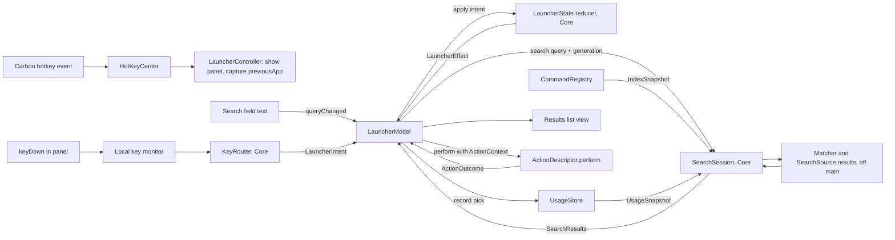

# OpenRay design

**Status:** Draft, 2026-11-14.

## 1. Summary

OpenRay is an open-source, native macOS keyboard launcher. A global hotkey shows a floating panel; the user types and acts on the results. It covers the basics: app search, system commands, quicklinks, a calculator, clipboard history, Quick AI, window management, file search, snippets and script commands.

A few decisions shape everything else. The panel is a non-activating `NSPanel` at screen-saver level, and the app is always an accessory app, so the panel appears over full-screen apps without taking focus from them. Every feature plugs in through one interface: sources yield `SearchItem`s, items carry `ActionDescriptor`s, and actions return an `ActionOutcome`. All logic lives in `OpenRayCore`, which imports no AppKit, SwiftUI or Carbon and is tested with `swift test`. SQLite holds usage, clipboard history and snippets; `UserDefaults` holds preferences; the Keychain holds the API key. A permission is requested only when the feature that needs it is first used.

## 2. Goals and non-goals

**Goals**

- The panel appears within 50 ms (p95, warm) over any app, including full-screen apps, on every Space and display, and never deactivates the frontmost app.
- Everything is reachable from the keyboard, and every key the launcher reacts to is routed from one place.
- Adding a command touches no launcher code (milestone 3's "done when").
- Matching, ranking, the command model, storage and every feature's decision logic can be tested with `swift test` without launching the app.
- OpenRay works with no permissions granted, and asks for each permission only when the feature that needs it is first used.
- No telemetry. The only network traffic is update checks and Quick AI requests the user triggers.
- A stranger installs OpenRay with one command and it updates itself.

**Non-goals**

- A third-party extension API or store, compatibility with other launchers' extensions or script metadata, cloud sync, team features, theming.
- The Mac App Store and the App Sandbox.
- A resizable or movable panel, multiple launcher windows, per-command global hotkeys.
- Shipping translations in v0.1. The code is ready for localisation; only English ships.
- These feature limits for v1: no currency conversion, no snippet auto-expansion while typing, no rich-text snippets, no saved AI chat history, custom AI commands, attachments or second AI provider, no inline script output, no window layouts, drag-snapping or animation, no file content search, no clipboard encryption.

## 3. Architecture overview

### 3.1 Module map

| Module | Contains | May import |
|---|---|---|
| `OpenRayCore` (Swift package, `Packages/OpenRayCore`) | Value types and protocols of the command model; key routing and navigation state; matching, ranking and frecency; the app index scanner; the database, migrations and stores; preferences; the calculator; clipboard capture rules; snippet rendering; window geometry; Spotlight queries; the script parser and runner; the Claude provider, SSE parser and Quick AI session; every feature's view model | Foundation, Observation, Synchronization, CoreGraphics, CoreServices, CryptoKit, os, GRDB |
| App target (`OpenRay/`) | Windows and SwiftUI views; Carbon hotkeys; the key monitor; AppKit, Accessibility (AX), IOKit, Apple events, Keychain and ServiceManagement integration; pasteboard access; Sparkle; the composition root | Everything, including `OpenRayCore` |

Dependencies run one way: the app target depends on `OpenRayCore`. `OpenRayCore` never imports AppKit, SwiftUI or Carbon. On macOS `import SwiftUI` re-exports AppKit, so SwiftUI is excluded too. CI enforces the rule by grepping Core's sources for those imports, and for `Cocoa`, which re-exports AppKit too. Carbon and AppKit constants that Core needs (virtual key codes, Carbon modifier bits, `NSEvent` modifier-flag bits) are copied as literals with a comment naming the header.

If features later need views inside the package, they go in a separate `OpenRayFeatures` target that depends on Core; Core itself stays UI-free.

### 3.2 Runtime objects

| Object | Module | Responsibility |
|---|---|---|
| `AppDelegate` | App | Composition root. Owns every object below and the list of built-in features (`BuiltInFeatures.swift`). Attached to the SwiftUI `App` with `@NSApplicationDelegateAdaptor`; the `App` keeps the existing `MenuBarExtra`. |
| `HotKeyCenter` | App | Registers the global hotkey with Carbon (§4.1.2). |
| `LauncherHotKey` | App | `@MainActor @Observable`. Keeps the `launcher.hotKey` preference and the registration in step, and holds what Settings and the menu-bar menu show when the hotkey is not working (§4.1.2). |
| `LauncherController` | App | Shows, places and hides `LauncherPanel`; connects the search field and the key monitor to `LauncherModel`. |
| `FocusRestorer` | App | Records the previously frontmost app and gives the keyboard back to it (§4.1.7). One instance, shared by the launcher and the settings window. |
| `LauncherModel` | App | `@MainActor @Observable`. Holds `LauncherState`, executes its effects, holds the current results, runs actions, records picks. The only observable state the launcher views read. |
| `LauncherState`, `KeyRouter` | Core | Pure navigation state machine and key-to-intent mapping (§4.1.3, §4.1.4). |
| `CommandRegistry` | Core | Collects every source's indexed items into an immutable `IndexSnapshot` (§4.2.4). |
| `SearchSession` | Core | Fans out one root query to the matcher and the sources, merges, publishes `SearchResults` (§4.2.5). |
| `ScreenRegistry` | App | Maps a `ScreenRequest` to the owning feature's `ScreenSpec` (§4.2.3). |
| `HUDController` | App | Transient message window (§4.1.6). |
| `PasteService` | App | The only writer of the general pasteboard and the only poster of synthetic key events (§4.1.7). |
| `PermissionCenter` | App | The only place that checks or requests a permission (§5.1). |
| `SettingsWindowController` | App | The settings and onboarding windows (§4.3.5). |
| `AppDatabase` and stores | Core | SQLite through GRDB (§4.3). |
| `Preferences` | Core | `@MainActor @Observable` view of `UserDefaults` (§4.3.4). |

### 3.3 From hotkey to action

1. The user presses the hotkey. Carbon delivers the event on the main run loop to `HotKeyCenter`, whose `onPress` reaches `LauncherController.toggle()`.
2. `LauncherController` has `FocusRestorer` record the frontmost app as `previousApp`, places the panel, applies `.willShow` (whose effects restart the root search and make the search field first responder), and makes the panel key.
3. Each text change in the field becomes a `.queryChanged` intent. Other keys go through one local key monitor to `KeyRouter`, which returns an intent or lets the key fall through to the field editor.
4. `LauncherModel` applies the intent to `LauncherState`. The reducer returns effects. At the root, a query change returns `.search(query:generation:)`, which `LauncherModel` passes to `SearchSession`.
5. `SearchSession` cancels the previous search, matches the query against the `IndexSnapshot` and asks each source for query-specific results, all off the main actor. It publishes `SearchResults` tagged with the generation; `LauncherModel` drops stale generations, hands the rows to the reducer as `.resultsArrived`, and the list redraws.
6. Return (or a shortcut, or a choice in the action panel) becomes `.perform`. `LauncherModel` checks the action's required permissions, shows its confirmation if it has one, records the pick in `UsageStore`, and awaits `perform(ActionContext)`.
7. The returned `ActionOutcome` closes the launcher, keeps it open, pushes a screen, pops to root, replaces the query, or closes it and shows a HUD message.



### 3.4 Concurrency model

Both modules build in the Swift 6 language mode with strict concurrency and enable the `NonisolatedNonsendingByDefault` upcoming feature (in the package through `swiftSettings`, in the app target through `SWIFT_UPCOMING_FEATURE_NONISOLATED_NONSENDING_BY_DEFAULT = YES`). The app target also sets `SWIFT_DEFAULT_ACTOR_ISOLATION = MainActor`, so its classes and protocols are main-actor isolated without an annotation (the sketches in this document write `@MainActor` out for clarity), and the few app-target value types that must be usable from any isolation (`HotKeySlot`, `HotKeyError`, `SettingsPane`) are declared `nonisolated`. Core keeps the default nonisolated isolation. All three settings ship with Xcode 26 (Swift 6.2).

Under `NonisolatedNonsendingByDefault`, a plain `async` function runs on its caller's actor, so a nonisolated `async` method called from the main actor runs on the main thread. Task-group children do not inherit the caller's actor. The rules that follow from this:

- **Main actor:** all UI, `LauncherModel`, `SearchSession`'s coordination, `CommandRegistry`, `Preferences`, `PermissionCenter`, `PasteService`, `ClipboardMonitor` and `QuickAISession`.
- **`@concurrent`:** every Core function that does blocking I/O or more than about 1 ms of CPU work is marked `@concurrent`. Named cases: building `IndexSnapshot`, scanning app bundles, the matcher's `rank`, SHA-256 hashing of clipboard payloads, Keychain calls, and the calculator only if profiling shows it needs it.
- **Actors with a serial dispatch-queue executor** for blocking calls into other processes: `AXWindowController` (§4.7), `SpotlightSearcher` (§4.8) and `AppleEventSender` (§4.2.10). Each declares `nonisolated var unownedExecutor` backed by its own `DispatchSerialQueue`, so a blocking call never occupies a thread of the cooperative pool.
- **GRDB** runs database reads and writes on its own queues; stores are `Sendable` structs with `async` methods, except `SQLiteUsageStore`, an actor that also holds the in-memory usage snapshot.
- **Streams:** a producer task created inside a nonisolated synchronous function (the Quick AI provider, the script runner) runs on the global concurrent executor and is cancelled through the stream's `onTermination`.
- Only `Sendable` values cross isolation boundaries. `NSImage`, `AXUIElement`, `NSPasteboard`, `NSRunningApplication` and `NSAppleEventDescriptor` stay in the app target and inside the actor that uses them.

Code sketches in this document were type-checked against the macOS 26.5 and 27.2 SDKs. Type-checking does not run Swift 6's region-based isolation checks, which only run when SIL is generated, so a sketch that type-checks can still fail a build. CI builds the package and the app in Swift 6 mode, and that build is the authority.

### 3.5 Shared mechanisms

Each of these has exactly one owner. Features call the owner; they never reimplement it.

| Mechanism | Owner | Defined in |
|---|---|---|
| Key routing and list selection | `KeyRouter`, `LauncherState`, `LauncherModel` | §4.1.3, §4.1.4 |
| The launcher hotkey: its preference, registration and failure state | `LauncherHotKey` | §4.1.2 |
| Root search fan-out, cancellation, generations | `SearchSession`, `LauncherState.generation` | §4.2.5 |
| Recording a pick for ranking | `LauncherModel` → `UsageStore` | §4.2.7 |
| Writing the pasteboard, pasting into the previous app | `PasteService` | §4.1.7 |
| Restoring focus to the previous app | `FocusRestorer` | §4.1.7 |
| Transient messages | `HUDController` | §4.1.6 |
| Confirmations | In-panel confirmation view | §4.1.6 |
| Checking and requesting permissions | `PermissionCenter` | §5.1 |
| Sending Apple events | `AppleEventSender` | §4.2.10 |
| Preferences | `Preferences` / `PreferencesStore` | §4.3.4 |
| User content (usage, commands, clips, snippets) | `AppDatabase` and its stores | §4.3 |
| Secrets | `SecretStore` | §4.6.5 |
| The settings window | `SettingsWindowController` | §4.3.5 |
| Logging and signposts | One `Logger` per subsystem category, one `OSSignposter` | §5.3 |

## 4. Subsystems

### 4.1 Launcher shell

The shell is the panel, the hotkey, the key router, the navigation stack, the results list, the action panel, the HUD and the paste path. It knows nothing about any particular feature.

#### 4.1.1 Panel

`LauncherPanel` is an `NSPanel` subclass created once at launch and only ever ordered out, never closed.

```swift
// App target
final class LauncherPanel: NSPanel {
    static let size = NSSize(width: 720, height: 474)   // fixed; the panel never resizes with its content
    static let cornerRadius: CGFloat = 18
    init(contentRect: NSRect)   // styleMask: [.borderless, .nonactivatingPanel, .fullSizeContentView]
    override var canBecomeKey: Bool { true }    // borderless windows return false by default
    override var canBecomeMain: Bool { false }
}
```

| Property | Value | Why |
|---|---|---|
| `styleMask` | includes `.nonactivatingPanel`, set in `init` | Changing this style after creation is reported not to update the window server's activation-prevention flag. UNVERIFIED on macOS 26: confirm with a test build in M1 (§8, item 1). |
| `collectionBehavior` | `[.canJoinAllSpaces, .canJoinAllApplications, .fullScreenAuxiliary, .transient, .ignoresCycle]` | Apple DTS (forum thread 826308, tested on macOS 26) gives this set for panels over other apps' full-screen Spaces. `.transient` replaces DTS's `.stationary` because the panel is short-lived; only one of managed, transient and stationary is allowed. |
| `hidesOnDeactivate`, `becomesKeyOnlyIfNeeded` | `false`, `false` | |
| `animationBehavior` | `.none` | Latency |
| `isReleasedWhenClosed` | `false` | Created once |
| `isOpaque`, `backgroundColor`, `hasShadow` | `false`, `.clear`, `true` | The glass content view draws the only background |
| `level` | `.screenSaver`, **set last** | DTS: `.floating` and `.statusBar` sit below other apps' full-screen Spaces. |

`isFloatingPanel` is not set. Setting it to `true` resets the level to `.floating` (observed on macOS 27.0: the level changes from 1000 to 3), which would put the panel below full-screen apps. The configuration code sets `level` after every other property, and a DEBUG assertion checks `level == .screenSaver` afterwards.

The DTS answer requires an accessory app. `LSUIElement = YES` is already set, and **OpenRay never switches to the `.regular` activation policy**, not even while Settings is open, because a regular app cannot layer over full-screen Spaces.

View hierarchy:

- `NSGlassEffectView` (macOS 26 system material, corner radius 18) is the panel's `contentView`.
- Inside it, `LauncherRootView` stacks `SearchBarView` (AppKit, 56 points high: an icon and `ShellSearchField: NSTextField`) above `LauncherBodyHostingView`, an `NSHostingView<LauncherBody>` (SwiftUI: the list or a custom screen, the action panel overlay, confirmations and the footer).
- The hosting view never accepts first responder, so a click on the list cannot take the keyboard from the search field, and its `sizingOptions` are empty, so SwiftUI content never drives the window's size.

The panel has one fixed size, 720 × 474 points (`LauncherPanel.size`). The list scrolls inside it; nothing the results or a screen do resizes the window.

The search field is AppKit so the shell controls first responder deterministically with `makeFirstResponder`. It is the only text input in the panel: pushed screens use it as a filter or as their input line, according to their `SearchBarMode`.

**Show.** `LauncherController.toggle()` hides the panel if it is visible and key. Otherwise `show()` has `FocusRestorer` record the frontmost app as `previousApp` (§4.1.7), un-hides OpenRay without activating it if an earlier focus restore hid it, sets the frame from `PanelPlacement` (§4.1.8), applies `.willShow`, and calls `makeKeyAndOrderFront(nil)`. `.willShow` resets to the root frame and returns `.focusSearchField`, which makes the field first responder with the previous query selected (§4.1.4), before the panel is ordered front.

**Hide.** Triggers are Esc at the bottom of the Esc ladder, `windowDidResignKey`, the hotkey, and the outcomes `.closeLauncher` and `.showHUD`. The panel is ordered out and then `FocusRestorer.restoreIfNeeded()` runs. The order matters: the restorer acts only when `NSApp.isActive`, and while the panel is key that can be true although the app behind it is still frontmost (§8, item 4). Ordering the key panel out makes it resign key, which calls `hide()` again; the second call returns because the panel is no longer visible. Hiding does not cancel an action that is still running. It applies `.didHide`, which gives up a Return that was still waiting for its results (§4.1.4) and otherwise leaves `LauncherState` as it is; the next `.willShow` resets it.

**Main menu.** `NSTextField` performs copy, paste, cut, undo and select-all through Edit-menu key equivalents, not through `keyDown`. A menu-bar-only app may have no Edit menu, which would make ⌘V do nothing in the search field and in the settings window. In `applicationDidFinishLaunching` the app delegate installs a hidden `NSApp.mainMenu` (`MainMenu.make(appDelegate:)`) with three items. The first is the application menu, which is what AppKit takes the first item of the main menu to be whatever it contains. It has Settings… (⌘,) and Quit OpenRay (⌘Q), which do what the same items of the menu-bar menu do: that menu's key equivalents work only while it is open, so without these ⌘Q would do nothing while the settings window is key. In the launcher panel ⌘Q does not get this far: the key monitor swallows it (§4.1.3), because there it would quit OpenRay under the menu bar of another app. Settings… names the app delegate as its target, because under the SwiftUI lifecycle `NSApp.delegate` is an object of SwiftUI's. The second is File with Close Window (⌘W, `performClose:`), so the settings window closes from the keyboard. The third is Edit (Undo, Redo, Cut, Copy, Paste, Select All with the standard selectors and key equivalents). The search field's cell sets `allowsUndo`, without which ⌘Z reaches the field and does nothing. UNVERIFIED: that the SwiftUI `App` lifecycle leaves a hand-installed main menu in place, and that its key equivalents fire while the panel is key but OpenRay is not the active app. The M1 checklist tests ⌘C, ⌘V and ⌘Z in the panel and in Settings. The fallback is for the key monitor to send the standard selectors with `NSApp.sendAction(_:to:from:)`.

#### 4.1.2 Global hotkey

```swift
// OpenRayCore
public struct HotKey: Codable, Hashable, Sendable {
    public var keyCode: UInt32                 // virtual key code (kVK_*), layout-independent
    public var modifiers: Modifiers
    public struct Modifiers: OptionSet, Codable, Hashable, Sendable {
        public let rawValue: UInt8             // stored with the preference: the bit assignments never change
        public static let command, option, control, shift: Modifiers   // 1<<0, 1<<1, 1<<2, 1<<3
        public init(eventModifierFlags: UInt)  // from NSEvent.ModifierFlags.rawValue; Caps Lock, Fn and the numeric-pad flag are dropped
    }
    public enum Validation: Sendable, Equatable { case ok, needsModifier, optionShiftOnly }   // optionShiftOnly is a warning
    public var carbonModifiers: UInt32 { get } // cmdKey 1<<8, shiftKey 1<<9, optionKey 1<<11, controlKey 1<<12 (Events.h)
    public func validate() -> Validation
    public static func isReservedShortcut(_ chord: KeyChord) -> Bool   // ⌘C, ⌘Tab and the like, which the recorder refuses
    public static let launcherDefault = HotKey(keyCode: 0x31 /* kVK_Space */, modifiers: [.option])
}

// App target
enum HotKeySlot: UInt32 { case launcher = 1 }  // the raw value is the Carbon hotkey ID
enum HotKeyError: Error, Equatable { case inUseByAnotherApp, rejected(OSStatus) }

@MainActor protocol HotKeyRegistering {        // the seam for a fake; no app tests use it yet
    /// Gives the slot this hotkey, replacing the one it had. On failure the slot keeps its previous hotkey.
    func register(_ key: HotKey, for slot: HotKeySlot) -> Result<Void, HotKeyError>
    func unregister(_ slot: HotKeySlot)
    func suspendAll()                          // releases every hotkey until resumeAll(), for the recorder
    func resumeAll() -> [HotKeySlot: HotKeyError]   // the slots that could not be registered again; they are left without a hotkey
}
@MainActor final class HotKeyCenter: HotKeyRegistering {
    var onPress: (@MainActor (HotKeySlot, _ eventTime: TimeInterval) -> Void)?
}

@MainActor @Observable final class LauncherHotKey {
    struct Failure: Equatable { let hotKey: HotKey; let error: HotKeyError }   // the chord that could not be registered
    static let fallback = HotKey(keyCode: 0x31 /* kVK_Space */, modifiers: [.control, .option])
    init(registrar: any HotKeyRegistering, preferences: Preferences)
    private(set) var isActive: Bool            // a hotkey is registered
    private(set) var failure: Failure?         // the last failed registration; cleared by the next success, except the fallback's
    private(set) var usesFallback: Bool
    var hotKey: HotKey { get }                 // the stored hotkey, or the fallback standing in for it
    func registerAtLaunch()
    func record(_ key: HotKey)                 // registers, then stores; on failure the previous hotkey stays
    func beginRecording()                      // suspendAll()
    func endRecording()                        // resumeAll(); a hotkey that does not come back becomes a failure
}
```

`HotKeyCenter` only talks to Carbon. `LauncherHotKey` sits between it, `Preferences` and the UI: the recorder, the General pane and the menu-bar menu read and change the hotkey through it, never through the preference or the registrar directly.

**Registration.** One `InstallEventHandler` on `GetApplicationEventTarget()` for `kEventClassKeyboard`/`kEventHotKeyPressed`, then `RegisterEventHotKey(code, carbonModifiers, EventHotKeyID(signature:id:), target, kEventHotKeyExclusive, &ref)`. These functions are present and not deprecated in the macOS 27 SDK, and none of them causes a permission prompt. If the handler cannot be installed, `register` fails with `.rejected(status)` without registering anything, because a hotkey without the handler would be held but never fire. Registering the chord a slot already holds returns success without calling Carbon, because registering a chord this app holds exclusively would fail. When a slot changes chord, the new chord is registered before the old one is unregistered, so a failure changes nothing and the previous hotkey keeps working.

**Exclusivity.** With `kEventHotKeyExclusive`, OpenRay's registration stops other apps' non-exclusive registrations of the same chord from receiving events while OpenRay holds it, so only OpenRay fires. Registration fails with `eventHotKeyExistsErr` (-9878) if another app already holds the chord. `CarbonEvents.h` is inconsistent about whether a non-exclusive holder causes that error (the `HotKeyOptions` documentation says yes, the `RegisterEventHotKey` result documentation implies only exclusive holders do); M1 tests both cases (§8, item 2). -9878 maps to `.inUseByAnotherApp`, shown as "⌥Space is in use by another app."; any other status maps to `.rejected(status)`, shown as "macOS could not register ⌥Space (error -9868)." The message names the chord that failed, because after a failed change the recorder shows the previous hotkey, which still works.

**Threading.** Carbon dispatches application-target events on the main run loop. The handler is a non-capturing C function that recovers `HotKeyCenter` from `userData` and calls `MainActor.assumeIsolated`, which traps if the assumption is ever wrong. `HotKeyCenter` must be `@MainActor` for this pattern to compile in Swift 6; with a non-isolated class, generating SIL reports "sending 'me' risks causing data races". `GetEventTime(event)` gives the trigger timestamp for latency measurement.

**Option-only chords.** macOS 15.0 made hotkeys whose only modifiers are Option or Option+Shift fail (forum reports show error -9868). An Apple engineer stated this was addressed in macOS 15.2 beta 2; a later user report claims an intermittent regression. UNVERIFIED on macOS 26 and 27: test registration of ⌥Space on both. `register` checks the status every time, and the General pane warns while the hotkey is an Option-only chord.

**Fallback.** `LauncherHotKey.registerAtLaunch()` registers the stored hotkey. If that is the default, ⌥Space, and it cannot be registered, OpenRay registers ⌃⌥Space in its place for this session only. The fallback is never written to `launcher.hotKey`: the preference keeps the default, so every launch tries ⌥Space again. The fallback must not go unnoticed, so while `usesFallback` is true `failure` keeps the refusal of ⌥Space, and OpenRay tells the user in three places: it opens Settings at the General pane at launch; the pane shows the error for ⌥Space under the recorder, which shows ⌃⌥Space, with a note that ⌃⌥Space opens the launcher until OpenRay quits and that ⌥Space is tried again the next time it starts; and the menu-bar menu's first item reads "Hotkey is ⌃⌥Space for now — open Settings". Recording any hotkey ends the fallback. A hotkey the user chose has no fallback, and if the fallback is refused too, the failure reported is the default's, since that is the chord the recorder shows.

**Failure.** If no hotkey could be registered at launch (`isActive` is false), OpenRay opens Settings at the General pane with the error shown under the recorder, and while that lasts the menu-bar menu's first item reads "Hotkey inactive — open Settings". A change in the recorder that cannot be registered leaves both the registration and the preference on the previous hotkey and shows the same error, naming the chord that was refused; the next successful registration clears it. The recorder releases the hotkey while it records (see Recorder); if the hotkey cannot be registered again afterwards, because another app took the chord in the meantime, `resumeAll()` reports it, `isActive` becomes false and the same error and menu item appear. OpenRay never posts a user notification, which would need its own authorization prompt.

**Recorder.** `HotKeyRecorderView` is an `NSView` that becomes first responder and reads `keyDown` and `flagsChanged`. A click, Space or Return starts recording. While recording it calls `suspendAll()` (through `LauncherHotKey.beginRecording()`), otherwise Carbon would consume the current hotkey before the view saw it, and it overrides `performKeyEquivalent` to record ⌘ chords before the main menu sees them, otherwise typing ⌘W while recording would close the window. It requires at least one of ⌘, ⌃ or ⌥, and it refuses the chords for which `HotKey.isReservedShortcut` is true: ⌘A, ⌘C, ⌘V, ⌘X, ⌘Z, ⌘⇧Z, ⌘Q, ⌘W, ⌘H, ⌘M, ⌘, (which is also the launcher's own chord for Settings), ⌘Tab, ⌘⇧Tab and ⌥⌘⎋, which as a global hotkey would stop working in every app. The list stops at shortcuts that work nearly everywhere: ⌘S, ⌘N and ⌘F exist only in some apps, and ⌘Space and ⌘` can be reassigned in System Settings. The letters are matched by what the key types on the current layout, like the launcher's own chords (§4.1.3), and for this check the recorder reads what the key types with ⌘ held (`characters`): on "Dvorak – QWERTY ⌘" that is another letter than without. A refused chord beeps and the recorder shows why ("Add ⌘, ⌃ or ⌥", "⌘C is reserved") until a modifier is pressed for the next chord, so letting go of the refused chord does not clear it; recording continues. A key that repeats because it is held is answered once. Esc cancels, as does losing first responder or the window resigning key. Delete, or Forward Delete, restores the default hotkey, ⌥Space, through the same path as any other chord; the recorder has no way to leave the launcher without a hotkey. Recording ends, which resumes the current hotkey, before the new chord is registered, so that the new one replaces it as described under Registration. The display string ("⌥Space") comes from `HotKeyFormatter`: fixed names for keys that type nothing visible (Space, ↩, the arrows, F1 to F20) and otherwise `UCKeyTranslate` with the current keyboard layout, in upper case. It is recomputed when the input source changes; the binding stays on the physical key code. The hotkey is stored as the preference `launcher.hotKey` (§4.3.4).

#### 4.1.3 Key routing

There is one interception point: an `NSEvent.addLocalMonitorForEvents(matching: .keyDown)` monitor (`LauncherKeyMonitor`), installed when the panel becomes key and removed when it resigns key. It ignores events for other windows, turns every other key press into a `KeyChord` and a `KeyRouter.Context`, and asks the router. The monitor decides nothing itself: whether the field editor `hasMarkedText()` is one more field of the context, and the router returns `nil` for every chord while it is true, so input-method composition keeps Return, the arrows and Esc. The monitor runs before key-equivalent dispatch, so ⌘ chords and plain keys take the same path.

```swift
// OpenRayCore
public struct KeyChord: Hashable, Codable, Sendable {
    public var keyCode: UInt16
    public var modifiers: HotKey.Modifiers     // ⌘ ⌥ ⌃ ⇧ only (HotKey.Modifiers(eventModifierFlags:))
    public var characters: String?             // charactersIgnoringModifiers
}
public enum VirtualKey { /* the kVK_* codes the router and HotKey.isReservedShortcut need, copied from Events.h */ }
public struct KeyRouter: Sendable {
    public struct Context: Sendable {
        public var actionPanelOpen: Bool
        public var queryIsEmpty: Bool          // the search field is empty (LauncherState.searchFieldText)
        public var depth: Int                  // 0 = root
        public var selectedItemShortcuts: [KeyChord: ActionID]
        public var hasMarkedText: Bool         // an input method is composing in the search field
        public init(state: LauncherState, selectedItemShortcuts: [KeyChord: ActionID] = [:], hasMarkedText: Bool = false)
    }
    public func intent(for chord: KeyChord, in context: Context) -> LauncherIntent?   // nil: let AppKit handle it
    public func swallows(_ chord: KeyChord) -> Bool   // no intent, and AppKit must not see it either: ⌘Q
}
```

Routing, in priority order:

| Chord | Intent |
|---|---|
| Any chord while `hasMarkedText` | `nil` |
| Esc | `.escape` (see the Esc ladder in §4.1.4) |
| ↑ / ↓, ⌃P / ⌃N | `.moveSelection(-1)` / `.moveSelection(1)` |
| Return, keypad Enter | `.performPrimary` |
| Tab | `.tabComplete` |
| Delete with an empty field at depth > 0, while the action panel is closed | `.back` |
| ⌘K | `.toggleActionPanel` |
| ⌘1 to ⌘9 | `.activateIndex(n)`, matched by the key code of the digit row so AZERTY works without Shift |
| ⌘[ | `.back` |
| ⌘, | `.openSettings` |
| A chord that triggers a shortcut in `selectedItemShortcuts` | `.performAction(id)` |
| ⌘Q | `nil`, and `swallows` is true: the monitor stops the event |
| Anything else, including ⌘A, ⌘C, ⌘V, ⌘X, ⌘Z and typing | `nil`: falls through to the field editor |

**Modifiers are exact.** A fixed chord matches only with exactly the modifiers the table shows, out of ⌘, ⌥, ⌃ and ⇧: Esc, the arrows, Return, Enter, Tab and Delete with none, ⌃P and ⌃N with Control alone, the ⌘ chords with Command alone. Caps Lock, Fn and the numeric-pad flag (which AppKit sets on arrow keys) never count. So ⇧Tab, ⌥Return and ⌘⇧K are not fixed chords: they are free for item shortcuts and otherwise fall through. While the action panel is open the field holds the panel's filter, so Delete stays an editing key there.

**Layouts.** The chords named by a letter or a punctuation mark (K, P, N, `[` and `,`) match on `characters`, lower-cased, when that value is ASCII, so on Dvorak ⌘K is the key that types K. When it is not ASCII (for example on a Cyrillic layout) they match on the key code of that key's position on an ANSI keyboard.

**⌘Q** is the one chord the router has no intent for and still keeps from AppKit (`swallows`). The main menu has Quit OpenRay on ⌘Q for the settings window (§4.1.1). From the panel that item would end OpenRay, hotkey included, while the menu bar still shows the app behind the panel, so the monitor stops the event. This holds while an input method is composing too.

**Item shortcuts** are looked up only after every fixed chord has declined, so an item can never take over Esc, Return or ⌘K. A shortcut is triggered when the modifiers are equal and the key matches: by `characters`, compared without case, when both the shortcut and the pressed chord have ASCII characters, and by key code otherwise. If one press triggers two of the item's shortcuts, the action with the smaller `ActionID` wins, which keeps routing deterministic.

`CommandRegistry` drops, and logs, any action shortcut that collides with ⌘A, ⌘C, ⌘V, ⌘X, ⌘Z, ⌘⇧Z or a chord in this table.

#### 4.1.4 Navigation state

The launcher is a stack of frames. The root frame is search; every other frame is a screen pushed by an action or by Tab. The state machine is pure Core code.

```swift
// OpenRayCore
public struct LauncherState: Equatable, Sendable {
    public struct Row: Equatable, Sendable, Identifiable {   // what navigation needs to know about a displayed row
        public var id: ItemID
        public var primaryAction: ActionID?    // what Return runs: the item's actions[0]
        public var tabTarget: ScreenRequest?   // what Tab opens
        public init(id: ItemID, primaryAction: ActionID? = nil, tabTarget: ScreenRequest? = nil)
        public init(_ item: SearchItem)
    }
    public struct Frame: Equatable, Sendable {
        public var screen: ScreenRequest?      // nil = root search
        public var query: String
        public var rows: [Row]                 // displayed order
        public var selection: ItemID?
        public var actionInFlight: Bool { get }        // computed: the frame waits for the outcome of an action
        public var selectedIndex: Int? { get }
        public var selectedRow: Row? { get }
    }
    public struct ActionPanelState: Equatable, Sendable {
        public var filter: String              // what the search field holds while the panel is open
        public var rows: [ActionID]            // the listed actions after filtering, in displayed order
        public var selection: ActionID?
    }
    public private(set) var stack: [Frame]             // never empty; stack[0] is root
    public private(set) var actionPanel: ActionPanelState?
    public private(set) var generation: UInt64         // bumped on every root query change and on every show
    public private(set) var actionSerial: UInt64       // bumped by .actionStarted; names that action in .actionFinished
    public var tabFallback: ScreenRequest?             // set by the app: Quick AI's chat screen, or nil
    public var top: Frame { get }
    public var depth: Int { get }                      // 0 = root
    public var searchFieldText: String { get }         // the action panel's filter while it is open, else the top frame's query
    public mutating func apply(_ intent: LauncherIntent) -> [LauncherEffect]
}

public enum LauncherIntent: Sendable, Equatable {
    case willShow
    case didHide                                       // gives up an activation that waits for results; nothing else
    case queryChanged(String)                          // the search field's text changed
    case moveSelection(Int), activateIndex(Int)        // activateIndex is 1-based
    case performPrimary, performAction(ActionID)
    case tabComplete, toggleActionPanel, back, escape, openSettings
    case push(ScreenRequest)
    case resultsArrived(rows: [LauncherState.Row], generation: UInt64)
    case screenRowsChanged([LauncherState.Row])
    case actionPanelRowsChanged([ActionID])
    case actionStarted
    case actionFinished(ActionOutcome, serial: UInt64)
}

public enum LauncherEffect: Sendable, Equatable {
    case search(query: String, generation: UInt64)     // root frame only
    case forwardQuery(String)                          // to the top screen's ScreenContext
    case perform(ActionID, on: ItemID?)                // nil item: a screen-level action
    case cancelAction
    case showScreen(ScreenRequest)
    case popScreen                                     // once per frame removed
    case hide
    case focusSearchField                              // first responder, with its text selected
    case scrollTo(ItemID), openSettings
}
```

The reducer never sees a `SearchItem`, a result section or an action descriptor, so everything it has to decide from travels in the intents. A `Row` carries the item's primary action and Tab target, which is how `.performPrimary`, `.activateIndex` and `.tabComplete` are answered without asking the app. The action panel's rows are the `ActionID`s the app lists after filtering. An action is named by the value of `actionSerial` after its `.actionStarted`, so that an outcome arriving late is never taken for the outcome of another action.

Rules:

- Each frame keeps its own query and selection, so going back restores both. A pushed frame starts with an empty query and no rows. Going back does not search again.
- Selection is tracked by `ItemID`, not by index, so rows that arrive later for the same query never move the highlight.
- **A new query selects the first row.** When a frame's query changes (and on every show), the next rows to arrive for that frame select their first row, even if the previously selected item is still among them. Until they arrive the selection stays where it was.
- **A vanished row keeps its position.** When rows arrive for an unchanged query and the selected item is no longer among them, the selection moves to the row now at the same position, or to the last row if the list became shorter. Empty rows clear it.
- **No wrap-around.** `.moveSelection` stops at the first and the last row. With nothing selected, a move down selects the first row and a move up the last.
- `.resultsArrived` with a generation other than the current one is dropped. `LauncherState.generation` is the only generation counter in the app. Root results that arrive while a screen is on top update the root frame without scrolling; `.screenRowsChanged` is ignored at the root.
- `.activateIndex(n)` selects the n-th row of the top frame and performs its primary action; a position outside the rows does nothing.
- **Return ahead of the results.** Results arrive at least one main-actor turn after the query change that asked for them, and until then root search still holds the rows of its previous query. `.performPrimary` (with the action panel closed), `.activateIndex` and `.tabComplete` never act on those rows. While the root waits for the results of its query, the activation is remembered and performed on those results when they arrive: Return on their first row, ⌘n on their n-th, Tab on their first row's Tab target or else the fallback. The first results for the query use the activation up, also when they are empty or have no such row; rows that a slow source adds afterwards (§4.2.5) only update the list. Only the last activation is remembered. It is given up when the user does anything else first (typing, moving the selection, Esc, pushing or popping a screen, showing again), when the launcher is hidden (`.didHide`), and when an action starts; rows arriving and the late outcome of a cancelled action leave it alone. `.performAction` and opening the action panel are ignored in the same gap, because they name actions of the item that is on its way out. The app's side of this: every `.search` is answered with `.resultsArrived`, with no rows if it found nothing or failed, unless a newer search has replaced it.
- **On a screen nothing waits.** `.screenRowsChanged` does not say which query its rows answer, so the reducer cannot tell the answer it would wait for from a late answer to an earlier query, or from a row the screen added meanwhile. On a screen, Return, ⌘n, Tab, item shortcuts and the action panel act on the rows shown. A list screen still answers every `.forwardQuery` with `.screenRowsChanged`, which is what moves the selection to the first row of a new query. Whether a screen should name the query it answers is open (§8, item 28).
- **Esc ladder:** cancel the frame's in-flight action; else close the action panel; else pop the frame; else clear the query; else hide.
- **Back** (⌘[, Delete) closes the action panel if it is open. Otherwise it pops one frame, which cancels an action running in that frame, and does nothing at the root.
- **Tab:** if the selected item has a `tabTarget`, push it. Otherwise, at the root with a non-empty query, push `tabFallback` with the query as its argument. Otherwise do nothing. At the root, Tab ahead of the results waits for them, as Return does.
- **Action panel.** `.toggleActionPanel` opens the panel with an empty filter and no rows; the app then supplies the rows with `.actionPanelRowsChanged`, and again whenever the filter changes. At the root the panel opens only with an item selected; a screen can have actions of its own, so there it opens without one. While it is open, `.queryChanged` edits the filter and leaves the frame's query alone, `.moveSelection` moves within the panel, and `.performPrimary` performs the selected action on the frame's selected item. The rows for a new filter select their first action; rows that merely update keep the selected action while it is still listed. `.activateIndex` and `.tabComplete` are ignored. A second `.toggleActionPanel`, Esc, back, performing an action, and pushing or popping a screen close it.
- **While an action is in flight** in the top frame, `.performPrimary`, `.performAction`, `.activateIndex`, `.tabComplete`, `.push` and opening the action panel are ignored: one action runs at a time per frame, and nothing is pushed over a frame that waits for one, so only the top frame can be waiting. Typing and moving the selection still work. Esc cancels the action (`.cancelAction`), and so does popping its frame.
- **Outcomes.** `.actionStarted` marks the top frame as waiting for the action that `actionSerial` now names. `.actionFinished(outcome, serial:)` is applied only if the top frame still waits for that serial, so an outcome always navigates from the frame that started its action. It is dropped after the action was cancelled, after its frame was popped, and after the launcher was shown again. `.closeLauncher` and `.showHUD` return `.hide`; `.keepOpen` only ends the wait; `.popToRoot` pops every screen; `.push` pushes; `.replaceQuery` changes the query as typing would, with a new search at the root and `.forwardQuery` on a screen.
- **Show.** `.willShow` pops every screen, closes the action panel and stops waiting for any action. It does not return `.cancelAction`: an action still running from before keeps running (§4.1.1), but its outcome no longer navigates. The root keeps its query and, of the rows it still has, selects the first. The generation is bumped and `.search` is returned for that query, so results from before the hide are stale and the fresh ones select their first row. `.focusSearchField` follows, which selects the query text so typing replaces it. Hiding (`.didHide`) changes nothing in the state that the next show would see: it only gives up an activation that was waiting for results, so that an action cannot run after the launcher has gone.

`LauncherModel` (app target) holds the state, the current `SearchResults` and the screens on the stack. Before applying an intent, it offers it to the top screen if that screen is a custom screen, the action panel is closed and no action is in flight (§4.1.5). It derives `selectedItemShortcuts` from the selected item's actions, and the rows of `.resultsArrived` from the results with `LauncherState.Row(item)`. It reaches the window through the `LauncherShell` protocol (hide, focus the field, set the field's text, open Settings), which `LauncherController` implements.

No effect carries the search field's text. The reducer changes it in several ways (Esc clears the query, leaving a screen restores the query below, the action panel swaps its filter in and out, `.replaceQuery`), so after every intent the model compares `searchFieldText` with its value before and writes the field only if the reducer changed it. It must not write otherwise: text an input method is still composing is in the field but not yet in the state, and writing would discard it. The write comes before the effects run, so that `.focusSearchField` selects the new text.

**Running an action.** For `.perform`, `LauncherModel` finds the action, then:

1. If the action has a `confirmation`, shows it in the panel (§4.1.6) and stops if the user declines.
2. Checks `requiredPermissions` with `PermissionCenter` (§5.1). If one is missing it requests it or pushes the permission screen, as §5.1 describes, instead of running the action.
3. If the item is in the root frame or a list screen, records the pick with `UsageStore.record(pick:query:at:)` using that frame's query.
4. Applies `.actionStarted` and notes `actionSerial`, runs `perform` in a stored `Task`, and applies `.actionFinished(outcome, serial:)` with that serial.
5. If `perform` throws, shows the error's `localizedDescription` in the HUD with the launcher still open, and logs it.

#### 4.1.5 Results list and screens

The list is SwiftUI: a `ScrollView` with a `LazyVStack` of non-focusable rows, selection driven by the model, and `ScrollViewReader.scrollTo` keeping the selected row visible. Each `.scrollTo` effect becomes a scroll request on the model, which the list observes; requests are numbered so that two for the same row are distinct. A row view is `Equatable` and holds only the values it draws, so SwiftUI skips the rows that did not change when the selection moves or new results arrive. Rows render `ScoredItem` data (§4.2.2), never views supplied by features, so the list can be replaced with an `NSTableView` inside `NSViewRepresentable` without touching any feature if it misses the latency budget. SwiftUI `List` is not used because its own selection and focus handling fights the shell's routing. UNVERIFIED: that `LazyVStack` meets the 16 ms budget with 200 rows replaced on every keystroke; the M1 benchmark decides.

A pushed screen is one of two kinds (`ScreenSpec`, §4.2.3):

- **List screen.** The feature supplies rows through `ScreenContext.setSections(_:)` and, optionally, a detail view for the selected item (clipboard preview, Quick Look). The shell renders the rows and owns selection, Return, ⌘1–9 and ⌘K exactly as at the root. Clipboard history, snippets, file search and "Open With" are list screens.
- **Custom screen.** The feature supplies a view and a `handleIntent` function. The shell offers each intent to `handleIntent` first; the screen returns `true` if it consumed it. Quick AI, script output, argument entry for scripts and quicklinks, and the permission screen are custom screens.

#### 4.1.6 Action panel, confirmations and HUD

**Action panel (⌘K).** An overlay drawn inside the panel, never an `NSMenu`, because menus and other windows may appear below a screen-saver-level panel. It lists the selected item's actions, or the screen's actions for a custom screen, with their shortcuts. While it is open, the search field's text is swapped for the panel's own filter text and swapped back when it closes. The shell matches the actions against the filter and reports the ones it lists with `.actionPanelRowsChanged`; the reducer owns the selection among them (§4.1.4).

**Confirmations.** An action with a `confirmation` shows an in-panel view (title, message, a destructive button and Cancel; Return confirms, Esc cancels). OpenRay never uses `NSAlert` from the launcher: an alert would appear behind the panel, and when it became key the panel would resign key and hide.

**System windows.** Any action that opens a window outside the panel (`NSOpenPanel`, Settings, a permission prompt, the first Apple event to a new target) calls `ActionContext.closeLauncher()` first.

**HUD.** `HUDController` owns a borderless non-activating panel with the same level and collection behaviour as the launcher. It shows an icon and one line of text near the bottom of the screen and fades out after 1.5 s. Actions reach it through `ActionContext.showHUD(_:)` (launcher stays as it is) or by returning `.showHUD(_:)` (launcher closes first). It works while the launcher is hidden, which silent scripts and paste fallbacks rely on.

#### 4.1.7 Focus restore and paste

Because the panel is non-activating, the frontmost app normally stays active and nothing needs restoring.

**`FocusRestorer`** (app target) keeps the `NSRunningApplication` behind `previousApp`. `AppDelegate` creates one and gives it to both `LauncherController` and `SettingsWindowController`, because OpenRay becomes the active app only through one of its own windows, in practice Settings.

- `recordFrontmostApp()` is called before the launcher is shown and before Settings activates OpenRay. It stores `NSWorkspace.shared.frontmostApplication`, unless that is OpenRay itself: then the app recorded earlier is kept, so a launcher opened over Settings, or Settings opened from the launcher, still leads back to the app the user came from.
- `restoreIfNeeded()` is called after the panel has been ordered out (§4.1.1) and one run-loop turn after the settings window closes, when the window has left the screen. It acts only if `NSApp.isActive` and none of OpenRay's windows that can become main is still visible. That is the one state that needs repair: OpenRay active with no window to take the keyboard, so typing would go nowhere. While Settings is visible it keeps the keyboard and nothing is restored.
- To restore, it calls `NSApp.yieldActivation(to:)` and then `activate(from: .current, options: [])` on the previous app (macOS 14+). If there is no previous app, if it has quit, or if `activate` returns `false`, it calls `NSApp.hide(nil)` instead, which lets the system choose the next app. A hidden app keeps its windows off screen, so `LauncherController.show()` calls `NSApp.unhideWithoutActivation()` first when `NSApp.isHidden`.
- ⌘, in the launcher shows Settings first and hides the panel second, so that the hide finds a visible window and does not hand the keyboard to the previous app. Settings opened any other way makes the panel resign key, which hides it the same way.

`restore() async -> Bool` (M4, for paste) additionally waits up to 300 ms for `NSWorkspace.didActivateApplicationNotification` naming that app. The header warns that activation "is not guaranteed". UNVERIFIED: that `yieldActivation` and `activate(from:)` succeed from an accessory app, and that `NSApp.hide(nil)` then leaves the keyboard with a sensible app (§8, item 4). If the previous app quit, `restore()` returns `false`.

**`PasteService`** (app target, `@MainActor`) is the only code that writes the general pasteboard or posts synthetic key events. Features reach it through `ActionContext.copy(_:)` and `ActionContext.paste(_:)`; the Lock Screen command uses its `post(_ chord: KeyChord)` (§4.2.10).

```swift
// OpenRayCore
public struct AppRef: Sendable, Hashable { public var pid: pid_t; public var bundleID: String? }
public struct ClipRepresentation: Sendable, Hashable { public var uti: String; public var data: Data }
public enum PasteContent: Sendable, Hashable {
    case text(String, cursorOffsetFromEnd: Int?)
    case representations([ClipRepresentation])
}
public enum PasteResult: Sendable, Equatable {
    case pasted
    case copiedOnly(Reason)
    public enum Reason: Sendable, Equatable { case noAccessibility, targetChanged, noTarget }
}
```

`paste(_:)` runs these steps in order; `copy(_:)` runs steps 1 and 2 only.

1. `clearContents()` and write every representation; keep the returned `changeCount`.
2. If clipboard history is on, give `ClipboardMonitor` that `changeCount` to skip, and pass a `CapturedClip` of what was written, with source OpenRay, to `ClipboardStore.insertOrBump`. OpenRay's own writes are recorded (a duplicate bumps the existing item) without reading the pasteboard back.
3. Hide the launcher if it is visible.
4. If `NSApp.isActive`, `await FocusRestorer.restore()`.
5. If the frontmost app's pid is not `previousApp.pid`, return `.copiedOnly(.targetChanged)`.
6. If `PermissionCenter` does not report Accessibility as granted, show the HUD "Copied — press ⌘V" and return `.copiedOnly(.noAccessibility)`. The first time this happens the HUD adds "Grant Accessibility in Settings to paste directly"; Settings › General lists permissions with Grant buttons (§5.1).
7. Post ⌘V with `CGEvent(keyboardEventSource:virtualKey:keyDown:)`, flags `.maskCommand`, to `.cghidEventTap`; then post ← `cursorOffsetFromEnd` times if set. Return `.pasted`.

Posting events is not blocked by Secure Event Input; the cursor arrows may be ignored in a secure field, which is harmless.

#### 4.1.8 Placement

```swift
// OpenRayCore. All rects in AppKit global coordinates (origin at the bottom-left of the primary display, y up).
public struct DisplayGeometry: Sendable, Equatable { public let id: UInt32; public let frame: CGRect; public let visibleFrame: CGRect }
public enum PanelPlacement {
    public static func frame(displays: [DisplayGeometry], mouse: CGPoint, size: CGSize) -> CGRect
}
```

The panel opens on the display whose `frame` contains `NSEvent.mouseLocation`, centred horizontally in that display's `visibleFrame`, with its top edge 22 % of the `visibleFrame`'s height below its top. The top edge is fixed and does not depend on the panel's height. The left and top edges are rounded to whole points; the size is passed through, and the app always passes `LauncherPanel.size` (§4.1.1), so the panel neither moves nor grows as results arrive.

The panel stays inside the `visibleFrame` whenever it fits there. At 474 points high it fits under the 22 % inset only if the `visibleFrame` is at least 608 points high; on a shorter display it sits higher, with its bottom edge on the bottom of the `visibleFrame`. A panel taller or wider than the `visibleFrame` cannot fit: it keeps its top-left corner, where the search field is, inside the `visibleFrame` and runs off the bottom or the right.

Finding the display has two edge cases. `CGRect.contains` includes a rectangle's minimum edges and excludes its maximum edges, so a mouse on the seam between two displays belongs to the display that starts there, whatever the order of the list. For the same reason a mouse resting exactly on a display's top edge can be in no display at all, so a second pass accepts the first display whose frame grown by one point contains it. A mouse that is still on no display gets the first display in the list, and an empty list gives a frame of the requested size at the origin.

The app target snapshots `NSScreen.screens` into `[DisplayGeometry]` on the main actor, with `NSScreenNumber` as the `id`, and refreshes it on `NSApplication.didChangeScreenParametersNotification`, which also re-places a visible panel. Window management uses the same type (§4.7).

#### 4.1.9 Latency budget

| Path | p95 budget | Measured from → to |
|---|---|---|
| Hotkey → panel on screen (warm) | 50 ms | `GetEventTime` of the hotkey event → first `NSView.displayLink(target:selector:)` callback after `orderFront`, compared with `GetCurrentEventTime()` (same since-boot clock per `CarbonEventsCore.h`) |
| First show after launch | 200 ms | same |
| Keystroke → root results drawn (index match and `.inline` sources) | 16 ms | `NSEvent.timestamp` → display-link tick after the state commit |
| Keystroke → first batch from a `.slow` source | 100 ms; typing never blocks | same |

`FrameLatencyProbe` (app target) takes these measurements. A signpost interval cannot begin in the past, so each interval begins when the event is handled (the hotkey callback, the field's text-change callback) and ends at the first display-link tick after the panel was ordered front or the results were committed. The time the budget is about, from the event's own timestamp to that tick, includes the wait before the handler ran; the probe computes it and writes it into the interval's end message ("12.3 ms since the event"). Read the budget from that message, not from the interval's length. A measurement that never reaches a frame, because the panel was hidden or the next keystroke replaced it, ends with the message "abandoned".

The panel and hosting view are built and laid out at launch to warm the first show. UNVERIFIED: that laying out without ordering the panel front warms SwiftUI enough; measure it. Signpost intervals are listed in §5.3.

#### 4.1.10 Failure modes

| Case | Behaviour |
|---|---|
| Hotkey registration fails | §4.1.2 Failure |
| Secure Event Input is on (password field) | UNVERIFIED whether Carbon hotkeys still fire; test on macOS 26 and 27 with `IsSecureEventInputEnabled()` logged |
| Input-method candidate windows under a screen-saver-level panel | UNVERIFIED whether they appear; test Japanese and Pinyin input |
| Hotkey during Mission Control or while another app's menu is open | UNVERIFIED; test |
| `previousApp` quit while the panel was open | Nothing to restore unless OpenRay is the active app, and then `NSApp.hide(nil)` (§4.1.7); paste returns `.copiedOnly(.targetChanged)` |
| Display removed while the panel is visible | Re-placed on the display under the mouse, or the first display (§4.1.8) |
| Slow action | Footer spinner; the panel stays; Esc cancels the task |

### 4.2 Command model, search and ranking

One interface carries every feature. A **source** (`SearchSource`) yields **items** (`SearchItem`); each item carries **actions** (`ActionDescriptor`); performing an action returns an **outcome** (`ActionOutcome`). A **feature** (`Feature`, app target) bundles sources, an optional settings pane and the screens it can push. All of these types except `Feature` and `ScreenSpec` live in Core and contain no views.

#### 4.2.1 Identifiers

```swift
// OpenRayCore
public struct ItemID: RawRepresentable, Hashable, Sendable, Codable {     // "<namespace>:<local>"
    public let rawValue: String
    public init(rawValue: String)
    public enum Namespace: String, Sendable, CaseIterable { case app, system, command, quicklink, script, file, clip, snippet }
    public init(_ namespace: Namespace, _ local: String)
    public var namespace: Namespace? { get }   // nil for an unknown namespace
    public var local: String { get }           // everything after the first colon; may itself contain colons
}
public struct ActionID: RawRepresentable, Hashable, Sendable, Codable { public let rawValue: String }
public struct FeatureID: RawRepresentable, Hashable, Sendable, Codable { public let rawValue: String }
public struct SourceID: RawRepresentable, Hashable, Sendable { public let rawValue: String }
```

The identifier types are `RawRepresentable`, so each one encodes as a plain string, not as an object with a `rawValue` key: `["system:sleep","clip:7"]`, and a `ScreenRequest` as `{"feature":"ai","screen":"chat"}`. Anything that persists or transmits an identifier relies on that.

`ItemID`s are stored in the usage, alias and override tables, so their format is fixed. Sources build them with the factory for their namespace (`ItemID.app(bundleID:)`, `.app(path:)`, `.system(_:)`, `.command(_:_:)`, `.quicklink(_:)`, `.script(path:)`, `.file(path:)`, `.clip(rowID:)`, `.snippet(_:)`):

| Namespace | Local part | Example |
|---|---|---|
| `app` | Bundle ID, or `path:<absolute path>` when there is no bundle ID or another copy already holds it | `app:com.apple.Safari`, `app:path:/Applications/Old/Safari.app` |
| `system` | Command name | `system:sleep` |
| `command` | `<feature>.<name>` for feature entry points and fixed commands | `command:clipboard.history`, `command:window.leftHalf`, `command:ai.ask` |
| `quicklink` | UUID | `quicklink:6F1C…` |
| `script` | Absolute path | `script:/Users/…/Scripts/wifi.sh` |
| `file` | Absolute path | `file:/Users/…/report.pdf` |
| `clip` | Row ID in `clip_item` | `clip:4182` |
| `snippet` | UUID | `snippet:9A0E…` |

#### 4.2.2 Items and actions

```swift
// OpenRayCore
public enum IconSource: Sendable, Hashable { case file(path: String), symbol(String), emoji(String), bundled(String) }
public struct NameVariant: Sendable, Hashable { public var text: String; public var weight: Double }  // 0.95 alias/keyword, 0.9 transliteration

public struct SearchItem: Sendable, Identifiable {
    public let id: ItemID
    public var title: String
    public var subtitle: String?
    public var alternateNames: [NameVariant]   // localised names, transliterations, keywords
    public var icon: IconSource
    public var kindLabel: String               // "Application", "Command", "Quicklink"
    public var accessories: [String]           // short trailing labels
    public var tabTarget: ScreenRequest?
    public var actions: [ActionDescriptor]     // [0] is primary (↩); [1] gets ⌘↩ unless it has its own shortcut
}

public struct ActionDescriptor: Sendable, Identifiable {
    public let id: ActionID
    public var title: String
    public var icon: IconSource?
    public var shortcut: KeyChord?
    public var isDestructive: Bool
    public var confirmation: Confirmation?
    public var requiredPermissions: Set<Permission>      // §5.1
    public var perform: @MainActor @Sendable (any ActionContext) async throws -> ActionOutcome
}
public struct Confirmation: Sendable, Hashable { public var title: String; public var message: String?; public var confirmTitle: String }

public enum ActionOutcome: Sendable, Equatable {
    case closeLauncher, keepOpen, popToRoot
    case push(ScreenRequest)
    case replaceQuery(String)
    case showHUD(String)                       // closes the launcher, then shows the HUD
}

public struct ScreenRequest: Hashable, Sendable, Codable { public var feature: FeatureID; public var screen: String; public var argument: String? }
public enum SearchBarMode: Sendable, Hashable { case hidden, filter(placeholder: String), input(placeholder: String) }

public enum Placement: Sendable { case ranked, pinnedTop }
public struct ScoredItem: Sendable {
    public var item: SearchItem
    public var quality: Double                 // match quality, 0...1 (§4.2.6)
    public var placement: Placement
    public var highlights: [Range<Int>]        // character offsets into title
}
public struct ResultSection: Sendable, Identifiable { public let id: String; public var title: String?; public var rows: [ScoredItem] }
public struct SearchResults: Sendable { public var sections: [ResultSection]; public var generation: UInt64 }
```

Actions are built eagerly with their item. Descriptors are cheap values plus a closure, and the shell needs the selected item's shortcuts before ⌘K is pressed.

Actions talk to the shell through `ActionContext`. Features reach other services (stores, `SystemControl`, `AXWindowController`) through what they captured from `FeatureEnvironment` when they built their sources.

```swift
// OpenRayCore
@MainActor public protocol ActionContext: AnyObject {
    var previousApp: AppRef? { get }
    var query: String { get }                  // the current frame's query
    func closeLauncher()                       // before opening any window outside the panel
    func showHUD(_ text: String)
    func confirm(_ confirmation: Confirmation) async -> Bool
    func copy(_ content: PasteContent)
    func paste(_ content: PasteContent) async -> PasteResult
}

@MainActor public protocol ScreenContext: AnyObject {
    var request: ScreenRequest { get }
    var searchText: String { get }
    func searchTextChanges() -> AsyncStream<String>
    func setSearchText(_ text: String)
    func setSearchBarMode(_ mode: SearchBarMode)
    func setSections(_ sections: [ResultSection])        // list screens
    func setScreenActions(_ actions: [ActionDescriptor]) // ⌘K entries for custom screens
    var actionContext: any ActionContext { get }
}
```

#### 4.2.3 Sources, features and screens

```swift
// OpenRayCore
public enum SourceLatency: Sendable { case inline, slow }   // inline: answers in under 5 ms
public struct SearchQuery: Sendable, Hashable {
    public var raw: String; public var normalized: String; public var head: String; public var tail: String
    public init(_ raw: String)                 // trims, folds and splits the text as typed
}

public protocol SearchSource: Sendable {
    var id: SourceID { get }
    var latency: SourceLatency { get }
    /// Items matched and ranked centrally. Yields the full set on start and again on every change.
    func indexedItems() -> AsyncStream<[SearchItem]>
    /// Results computed from the query (calculator answer, "Quit <app>"). nil = nothing to add.
    func results(for query: SearchQuery) async throws -> [ScoredItem]?
}
// A protocol extension gives both requirements empty defaults.

// App target
@MainActor protocol Feature {
    var id: FeatureID { get }
    func makeSources(_ env: FeatureEnvironment) -> [any SearchSource]
    var settingsPane: SettingsPane? { get }                                   // §4.3.5
    func makeScreen(_ request: ScreenRequest, context: any ScreenContext, env: FeatureEnvironment) -> ScreenSpec?
}

@MainActor struct ScreenSpec {
    var title: String
    var searchBar: SearchBarMode
    var body: Body
    enum Body {
        case list(detail: ((ItemID) -> AnyView)?)                       // rows via ScreenContext.setSections
        case custom(AnyView, handleIntent: (LauncherIntent) -> Bool)    // true = consumed
    }
}

@MainActor struct FeatureEnvironment {      // shared services, built once by AppDelegate
    let database: AppDatabase
    let usage: any UsageStore
    let commands: CommandStore
    let preferences: Preferences
    let permissions: PermissionCenter
    let system: any SystemControl
    let windows: AXWindowController
    let secrets: any SecretStore
}
```

`SearchQuery.normalized` is the query without surrounding whitespace, folded for case, diacritics and width (§4.2.6). `head` is the first whitespace-separated token of the query and `tail` the rest, trimmed; quicklinks use them (§4.2.9). `ScreenRegistry` asks the feature named by `ScreenRequest.feature` for a `ScreenSpec` and keeps the spec alive while its frame is on the stack; the spec's closures capture the feature's Core view model. `BuiltInFeatures.swift` lists the `Feature` values and is the only place a new command is added.

#### 4.2.4 Command registry

`CommandRegistry` (Core, `@MainActor`) holds `[any SearchSource]` and listens to each source's `indexedItems()` stream. On every change it builds a new immutable, `Sendable` `IndexSnapshot` in a `@concurrent` function and publishes it back on the main actor. The snapshot stores each item's names pre-normalised (§4.2.6) next to the originals. While building it, the registry applies the user's overrides from `CommandStore`: aliases become `NameVariant`s and pin on an exact match, hidden items leave root search, disabled commands disappear. It also drops action shortcuts that collide with editing chords (§4.1.3).

#### 4.2.5 Search session

`SearchSession` (Core, `@MainActor`, not observable) is the only owner of root-search fan-out, cancellation and merging. Pushed screens never use it; they read the field through `ScreenContext`.

```swift
// OpenRayCore
@MainActor public final class SearchSession {
    public init(registry: CommandRegistry, usage: any UsageStore, now: @escaping @Sendable () -> Date)
    public func update(query: String, generation: UInt64)
    public var onResults: (@MainActor (SearchResults) -> Void)?
}
```

1. `update` cancels the previous task, parses `SearchQuery`, and starts a task that captures the current `IndexSnapshot` and `await usage.snapshot()` (an in-memory value, no disk access).
2. The task runs a task group: one child for the matcher (`@concurrent func rank(...)`, checking `Task.isCancelled` every 256 items) and one child per source's `results(for:)`.
3. It publishes once all `.inline` children have returned or after 12 ms, whichever comes first. `.pinnedTop` items go above the ranked section, each `.slow` source gets its own section below it as it arrives (published again with the same generation), and the fallback section (§4.2.9) goes last. An `.inline` source that misses the deadline is shown in a late section and logged as misclassified.
4. When the new query extends the previous one, the matcher filters only the previous survivors.

#### 4.2.6 Fuzzy matching

**Normalisation.** Each original `Character` is folded with `String(c).folding(options: [.caseInsensitive, .diacriticInsensitive, .widthInsensitive], locale: nil)`, and each resulting scalar records its source character index in a map. Folding can change length ("Größe" folds to "grosse"), so highlights are mapped back through the map.

**Word starts.** Character classes come from the original character: separator (whitespace and `-_./()[]:,&+`), upper, lower, digit, CJK (Han, Kana, Hangul), other. A position is a word start when it is index 0, follows a separator, is a lower→upper or letter↔digit transition, or is CJK. Every CJK character counts as a word start because those scripts do not use spaces.

**Non-Latin names.** At index time `applyingTransform(.toLatin, reverse: false)` followed by `.stripDiacritics` adds a transliterated variant with weight 0.9 ("微信 Привет" becomes "wei xin Privet"). The query is matched against the title and every variant; the best score wins.

**Quality tiers** (m = query length, n = name length, in scalars):

| Tier | Condition | Quality q |
|---|---|---|
| Alias exact | normalised query equals an alias | 1.0, pinned first |
| Exact | name equals query | 1.0 |
| Prefix | name starts with query | 0.9 + 0.1·m/n |
| Word prefix | a word start begins a contiguous match | 0.8 + 0.1·m/n |
| Acronym | query is a prefix of the word-start initials ("vsc" → Visual Studio Code) | 0.75 |
| Fuzzy | subsequence, scored by the DP below | 0.7 · dp / dpMax(m) |

q is multiplied by the variant weight. Fuzzy matches with q < 0.2 are dropped; the threshold is tuned against fixture tests.

**DP.** fzf's v2 scheme, reimplemented: a Smith–Waterman-style O(n·m) DP after a linear subsequence prefilter, with names truncated to 256 scalars. Constants from fzf's `src/algo/algo.go`: match 16; gap start −3, gap extension −1; boundary bonus 8 (whitespace boundary 10, delimiter boundary 9); camel-case or digit transition 7; consecutive 4; first query character bonus ×2. `dpMax(m) = 16m + 2·10 + 10·(m−1)`. fzf is MIT-licensed; the matcher's source carries a credit line.

#### 4.2.7 Frecency and per-query learning

- **Item frecency.** A pick at time t updates `s ← s·2^(−(t−t₀)/H) + 1` and `t₀ ← t`, with half-life H = 7 days. At query time `f = s·2^(−(now−t₀)/H)`.
- **Query affinity.** A pick also upserts `(normalized query, item)` with the same decay. At query time, for query q, `a = Σ decayed(score) · m/|Q|` over stored queries Q with `Q.hasPrefix(q)`. A pick of Safari after typing "saf" boosts Safari when the user types "s". Stored queries are capped at 32 scalars.
- **Final rank:** `r = q + 0.15·min(1, ln(1+f)/ln 17) + 0.25·min(1, a/3)`. Match quality stays dominant; learning can overturn a near tie. Ties break on shorter title, then localised comparison, then `ItemID`.
- **Empty query:** the root shows the 8 items with the highest f, below any `.pinnedTop` items.
- `now` is injected for tests.

```swift
// OpenRayCore
public struct UsageSnapshot: Sendable {
    public func frecency(of id: ItemID, at now: Date) -> Double
    public func affinity(of id: ItemID, query: String, at now: Date) -> Double
}
public protocol UsageStore: Sendable {
    func record(pick: ItemID, query: String, at: Date) async throws
    func snapshot() async -> UsageSnapshot
}
```

`SQLiteUsageStore` (an actor in Core) loads both tables at launch, writes each pick through to SQLite (§4.3.2), and keeps its in-memory `UsageSnapshot` current, so ranking never waits on disk. `LauncherModel` records every pick (§4.1.4). At launch the store deletes `usage` rows whose decayed score is below 0.01 and keeps `query_usage` to 5,000 rows, pruning the lowest decayed scores.

#### 4.2.8 App index

`AppIndexSource` (Core, Foundation and CoreServices only) scans, in order: `/Applications`, `/Applications/Utilities`, `/System/Applications`, `/System/Applications/Utilities`, `~/Applications`, `/System/Library/CoreServices/Applications`, `/System/Library/CoreServices/Finder.app`, and user-added folders. Scans are `@concurrent`.

- Descend to depth 3 (for folders such as `/Applications/Setapp/`), never into a `.app`.
- Follow symlinks (`/Applications/Safari.app` is a symlink into `/System/Cryptexes/App/…`) and dedupe by resolved path.
- Keep bundles whose `CFBundlePackageType` is `APPL`, including `LSUIElement` apps.

**Names** indexed for each app: the file name without `.app`; `CFBundleDisplayName` and `CFBundleName`; `FileManager.displayName(atPath:)`; and localised names for `Bundle.preferredLocalizations(from:forPreferences: Locale.preferredLanguages)` plus `en`. System apps keep localised names in `Contents/Resources/InfoPlist.loctable` (a plist of `{lang: {CFBundleDisplayName: …}}`), read directly with `PropertyListSerialization`; `Bundle.localizedInfoDictionary` returns nil for a non-main bundle. Third-party apps use `<lang>.lproj/InfoPlist.strings`.

**IDs** follow §4.2.1: the copy in the earliest root keeps `app:<bundleID>`; other copies, and bundles without a bundle ID or with an unreadable `Info.plist`, get `app:path:<path>` with the path as subtitle.

**Freshness.** An `FSEventStream` on the writable roots (directory events, 1 s latency, `FSEventStreamSetDispatchQueue`) rescans the root an event falls under. `kFSEventStreamEventFlagMustScanSubDirs` or dropped events trigger a full rescan, as do launch and `NSWorkspace.didWakeNotification`. The sealed system roots only change with OS updates, so the launch scan covers them.

**Icons.** Core carries `.file(path)`. The app target loads icons with `NSWorkspace.icon(forFile:)` into an LRU cache keyed by path and modification date. Icons stay out of Core because Core must not depend on AppKit.

**Actions:** Open (`openApplication(at:configuration:)`), Show in Finder, Copy Path, Copy Bundle Identifier, Quit (HUD "Not running" if it is not), Add Alias (opens Settings › Commands), Hide from Root Search (writes an override).

#### 4.2.9 Aliases, quicklinks and fallback

**Aliases.** Any item can have one or more aliases (stored in `CommandStore`). An exact alias match pins the item first; an alias prefix match ranks as a Prefix-tier match.

**Quicklinks.** A quicklink has a name, a URL template, an optional app to open it with and an icon. `{query}` in the template is replaced with the argument, percent-encoded with `.urlQueryAllowed` minus `&+=?#`. If the query's `head` equals a quicklink's name or alias, the quicklink is pinned first with `tail` as its argument. Selected without an argument, it pushes a one-field argument screen. It opens with `NSWorkspace.open(_:withApplicationAt:configuration:)` when an app is set and `open(_:)` otherwise; any scheme is allowed. If `URL(string:)` fails after substitution, the HUD shows an error and the launcher stays open. Quicklinks are created and edited in Settings › Commands.

**Fallback.** When the ranked section is empty, the root shows the fallback section: "Ask AI" (`command:ai.ask`) always first, then the user-ordered fallback list, seeded with the Google and DuckDuckGo quicklinks and "Search Files". Each runs with the full raw query. Entries whose feature is not present are skipped.

#### 4.2.10 System commands

System command descriptors live in Core; their effects go through `SystemControl`, a Core protocol with one method per command, implemented in the app target and passed to the system-command source through `FeatureEnvironment`.

| Command | Mechanism | Confirmation | Permission |
|---|---|---|---|
| Sleep | `IOPMSleepSystem(IOPMFindPowerManagement(MACH_PORT_NULL))`; the header says the caller "must be root or the console user" | none | none |
| Restart, Shut Down, Log Out | `kAERestart`, `kAEShutDown`, `kAEReallyLogOut` (`kCoreEventClass`) to `com.apple.loginwindow` (QA1134). Running apps can cancel. | yes | `.automation(bundleID: "com.apple.loginwindow")`. UNVERIFIED whether macOS prompts for loginwindow as a target; test a signed build on macOS 26. |
| Empty Trash | Finder event `fndr`/`empt` (Finder.sdef) | yes | `.automation(bundleID: "com.apple.finder")` |
| Toggle Appearance | System Events: a get event, then a set event, of the `dark mode` property of `appearance preferences`. Read the four-character codes from SystemEvents.sdef. | none | `.automation(bundleID: "com.apple.systemevents")` |
| Quit App, Force Quit App, Quit All Apps | `NSRunningApplication.terminate()` / `forceTerminate()` over `.regular` apps; Quit All skips Finder and OpenRay. Items come from a main-actor source fed by workspace launch and terminate notifications. | Force Quit and Quit All only | none |
| Lock Screen (M7) | Post ⌃⌘Q through `PasteService`'s event-posting path. UNVERIFIED that a synthetic ⌃⌘Q locks the screen on macOS 26 and 27. | none | `.accessibility` |

**`AppleEventSender`** (app target) is an actor with a serial-queue executor and the only place Apple events are sent. It takes a `Sendable` description of the event (target bundle ID, class, ID, parameters), builds the `NSAppleEventDescriptor` inside the actor, and calls `sendEvent(options:timeout:)`. `NSAppleScript` is not used: it is not `Sendable` and has historically required the main thread. If the target is not running (`procNotFound`), the sender launches it with `activates = false` and retries once.

#### 4.2.11 Failure modes

| Case | Behaviour |
|---|---|
| A source throws or is slow | Its section is omitted; after 2 s the condition is logged. Other results stand. |
| Query changes mid-search | The task is cancelled; stale results are dropped by generation. |
| FSEvents drops events or a volume unmounts | Full rescan. Vanished apps are removed; their usage rows are pruned by decay. |
| Automation denied | §5.1 |
| Restart cancelled by an app | Nothing to do; loginwindow names the cancelling app. |
| Database unavailable | Ranking uses an empty `UsageSnapshot`; search still works. |

### 4.3 Storage and settings

Data is split by kind, with one store for each:

| Kind | Where | Examples |
|---|---|---|
| Small preferences | `UserDefaults` via `PreferencesStore` | hotkey, clipboard retention, AI model |
| Secrets | Keychain via `SecretStore` (§4.6.5) | Anthropic API key |
| User content and anything that grows | SQLite via `AppDatabase` | usage, aliases, quicklinks, clips, snippets |
| User files | Folders on disk | script commands |

#### 4.3.1 Database files

All paths come from `AppPaths` (Core), which derives them from `AppInfo.bundleIdentifier`, the running bundle's identifier, so Debug and Release builds never share data (§6.6). A process without a bundle identifier, such as a `swift test` run, uses its process name instead.

| Path under `~/Library/Application Support/<bundle id>/` (mode 0700) | Contents |
|---|---|
| `OpenRay.sqlite` (+ `-wal`, `-shm`) | usage, commands, snippets |
| `Clipboard/Clipboard.sqlite` (+ `-wal`, `-shm`) | clipboard history |
| `Clipboard/Blobs/` | clipboard payloads over 256 KB, named `<sha256>.<ext>` |
| `Scripts/` | default script folder (§4.10) |

Clipboard history lives in its own database so that clearing history can delete the whole directory, a corrupt history cannot take snippets with it, and backups can exclude it. `URLResourceValues.isExcludedFromBackup` applies only to the item it is set on, and in WAL mode recent data lives in the `-wal` file, so the flag is set on the `Clipboard/` directory, not on the database file.

**GRDB** (§5.2) wraps the system SQLite. It provides `DatabasePool` (WAL, concurrent reads, serialised writes; `@unchecked Sendable`), `DatabaseMigrator` (`Sendable`), `ValueObservation`, and FTS5 support. The macOS 26 SDK ships SQLite 3.51.0 and the 27.2 SDK 3.54.0, both built with FTS5, so the FTS5 `trigram` tokenizer (SQLite 3.34+) is available on every supported OS. A CI test that creates a trigram table guards this. GRDB 7.12.0 has no trigram helper, so the tokenizer is `FTS5TokenizerDescriptor(components: ["trigram"])`.

Pragmas, set in `Configuration.prepareDatabase`: `journal_mode=WAL`, `foreign_keys=ON`; `Clipboard.sqlite` also sets `secure_delete=ON` and `auto_vacuum=INCREMENTAL`.

**Migrations.** One `DatabaseMigrator` per file. Migration names carry their milestone. A migration that has shipped is never edited. `eraseDatabaseOnSchemaChange` is on in DEBUG builds only.

#### 4.3.2 Schema

```sql
-- OpenRay.sqlite, migration "m2_usage"
CREATE TABLE usage (
  item_id   TEXT PRIMARY KEY,         -- ItemID, §4.2.1
  score     REAL NOT NULL,            -- decayed score as of ref_time
  ref_time  REAL NOT NULL,            -- unix seconds
  use_count INTEGER NOT NULL
);
CREATE TABLE query_usage (
  query     TEXT NOT NULL,            -- normalised query at pick time, at most 32 scalars
  item_id   TEXT NOT NULL,
  score     REAL NOT NULL,
  ref_time  REAL NOT NULL,
  PRIMARY KEY (query, item_id)
);

-- OpenRay.sqlite, migration "m3_commands"
CREATE TABLE alias (alias TEXT PRIMARY KEY, item_id TEXT NOT NULL);       -- alias stored normalised
CREATE TABLE item_override (
  item_id  TEXT PRIMARY KEY,
  hidden   INTEGER NOT NULL DEFAULT 0,   -- not shown in root search
  disabled INTEGER NOT NULL DEFAULT 0    -- not available anywhere
);
CREATE TABLE quicklink (
  id TEXT PRIMARY KEY,                  -- UUID
  name TEXT NOT NULL, template TEXT NOT NULL,
  open_with TEXT,                       -- bundle ID
  icon TEXT, created_at REAL NOT NULL
);
CREATE TABLE fallback (item_id TEXT PRIMARY KEY, position INTEGER NOT NULL);
-- seeds: Google and DuckDuckGo quicklinks with fixed UUIDs; fallback rows for them and command:files.search

-- OpenRay.sqlite, migration "m7_snippets"
CREATE TABLE snippet (
  id TEXT PRIMARY KEY,                  -- UUID
  name TEXT NOT NULL, keyword TEXT UNIQUE, body TEXT NOT NULL,
  created_at REAL NOT NULL, updated_at REAL NOT NULL
);
CREATE VIRTUAL TABLE snippet_fts USING fts5(name, keyword, body,
  content='snippet', content_rowid='rowid', tokenize='trigram');

-- Clipboard.sqlite, migration "m4_clipboard"
CREATE TABLE clip_item (
  id INTEGER PRIMARY KEY,
  kind TEXT NOT NULL CHECK (kind IN ('text','rtf','image','files')),
  content_hash BLOB NOT NULL UNIQUE,    -- SHA-256 of kind + primary representation
  plain_text TEXT,                      -- search and preview; file paths joined by "\n"
  source_bundle_id TEXT,
  byte_size INTEGER NOT NULL,
  first_copied_at REAL NOT NULL, last_copied_at REAL NOT NULL,
  copy_count INTEGER NOT NULL DEFAULT 1,
  pinned INTEGER NOT NULL DEFAULT 0
);
CREATE INDEX clip_item_recent ON clip_item(pinned DESC, last_copied_at DESC);
CREATE TABLE clip_rep (                 -- every stored type of one item, for faithful paste-back
  item_id INTEGER NOT NULL REFERENCES clip_item(id) ON DELETE CASCADE,
  uti TEXT NOT NULL, data BLOB, blob_file TEXT,   -- exactly one of data and blob_file is set
  PRIMARY KEY (item_id, uti)
);
CREATE VIRTUAL TABLE clip_fts USING fts5(plain_text,
  content='clip_item', content_rowid='id', tokenize='trigram');
```

FTS tables are kept in sync with triggers. Trigram matching needs at least three characters, so shorter queries fall back to `LIKE` over the 500 most recent rows. The `snippet.keyword` column exists for a possible future auto-expansion, which would then need no migration.

#### 4.3.3 Stores

Stores are `Sendable` structs (or, for `SQLiteUsageStore`, an actor) in Core with `async` methods that exchange `Sendable` values. GRDB types never appear in their interfaces: observation is exposed as `AsyncThrowingStream`, so the app target never imports GRDB.

```swift
// OpenRayCore
public struct AppDatabase: Sendable {
    public static func openOnDisk(at directory: URL) throws -> AppDatabase
    public static func inMemory() throws -> AppDatabase                // tests
}
public actor SQLiteUsageStore: UsageStore { public init(database: AppDatabase) async throws }   // §4.2.7

public struct CommandStore: Sendable {
    public func snapshot() async throws -> CommandOverrides           // aliases, overrides, quicklinks, fallback order
    public func changes() -> AsyncThrowingStream<CommandOverrides, Error>
    public func setAlias(_ alias: String, for id: ItemID) async throws
    public func setOverride(_ override: ItemOverride, for id: ItemID) async throws
    public func saveQuicklink(_ q: Quicklink) async throws
    public func deleteQuicklink(_ id: UUID) async throws
    public func setFallbackOrder(_ ids: [ItemID]) async throws
}

public struct ClipboardStore: Sendable {
    @concurrent public func insertOrBump(_ clip: CapturedClip) async throws -> ClipID   // hashes off the main actor
    public func search(_ query: String, limit: Int) async throws -> [ClipSummary]
    public func representations(of id: ClipID) async throws -> [ClipRepresentation]
    public func setPinned(_ pinned: Bool, _ id: ClipID) async throws
    public func delete(_ id: ClipID) async throws
    public func deleteAll() async throws
    public func prune(policy: RetentionPolicy, now: Date) async throws
    public func observeRecent(limit: Int) -> AsyncThrowingStream<[ClipSummary], Error>
}

public struct SnippetStore: Sendable {
    public func save(_ snippet: Snippet) async throws
    public func delete(_ id: UUID) async throws
    public func search(_ query: String) async throws -> [Snippet]
    public func observeAll() -> AsyncThrowingStream<[Snippet], Error>
}
```

`CommandOverrides`, `ItemOverride`, `Quicklink`, `Snippet`, `ClipID`, `ClipSummary` and `RetentionPolicy` are `Sendable` value types mirroring the tables in §4.3.2. `CapturedClip` carries a clip's kind, its representations (`[ClipRepresentation]`, §4.1.7), its plain text and its source bundle ID.

#### 4.3.4 Preferences

`UserDefaults` is not `Sendable` (the conformance is explicitly unavailable in the macOS 26.5 and 27.2 SDKs), but it is documented as thread-safe. So the store that wraps it is declared `@unchecked Sendable` with a comment saying why, and views bind to a main-actor observable façade.

```swift
// OpenRayCore
public struct PreferenceKey<Value: Codable & Sendable>: Sendable {
    public let name: String
    public let defaultValue: Value
}
public protocol PreferencesStore: Sendable {
    func value<V>(for key: PreferenceKey<V>) -> V                     // the key's default when nothing readable is stored
    func set<V>(_ value: V, for key: PreferenceKey<V>)
    /// The current value, then the new value after every `set` on this store. For code off the main actor.
    func changes<V>(for key: PreferenceKey<V>) -> AsyncStream<V>
}
public final class UserDefaultsPreferencesStore: PreferencesStore, @unchecked Sendable {
    public init(defaults: UserDefaults)        // UserDefaults is documented thread-safe
}
public final class InMemoryPreferencesStore: PreferencesStore {}      // Mutex-backed, for tests; encodes values the same way
@MainActor @Observable public final class Preferences {
    public init(store: any PreferencesStore)  // what views and main-actor code read and write
    public subscript<V>(key: PreferenceKey<V>) -> V { get set }
}
```

**Stored form.** A value is stored as a string of JSON, not as encoded `Data`, so `defaults read` shows it: a `Bool` as `true`, `[String]` as `["a","b"]`, a `HotKey` as `{"keyCode":49,"modifiers":2}`, and an optional preference set to nil as `null`. `JSONEncoder` writes it, with infinity and NaN as the strings `Infinity`, `-Infinity` and `NaN`, which JSON has no numbers for. It is not a native property-list object because property lists have no null: `PropertyListEncoder` writes the string `$null` for nil, and `PropertyListDecoder` then refuses to read a `String` with that value, anywhere in a preference. A stored object that is not a string, or that does not decode as the key's type, reads as the key's default and is logged.

**Changes.** `changes(for:)` yields the current value at once and then the value after every `set` made through the same store instance. A consumer that falls behind sees only the newest value, and after concurrent sets the last value yielded is the one that is stored. It does not observe `UserDefaults`: a write by another process (`defaults write`) or through another store instance is picked up by the next `value(for:)`, not by the stream. `Preferences` has the same boundary: reading a preference in an observation scope, such as a SwiftUI body, re-runs that scope when a preference is written through that `Preferences` object. So the app creates one store and one `Preferences`, in `AppDelegate`, and everything shares them.

Every preference has one `PreferenceKey`, declared next to the feature that owns it as a static member in an extension of `PreferenceKey` (`PreferenceKey.launcherHotKey`), with a typed accessor on `Preferences` (`preferences.launcherHotKey`):

| Key | Type | Default | Milestone |
|---|---|---|---|
| `launcher.hotKey` | `HotKey` | `.launcherDefault` | M1 |
| `onboarding.completedVersion` | `Int` | 0 | M3 |
| `clipboard.enabled` | `Bool` | `false` | M4 |
| `clipboard.retention` | `RetentionPolicy` | 1 month | M4 |
| `clipboard.ignoredApps` | `[String]` | §4.5 | M4 |
| `ai.model` | `AIModelID` | `claude-haiku-5-5` | M5 |
| `ai.effort` | `AIEffort` | `.low` | M5 |
| `windows.gap`, `windows.stageStripInset` | `Double` | 0, 0 | M7 |
| `files.scope` | `FileScope` (home, chosen folders, or everywhere indexed) | home | M7 |
| `scripts.folders` | `[String]` | `[<AppSupport>/<bundle id>/Scripts]` | M8 |

Launch-at-login state is never stored (§4.3.6). Sparkle keeps its own defaults.

#### 4.3.5 Settings window

Settings is a hand-built `NSWindow`, not the SwiftUI `Settings` scene. Since macOS 14 the scene can only be opened through `SettingsLink` or `@Environment(\.openSettings)`, which AppKit callers cannot reach, and neither activates an accessory app (Apple forums thread 731628).

```swift
// App target
@MainActor final class SettingsWindowController: NSWindowController, NSWindowDelegate {
    init(panes: [SettingsPane], focusRestorer: FocusRestorer)
    func show(pane: SettingsPane.ID? = nil)   // records the frontmost app, NSApp.activate(), makeKeyAndOrderFront
}
struct SettingsPane: Identifiable {
    let id: String
    let title: LocalizedStringResource
    let systemImage: String
    let order: Int
    let makeView: @MainActor () -> AnyView
}
```

The menu-bar item, ⌘, in the launcher, the "OpenRay Settings" command and hotkey failures all call `show(pane:)`. It does not hide the launcher: the panel hides when it resigns key, and ⌘, hides it after Settings is up (§4.1.7). The app stays `.accessory` throughout (§4.1.1). `NSApp.activate()` (macOS 14+) is documented as "not guaranteed"; one run-loop turn after showing, the controller activates once more if none of OpenRay's windows is key. It leaves things alone if another OpenRay window, such as the launcher, has taken the keyboard since. UNVERIFIED: that this reliably brings the window to the front on macOS 26 and 27, including when invoked from the panel over a full-screen app; on the manual checklist.

The window is titled, closable and miniaturisable, 660 × 420 points, and is never released when closed. ⌘W closes it through File › Close Window in the hidden main menu (§4.1.1). When it closes, the controller runs `FocusRestorer.restoreIfNeeded()` one run-loop turn later, because closing its last window would otherwise leave OpenRay the active app with nowhere for typing to go (§4.1.7).

The window's content is an `NSHostingController` whose root view is a plain `HStack`, not a `NavigationSplitView`: a `List` of the panes in sidebar style, sorted by `order`, then a divider, then the selected pane's view. The selection lives in an `@Observable` object the controller owns, which is how `show(pane:)` switches panes from AppKit.

**Panes.** General (hotkey recorder, launch at login, permissions with their state and Grant buttons) ships in M1 with the hotkey recorder only. Commands (enable, disable and hide items; aliases; quicklinks; fallback order) arrives in M3. Each feature contributes its own pane through `Feature.settingsPane` (Clipboard, Quick AI, Window Management, File Search, Snippets, Scripts). Updates and About (version, licences and acknowledgements) arrive in M6.

#### 4.3.6 Launch at login

```swift
// OpenRayCore
public enum LoginItemStatus: Sendable { case disabled, enabled, requiresApproval, unavailable }
@MainActor public protocol LoginItemControlling {
    var status: LoginItemStatus { get }
    func setEnabled(_ on: Bool) throws
    func openSystemSettings()
}
// App target: SMAppServiceLoginItem wraps SMAppService.mainApp
// (.status, register(), unregister(), openSystemSettingsLoginItems()).
```

`SMAppService.Status` maps `.notRegistered` → `.disabled`, `.enabled` → `.enabled`, `.requiresApproval` → `.requiresApproval`, `.notFound` → `.unavailable`. The status is re-read whenever the pane appears and on `NSApplication.didBecomeActiveNotification`, because the user can change it in System Settings › General › Login Items. `.requiresApproval` shows an "Open Login Items" button. No permission prompt is involved; macOS posts its own "login item added" notification.

If `register()` throws (for example a build running from DerivedData or a translocated copy), the error is shown inline and the toggle stays off. UNVERIFIED: how `mainApp` behaves for translocated or ad-hoc-signed bundles. Debug builds disable the toggle.

#### 4.3.7 Onboarding

The onboarding window uses `SettingsWindowController`'s activation path and opens while `onboarding.completedVersion` is below the current onboarding version. A milestone that adds a step bumps the version, so existing users see only the new steps.

1. **Welcome (M3).** States that OpenRay sends no telemetry.
2. **Hotkey (M3).** The recorder, defaulting to ⌥Space, with a "Use ⌘Space" path: the user turns off Spotlight's "Show Spotlight search" shortcut themselves (UNVERIFIED: the exact labels and any deep link on macOS 26). Onboarding registers the chosen chord and asks the user to press it; the step passes when the handler fires. This works whatever `RegisterEventHotKey` does while Spotlight still holds ⌘Space (UNVERIFIED whether it returns an error or silently never fires).
3. **Launch at login (M3).** A checkbox; nothing is registered until Continue.
4. **Clipboard history (M4).** Off by default. Turning it on here is the first pasteboard read, so any system alert appears in context (§4.5).
5. **Updates (M6).** "Check automatically", on by default. Onboarding sets `updater.automaticallyChecksForUpdates` in both branches (§6.4).
6. **Permissions (M4).** Text only: Accessibility is needed to paste directly and, later, for window management; each permission is asked for at first use.

#### 4.3.8 Failure modes

| Case | Behaviour |
|---|---|
| Database fails to open or migrate | Move it aside to `*.corrupt-<date>`, create a fresh one, show a one-time notice. For `OpenRay.sqlite`, export snippets first if they can be read. |
| Disk full | Writes throw; the clipboard monitor drops the clip and logs it; the launcher keeps working read-only. |
| Settings window opens behind other windows | One retry (§4.3.5); on the manual checklist |

### 4.4 Calculator

The calculator is an `.inline` `SearchSource` with a hand-written lexer, recursive-descent parser and evaluator in Core. It returns one `.pinnedTop` item (`command:calculator.answer`) when the query contains a digit, parses completely, and contains at least one operator, function or conversion; a bare `42` returns nothing.

`NSExpression` is rejected. Each of these was reproduced: `"1/2"` evaluates to 0 (integer division); `FUNCTION('abc','uppercaseString')` runs an arbitrary selector; malformed input such as `"2+"` raises an Objective-C exception that Swift cannot catch, which would crash the launcher on a partial keystroke; and it has neither locale-aware parsing nor units.

```
input      := arith [ ("to"|"in"|"as") unit ]
arith      := term   { ("+"|"-") term }
term       := power  { ("*"|"×"|"/"|"÷"|"mod") power }
power      := unary  [ "^" power ]                  // right-associative
unary      := ("-"|"+") unary | postfix
postfix    := primary [ "%" | "!" ]
primary    := number [unit] | "pi" | "e" | func "(" arith { argsep arith } ")" | "(" arith ")"
func       := sqrt cbrt abs round floor ceil ln log log2 sin cos tan asin acos atan min max
```

- **Arithmetic.** `+ − × ÷` and integer powers use `Decimal`, so `0.1+0.2` gives `0.3`. Transcendental functions use `Double`. The result is `CalcValue(number: Decimal, unit: Dimension?)`.
- **Percent.** `a ± b%` means `a·(1 ± b/100)`; a lone `%` means `/100`.
- **Limits.** Errors are a thrown `CalcError`, never shown as a row. Input is capped at 256 characters and nesting at 64 levels; factorial accepts integers up to 170.
- **Locale.** The decimal separator is `Locale.current.decimalSeparator`. The grouping separator is accepted only between groups of exactly three digits. When the decimal separator is `,`, function arguments are separated by `;`. Display uses `Decimal.FormatStyle` with the current locale and up to 12 significant digits.
- **Units.** Offline conversion with Foundation `Measurement` and `Dimension`: length, mass, volume, area, temperature, speed, duration and data size (`UnitInformationStorage`).
- **Actions.** Copy Answer (↩, without grouping separators), Paste Answer (⌘↩, through `ActionContext.paste`), Copy Expression.

### 4.5 Clipboard history

Clipboard history is opt-in. When on, `ClipboardMonitor` records what the user copies; the "Clipboard History" command (`command:clipboard.history`) pushes a list screen to search and paste it.

**Pasteboard privacy.** Facts from the macOS 26.5 and 27.2 SDK headers, which are identical here:

- `NSPasteboard.accessBehavior` has the cases `.default`, `.ask`, `.alwaysAllow` and `.alwaysDeny`. For the general pasteboard, `.default` is documented as "ask upon programmatic access". An app moves to `.ask` after its first alert and then appears in System Settings.
- Under `.ask` and `.alwaysDeny`, access "that is both user originated and paste related will always be allowed".
- `detectedPatterns(for:)` and `detectedMetadata(for:)` inspect the pasteboard without notifying the user and without giving access to the contents. `detectedValues(for:)` reads the contents when a pattern matches, so it counts as programmatic access and can raise the alert.
- The macOS 27.2 release notes say the `EnablePasteboardPrivacyDeveloperPreview` user default "has been removed". Neither the macOS 26.x nor the 27.0 release notes mention the alert.

UNVERIFIED: whether the alert is enforced by default on macOS 26.x or 27.2, and which calls trigger it (`changeCount`, `types`, data reads). Third-party reports conflict: some say macOS 26 shows nothing unless the preview default was set. Before M4 starts, on macOS 26.x with the preview default set and on 27.2 without it, a Developer ID build observes whether `changeCount`, `types` and `string(forType:)` each raise the alert. OpenRay never tries to read the TCC database to infer state; macOS 27 states that apps "can no longer access the local TCC database directly".

Because a background reader is the textbook case of programmatic access, the design assumes the alert is enforced:

- History is off by default and is turned on in onboarding or in its settings pane, which is when the first read happens.
- On every enable and launch, the monitor checks `accessBehavior`. `.alwaysAllow`: run normally. `.default` or `.ask`: explain that macOS may ask on each copy and recommend "Allow". `.alwaysDeny`: pause capture and show a banner explaining how to allow access in Privacy & Security, without deep-linking to the pane. UNVERIFIED: that pane's name ("Paste from Other Apps" is reported) and whether `changeCount` stays readable under `.alwaysDeny`.
- Paste-back is posted into another app, so the read happens there, in response to the user's paste.

**Detecting changes.** `NSPasteboard` has no change notification. `ClipboardMonitor` (app target, `@MainActor`) polls `NSPasteboard.general.changeCount` with a 0.5 s timer (0.2 s tolerance); Maccy uses the same default. UNVERIFIED: the per-poll cost; measure it in Instruments. `NSPasteboard` is not main-actor isolated in the SDK but is not `Sendable`; confining it to the main actor is a choice, and large reads could move to a dedicated actor that uses `NSPasteboard.general` itself.

On a change the monitor:

1. Skips it if `changeCount` is one `PasteService` reported writing (§4.1.7).
2. Reads `types` and skips the change if it contains `org.nspasteboard.ConcealedType`, `org.nspasteboard.TransientType` or `org.nspasteboard.AutoGeneratedType` (nspasteboard.org), or if the frontmost app is on the ignore list. Concealed content is never stored.
3. Reads from the first item: `public.file-url` (all items), images (`public.png`, `public.tiff`, `public.jpeg`, `public.heic`), `public.rtf` and `public.utf8-plain-text`. Large or volatile private types (for example `com.apple.webarchive`, `org.chromium.web-custom-data`) are ignored.
4. Takes the source app from `org.nspasteboard.source` if present, otherwise from the frontmost app (which can be wrong by up to one polling interval).
5. Passes a `CapturedClip` to `ClipboardStore.insertOrBump`, which hashes off the main actor. A duplicate hash updates `last_copied_at` and `copy_count` and moves the item to the top.

The decisions in steps 2–5 are pure Core functions over `[UTI: Data]`.

**Limits.** Text over 1 MB and images over 20 MB are not stored; images are stored at full resolution. Retention is 1 day, 7 days, 1 month (default), 3 months or unlimited, with a hard cap of 5,000 unpinned items; pinned items are exempt. Pruning runs at launch and hourly, deletes orphaned blob files, and runs `incremental_vacuum`.

**Ignore list.** Defaults to the bundle IDs of common password managers (Passwords, 1Password, Bitwarden); each ID must be verified, as must whether those apps already set `ConcealedType`.

**Screen.** A list screen with search through `clip_fts` and a detail view previewing text, images or file lists. Actions: Paste (↩, `PasteContent.representations`), Copy (⌘↩), Pin or Unpin (⌘⇧P), Delete (⌃X), Clear History (⌃⇧X, confirmed).

**Encryption** is not used. SQLCipher would add a C dependency and a custom GRDB build, its key would sit in the same user's Keychain, and same-user malware can read the live pasteboard anyway; the system SQLite's codec is Apple-restricted (`HAS_CODEC_RESTRICTED`). OpenRay relies instead on skipping concealed content, `secure_delete`, mode 0700, backup exclusion, retention and FileVault.

| Case | Behaviour |
|---|---|
| Data read returns nil after a `changeCount` change | Treated as denied or transient: skipped; `accessBehavior` shown in the screen |
| `.alwaysDeny` | Existing items stay visible under a banner; capture is paused |
| Paste target quit or changed | `PasteService` leaves the content copied (§4.1.7) |

### 4.6 Quick AI

Quick AI answers a question typed in the launcher with a streamed reply from the Claude API, using the user's own API key, with follow-ups in the same thread. Nothing is sent until the user asks. Sources checked on 2026-11-14: Anthropic's streaming, errors, rate limits, models, prompt caching and Messages API documentation and the `2026-10-21` API-version migration guide; Apple TN3137 and the `NSAllowsLocalNetworking` reference; the SecItem headers; Ollama's `docs/api.md`.

#### 4.6.1 Provider protocol

```swift
// OpenRayCore
public struct AIProviderID: RawRepresentable, Hashable, Sendable, Codable { public var rawValue: String }
public struct AIModelID: RawRepresentable, Hashable, Sendable, Codable { public var rawValue: String }
public enum AIEffort: String, Sendable, Codable, CaseIterable { case low, medium, high }

/// Provider-specific blocks (Claude thinking blocks and their signature) replayed verbatim; other providers drop them.
public struct ProviderOpaqueBlock: Sendable, Hashable { public let provider: AIProviderID; public let json: Data }
public enum AIContentBlock: Sendable, Hashable { case text(String), opaque(ProviderOpaqueBlock) }
public struct AIMessage: Sendable, Hashable {
    public enum Role: String, Sendable { case user, assistant }
    public let role: Role
    public let content: [AIContentBlock]
}
public struct AIRequest: Sendable {
    public var model: AIModelID
    public var system: String
    public var messages: [AIMessage]
    public var maxOutputTokens: Int
    public var effort: AIEffort?
}
public struct AIUsage: Sendable, Hashable { public var inputTokens = 0, outputTokens = 0, cacheReadInputTokens = 0, cacheCreationInputTokens = 0 }
public enum AIStopReason: Sendable, Hashable { case endTurn, maxTokens, refusal(category: String?), contextWindowExceeded, other(String) }
public enum AIEvent: Sendable {
    case started(model: AIModelID, requestID: String?)
    case reasoning(active: Bool)               // a thinking block is open: show "Thinking…"
    case textDelta(String)
    case usage(AIUsage)                        // cumulative
    case finished(AIStopReason, assistant: AIMessage)
}
public enum AIError: Error, Sendable, Equatable {
    case missingCredentials, invalidCredentials, permissionDenied(String)
    case rateLimited(retryAfter: Duration?), spendLimitReached(String), billing(String)
    case overloaded, server(status: Int, message: String), badRequest(String)
    case modelUnavailable(AIModelID), network(URLError.Code), malformedStream(String)
}
public protocol AIProvider: Sendable {
    var id: AIProviderID { get }
    func availableModels() async throws -> [AIModelID]    // also validates the credentials
    func stream(_ request: AIRequest) -> AsyncThrowingStream<AIEvent, any Error>
}
public protocol ByteStreamTransport: Sendable {             // URLSession in the app, fixtures in tests
    func open(_ request: URLRequest) async throws -> (HTTPURLResponse, AsyncThrowingStream<[UInt8], any Error>)
}
```

**Cancellation.** `stream(_:)` builds its stream with `AsyncThrowingStream.makeStream`, starts one producer task, and sets `continuation.onTermination = { _ in task.cancel() }`. When the consumer stops iterating or is cancelled, the producer and its in-flight request are cancelled. Cancellation ends the stream with `CancellationError`, never an `AIError`.

**A later provider.** An Ollama provider would POST `{model, messages, stream: true}` to `http://localhost:11434/api/chat`, read newline-delimited JSON (`message.content` → `.textDelta`, `done: true` → `.finished`), send only `.text` blocks of history, need no key, and list models with `GET /api/tags`. Loopback connections are not subject to Local Network privacy, so a localhost provider causes no prompt; a provider on another LAN host would, attributed to OpenRay. ATS on macOS 14+ blocks connections to IP addresses by default, so that provider also needs `NSAppTransportSecurity › NSAllowsLocalNetworking = YES`. None of this ships in v1.

#### 4.6.2 Claude provider

`ClaudeProvider` (Core) uses `URLSession` through `ByteStreamTransport`; there is no official Swift SDK.

**Request.** `POST https://api.anthropic.com/v1/messages` with headers `x-api-key`, `anthropic-version: 2026-10-21` and `content-type: application/json`. Under that API version `temperature`, `top_p` and `top_k` are rejected on every model, so they are never sent.

```json
{ "model": "claude-haiku-5-5", "max_tokens": 8192, "stream": true,
  "system": [{"type": "text", "text": "<frozen per thread>"}],
  "messages": [ ... ],
  "output_config": {"effort": "low"},
  "cache_control": {"type": "ephemeral"} }
```

- **Thinking.** `thinking` is omitted, so every allowed model runs adaptive thinking, and depth is controlled only through `effort`. `{type: "disabled"}` returns 400 on Opus 5.5 and Sonnet 5.5, and `budget_tokens` returns 400 on all of them. With the default `display: "omitted"`, a thinking block streams an empty `thinking_delta` and then a `signature_delta`; the UI shows "Thinking…" while the block is open.
- **Effort** is always sent, because defaults differ (Haiku 5.5 and Opus 5.5 default to `medium`, Sonnet 5.5 to `high`). OpenRay defaults to `low`, as the documentation advises for chat; the setting is under Advanced in the Quick AI pane.
- **`max_tokens` is 8192.** Thinking counts toward it, so a small cap could end a reply before any text appears.
- **Prompt caching** is on through top-level automatic `cache_control`, which places the breakpoint on the last block and moves it forward as the thread grows. Prefixes under the model's minimum (512 tokens for these models) silently do not cache, so a one-shot question costs at most a 1.25× write on a few hundred tokens; follow-ups within 5 minutes read history at the cache-read price.
- **Server-side refusal fallbacks** are not sent in v1 (Haiku 5.5 has none; see §8).

**Models.** The picker shows the intersection of `GET /v1/models` with this allowlist:

| ID | Latency (docs) | Role |
|---|---|---|
| `claude-haiku-5-5` | Fastest | Default |
| `claude-sonnet-5-5` | Fast | Better answers |
| `claude-opus-5-5` | Moderate | Best general model |

**SSE parsing.** `URLSession.bytes(for:)`'s `.lines` drops blank lines, which are SSE's event separator (checked against a fixture). So `SSEParser` (`mutating func consume(_ bytes: some Collection<UInt8>) -> [ServerSentEvent]` plus `finish()` at end of stream) implements the WHATWG rules over raw bytes: LF or CRLF endings, `event:` and `data:` fields with multiple `data` lines joined by `\n`, `:` comment lines, dispatch on a blank line. The transport batches bytes into chunks of up to 4 KB.

**Event mapping.** Each event's `data` is decoded into `ClaudeStreamEvent` and assembled by the pure `ClaudeMessageAccumulator`.

| Event | Action |
|---|---|
| `message_start` | `.started(model, request-id header)`; initial usage |
| `content_block_start` | `text`: open a text buffer. `thinking`: `.reasoning(active: true)`. Any other type: keep its raw JSON as an opaque block. |
| `content_block_delta` | `text_delta`: append and emit `.textDelta`. `thinking_delta`, `signature_delta`: accumulate into the opaque thinking block. |
| `content_block_stop` | Close the block; thinking: `.reasoning(active: false)` |
| `message_delta` | Read `stop_reason` and cumulative usage |
| `message_stop` | `.finished(reason, assistant)`, with text blocks as `.text` and thinking blocks as `.opaque`, exactly as received |
| `ping`, unknown events | Ignored; the documentation says new event types may be added |
| `error` | Mapped to an `AIError` (`overloaded_error` → `.overloaded`) |

**Stop reasons.** `end_turn`: complete. `max_tokens`: complete, with an "Answer cut off" notice. `refusal`: discard partial text, as the documentation advises, and show a refusal using `stop_details.category`. `model_context_window_exceeded`: "Thread too long, start a new one". Anything else (`stop_sequence`, `pause_turn`, `tool_use`, unknown): `.other`, treated as complete and logged.

**HTTP errors.** Error bodies are `{type: "error", error: {type, message}, request_id}`.

| Status | `AIError` |
|---|---|
| 400 with `invalid_request_error` whose message starts with "You have reached your specified" | `spendLimitReached` (a spend limit the user set on the organisation or workspace) |
| other 400, and 413 | `badRequest` |
| 401 | `invalidCredentials` |
| 402 | `billing` |
| 403 | `permissionDenied` |
| 404 | `modelUnavailable` |
| 429 with `error.details.error_code == "enforced_spend_limit_reached"` | `spendLimitReached` (the usage tier's cap; no `retry-after`) |
| other 429 | `rateLimited` |
| 500, 502, 503, 504 | `server` |
| 529 | `overloaded` |

**Retry policy.** A pure `RetryPolicy` with an injected clock. Retries happen only before the first `text_delta`, at most twice, waiting for `retry-after` when present and otherwise 0.5 s × 2ⁿ with full jitter. The body is resent byte-identical so the cache still hits. Retried: connection loss or timeout, 408, 429 with `retry-after` ≤ 10 s, 500/502/503/504, 529, and a mid-stream `overloaded_error` or `api_error` before any text. Never retried: other 4xx, either spend limit, `billing`, `notConnectedToInternet`, and any error after text has streamed (the partial text is kept and a Retry action is offered).

**Session configuration.** `URLSessionConfiguration.ephemeral` with `urlCache = nil`, `httpCookieStorage = nil`, `httpShouldSetCookies = false` and `requestCachePolicy = .reloadIgnoringLocalCacheData`; the ephemeral configuration alone still has an in-memory cache and cookie store. `timeoutIntervalForRequest = 60` (the idle gap between bytes) and `timeoutIntervalForResource = 300`. UNVERIFIED: how often `ping` arrives while omitted thinking produces no text; measure the longest byte gap at `high` effort on Opus 5.5 before keeping 60 s.

#### 4.6.3 System prompt

Frozen at the start of each thread so the cached prefix stays stable:

> You answer questions typed into OpenRay, a macOS keyboard launcher. Answers appear in a small panel and are often copied or pasted elsewhere. Lead with the answer: no preamble, no restating the question, no sign-off. Default to one to four sentences or a short list; go longer only when steps or code are needed. When asked to write or rewrite text, output only that text. Put code in fenced blocks with a language tag. Use Markdown sparingly: bold, inline code, lists, fenced code; no tables, headings or images. If the question is ambiguous, answer the likeliest reading and state the assumption in one clause. If the answer may have changed since your training data, say so briefly. Reply in the language of the question. Today's date is {yyyy-MM-dd}.

#### 4.6.4 Conversation state

`QuickAISession` (Core, `@MainActor @Observable`) is owned by the Quick AI feature for the app's lifetime, so a reply keeps streaming while the panel is hidden. It holds `turns: [AIMessage]` in memory only, a `phase` (`.idle`, `.waiting`, `.thinking`, `.streaming`, `.complete(AIStopReason)`, `.failed(AIError)`, `.cancelled`), the frozen system prompt and the model pinned for the thread. It consumes the provider's stream through `AIEventCoalescer` (Core, injected clock), which batches text deltas into at most one main-actor update every 33 ms, and cancels the consuming task on Stop, Regenerate, New Chat or reset.

History is append-only, because models that preserve thinking reject a replayed thinking block after any earlier content changed:

- **Regenerate** removes only the final assistant turn.
- A **failed or refused exchange** is never appended; the question goes back into the field for editing.
- **Stop after text has streamed** appends a text-only assistant turn and drops the unfinished thinking block.

The thread ends on New Chat, on quit, or after 15 minutes idle. While a thread is live, the Quick AI source returns a `.pinnedTop` "Continue AI chat" item for the empty query.

#### 4.6.5 Key storage

```swift
// OpenRayCore
public struct SecretAccount: Hashable, Sendable { public let service: String; public let account: String }
public protocol SecretStore: Sendable {
    func read(_ account: SecretAccount) async throws -> String?
    func write(_ value: String, for account: SecretAccount) async throws
    func delete(_ account: SecretAccount) async throws
}
// App target: KeychainSecretStore, whose methods are @concurrent so SecItem calls never run on the main actor.
```

The key is a generic-password item with `kSecAttrService` = bundle ID + `.anthropic`, `kSecAttrAccount` = `"api-key"`, `kSecAttrSynchronizable` = false, in the file-based login keychain (`kSecUseDataProtectionKeychain` is not set). TN3137 says data-protection keychain access groups "must be authorized by a provisioning profile"; Debug builds are ad-hoc signed and CI builds are unsigned, so neither could use it. `kSecAttrAccessible` applies on macOS only to synchronizable or data-protection items, so none is set.

On Developer ID builds the item's access list trusts the app's designated requirement (bundle ID and team), which survives updates. Each ad-hoc rebuild changes the signature, so expect a "wants to use your confidential information" prompt after rebuilding (UNVERIFIED; confirm with two ad-hoc builds on macOS 26). The key is read lazily, only when a request is about to be sent, so any prompt follows a user action.

The key is wrapped in `struct APIKey: CustomStringConvertible, CustomDebugStringConvertible, CustomReflectable`, which prints `sk-ant-…<redacted>`, and is held only for the duration of a request. Requests and headers are never logged; only the `request-id` header is.

#### 4.6.6 Launcher integration

- "Ask AI" (`command:ai.ask`) is the first fallback row (§4.2.9), and the app sets `LauncherState.tabFallback` to the chat screen, so Tab with a non-empty query and no `tabTarget` asks the question (§4.1.4).
- The chat is a custom screen using the shell field with `.input(placeholder: "Ask a follow-up")`. Return sends the field's text as a follow-up; `setSearchText("")` clears it.
- Esc while waiting or streaming stops the reply (the screen consumes `.escape`); the next Esc goes down the normal ladder.

| State | View |
|---|---|
| No key | "Add your Anthropic API key" with a button that opens the Quick AI pane |
| Waiting or thinking | Spinner and "Thinking…" |
| Streaming | Growing answer |
| Complete | Answer, a token line ("812 in · 240 out · 600 cached"), the field ready for a follow-up |
| Error | Message with Retry or Open Settings |
| Cancelled | Partial answer marked "Stopped" |

Screen actions in ⌘K: Paste Answer (⌘↩, through `ActionContext.paste`), Copy Answer (⌘⇧C), Regenerate (⌘R), New Chat (⌘N), Stop (Esc). Token counts replace any cost estimate: `GET /v1/models` returns no prices, and hard-coded prices go stale. The pane links to the Anthropic Console for spend.

**Rendering.** `MarkdownBlockParser` (Core, pure) splits text into paragraphs, list items, fenced code, quotes and headings (rendered bold). Completed blocks are frozen with stable IDs; only the last, open block is re-parsed on each update. Inline formatting uses `AttributedString(markdown:options: .init(interpretedSyntax: .inlineOnlyPreservingWhitespace, failurePolicy: .returnPartiallyParsedIfPossible))`; SwiftUI `Text` does not render block-level intents, so blocks are laid out in a `LazyVStack`. Code blocks are monospaced with a copy button.

#### 4.6.7 Settings and privacy

The Quick AI pane has a `SecureField` for the key; **Save & Verify**, which calls the free `GET /v1/models` (200 saves the key and fills the model picker, 401 shows "Key rejected", 403 shows the API's message, and keys starting with `sk-ant-admin` get a warning); **Remove Key**; model and effort pickers; and this statement:

> Quick AI sends data to Anthropic (api.anthropic.com, HTTPS) only when you press Tab or Return to ask, ask a follow-up, regenerate, or verify a key. It sends your question, earlier messages in the current thread, a short instruction text including today's date, the model name and your API key. It never sends keystrokes before you ask, your clipboard, selection, files or screen contents. Threads stay in memory and are discarded on quit. Anthropic handles API data under its commercial terms (link).

#### 4.6.8 Failure modes

| Case | Behaviour |
|---|---|
| No key | Empty state; no request |
| Keychain read denied or prompt cancelled (`errSecAuthFailed`, `errSecInteractionNotAllowed`) | "Couldn't read key" with Retry; the key is not deleted |
| `invalidCredentials` | "Key rejected", opens the pane |
| `modelUnavailable` | "Model unavailable to this key", opens the model picker |
| Offline | Fails at once with "You're offline"; no retries |
| `rateLimited` beyond the retry policy | "Rate limited, try again in N s" |
| `spendLimitReached`, `billing` | The API's message with a link to the Console's limits or billing page |
| Error after text has streamed | Partial text kept; Retry offered |
| Refusal | Partial text discarded; "Claude declined (category)"; question kept for editing |
| Panel hidden mid-stream | The stream continues; the root shows "Continue AI chat" |
| Quit mid-stream | The task is cancelled |
| Malformed SSE | `malformedStream`, logged with the request ID |

### 4.7 Window management

Window commands act on the focused window of the previously frontmost app: left, right, top and bottom halves; the four quarters; first, centre and last thirds; first and last two-thirds; maximise; almost maximise; centre; next and previous display; restore. They are items `command:window.<action>` with `requiredPermissions: [.accessibility]` and no default global shortcuts, so they cannot clash with macOS's own tiling (Fn-Control-arrow keys, macOS 15+).

```swift
// OpenRayCore: pure geometry
public enum WindowAction: String, Sendable, CaseIterable {
    case leftHalf, rightHalf, topHalf, bottomHalf, topLeft, topRight, bottomLeft, bottomRight
    case firstThird, centerThird, lastThird, firstTwoThirds, lastTwoThirds
    case maximize, almostMaximize, center, nextDisplay, previousDisplay, restore
}
public enum ScreenCoordinates {      // AppKit (bottom-left origin, y up) <-> AX (top-left origin, y down)
    public static func toAX(_ r: CGRect, primaryMaxY: CGFloat) -> CGRect       // y' = primaryMaxY - r.maxY
    public static func toAppKit(_ r: CGRect, primaryMaxY: CGFloat) -> CGRect
}
public enum WindowLayout {
    /// `window` and the result are in AX coordinates; `displays` are DisplayGeometry (AppKit coordinates, §4.1.8).
    public static func target(for action: WindowAction, window: CGRect, displays: [DisplayGeometry],
                              gap: CGFloat, stageStripInset: CGFloat) -> CGRect?
}
public enum WindowError: Error, Sendable { case notTrusted, noWindow, fullScreen, notResizable, appNotResponding, unchanged }
public protocol WindowBackend {                // AX in the app, a fake in tests
    func readFrame() throws(WindowError) -> CGRect
    func isSizeSettable() throws(WindowError) -> Bool
    func write(size: CGSize) throws(WindowError)
    func write(position: CGPoint) throws(WindowError)
}
public enum WindowMover {                      // write, read back, re-anchor
    public static func apply(_ target: CGRect, for action: WindowAction, to window: some WindowBackend) throws(WindowError)
}

// App target
actor AXWindowController {                     // serial dispatch-queue executor, §3.4
    func perform(_ action: WindowAction, pid: pid_t, displays: [DisplayGeometry]) throws(WindowError)
}
```

**Coordinates.** `kAXPositionAttribute` is documented with 0,0 at "the top-left corner of the screen that displays the menu bar", y increasing downward; AppKit puts the origin at the bottom-left of the primary display, y up. `WindowLayout` converts each display to AX space with `ScreenCoordinates.toAX`, using the `maxY` of the display whose frame origin is (0, 0), so all layout maths happens in one space.

**Flow.**

1. When `AXWindowController` is created it calls `AXUIElementSetMessagingTimeout(AXUIElementCreateSystemWide(), 1.0)`. A timeout set on any other element applies only to that element object, not to the window elements read from it, so only the system-wide call bounds every AX call.
2. `AXUIElementCreateApplication(pid)`, with the pid from `ActionContext.previousApp`. The panel is non-activating, so that app is still frontmost.
3. Read `kAXFocusedWindowAttribute`; if it fails or the subrole is not `AXStandardWindow`, fall back to `kAXMainWindowAttribute`.
4. Read the frame, compute the target, and let `WindowMover` write size, position, then size again (moving across displays can clamp the first size write), read the frame back, and if the app refused or rounded the size, re-anchor it to the target edge for edge-anchored actions or centre it in the target otherwise.

`AXUIElement` is not `Sendable`; every AX object lives inside the actor, which imports `@preconcurrency import ApplicationServices`, and only `Sendable` values cross its boundary. Restore frames are kept in memory inside the actor, keyed by `AXUIElement` (`CFEqual`/`CFHash`), and dropped when the app terminates. The private `_AXUIElementGetWindow` is never used. There is no animation: AX offers only discrete writes, and animating would mean about ten synchronous round-trips into a possibly slow app.

**Edge cases.**

| Case | Behaviour |
|---|---|
| Size not settable (`AXUIElementIsAttributeSettable`) | Move only |
| Minimum size or size increments (Terminal) | Handled by the read-back step |
| App not responding (`.cannotComplete`) | HUD "App not responding" |
| No AX window | HUD "No window to move" |
| Chromium and Electron apps | If the app's `AXEnhancedUserInterface` is true, set it false around the write and restore it afterwards (these apps animate their own resizing otherwise, and the writes race). The attribute is not in the public headers. |
| Native full screen | Read the undocumented `"AXFullScreen"` attribute (UNVERIFIED on macOS 26 and 27) and return `.fullScreen` |
| Stage Manager | UNVERIFIED that `visibleFrame` excludes the strip. If the undocumented default `com.apple.WindowManager` › `GloballyEnabled` is true, apply `windows.stageStripInset` on the strip's side. |
| macOS tiling | UNVERIFIED whether an AX write clears the system's tiled state. `windows.gap` defaults to 0; "Tiled windows have margins" stays the user's system preference. |
| Next and previous display | Displays are ordered by `minX`, then `minY`. A window whose frame equals a known action frame gets that action re-applied on the target display; any other window is scaled proportionally between the two `visibleFrame`s. |

### 4.8 File search

File search finds files by name through Spotlight, behind the "Search Files" command (`command:files.search`) and its fallback row. It is a list screen, not a root source, in v1. Actions: Open (↩), Reveal in Finder (⌘↩), Open With (pushes a list of apps from `NSWorkspace.urlsForApplications(toOpen:)`), Quick Look (⌘Y), Copy Path (⌘⇧C), Move to Trash (⌃X, confirmed). Content search and an OpenRay index are out of scope.

**API: `MDQuery`, synchronous, with a result cap.** `MDQuerySetMaxCount` exists only on `MDQuery`; `NSMetadataQuery` has no cap, needs a run loop, and is not `Sendable`.

```swift
// OpenRayCore
public struct FileQuery: Sendable { public var text: String; public var scopes: [URL]; public var limit = 60 }
public enum SpotlightQueryBuilder {
    // tokens -> (kMDItemFSName == "tok*"cd …) for the prefix pass, "*tok*"cd for the substring pass,
    // && kMDItemContentTypeTree != "com.apple.application-bundle"; escapes " * \ in tokens
    public static func build(_ q: FileQuery, pass: Pass) -> String
    public enum Pass: Sendable { case namePrefix, nameSubstring }
}
public struct FileHit: Sendable { public let url: URL; public let lastUsed: Date?; public let contentType: String? }
public enum FileRanker { public static func rank(_ hits: [FileHit], query: String, usage: UsageSnapshot, now: Date) -> [FileHit] }
public actor SpotlightSearcher {               // serial dispatch-queue executor, §3.4
    public func search(_ q: FileQuery) -> [FileHit]
    public func indexLooksDisabled() -> Bool   // canary query, cached for 5 minutes
}
```

**Data flow.**

- The screen debounces input by 120 ms; at most one search is in flight and one pending, and pending searches are coalesced. The synchronous query cannot be interrupted by task cancellation, which is why coalescing matters.
- `search` runs a name-prefix query capped at 100 and then a substring query capped at 200, merges them by path, re-ranks with `FileRanker`, and returns the top 60.
- Each query is sorted by `kMDItemLastUsedDate` newest first, using `MDQuerySetSortOptionFlagsForAttribute(q, kMDItemLastUsedDate, kMDQueryReverseSortOrderFlag)`; the default order is ascending. The scope is `kMDQueryScopeHome` by default, configurable, with `kMDQueryScopeComputerIndexed` for "everywhere".
- `MDQuerySetMaxCount` does not return the top N by the sort keys. On macOS 27.0 a capped query returned an engine-chosen subset (observed: the most recently used items) and then sorted only that subset. That is why each pass is capped generously and `FileRanker` re-ranks: by the shared fuzzy name score (§4.2.6), recency from `kMDItemLastUsedDate`, and OpenRay frecency for files opened from the launcher, with penalties for path depth and paths containing `/Library/`, `node_modules` or `.git`.
- `MDQueryExecute(q, kMDQuerySynchronous)` runs the calling thread's run loop in the default mode until the initial results are gathered (`MDQuery.h`). It runs on the actor's dedicated queue thread, where nothing else is registered with the run loop. An experiment capped at 5 and scoped to `/System/Applications` returned in 55 ms.

**Quick Look.** ⌘Y switches the detail pane between metadata and a `QLPreviewView` (QuickLookUI) wrapped in `NSViewRepresentable`. `QLPreviewPanel` is avoided because it takes control through the responder chain. UNVERIFIED: that `QLPreviewView` renders in the non-activating panel; `SwiftUI.quickLookPreview(_:)` is the fallback.

**Privacy.** Full Disk Access is never requested: Spotlight returns metadata without OpenRay opening files, and opening a result goes through `NSWorkspace`, so the receiving app reads it. Showing an icon or preview of a file in Desktop, Documents, Downloads or iCloud Drive may trigger a Files & Folders prompt naming OpenRay (UNVERIFIED; test on a fresh user account), so the Info.plist carries usage strings for those folders (§5.1). Files in privacy-protected app data (Mail, Messages) may be missing; the pane says so. Folders excluded in Spotlight's privacy list do not appear.

**Spotlight off.** When a query returns nothing, a canary query (application bundles in `/System/Applications`, cap 1) runs. If it also returns nothing, the screen shows "Spotlight indexing appears to be off" with the `sudo mdutil -i on /` instruction; OpenRay never runs `sudo`. An opt-in slower fallback walks the configured scopes with `FileManager`, capped at depth 6 and 20,000 entries, skipping hidden files and packages.

### 4.9 Snippets

A snippet is named plain text with an optional keyword, searched and pasted from the launcher. "Search Snippets" (`command:snippets.search`) pushes a list screen backed by `snippet_fts`; each snippet is also an indexed root item (`snippet:<uuid>`) matched on its name and keyword. Snippets are created and edited in Settings › Snippets, so the panel never hosts a second text editor. Actions: Paste (↩), Copy (⌘↩), Edit (⌘E, opens the pane), Delete (⌃X, confirmed), and the command "Create Snippet" (opens the pane).

Placeholders:

| Placeholder | Meaning |
|---|---|
| `{date}`, `{time}`, `{datetime}` | Current date and time; optional `format="yyyy-MM-dd"` via `Date.FormatStyle` |
| `{clipboard}` | The latest clipboard-history item if history is on; otherwise a pasteboard read, which may raise the privacy alert (§4.5) |
| `{cursor}` | Where the caret ends up; at most one per snippet |
| `{{`, `}}` | Literal braces |

`SnippetRenderer` (Core, pure, with injected clock, locale and clipboard text) returns `(text: String, cursorOffsetFromEnd: Int?)`, counted in grapheme clusters, and the result goes to `ActionContext.paste(.text(_:cursorOffsetFromEnd:))`. UNVERIFIED: that ← moves by one grapheme cluster in every app (check Terminal and Electron apps). Pasting a snippet does not restore the previous clipboard: restoring needs a programmatic read, with the privacy alert risk and timing races.

Auto-expansion while typing is not in v1. It needs a session event tap on `keyDown` (Input Monitoring) plus event posting (Accessibility); the tap receives nothing while Secure Event Input is on, so expansion would fail silently in password fields and some terminals; and composing input methods make keyword matching unreliable.

### 4.10 Script commands

Executable files in the script folders become commands. Each script runs in one of two modes and takes up to three text arguments.

**Location.** The default folder is `<AppSupport>/<bundle id>/Scripts`, created on first use. "Open Scripts Folder" reveals it; "Add Script Folder…" closes the launcher and shows an `NSOpenPanel`, adding the choice to `scripts.folders`. A folder inside Desktop, Documents, Downloads or iCloud Drive gets a warning, because reading it triggers a Files & Folders prompt. OpenRay reads top-level files and one level of subfolders (the subfolder name becomes the group) and ignores dotfiles.

**Discovery.** Folders are scanned at launch; afterwards an `FSEventStream` with file events and 0.3 s latency, on its own dispatch queue, rescans changed paths. Parsing is cached by path, modification time and size. Files that fail to parse appear in a "Script Diagnostics" list screen, not as commands. Each script is an indexed item `script:<absolute path>`.

**Metadata** is read from the first 8 KiB. Comment prefixes `#`, `//`, `--` and `;` are accepted, followed by `@openray.<key> <value>`:

```
#!/bin/zsh
# @openray.schemaVersion 1                   (required)
# @openray.title Toggle Wi-Fi                (required)
# @openray.mode silent                       (required: silent | fullOutput)
# @openray.icon 📶                           (emoji | sf:wifi | relative/path.png)
# @openray.description Turns Wi-Fi on or off
# @openray.keywords wifi network
# @openray.argument1 {"placeholder":"SSID","optional":true}   (argument1 to argument3; text only)
# @openray.timeout 30                        (seconds)
# @openray.needsConfirmation true
```

```swift
// OpenRayCore
public struct ScriptMetadata: Sendable, Equatable { /* the fields above */ }
public enum ScriptMetadataParser { public static func parse(_ head: String) -> Result<ScriptMetadata, ScriptParseError> }
public enum ScriptEvent: Sendable { case stdout(String), stderr(String), exited(Int32), timedOut, cancelled }
public struct ScriptInvocation: Sendable {
    public let executable: URL
    public let arguments: [String]
    public let environment: [String: String]
    public let workingDirectory: URL
    public let timeout: Duration?
}
public protocol ScriptRunning: Sendable { func run(_ invocation: ScriptInvocation) -> AsyncThrowingStream<ScriptEvent, Error> }
public final class PosixScriptRunner: ScriptRunning {}
```

**Arguments.** A script with arguments pushes a custom screen that uses the shell field with `.input(placeholder: <argumentN placeholder>)`. Return stores the value, clears the field and moves to the next argument; after the last one the script runs. Quicklinks without an argument use the same screen with one field.

**Execution.** `PosixScriptRunner` uses `posix_spawn` directly, not `Foundation.Process`, so it controls the process group: `POSIX_SPAWN_SETPGROUP` (the child leads its own group) and `POSIX_SPAWN_CLOEXEC_DEFAULT`. The working directory is set with `posix_spawn_file_actions_addchdir` (available on macOS 26; the `_np` variant is deprecated). stdin is `/dev/null`; stdout and stderr go to pipes read with `DispatchIO` and decoded as lossy UTF-8, with partial sequences buffered across reads. Exit is detected with `DispatchSource.makeProcessSource(.exit)` and `waitpid`. The file is executed directly, so the kernel handles the shebang; a non-executable file with a shebang offers "Make Executable" (`chmod u+x`). Arguments are passed as argv, never interpolated into a shell string; an empty optional argument is passed as `""` to keep positions.

**Cancellation and timeout.** Cancelling the task, Stop (⌘.), or the timeout sends `killpg(SIGTERM)` and then `SIGKILL` after 2 s. Default timeouts: silent 30 s, fullOutput none. Grandchildren that call `setsid` escape the group; this is documented.

**Environment.** A GUI app inherits launchd's minimal `PATH` (UNVERIFIED that it is `/usr/bin:/bin:/usr/sbin:/sbin`; log `ProcessInfo` in a Finder-launched build). On the first script run OpenRay runs `$SHELL -l -i -c 'env -0'` between sentinel markers with a 5 s timeout and caches the result; if that fails it retries with `-l` only, and finally falls back to the inherited environment with `/opt/homebrew/bin:/usr/local/bin` prepended. "Reload Shell Environment" re-captures it. OpenRay adds `OPENRAY=1`, `OPENRAY_VERSION`, `OPENRAY_SCRIPT_PATH` and `NO_COLOR=1`, sets `TERM=dumb`, and sets a UTF-8 `LANG` if none is set.

**Output modes.**

- **silent:** the action calls `closeLauncher()`, runs the script, and shows the last non-empty stdout line (cut to 80 characters) in the HUD. On a non-zero exit the HUD says "Script failed"; the output stays available from "Show Last Script Output".
- **fullOutput:** pushes a custom screen that streams stdout and stderr in arrival order in a monospaced view, strips ANSI escapes, and keeps a 4 MB ring buffer. Esc while running stops the script. Actions: Copy Output (⌘⇧C), Run Again (⌘R), Stop (⌘.), Open in Editor (⌘O).

**Security.** Scripts run unsandboxed as the user; the real boundary is the user account, since anything that can write to the folder can also edit `~/.zshrc`. OpenRay never runs a script without a user action. It refuses files and folders that are world-writable or owned by another user. A file with the `com.apple.quarantine` attribute needs confirmation before its first run, and OpenRay removes the attribute only after that confirmation. macOS treats OpenRay as the responsible process for its children: TN3179 states this for local network access ("macOS considers the app to be the responsible code"); UNVERIFIED for other privacy services. So prompts a script causes (Automation through `osascript`, Documents) name OpenRay, and the script receives the error if the user denies them.

**Future work.** An inline mode (output as the row's subtitle, refreshed in the background), dropdown and password arguments, and the trust records that background execution would need.

## 5. Cross-cutting concerns

### 5.1 Permissions

**Rule.** OpenRay never asks for a permission at launch or in onboarding. Each action declares `requiredPermissions`. Commands stay listed when a permission is missing. `PermissionCenter` is the only code that checks or requests permissions; it lands in M3 with the first command that needs one.

```swift
// OpenRayCore
public enum Permission: Sendable, Hashable { case accessibility, automation(bundleID: String) }
public enum PermissionState: Sendable { case granted, denied, notDetermined, unknown }

// App target
@MainActor @Observable final class PermissionCenter {
    func state(_ p: Permission) async -> PermissionState
    func request(_ p: Permission) async -> PermissionState   // shows the system prompt where one exists
    func openSystemSettings(for p: Permission)
}
```

**Before an action runs** (§4.1.4), `LauncherModel` asks `PermissionCenter` for each required permission:

- `.granted`: run.
- Automation `.notDetermined`: close the launcher (the prompt is a system window), `request`, and run if granted.
- Accessibility not granted, or anything `.denied`: push the shared permission screen, a custom screen that says what the permission is for, offers **Grant** (or **Open System Settings** if denied), and shows live status.

Paste actions do not declare Accessibility; they degrade to copy instead (§4.1.7). Settings › General lists every permission with its state and a Grant button.

**Accessibility.** `AXIsProcessTrusted()` checks the state. Grant calls `AXIsProcessTrustedWithOptions(["AXTrustedCheckOptionPrompt": true] as CFDictionary)`, using the string literal: under Swift 6, referencing the global `kAXTrustedCheckOptionPrompt` fails to compile as "not concurrency-safe". The prompt "occurs asynchronously and does not affect the return value". There is no grant notification, so `PermissionCenter` polls `AXIsProcessTrusted()` every 0.5 s while the permission screen or the pane is visible, and for two minutes after Grant. UNVERIFIED: that a grant takes effect without relaunching on macOS 26 and 27. If a later AX call returns `.apiDisabled`, the permission is marked revoked. `CGRequestPostEventAccess` is not used.

**Automation.** `state` and `request` call `AEDeterminePermissionToAutomateTarget` from a `@concurrent` helper, never on the main thread (the header warns it "may take arbitrarily long" there): first with `askUserIfNeeded: false`; `errAEEventWouldRequireUserConsent` means `.notDetermined`, and `request` calls again with `true`; `errAEEventNotPermitted` means `.denied`; `procNotFound` means the target must be launched first (`AppleEventSender` does this). Denied Automation opens Privacy & Security › Automation (UNVERIFIED: the `x-apple.systempreferences:com.apple.preference.security?Privacy_Automation` link on macOS 26).

**Matrix.**

| Feature | Needs | When asked | If missing or denied |
|---|---|---|---|
| Hotkey, launcher, app search, quicklinks, calculator, settings | nothing | — | — |
| Launch at login | no privacy permission; macOS shows a "login item added" notification | on enabling | `.requiresApproval`: "Open Login Items" |
| Restart, Shut Down, Log Out | Automation for loginwindow (UNVERIFIED whether macOS asks) | first use | permission screen |
| Empty Trash, Toggle Appearance | Automation for Finder, System Events | first use | permission screen; other commands unaffected |
| Clipboard history capture | pasteboard access (`accessBehavior`, §4.5) | first read after enabling | capture paused with a banner |
| Paste into the previous app (clipboard, calculator, snippets, Quick AI) | Accessibility | Grant in Settings or the permission screen | copies instead; HUD says to press ⌘V |
| Window management, Lock Screen | Accessibility | first use | permission screen |
| File search | nothing; Files & Folders prompts possible on previews (UNVERIFIED) | possibly first preview | protected files omitted |
| Script commands | nothing for OpenRay; prompts that scripts cause are attributed to OpenRay | when a script triggers one | the script receives the error |
| Quick AI | nothing (outbound HTTPS, file-based Keychain) | — | — |
| Auto-update | nothing | — | — |

**Entitlements (release).** Only `com.apple.security.automation.apple-events = true`. Under the hardened runtime, which notarisation requires, Apple events are blocked without it even outside the sandbox. No sandbox, network-client, JIT, unsigned-memory, library-validation or dyld-environment entitlements. UNVERIFIED: whether Apple events sent by a script's `osascript` child depend on OpenRay's entitlement. Debug builds add `get-task-allow` (Xcode does this) and `com.apple.security.cs.disable-library-validation` (§6.6).

**Info.plist (v1).**

| Key | Value or purpose | From |
|---|---|---|
| `LSUIElement` | `YES` (already set) | M0 |
| `NSAppleEventsUsageDescription` | "OpenRay sends commands to Finder, System Events and the login window when you run Empty Trash, Toggle Appearance, Restart, Shut Down or Log Out." | M3 |
| `NSDesktopFolderUsageDescription`, `NSDocumentsFolderUsageDescription`, `NSDownloadsFolderUsageDescription` | Previews in file search and scripts in those folders | M7 |
| `SUFeedURL`, `SUPublicEDKey`, `SUEnableSystemProfiling = NO` | Sparkle (§6.4) | M6 |

Accessibility and pasteboard access have no usage-description key; their prompt text comes from the system. UNVERIFIED for pasteboard access: check Apple's Information Property List reference. Keys for Input Monitoring, removable or network volumes, and local networking are not added until a feature needs them.

### 5.2 Dependencies

Third-party code is avoided unless it saves substantial, risky work. `DEPENDENCIES.md` lists each dependency's name, licence, exact pinned version and reason; anything new needs a written justification in its pull request.

| Dependency | Purpose | Licence | Pin | Target |
|---|---|---|---|---|
| GRDB.swift | SQLite access: connection pool, migrations, observation, FTS5, `Sendable` types | MIT | `exact: "7.12.0"` (requires swift-tools 6.1; Xcode 26 ships Swift 6.2) | `OpenRayCore` only |
| Sparkle | Auto-update | MIT for Sparkle itself, plus BSD-style licences for bundled components (bsdiff/bspatch) and other bundled notices, which must be reproduced in the app's acknowledgements | `exact: "2.10.1"` | App target only (binary XCFramework) |

`Package.resolved` is committed for both the package and the Xcode project, and CI checks that they resolve GRDB to the same version, because `swift test` and `xcodebuild` resolve separately.

Considered and not adopted: KeyboardShortcuts (MIT; the hotkey code needed is about 300 lines), `swift-subprocess` 1.0.2 (Apache-2.0; the runner is about 250 lines and is the fallback if it grows), any fuzzy-matching, SSE, Markdown or math-parser package (each under 500 lines to own, and none fits the requirements), SQLCipher (§4.5), SettingsAccess (works around a scene OpenRay does not use).

### 5.3 Error handling and logging

**Principles.** No user input may crash the app: the calculator, the matcher, the SSE parser and the script parser return errors as values and are fuzz-tested. Each feature degrades on its own (a failing source omits its section, a missing permission degrades or explains, an unavailable database leaves search working). Errors thrown from actions surface in the HUD (§4.1.4). Failures that need the user to act open the relevant settings pane; nothing posts user notifications.

**Logging.** `Logger(subsystem: AppInfo.bundleIdentifier, category: …)`, one category per subsystem (`launcher`, `search`, `storage`, `clipboard`, `ai`, `windows`, `files`, `scripts`, `permissions`, `updates`). The loggers are static members of `Log` in Core (`Log.launcher`, `Log.storage`), each added with the first subsystem that logs. Interpolations are private by default. Queries, clipboard contents, AI prompts and replies, and file paths use `privacy: .private`, or `.private(mask: .hash)` where entries need correlating. Counts and timings use `.public`. API keys are never logged.

**Signposts.** One `OSSignposter(subsystem: bundleID, category: .pointsOfInterest)`, held with the interval names by `Signposts` in Core, with intervals `hotkeyToFirstFrame`, `keystrokeToResults`, `indexBuild` and `dbQuery`, viewed in Instruments against the budget in §4.1.9. The first two begin when their event is handled, not when it happened, and carry the true time since the event in their end message (§4.1.9).

**Diagnostics.** About › "Copy diagnostics" reads `OSLogStore(scope: .currentProcessIdentifier)`. UNVERIFIED: whether private values come back redacted when read in-process. Crash reports come from `~/Library/Logs/DiagnosticReports`; optionally a local-only `MXMetricManager` subscriber shows the last crash diagnostic in About. There is no analytics or crash SDK, and `PRIVACY.md` lists every network request (the appcast fetch and user-triggered Claude API calls).

### 5.4 Testing strategy

**Thin-shell rule.** AppKit, Carbon, AX, IOKit, Apple-event, Keychain and pasteboard adapters are short wrappers behind protocols, without branching. Every decision is a pure Core function over value snapshots, tested with Swift Testing (`import Testing`) under `swift test` in CI. App-target view models take fakes (`HotKeyRegistering`, `PreferencesStore`, `LoginItemControlling`, `SecretStore`, `AIProvider`).

| Area | Core tests (CI) |
|---|---|
| Shell | `KeyRouter` table (marked text, exact modifiers, keypad Enter, AZERTY ⌘1 by key code, Dvorak ⌘K by character, Cyrillic ⌘K fallback, item shortcuts and their priority, editing-chord fall-through); `LauncherState` (push and pop restore query and selection, first row on a new query, selection kept by position, no wrap-around, the Esc ladder, Tab fallback, stale generations dropped, re-show, the action panel, what is ignored while an action runs, late outcomes dropped by serial); `PanelPlacement` (negative-origin displays, mouse on a seam and on a top edge, displays without a menu bar, displays too small for the panel, whole points); `HotKey` (Codable round trip and stored format, Carbon modifier bits, validation); identifiers (namespace formats, plain-string coding); `PreferencesStore` and `Preferences` (round trips, defaults for unreadable values, `changes(for:)`, observation) |
| Search | Matcher golden cases (prefix against fuzzy, "vsc", "gh" → GitHub Desktop, Größe/grosse, 微信 by "weixin" and "wx", full-width input) and a property test that highlights increase and fold to the query; ranking with an injected clock and fake `UsageSnapshot` (learning flips "s" to Safari; frecency alone cannot lift q = 0.3 over a prefix match); decay maths at exact half-lives and pruning; `SearchSession` with fake sources (cancellation, the 12 ms publish, slow sections, selection kept by ID); app index over a temporary directory of fake bundles (Info.plist, loctable, lproj, symlink, duplicate bundle ID) and one FSEvents test with a 5 s timeout; quicklink expansion (spaces, `&`, `#`, emoji, empty argument); system command descriptors |
| Storage | Every store against `AppDatabase.inMemory()`; migrations from fixture databases of each earlier milestone; FTS queries; dedup bumps; pruning with an injected clock; a trigram-table smoke test |
| Calculator | Table-driven cases in `en_US`, `de_DE` and `fr_CH`; property tests against `Double` within tolerance; fuzzing with random bytes (no crash, bounded time) |
| Clipboard, snippets | `CapturedClip` rules (marker types, oversized payloads, duplicates); `SnippetRenderer` with fixed date, locale and clipboard |
| Quick AI | Recorded SSE fixtures in `Tests/OpenRayCoreTests/Fixtures/claude/` (plain text; thinking then text; refusal before and during output; `max_tokens`; mid-stream `overloaded_error`; unknown event and block types; `ping`; CRLF), each fed whole, byte by byte and in random chunks with identical results; JSON error fixtures (401, 404, 429 with `retry-after`, 429 tier cap, 400 user spend limit, 402, 529); a golden request body (no sampling parameters; `stream`, `effort`, `cache_control` present; all three headers); each request's messages are a prefix of the next except after Regenerate; `RetryPolicy` with a test clock; incremental Markdown parsing equals a full parse; `QuickAISession` transitions with `FakeAIProvider` |
| Window management | `WindowLayout` and `ScreenCoordinates` (mixed DPI, displays left of or above the primary, odd widths, gaps, Stage Manager inset); `WindowMover` against a fake backend that clamps sizes |
| File search | `SpotlightQueryBuilder` (escaping, multiple tokens, quotes and asterisks); `FileRanker`; one real `MDQuery` against `/System/Applications`, skipped if the canary fails |
| Scripts | Metadata parser golden files (malformed JSON arguments, unknown schema version, CRLF, every comment prefix); `PosixScriptRunner` with fixture scripts (exit codes, interleaved streams, a UTF-8 character split across reads, a timeout that kills a `sleep` grandchild through the process group, cancellation); environment parsing from canned `env -0` output |

SSE fixtures are recorded by `Scripts/record-claude-fixture.sh` with curl and the developer's key from an environment variable; the key never enters the file. An opt-in live smoke test runs only when `OPENRAY_LIVE_ANTHROPIC_KEY` is set and never in CI.

**Builds.** CI builds the package and the app in Swift 6 mode (the concurrency authority, §3.4), checks Core's imports (§3.1), checks the two `Package.resolved` files agree (§5.2), and runs `swift format lint --strict --recursive OpenRay Packages` against a committed `.swift-format`. Core benchmarks (200-row results through the reducer, matching over a large index) live in a separate test target timed with `ContinuousClock`; they report in CI but do not gate merges, because hosted runners are noisy.

**UI tests.** XCUITest may cover the settings and onboarding windows and the launcher, opened with the `-OpenRayShowPanelOnLaunch` launch argument instead of the hotkey. The job is non-blocking at first. UNVERIFIED: whether GitHub's hosted macOS runners allow UI automation, and whether `XCTOSSignpostMetric` latency tests run there.

**Manual release checklist** (`RELEASE_CHECKLIST.md`, run by hand on macOS 26 and 27 for each release): the panel over full-screen Safari, QuickTime and a Keynote presentation, on every Space with "Displays have separate Spaces" on and off, in Stage Manager and on two displays; hotkey toggling; the caret returning to TextEdit after dismissal; ⌘C, ⌘V and ⌘Z in the search field and in Settings; the latency budget in Instruments on the oldest supported Apple-silicon Mac; every permission flow; system commands on a signed build; paste into TextEdit, Terminal and a browser; window commands in Safari, Terminal, Chrome, System Settings, a full-screen window and Stage Manager; the login item; a Sparkle update; Gatekeeper on a downloaded build; VoiceOver. Automated UI tests use a private `NSPasteboard(name:)` so the user's clipboard is never touched.

### 5.5 Accessibility and localisation

**Accessibility.** The search field keeps focus, so selection changes are not announced automatically; `LauncherModel` posts `AccessibilityNotification.Announcement("<title>, <n> of <m>")` once the selection has rested for 300 ms, so a held arrow key does not queue one announcement per row, and only while the panel is visible. Rows carry labels and the `.isSelected` trait. Animations follow `NSWorkspace.shared.accessibilityDisplayShouldReduceMotion` in AppKit and `@Environment(\.accessibilityReduceMotion)` in SwiftUI, and reduced transparency is respected. Every function is reachable without a mouse, including the hotkey recorder. VoiceOver is on the manual checklist.

**Localisation.** The app target uses String Catalogs. Core uses `String(localized:bundle: .module)` with `defaultLocalization: "en"` in `Package.swift`. No user-visible string is built by concatenation, and plurals go through the catalog. Matching already handles localised app names and non-Latin scripts (§4.2.6, §4.2.8). Only English ships in v0.1.

## 6. Distribution and release

OpenRay ships as a Developer ID–signed, notarised zip, updated by Sparkle and installable through a Homebrew cask. A pushed tag produces the release with no manual steps. Notarisation needs a paid Apple Developer account before milestone 6.

### 6.1 Signing

Developer ID Application certificate, hardened runtime (`ENABLE_HARDENED_RUNTIME = YES` is already set), secure timestamp, no `get-task-allow`. Entitlements are in §5.1; none of them requires a provisioning profile, so release builds use none.

### 6.2 Artefact

`OpenRay-<version>.zip`, built in this order:

1. `xcodebuild archive`.
2. `-exportArchive` with `method = developer-id` and `signingStyle = manual`. Exporting signs Sparkle's nested helpers correctly, as Sparkle's documentation recommends.
3. `ditto -c -k --keepParent` the app.
4. `notarytool submit --key --key-id --issuer --wait`, using a Team App Store Connect API key. (`notarytool` also accepts Individual keys, which must omit `--issuer`.)
5. `stapler staple OpenRay.app`. A zip can be notarised but not stapled, so the app is stapled and zipped again.
6. `spctl -a -vv -t exec` as the final check.

A zip serves Sparkle, Homebrew and manual download; a DMG may come later. Before notarisation exists, no binaries are published: since macOS 15 users cannot Control-click › Open an unnotarised app and must use System Settings › Privacy & Security › Open Anyway. Pre-0.1 testers build from source; locally built apps carry no quarantine attribute.

### 6.3 Release workflow

`.github/workflows/release.yml` runs on tags `v*` on the `macos-26` runner, in a GitHub `release` environment with a required reviewer.

1. Check out with `fetch-depth: 0`.
2. Import the certificate into a temporary keychain (GitHub's documented recipe: `security create-keychain`, `set-keychain-settings -lut 21600`, `unlock-keychain`, `import -P … -A -t cert -f pkcs12`, `set-key-partition-list -S apple-tool:,apple:`, `list-keychain -d user -s`), with a keychain password generated per run by `openssl rand`.
3. Archive, export, notarise and staple (§6.2). If notarisation is rejected, run `notarytool log <id>`, upload the log as an artefact and fail.
4. Copy the current `appcast.xml` from `gh-pages` into the archive folder and run `generate_appcast` (§6.4).
5. `gh release create` as a draft, upload the zip, publish, then deploy the appcast to GitHub Pages and validate the deployed feed with `xmllint`.
6. Bump the cask in the tap.

Secrets: `DEVELOPER_ID_P12_BASE64`, `DEVELOPER_ID_P12_PASSWORD`, `NOTARY_KEY_P8_BASE64`, `NOTARY_KEY_ID`, `NOTARY_ISSUER_ID`, `SPARKLE_ED_PRIVATE_KEY`, `HOMEBREW_TAP_TOKEN` (a fine-grained token with write access to the tap only). Signing never runs on `pull_request`. Third-party actions are pinned by SHA. Sparkle's command-line tools come from the pinned release tarball, checked against its SHA-256.

**Versions.** `MARKETING_VERSION` is SemVer `0.MINOR.PATCH` from the tag. `CURRENT_PROJECT_VERSION` is `git rev-list --count HEAD`, which increases monotonically on a linear `main`; Sparkle compares `CFBundleVersion`. `CHANGELOG.md` follows Keep a Changelog; the job extracts the version's section to `OpenRay-<version>.md` beside the zip, which `generate_appcast` picks up as release notes (Markdown notes need Sparkle 2.9+) and which also becomes the GitHub Release body.

### 6.4 Sparkle

- `SPUStandardUpdaterController(startingUpdater: !isDebug, updaterDelegate:, userDriverDelegate:)`, created on the main actor by `AppDelegate`. Expect `@preconcurrency import Sparkle` (UNVERIFIED whether its headers are annotated for `Sendable`).
- Info.plist keys are in §5.1. `SUEnableAutomaticChecks` is left unset. Onboarding sets `updater.automaticallyChecksForUpdates` to true or false; the setter writes `SUEnableAutomaticChecks` to user defaults, and Sparkle skips its own permission prompt whenever that key has a value (Sparkle 2.10.1, `SPUUpdater.m`). Custom keys go in a partial `INFOPLIST_FILE` merged with the generated plist (UNVERIFIED that Xcode 26 merges the two).
- The EdDSA key pair is generated once with `generate_keys` on the maintainer's Mac; the private key lives only in the `SPARKLE_ED_PRIVATE_KEY` secret. CI runs `echo "$SPARKLE_ED_PRIVATE_KEY" | generate_appcast --ed-key-file - --download-url-prefix https://github.com/<owner>/openray/releases/download/vX.Y.Z/ --maximum-deltas 0 <dir>` (the `-s` option is deprecated). No delta updates in v0.1.
- The appcast is served from GitHub Pages on `gh-pages`; archives stay as Release assets. Copying the existing appcast in before `generate_appcast` keeps old entries.
- The updater delegate sets `supportsGentleScheduledUpdateReminders = true` (Sparkle 2.2+). Without it, dockless apps log a warning and scheduled alerts may appear behind other windows. "Update available" appears in the menu-bar menu and as a launcher result.
- A feed that cannot be reached is skipped silently on scheduled checks; "Check for Updates…" shows Sparkle's error.
- **Key rotation**, if the EdDSA key leaks: generate a new pair, ship an update whose Info.plist carries the new `SUPublicEDKey`, sign the archive with the new private key, and keep the same Developer ID team signature. When EdDSA validation with the old key fails, Sparkle falls back to checking that the update is Developer ID–signed by the installed app's team, and then validates the new key with the new download (`SUUpdateValidator.m`). Follow Sparkle's key-rotation documentation.

### 6.5 Homebrew

OpenRay starts with its own tap: `brew install <owner>/openray/openray`. The cask declares `auto_updates true`, `depends_on macos: ">= :tahoe"`, `zap` for `~/Library/Application Support/<bundle id>` and the defaults domain, and:

```ruby
livecheck do
  url "<SUFeedURL>"
  strategy :sparkle
end
```

The Sparkle strategy parses whatever URL it is given as an appcast; without `url` it would fetch the release zip and fail. homebrew-cask itself normally rejects repositories under 30 days old, and a self-submitted cask needs 90 forks, 90 watchers or 225 stars. Casks must pass Gatekeeper; Homebrew 5.0 announced that casks failing it would be disabled in September 2026 (UNVERIFIED whether that enforcement has landed).

### 6.6 Build configurations and contributor workflow

A contributor with no Apple account clones the repo, opens the project and runs. The Debug configuration:

- signs ad-hoc (`CODE_SIGN_IDENTITY = "-"`, as today);
- uses bundle ID `io.github.gabrieldeml.openray.debug`, so it never shares TCC grants, the login item, defaults or the database with an installed release (set in M1, before any of those existed);
- keeps `PRODUCT_NAME` as `OpenRay`, so the built product is `OpenRay.app` and its module `OpenRay` in both configurations, and sets `CFBundleDisplayName` to "OpenRay Dev" (`INFOPLIST_KEY_CFBundleDisplayName`), so the two builds can be told apart wherever macOS shows an app's display name. Text the app draws itself uses `AppInfo.name`, "OpenRay", in both;
- starts no Sparkle updater and disables the launch-at-login toggle;
- adds `com.apple.security.cs.disable-library-validation`, because library validation can stop ad-hoc builds from loading Sparkle.

The designated requirement of an ad-hoc signature is a bare `cdhash` (checked with `codesign -d -r-`), so every rebuild stops matching earlier Accessibility grants and Keychain access lists. The symptom is System Settings showing OpenRay Dev switched on while `AXIsProcessTrusted()` returns false. Fixes: `tccutil reset Accessibility io.github.gabrieldeml.openray.debug` and grant again; or set your own `DEVELOPMENT_TEAM` (a free Personal Team is enough) in a git-ignored `Local.xcconfig` pulled in with `#include?`, which Xcode skips when the file is missing. UNVERIFIED: that grants then survive rebuilds; confirm with `codesign -d -r-` and a rebuild. CI builds with `CODE_SIGNING_ALLOWED=NO` and is unaffected. `CONTRIBUTING.md` documents all of this.

**Project file.** The hand-written `.xcodeproj` stays. It already uses `PBXFileSystemSynchronizedRootGroup` (object version 77), so adding files does not touch `project.pbxproj`, which removes the main merge-conflict argument for generating it with XcodeGen or Tuist. Build settings move into `Config/*.xcconfig` so they diff cleanly. Target and scheme changes still need Xcode; revisit only if a second app target appears.

## 7. Milestone mapping

| Milestone | Delivers |
|---|---|
| 1 Launcher shell | `LauncherPanel` and its configuration (§4.1.1), the hidden main menu with its Edit menu, `HotKey`/`HotKeyCenter`/`LauncherHotKey`/recorder (§4.1.2), `KeyRouter` (§4.1.3), `LauncherState` and `LauncherModel` (§4.1.4), the value types of §4.2.1–4.2.2 in their final shape and the results list rendering `ResultSection`s from a fake `SearchSource` (§4.1.5), `FocusRestorer.restoreIfNeeded()` (§4.1.7), `DisplayGeometry` and `PanelPlacement` (§4.1.8), the latency signposts (§4.1.9, §5.3), `PreferencesStore`/`Preferences` with `launcher.hotKey` (§4.3.4), `SettingsWindowController` with the General pane (§4.3.5), the Debug bundle ID and bundle-ID-derived paths and logger (§6.6), the concurrency build settings (§3.4), the Core import check, `-OpenRayShowPanelOnLaunch`. Until M2 the model asks the one fake source directly and choosing a row only closes the launcher; until M3 ⌘K does nothing |
| 2 App search | The `ActionContext` implementation for primary actions; `CommandRegistry`, `SearchSession`, the matcher, frecency and `SQLiteUsageStore` (§4.2.4–4.2.7); GRDB, `AppDatabase` and `m2_usage` (§4.3); `AppIndexSource` with a primary action only (§4.2.8); pick recording in `LauncherModel` |
| 3 Command model | Secondary actions and the ⌘K panel; `ScreenRequest`, `ScreenSpec`, `ScreenRegistry`, `ScreenContext`, list and custom screens (§4.1.5); `Feature` and `FeatureEnvironment`; the HUD and in-panel confirmations (§4.1.6); `m3_commands` and `CommandStore`; aliases, overrides, quicklinks and the fallback section (§4.2.9); system commands, `SystemControl` and `AppleEventSender` (§4.2.10); `PermissionCenter` with Automation and the permission screen (§5.1); the Commands pane and feature panes; launch at login (§4.3.6); onboarding steps 1–3 (§4.3.7) |
| 4 First built-ins | Calculator (§4.4); clipboard history, `m4_clipboard` and `ClipboardStore` (§4.5); `PasteService` and `FocusRestorer.restore()` (§4.1.7); Accessibility in `PermissionCenter`; onboarding steps 4 and 6 |
| 5 Quick AI | §4.6: provider protocol, `ClaudeProvider`, SSE parsing, `QuickAISession`, `KeychainSecretStore`, the chat screen, `tabFallback`, the "Ask AI" fallback row |
| 6 Public v0.1 | §6: signing, notarisation, `release.yml`, Sparkle, appcast, Homebrew tap; Updates and About panes; onboarding step 5; `CONTRIBUTING.md`, `PRIVACY.md`, `DEPENDENCIES.md`, `CHANGELOG.md`, `RELEASE_CHECKLIST.md` |
| 7 More built-ins | Window management and Lock Screen (§4.7, §4.2.10), file search (§4.8), snippets and `m7_snippets` (§4.9); each ships as its own release |
| 8 Script commands | §4.10 |

**Built earlier than the feature that needs it**, to avoid rework:

| What | Built in | Needed by | Why early |
|---|---|---|---|
| Debug bundle ID and bundle-ID-derived paths, logger subsystem | M1 | M3 onwards (TCC, login item, database) | Changing them after grants or data exist strands both |
| Hidden Edit menu | M1 | M5 key field, M1 search field | ⌘V must work in the search field from the start |
| `PreferencesStore` and `PreferenceKey` | M1 | every milestone | The hotkey is the first preference; one store from day one |
| `DisplayGeometry` | M1 | M7 window management | One screen type for placement and window layout |
| `SearchItem`, `ScoredItem`, `ResultSection`, `SearchSource`, and the full `ActionDescriptor` shape including `requiredPermissions` and `confirmation` | M1 | M2, M3, M4, M7 | The list never changes its data type, and M3 adds secondary actions without changing earlier types |
| `ItemID` namespace scheme | M1 (format), M2 (first stored rows) | every later source | Usage rows written in M2 must keep matching |
| Pick recording for list screens, not just root | M2 (mechanism), M3 (screens) | M7 file ranking | `FileRanker` reads frecency for files |
| List screens with a detail pane, custom screens with `handleIntent` | M3 | M4 clipboard, M5 Quick AI, M7, M8 | Features never implement their own list navigation |
| HUD and in-panel confirmations | M3 | M3 system commands, M4 paste fallback, M8 silent scripts | |
| `PermissionCenter` | M3 | M3 Automation, M4 Accessibility, M7 window management | One permission flow, extended rather than replaced |
| `PasteService` with the clipboard-monitor hook | M4 | M5 Quick AI paste, M7 snippets, M7 Lock Screen event posting | One paste path, and OpenRay's own writes are never captured as foreign clips |
| `snippet.keyword` column | M7 | a possible future auto-expansion | No migration later |

## 8. Risks and open questions

| # | Question or risk | What must be decided or investigated | Before |
|---|---|---|---|
| 1 | Panel level | Is `.screenSaver` the lowest level at which a key, transient panel works over full-screen Spaces, or does `.popUpMenu` suffice? Does the choice hide input-method candidate windows, tooltips or system prompts? Also confirm that `.nonactivatingPanel` must be set in `init`. | M1 |
| 2 | Hotkey behaviour | On macOS 26 and 27: does ⌥Space register; do Carbon hotkeys fire under Secure Event Input and during Mission Control; does an existing non-exclusive registration make `kEventHotKeyExclusive` fail? | M1 |
| 3 | Default hotkey | Ship ⌥Space (with the session-only ⌃⌥Space fallback of §4.1.2), or push users to ⌘Space in onboarding? Decide after item 2. | M3 |
| 4 | Activation and focus | Do `NSApp.activate()` for Settings and `yieldActivation`/`activate(from:)` for focus restore work reliably from an accessory app on macOS 26 and 27? Does `activate(from:)` returning `true` mean the app came forward, and when the restorer falls back to `NSApp.hide(nil)`, does the keyboard end up with the app the user expects? Is `NSApp.isActive` true while only the non-activating panel is key, as running the restorer after `orderOut` assumes (§4.1.1)? Does the hand-installed main menu survive the SwiftUI lifecycle, and do its key equivalents fire while the panel is key (the Edit menu) and in the settings window (the Edit menu and ⌘W)? | M1 |
| 5 | List performance | Does `LazyVStack` meet 16 ms with 200 rows replaced per keystroke, and does laying out at launch warm the first show? If not, switch to `NSTableView`. | M1 |
| 6 | Pasteboard privacy | Is the alert enforced by default on macOS 26.x and 27.2, and which calls trigger it? Run the experiment in §4.5. If even `changeCount` alerts, reconsider whether clipboard history can ship as designed. | M4 |
| 7 | Automation targets | Does sending to loginwindow prompt? Does the Privacy_Automation settings link work on macOS 26? Test with a signed, hardened build. | M3 |
| 8 | Lock Screen | Does a synthetic ⌃⌘Q lock the screen? If not, Lock Screen does not ship (no private API). | M7 |
| 9 | Ranking constants | Tune H, the 0.15 and 0.25 weights and the 0.2 threshold against real sessions. Decide whether to collect sessions locally on an opt-in basis. | M2 |
| 10 | Ignore list | Verify the bundle IDs of the default ignored apps and whether those apps already set `ConcealedType`. | M4 |
| 11 | Currency conversion | Add it after v1? It would be OpenRay's first background network call (the ECB reference-rate feed is a candidate; its reuse terms are UNVERIFIED) and would need a setting. | after v1 |
| 12 | Quick AI default model | Compare Haiku 5.5 with Sonnet 5.5 at `low` effort on about 30 typical launcher questions for time to first token and quality. | M5 |
| 13 | Refusal fallbacks | Send `fallbacks: "default"` (beta `server-side-fallback-2026-07-01`) for Sonnet and Opus? That means keeping the `fallback` content block in replayed history and following its echo rules. | M5 |
| 14 | Quick AI timeouts and keys | Is a 60 s idle timeout right given `ping` frequency during thinking? Should DEBUG builds read the key from an environment variable to avoid Keychain prompts after each rebuild? Should the key move to the data-protection keychain once releases are Developer ID–signed (UNVERIFIED whether a Developer ID provisioning profile can authorise `keychain-access-groups`)? | M5, M6 |
| 15 | Accessibility grants | Does a grant take effect without relaunch? Do grants survive rebuilds when Debug is signed with a development team? | M4 |
| 16 | Window edge cases | Stage Manager inset, `AXFullScreen`, and interaction with macOS tiling (item list in §4.7). Should repeating an action cycle through ½ → ⅓ → ⅔? | M7 |
| 17 | File search | `MDQuerySetMaxCount`'s subset is engine-chosen, not guaranteed; check that strong name matches that were not used recently still appear with the two-pass caps. Does `QLPreviewView` render in the panel? Do previews raise Files & Folders prompts? Should file results ever join root search? | M7 |
| 18 | Script environment | Confirm launchd's default `PATH` and that environment capture works with zsh, bash and fish; confirm how TCC attributes a script's requests. | M8 |
| 19 | Concurrency verification | Patterns in this document were type-checked, not built; region-isolation errors only appear in a full Swift 6 build. Each milestone's CI build is the check. | every milestone |
| 20 | UI automation in CI | Can UI and signpost-metric tests run on GitHub's hosted runners, or do they stay a local release gate? | M1 |
| 21 | Feed URL | `SUFeedURL` is permanent once shipped: use `<owner>.github.io/openray` or buy a domain first? | M6 |
| 22 | Bundle ID | `io.github.gabrieldeml.openray` is permanent for TCC, defaults and Sparkle; confirm it. | M6 |
| 23 | Intel | macOS 26 is the last release for Intel Macs (Apple, WWDC25). Ship a universal binary for Intel users on 26.x, or arm64 only? | M6 |
| 24 | Auto-install | Should `SUAutomaticallyUpdate` default to on? | M6 |
| 25 | homebrew-cask | Submit once the thresholds are met, or wait for an unaffiliated contributor? | after M6 |
| 26 | Build details | Does Xcode 26 merge a partial `INFOPLIST_FILE` with the generated plist? Are Sparkle's headers `Sendable`-annotated? | M6 |
| 27 | Developer account | Notarisation needs a paid Apple Developer account. | M6 |
| 28 | Screen rows and the query | A list screen's rows do not say which query they answer, so on a screen Return, ⌘1–9 and Tab act on the rows shown even in the gap after a keystroke (§4.1.4). Should `ScreenContext.setSections` name the query, so that a screen can wait as root search does? | M3 |
